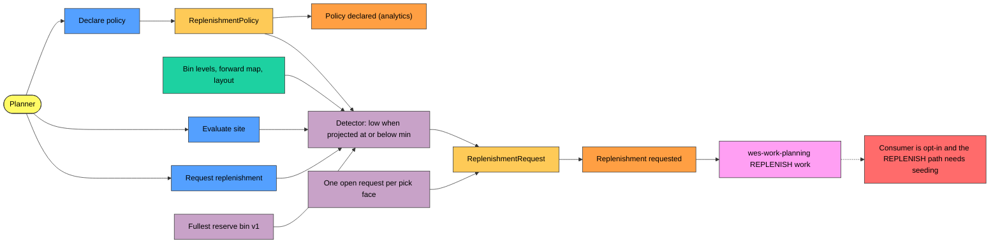
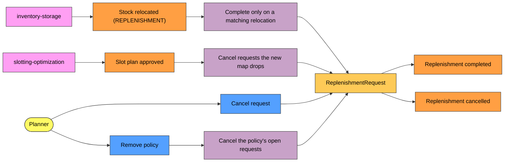
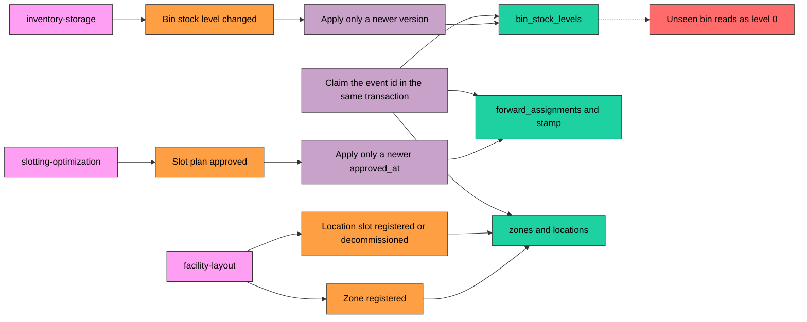

# EventStorming

:::info[Synced from pick-face-replenishment]
This page is a copy of [`docs/docs/ddd/eventstorming.md`](https://github.com/IQVO/pick-face-replenishment/blob/develop/docs/docs/ddd/eventstorming.md) on `develop`, derived from that repository's code. Edit it there, then re-sync.
:::

A design-level EventStorming of `pick-face-replenishment`, using the sticky colours of the ddd-crew
[EventStorming glossary and cheat sheet](https://github.com/ddd-crew/eventstorming-glossary-cheat-sheet): **orange**
domain event, **blue** command, **yellow** aggregate, **lilac** policy, **green** read model, **pink** external system,
**red** hotspot, small yellow actor.

## Detection and request flow

Source: `internal/application/usecases/{declare_policy,evaluate_site,raise_manual_request,evaluator}.go`,
`internal/domain/detection/{detector,source}.go`, `internal/domain/replenishment/request.go`.

## Completion and cancellation flow

Source: `internal/application/usecases/{apply_relocation,apply_forward_assignments,cancel_request,remove_policy}.go`.

## Local-copy flow

Source: `internal/application/usecases/{apply_bin_level,apply_forward_assignments,apply_layout,intake}.go`,
`internal/adapters/outbound/postgres/read_model.go`.

## Hotspots

| Hotspot | Where it comes from |
| --- | --- |
| `ReplenishmentRequested` is consumed only when wes-work-planning opts in, and only once the `REPLENISH` path is seeded | wes-work-planning plans one `REPLENISH` work unit per request id (its ADR 0042), but its consumer starts only with `REPLENISHMENT_MODE=kafka` and `REPLENISHMENT_CONSUMER_GROUP`; the default `permissive` consumes nothing, and `warehouse-infra` sets neither. The `REPLENISH` path is declared in process-path-management (its ADR 0036) and applied by `scripts/seed_catalogue.py`; until it is seeded in a cluster, wes-work-planning dead-letters the requests. Nothing is deployed ([Integration](https://iqvo.github.io/pick-face-replenishment/docs/ecosystem/integration)) |
| An unseen bin reads as level 0 | accepted in ADR 0005: a face whose level has not arrived yet can get an unnecessary, `URGENT` request |
| Partial fills leave the face below max | the next detection raises a new request once the first is closed (ADR 0002) |

Three earlier hotspots are closed on `develop`: inventory-storage now publishes `BinStockLevelChanged` (its ADR 0040),
its `StockRelocated` carries reason `REPLENISHMENT` for a completed `REPLENISH` task (its ADR 0041), and
wes-work-planning consumes `ReplenishmentRequested` and releases `REPLENISH` work (its ADR 0042).
