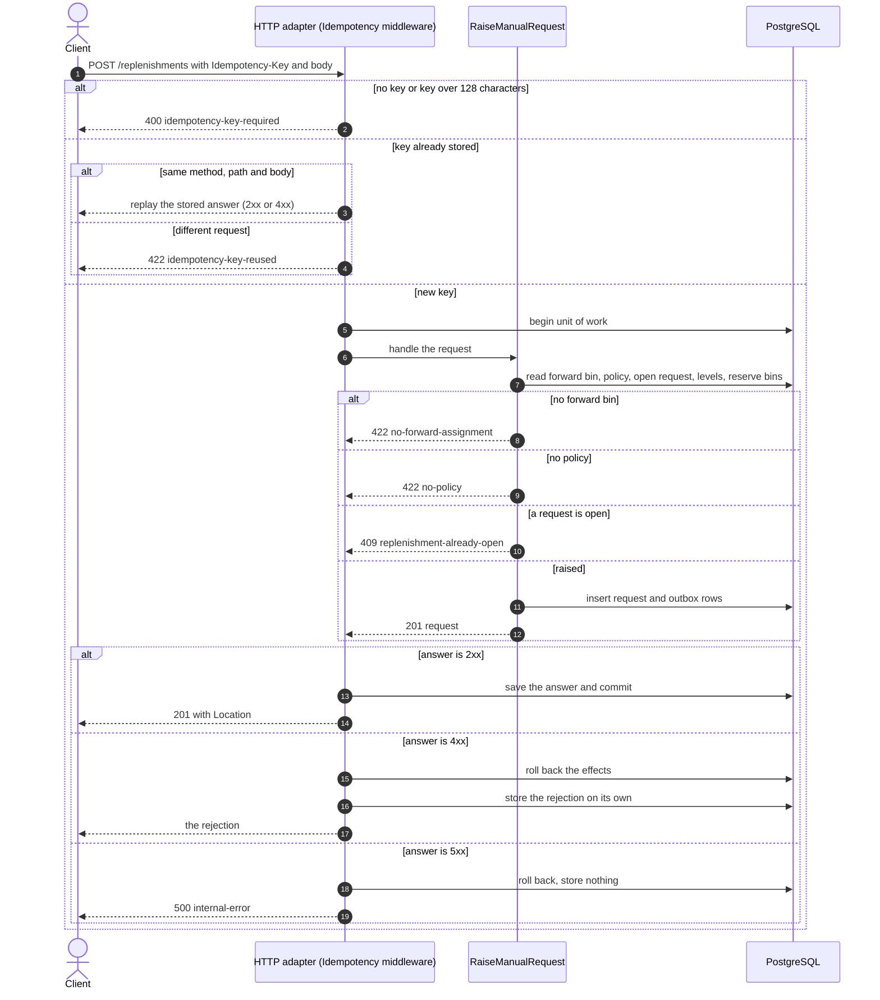
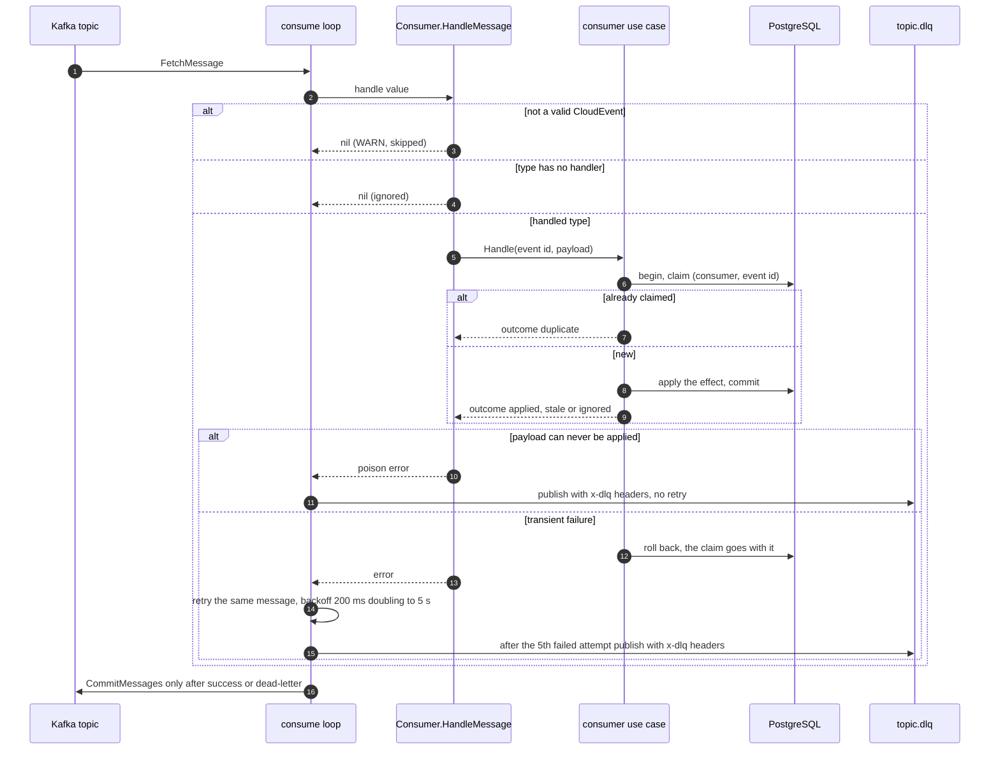
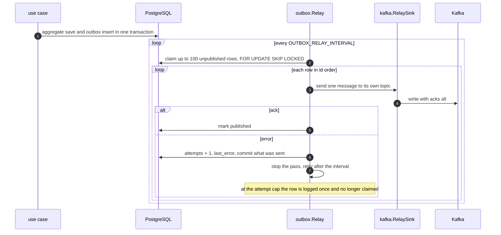
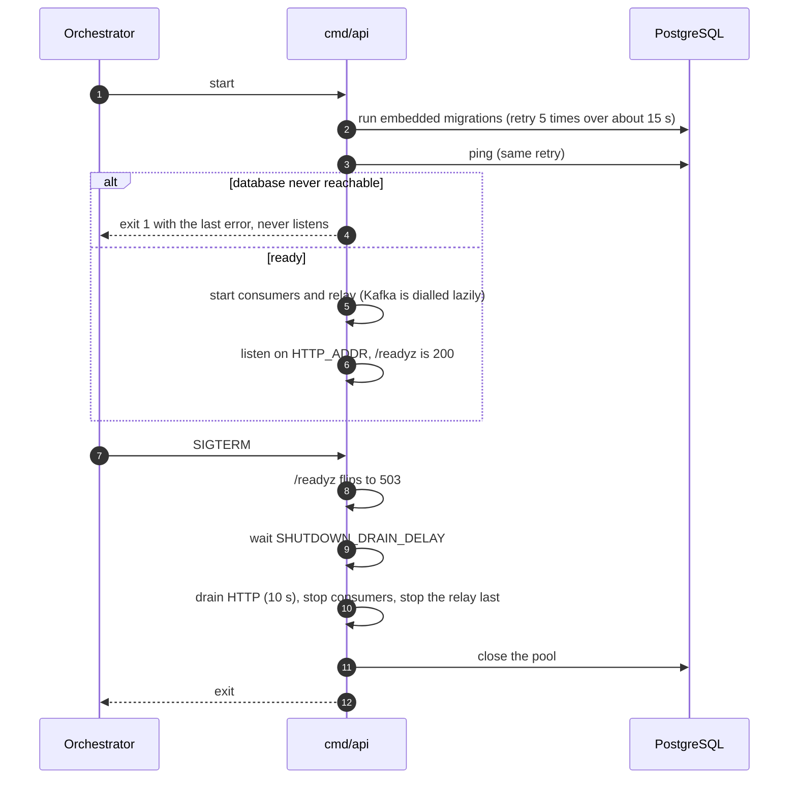

# Sequence diagrams

:::info[Synced from pick-face-replenishment]
This page is a copy of [`docs/docs/ddd/sequence-diagrams.md`](https://github.com/IQVO/pick-face-replenishment/blob/develop/docs/docs/ddd/sequence-diagrams.md) on `develop`, derived from that repository's code. Edit it there, then re-sync.
:::

UML sequence diagrams of the runtime paths, including the error branches.

## 1. Manual request with an Idempotency-Key

Source: `internal/adapters/inbound/http/idempotency.go`, `internal/application/usecases/raise_manual_request.go`.

## 2. A consumer handles one message

Source: `internal/adapters/inbound/kafka/{consumer,kafka,deadletter}.go`, `internal/application/usecases/intake.go`.
A handler that failed because the context was cancelled is never dead-lettered and its offset stays uncommitted.

## 3. The outbox relay

Source: `internal/adapters/outbound/outbox/relay.go`, `internal/adapters/outbound/postgres/outbox_repository.go`,
`internal/adapters/outbound/kafka/relay_sink.go`.

## 4. Boot and shutdown

Source: `cmd/api/main.go`, `cmd/api/adapters.go`, `internal/bootretry/bootretry.go`.
