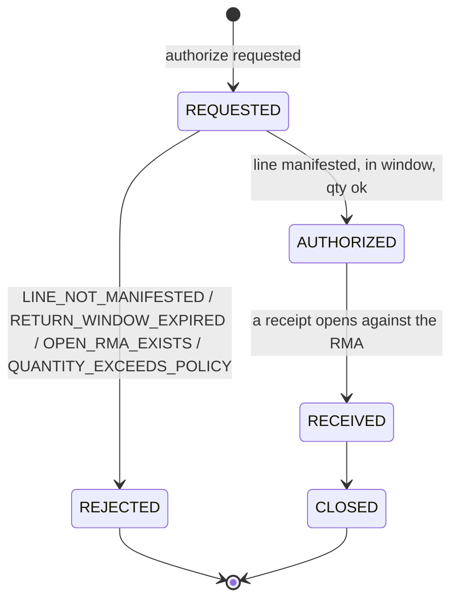

# Aggregate design canvas

:::info[Synced from returns-processing]
This page is a copy of [`docs/docs/ddd/aggregate-design-canvas.md`](https://github.com/IQVO/returns-processing/blob/develop/docs/docs/ddd/aggregate-design-canvas.md) on `develop`, derived from that repository's code. Edit it there, then re-sync.
:::

ddd-crew [Aggregate Design Canvas v1.1](https://github.com/ddd-crew/aggregate-design-canvas), for
the three aggregates and the policy object (ADR 0002). Everything below is
`internal/domain/**` — pure Go, no I/O.

## ReturnAuthorization (`internal/domain/returnauthorization`)

| Section | Content |
| --- | --- |
| Name | `ReturnAuthorization` (an **RMA**), identified by `rmaId` |
| Description | Permission to send one shipped order line back: the authorized quantity, the reason, the policy window |
| State transitions | `REQUESTED → AUTHORIZED \| REJECTED`; `AUTHORIZED → RECEIVED`; `RECEIVED → CLOSED`. `REJECTED` and `CLOSED` are terminal. `version` is 0 while REQUESTED, 1 when decided, +1 per accepted transition. |
| Commands | authorize (decide), mark received, close |
| Events | `ReturnAuthorized`, `ReturnAuthorizationRejected` |
| Invariants | 1. one open RMA per (order, line) — the aggregate refuses a known open sibling (`ErrOpenRMAExists`), a partial unique index closes the race; 2. authorizable only for the line's own manifested work unit and `now <= window_end`; 3. quantity in `[1, policy.max_units_per_line]` (shipped-quantity check planned, not built) |
| Corrective policies | none in-aggregate: a rejection is terminal, with its code |
| Throughput | low: one RMA per order line, decided once |
| Size | small: ~15 scalar fields, no collections |
| Concurrency | optimistic: every write guards `version` (409 `concurrent-modification`); the partial unique index decides racing creators |
| Repository | `ports.ReturnAuthorizationRepo` (Postgres `return_authorizations`) |

## ReturnReceipt (`internal/domain/returnreceipt`)

| Section | Content |
| --- | --- |
| Name | `ReturnReceipt`, identified by `receiptId` |
| Description | The physical arrival of returned goods: lines, each matched to an RMA or explicitly unexpected, each graded at most once |
| State | opened → lines inspected (per line, once); `version` +1 per accepted transition |
| Commands | open (with lines), inspect one line |
| Events | `ReturnReceiptOpened`, `UnexpectedReturnReceived` (one per UNEXPECTED line), `ReturnLineInspected` |
| Invariants | 1. every line is MATCHED (non-blank `rmaId`) or UNEXPECTED — the constructor refuses a third state; 2. inspected quantity in `[1, received quantity]`; 3. a line is inspected exactly once (`ErrLineAlreadyInspected`) |
| Corrective policies | none: a wrong grade is corrected by overriding the resulting disposition, never by re-inspecting |
| Throughput | low: one receipt per parcel |
| Size | small header + a `lines` collection (the parcel's lines) |
| Concurrency | optimistic `version`. The domain carries the AUTHORIZED → RECEIVED transition (`MarkReceived`), but no v1 use case calls it — the receipt itself carries the arrival fact |
| Repository | `ports.ReturnReceiptRepo` (Postgres `return_receipts` + `return_receipt_lines`) |

## Disposition (`internal/domain/disposition`) — the mutation-gate aggregate

| Section | Content |
| --- | --- |
| Name | `Disposition`, identified by `dispositionId` |
| Description | The immutable decision for one inspected line: outcome, grade, the line, the `policy_version` used, `supersedes`/`reason` on an override |
| State | none — created decided; never mutated (an override is a NEW aggregate instance) |
| Commands | `Decide` (the pure function, via inspection), stage (RESTOCK only), override (a new Disposition) |
| Events | `DispositionDecided`, `ReturnLineStaged` (once per RESTOCK disposition, idempotent on the disposition id) |
| Invariants | 1. `Decide` is deterministic and total over (grade × classification × policy) — the policy must carry a `*` default per grade; 2. RESTOCK only grade A/B, never a DISPOSE-classified SKU, never a hazmat SKU without a DOT rating — demoted to `vetoOutcome` (default DISPOSE), fail-closed; 3. an override carries `supersedes` + a non-empty reason and keeps the original's `policy_version`; 4. `ReturnLineStaged` emitted once per RESTOCK disposition (`ErrAlreadyStaged`, `ErrNotRestock`) |
| Corrective policies | the override — the ONLY mutation path, and it creates rather than edits |
| Throughput | one per inspected line (+1 per override) |
| Size | small: ~12 scalar fields |
| Concurrency | none needed beyond creation; staging idempotency is on the disposition id |
| Repository | `ports.DispositionRepo` (Postgres `dispositions`) |

## DispositionPolicy (`internal/domain/disposition`) — data, not an aggregate with behaviour

| Section | Content |
| --- | --- |
| Name | `DispositionPolicy`, a versioned table keyed by `version` (append-only) |
| Shape | `{version ≥ 1, return_window_days ≥ 0, max_units_per_line ≥ 1, vetoOutcome (default DISPOSE), rules: [{grade, productClass\|"*", outcome}]}` — validation refuses a policy without a `*` default per grade |
| Events | none of its own (a declare is a REST fact; the policy is read, never evented) |
| Concurrency | append-only: `PUT /disposition-policies/{version}` declares version N once |
| Repository | `ports.DispositionPolicyRepo` (Postgres `disposition_policies`) |

An exact `(grade, productClass)` rule wins over the `*` default; `Classification` (hazmat flag, DOT
hazard class with 0 = no rating, temperature class, optional forced outcome) is the other input to
`Decide`.

## shared (`internal/domain/shared`)

Not an aggregate: validated ids (`rma-`, `rcpt-`, `disp-` are the API's prefixes; the domain demands
non-blank, no NUL, no ECMA-262 blank), `Quantity` (integer ≥ 1), `SiteID`, and `OrderLineRef` with
the work-unit formula `{order_id}-line-{line_no}` and its parser — the exact reverse of
fulfillment-execution's `order_ref`.

Source: ADR 0002, `internal/domain/{returnauthorization,returnreceipt,disposition,shared}`,
`migrations/0001_returns-processing.up.sql`.
