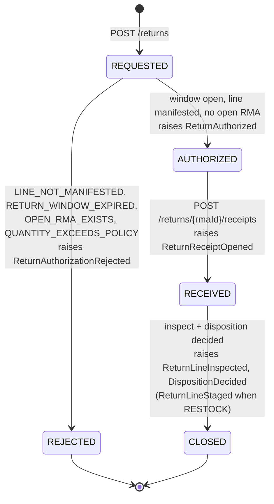

# Aggregate design canvas

ddd-crew [Aggregate Design Canvas](https://github.com/ddd-crew/aggregate-design-canvas),
for the four aggregates, from the context's `.claude/rules/domain-model.md`
and ADR 0002 on `develop` (written for this site; the repository does not ship
its own pack yet).

## ReturnAuthorization (`internal/domain/returnauthorization`)

| Section | Content |
| --- | --- |
| Description | Permission to send a shipped order line back; one open RMA per (orderRef, lineNo) |
| State transitions | `REQUESTED -> AUTHORIZED \| REJECTED -> RECEIVED -> CLOSED`; no transition out of a terminal state |
| Commands | `AuthorizeReturn` / `RejectReturn` (against the local copies of allocated lines + manifested work units) |
| Events | `ReturnAuthorized`, `ReturnAuthorizationRejected` |
| Invariants | authorizable only for a manifested work unit `{order_id}-line-{line_no}` inside the window; quantity <= policy max; one open RMA per order line |

## ReturnReceipt (`internal/domain/returnreceipt`)

| Section | Content |
| --- | --- |
| Description | The physical arrival of returned goods |
| Commands | `OpenReturnReceipt` (against an RMA; unmatched lines are `UNEXPECTED`), `InspectReturnLine` |
| Events | `ReturnReceiptOpened`, `ReturnLineInspected`, `UnexpectedReturnReceived` |
| Invariants | every line references an RMA line or is `UNEXPECTED` (no silent third state); inspected quantity <= received quantity; a line is inspected exactly once |

## Disposition (`internal/domain/disposition`, the richest aggregate and the mutation-gate package)

| Section | Content |
| --- | --- |
| Description | The immutable decision for one inspected line |
| Commands | `DecideDisposition` (runs in the same transaction as `InspectReturnLine`), `OverrideDisposition` (needs a reason) |
| Events | `DispositionDecided`, `ReturnLineStaged` (RESTOCK only) |
| Invariants | outcome = the pure function `f(grade, classification, policy version)`, recorded with the version used; `RESTOCK` only for grade A/B and never for a `DISPOSE`-classified SKU; `ReturnLineStaged` raised exactly once per disposition (idempotent on `disposition_id`); immutable — an override creates a superseding Disposition |

## DispositionPolicy (`internal/domain/disposition`)

| Section | Content |
| --- | --- |
| Description | The versioned operator table: grade x product class -> outcome, return window days, max units per line |
| Commands | `DeclareDispositionPolicy` (append-only versions), `GetDispositionPolicy` (read) |
| Events | none on the integration topic (a policy declaration is a REST fact; the analytics mirror is planned) |
| Invariants | append-only; each version complete |

Read models (projections, never aggregates): allocated order lines
(`allocated_order_lines`), manifested work units (`manifested_work_units`),
product classifications (`product_classifications`).

Source: `internal/domain/returnauthorization`, `internal/domain/returnreceipt`,
`internal/domain/disposition`, ADR 0002, and `features/*.feature`.
