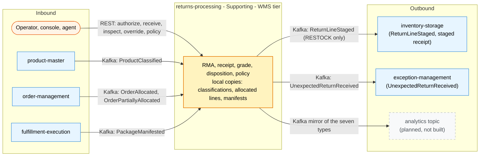

# Bounded context canvas

ddd-crew [Bounded Context Canvas](https://github.com/ddd-crew/bounded-context-canvas),
filled from the canvas in the context's own
[ADR 0001](https://github.com/IQVO/returns-processing/blob/develop/docs/adr/0001-returns-processing-bounded-context.md)
and its code on `develop` (the repository does not ship its own ddd-crew pack
yet; this page is written for this site from those sources).

## Canvas at a glance

Solid boxes are built on `develop`, none deployed: `warehouse-infra` has no
entry for this context, so every edge is wired-but-unused.

## Name

returns-processing

## Purpose

Authorize, receive, grade and disposition returned goods; put restockable
units back into the ledger through the existing staged-receipt seam; keep
every other outcome auditable.

## Strategic classification

**Supporting subdomain.** Value recovery is material (returns run 20-30 % of
e-commerce volume) but the differentiator is the ledger it feeds; the
disposition policy is a replaceable policy object (ADR 0001).

## Tier / CloudEvents subdomain

**WMS**, subdomain segment `wms` (receipts and stock provenance are WMS work;
the precedent is `inbound-receiving`). Type prefix
`com.warehouse.wms.returns-processing.`, source `/warehouse/returns-processing`.
Entity segments: `returnauthorization`, `returnreceipt`, `disposition`.

## Domain roles

System of record for RMA, return receipt and disposition. Open Host Service
for return facts (REST + events + a read-only MCP server). Conformist to
`product-master` (classification) and `order-management` /
`fulfillment-execution` (what was ordered and shipped).

## Inbound communication

Events: `ProductClassified` (product-master), `OrderAllocated` /
`OrderPartiallyAllocated` (order-management), `PackageManifested`
(fulfillment-execution) — each into a durable local copy, consumer groups from
`PRODUCT_CLASSIFICATION_CONSUMER_GROUP`, `ORDER_LINES_CONSUMER_GROUP` and
`MANIFEST_CONSUMER_GROUP`. REST commands from operators and the console. No
live REST/MCP call to any sibling, ever.

## Outbound communication

`ReturnAuthorized`, `ReturnAuthorizationRejected`, `ReturnReceiptOpened`,
`ReturnLineInspected`, `UnexpectedReturnReceived`, `DispositionDecided` and
`ReturnLineStaged` on `warehouse.returns-processing.events` (ADR 0004
catalogue) through the transactional outbox; analytics copies planned, not
built. REST reads for operators, the console and agents; read-only MCP tools
`get_return`, `list_returns_by_order`, `get_disposition_policy`.

## Ubiquitous language

RMA (return authorization), return receipt, return line, grade (A, B, C,
SCRAP), reason code, disposition (RESTOCK, REFURBISH, LIQUIDATE, DISPOSE,
RTV), disposition policy, return window, unexpected return, staged line. See
[Ubiquitous Language](/contexts/returns-processing/ubiquitous-language).

## Business decisions

A return is authorizable only against a shipped line (manifested work unit
`{order_id}-line-{line_no}`) inside the policy window; one open RMA per order
line; every receipt line references an RMA line or is explicitly UNEXPECTED; a
line is inspected once; the disposition is a pure function of (grade,
classification, policy version) and is immutable (an override creates a
superseding disposition with a reason); `ReturnLineStaged` is raised once per
RESTOCK disposition.

## Assumptions

The quantity shipped per line is NOT on `OrderAllocated` today: v1 caps the
authorized quantity by `DispositionPolicy.max_units_per_line` and records the
shipped-quantity check as planned / not built until order-management adds
`quantity` to its released line. Hazmat / temperature classes come from
`ProductClassified`; a SKU with no classification yet is treated as
unclassified (fail-open for grading, fail-closed for RESTOCK of a hazmat SKU).

## Verification

Mutation gate over every domain package; golden exact-JSON test per published
type; godog scenarios for the RMA -> receipt -> inspect -> disposition ->
staged path and for the unexpected-return path; an end-to-end test on real
Postgres + Kafka (testcontainers) driven only through Kafka and REST.

## Open questions

- When order-management adds `quantity` to released lines, the
  shipped-quantity check replaces the policy cap (an additive producer
  change, asked separately).
- When inventory-storage promotes `ItemStowed` to its integration topic, the
  restock loop can close on a stow fact (roadmap, never faked in the docs).
