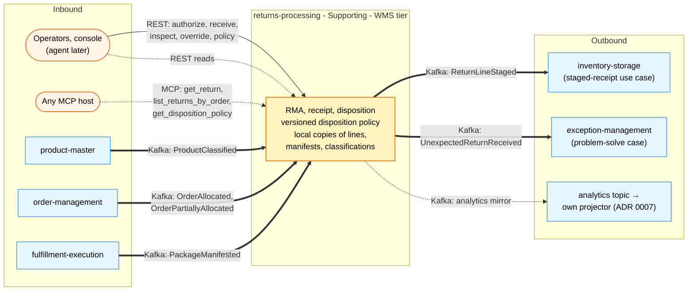

# Bounded context canvas

:::info[Synced from returns-processing]
This page is a copy of [`docs/docs/ddd/bounded-context-canvas.md`](https://github.com/IQVO/returns-processing/blob/develop/docs/docs/ddd/bounded-context-canvas.md) on `develop`, derived from that repository's code. Edit it there, then re-sync.
:::

ddd-crew [Bounded Context Canvas v5](https://github.com/ddd-crew/bounded-context-canvas), filled
from the code on `develop` and ADRs 0001–0005. Same section set as the fleet's other canvases (the
reference is inventory-storage's page).

## Canvas at a glance

Source: `internal/adapters/inbound/{http,mcp}`, `internal/adapters/inbound/kafka/*`,
`internal/adapters/outbound/kafka/encoder.go`, ADR 0001's canvas. The analytics mirror feeds the
service's OWN projector and reports, not a sibling ([ADR 0007](https://iqvo.github.io/returns-processing/docs/adr/0007-analytics-read-side)).

## Name

returns-processing — CloudEvents subdomain `wms`, `source=/warehouse/returns-processing`, type
prefix `com.warehouse.wms.returns-processing.`.

## Purpose

Authorize, receive, grade and disposition returned goods; put restockable units back into the
ledger through the existing staged-receipt seam; keep every other outcome auditable. Returns get
provenance, a grade and a defensible decision — a returned parcel is never hand-keyed as a supplier
receipt nor lost.

## Strategic classification

| Dimension | Classification | Justification |
| --- | --- | --- |
| **Domain** | **Supporting subdomain** | Value recovery is material (returns run 20–30 % of e-commerce volume) but the differentiator is the ledger it feeds; the disposition policy is a replaceable data object (ADR 0001) |
| **Business model** | **Cost reduction / value recovery** | Fewer lost restocks, no scrap re-entering sellable stock, every decision auditable |
| **Evolution** | **Custom-built (genesis)** | The first owner of the reverse flow in the fleet; REST + events are versioned Published Language from day one |
| Tier | **WMS** | Receipts and stock provenance are WMS work; the precedent is `inbound-receiving` |

## Domain roles

| Role | Stance |
| --- | --- |
| **System of record** | For the RMA, the ReturnReceipt and the Disposition. No other context writes any of them. |
| **Open Host Service** | Return facts on two surfaces: REST (`apis/openapi.yaml`) and events (`apis/asyncapi.yaml`), plus read-only MCP tools. |
| **Enforcer** | Runs every invariant on every write: manifest + window + one-open-RMA, no silent third line state, grade-once, pure deterministic decision with hard guardrails. |
| **Conformist** | To product-master (classification), order-management (allocated lines) and fulfillment-execution (manifests) — consumed as event-fed local copies, never live calls. |

## Inbound communication

| Message | Type | Sender | Channel | Collaborator behaviour |
| --- | --- | --- | --- | --- |
| `POST /returns` | command | operators, console | REST (`Idempotency-Key`) | authorize an RMA against the local copies |
| `GET /returns/{rmaId}`, `GET /returns?orderRef=` | query | operators, console, agent | REST | reads |
| `POST /returns/{rmaId}/receipts` | command | operators, console | REST (`Idempotency-Key`) | open a receipt; UNEXPECTED lines raise the case event |
| `POST /receipts/{receiptId}/lines/{lineNo}/inspect` | command | operators | REST (`Idempotency-Key`) | grade; disposition decided in the same tx |
| `POST /dispositions/{id}/override` | command | operators | REST (`Idempotency-Key`) | supersede with a mandatory reason |
| `PUT /disposition-policies/{version}`, `GET /disposition-policies/current` | command / query | operators | REST (PUT takes `Idempotency-Key`) | declare / read policy versions (append-only) |
| `get_return`, `list_returns_by_order`, `get_disposition_policy` | query | any MCP host | MCP, Streamable HTTP `:8090`, read-only | same read use cases as REST ([MCP tools](https://iqvo.github.io/returns-processing/docs/mcp/tools)) |
| `com.warehouse.wms.product-master.product.ProductClassified` | event | product-master | Kafka `warehouse.product-master.events` | version-guarded `product_classes` copy |
| `com.warehouse.wes.order-management.order.OrderAllocated` | event | order-management | Kafka `warehouse.order-management.events` | `allocated_lines` copy (lines carry NO quantity) |
| `com.warehouse.wes.order-management.order.OrderPartiallyAllocated` | event | order-management | Kafka `warehouse.order-management.events` | same copy, only the allocated lines |
| `com.warehouse.wes.fulfillment-execution.package.PackageManifested` | event | fulfillment-execution | Kafka `warehouse.fulfillment.events` | `manifested_units` copy (`order_ref` reversed) |
| Kubernetes liveness / readiness | query | kubelet | REST `GET /healthz`, `GET /readyz` | drain gate + Postgres ping + Kafka metadata |

## Outbound communication

| Message | Type | Receiver | Channel |
| --- | --- | --- | --- |
| `returnauthorization.ReturnAuthorized` / `ReturnAuthorizationRejected` | event | anyone | Kafka `warehouse.returns-processing.events` (key = rmaId) |
| `returnreceipt.ReturnReceiptOpened` / `ReturnLineInspected` / `UnexpectedReturnReceived` | event | exception-management consumes the unexpected one | Kafka `warehouse.returns-processing.events` (key = receiptId) |
| `disposition.DispositionDecided` | event | anyone | Kafka `warehouse.returns-processing.events` (key = dispositionId) |
| `disposition.ReturnLineStaged` | event | inventory-storage (staged-receipt use case, its ADR 0044 — built) | Kafka `warehouse.returns-processing.events` (key = dispositionId) |
| `<topic>.dlq` dead letters | event | operators | Kafka — inbound poison messages and outbox rows the encoder refuses |
| REST / MCP responses | query results | operators, console, agents | REST / MCP |

All messages are CloudEvents 1.0 structured mode and leave through the transactional outbox
([ADR 0005](https://iqvo.github.io/returns-processing/docs/adr/0005-transactional-outbox-and-relay)). The analytics mirror
(`warehouse.returns-processing.analytics`) is built: the relay writes it in the
same outbox pass and this service's own projector consumes it
([ADR 0007](https://iqvo.github.io/returns-processing/docs/adr/0007-analytics-read-side)).

## Ubiquitous language

Full glossary: [Ubiquitous language](/contexts/returns-processing/ubiquitous-language). The terms that carry the
model: RMA, return receipt, grade, reason code, disposition, outcome, disposition policy, return
window, unexpected return, staged line, local copy.

## Business decisions

| Decision | Source |
| --- | --- |
| Authorizable only against a manifested work unit, inside the window, quantity ≤ policy max | ADR 0002, `AuthorizeReturn` |
| One open RMA per (order, line) — aggregate rule + partial unique index | ADR 0002, `uq_rmas_one_open_per_order_line` |
| Every received line is MATCHED or explicitly UNEXPECTED — no silent third state | ADR 0002, `returnreceipt` constructor |
| A line is inspected exactly once; inspected qty ≤ received qty | ADR 0002 |
| `Decide` is a pure, total function of (grade, classification, policy version); every combination answers via the `*` default | ADR 0002 |
| RESTOCK only grade A/B, never a DISPOSE-classified SKU, never hazmat without a DOT rating — demoted to the veto outcome, fail-closed | ADR 0002 guardrails |
| The disposition is immutable; an override is a NEW disposition with `supersedes` + reason | ADR 0002 |
| `ReturnLineStaged` once per RESTOCK disposition (idempotent on disposition id) | ADR 0002/0004 |
| The policy is data: a change is a new version, never a redeploy | ADR 0002 |
| Events leave through the outbox only; at-least-once with a stable id | ADR 0005 |
| No auth on REST or MCP | fleet decision 2026-09-11 |

## Assumptions

- The shipped quantity per line is not on `OrderAllocated` today: the policy cap is the only
  ceiling (the shipped-quantity check is planned, not built — ADR 0003).
- Hazmat/temperature classes come from `ProductClassified`; an unclassified SKU is treated as
  unclassified (fail-open for grading, fail-closed for RESTOCK of a hazmat SKU — ADR 0001).
- Consumers dedupe on the CloudEvents `id` and tolerate at-least-once, per-aggregate-ordered
  delivery (ADR 0005).
- Until a producer event arrives, the matching copy is empty and authorizations fail closed
  (`LINE_NOT_MANIFESTED`), never open.

## Verification metrics

| Metric / gate | Source |
| --- | --- |
| Coverage gate 90 % on `internal/domain` + `internal/application` | `make coverage`, CI `test` job |
| Mutation thresholds 95/95 on every domain package (measured 100/100) | `.gremlins.yaml`, `mutation-fast` CI job |
| 15 BDD scenarios: RMA → receipt → inspect → disposition → staged, and the unexpected path | `features/*.feature` |
| Golden exact-JSON per published type | `internal/adapters/outbound/kafka/testdata/` |
| Catalogue fitness: every AsyncAPI type has an ADR 0004 line | `internal/architecture/catalogue_fitness_test.go` |
| Hexagonal fitness: no memory adapters in `cmd/**`, no auth, no flat envelope, relay attempt cap | `internal/architecture/*` |

The service exports **no runtime metrics today** (`GET /metrics` is declared in the spec but not
served — see [Observability](/contexts/returns-processing/observability)); the verification above is build-time
gates, not runtime signals.

## Open questions

- Shipped-quantity check per line — waits on order-management adding `quantity` to its released
  line (additive producer change, asked separately; roadmap).
- Restock loop closure — waits on inventory-storage promoting `ItemStowed` to its integration
  topic; until then a staged line's stow is invisible here (roadmap).
- Analytics mirror + read side — its own later decision (ADR 0004 records it as planned).
- `GET /metrics`: declared in `apis/openapi.yaml`, no handler wired yet — either implement the
  exposition or drop it from the spec; do not let the contract drift.
