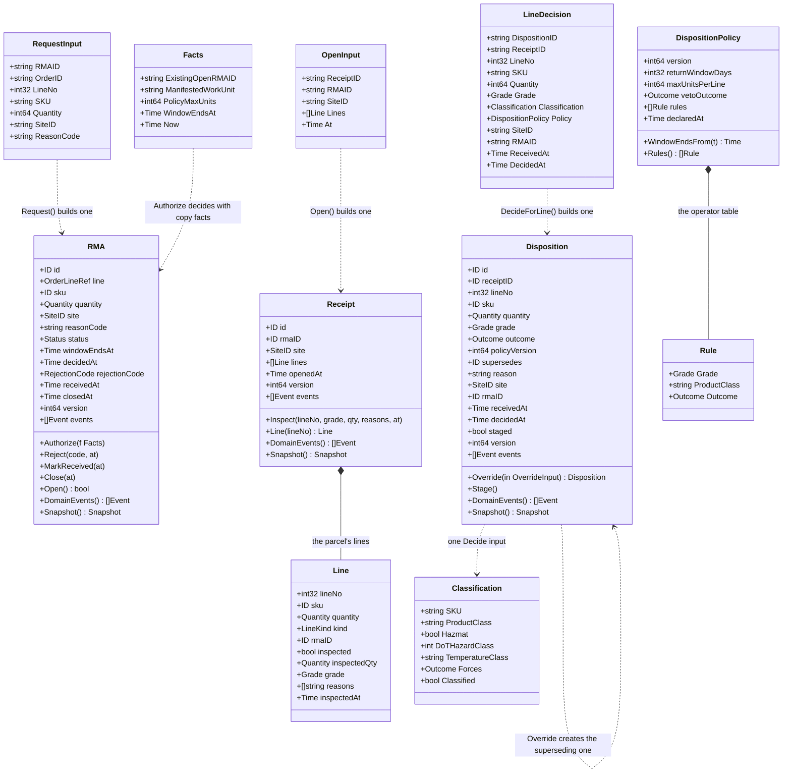

# Class diagram

:::info[Synced from returns-processing]
This page is a copy of [`docs/docs/ddd/class-diagram.md`](https://github.com/IQVO/returns-processing/blob/develop/docs/docs/ddd/class-diagram.md) on `develop`, derived from that repository's code. Edit it there, then re-sync.
:::

The domain model exactly as it exists in `internal/domain` (field and
method names taken from the code; pure Go, no I/O).

Facts worth knowing that the diagram cannot show:

- `Request` and `Open` are **package functions** of `returnauthorization`
  and `returnreceipt` (they validate the input and build the aggregate);
  `DecideForLine`, `Decide` and `Declare` are package functions of
  `disposition`. Everything after creation is a method on the aggregate —
  except `Decide`, which is a pure function over (grade, classification,
  policy) with no receiver.
- `Status` is a string type: `REQUESTED | AUTHORIZED | REJECTED | RECEIVED
  | CLOSED`, with `REJECTED` and `CLOSED` terminal. v1 decides in one
  transaction (REQUESTED → AUTHORIZED inside `AuthorizeReturn`); `Reject`,
  `MarkReceived` and `Close` are implemented and repository-tested but have
  no v1 use case caller.
- `RejectionCode` is a string type: `LINE_NOT_MANIFESTED`,
  `RETURN_WINDOW_EXPIRED`, `OPEN_RMA_EXISTS`, `QUANTITY_EXCEEDS_POLICY`;
  `RejectionCodeFor` maps the typed domain errors to the codes at the HTTP
  edge.
- A `Line` is built by `MatchedLine` or `UnexpectedLine` only, so a line is
  always exactly one kind — the zero `Line` (the refused third state) fails
  `Open`. `LineKind` is `MATCHED | UNEXPECTED`.
- `Decide`'s order of precedence: a forced outcome on the classification
  wins outright; then the table's exact (grade, class) entry or its `*`
  default; then a RESTOCK the table returned is demoted to `vetoOutcome`
  when the grade is below B or the SKU is hazmat without a DOT rating.
- The domain events (`ReturnAuthorized` … in each aggregate's `events.go`)
  are plain structs with a per-package `Header` and `OccurredAt()`; they
  know nothing of CloudEvents or Kafka — the outbound adapter maps them
  (ADR 0004).
- Repositories persist and restore through the immutable `Snapshot` (each
  aggregate's `snapshot.go`; `Restore` validates, so a corrupt row can
  never become a live aggregate); the views DTO
  (`internal/application/views`) is what inbound adapters see.
- `shared.ID` (validated, non-blank, no NUL), `shared.Quantity` (an
  integer ≥ 1), `shared.SiteID`, `shared.Grade` (`A | B | C | SCRAP`) and
  `shared.OrderLineRef` with the work-unit formula `{order_id}-line-{line_no}`
  (`WorkUnit()`, the reverse of fulfillment-execution's `order_ref`) are the
  shared value objects.
