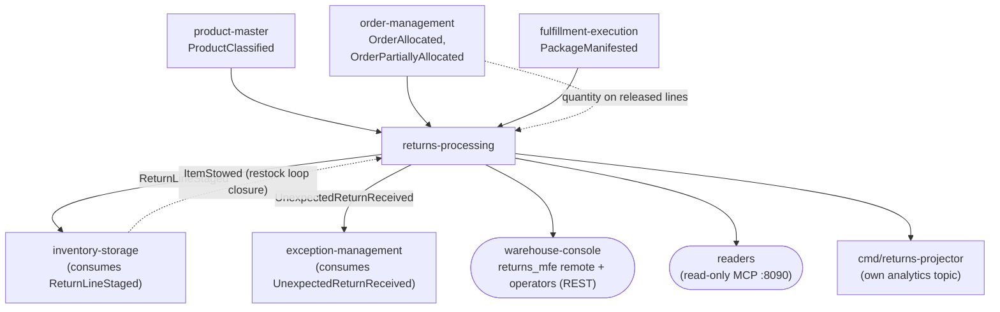

# Context map

:::info[Synced from returns-processing]
This page is a copy of [`docs/docs/ddd/context-map.md`](https://github.com/IQVO/returns-processing/blob/develop/docs/docs/ddd/context-map.md) on `develop`, derived from that repository's code. Edit it there, then re-sync.
:::

## Upstream edges (all Conformist, us downstream)

The pattern is uniform on purpose: returns-processing keeps durable local
copies fed by Kafka, restates each producer's payload in its own
`apis/asyncapi.yaml` and never makes a live REST or MCP call to a sibling at
request time, ever ([ADR 0003](https://iqvo.github.io/returns-processing/docs/adr/0003-local-copies-and-consumed-contracts)).

| Producer | Topic | Types consumed | Consumer group env | Status |
| --- | --- | --- | --- | --- |
| product-master | `warehouse.product-master.events` | `product.ProductClassified` | `PRODUCT_CLASSIFICATION_CONSUMER_GROUP` | Live (verified against the producer's spec, ADR 0003) |
| order-management | `warehouse.order-management.events` | `order.OrderAllocated`, `order.OrderPartiallyAllocated` | `ORDER_LINES_CONSUMER_GROUP` | Live (verified; the lines carry NO quantity) |
| fulfillment-execution | `warehouse.fulfillment.events` | `package.PackageManifested` | `MANIFEST_CONSUMER_GROUP` | Live (verified) |

Every other type on those topics is ignored; a message that is not a valid
CloudEvent is WARN + skip. The CloudEvents `id` is claimed in the same
Postgres transaction as the copy write; the offset commits only after a
durable effect.

## Downstream edges (us upstream)

| Consumer | Channel | Relationship | Status |
| --- | --- | --- | --- |
| inventory-storage | `ReturnLineStaged` on `warehouse.returns-processing.events` | Open Host Service / Published Language: the RESTOCK handover into its staged-receipt use case (its ADR 0044) | Built on both sides |
| exception-management | `UnexpectedReturnReceived` on `warehouse.returns-processing.events` | Published Language: opens a problem-solve case per unexpected line | Built on both sides |
| warehouse-console + operators | REST reads and commands; the `returns_mfe` Module Federation remote ([ADR 0006](https://iqvo.github.io/returns-processing/docs/adr/0006-console-remote-web)) | Open Host Service | Built |
| Agents and scripts | read-only MCP (`cmd/mcp`, `:8090`): `get_return`, `list_returns_by_order`, `get_disposition_policy` | Open Host Service | Built |
| This service's own projector | `warehouse.returns-processing.analytics` (twin of every event, same `type` and `id`) → `cmd/returns-reports` | Internal analytics read side ([ADR 0007](https://iqvo.github.io/returns-processing/docs/adr/0007-analytics-read-side)) | Built, chart-disabled by default |
| Any other fleet consumer | `warehouse.returns-processing.events` | Published Language (CloudEvents catalogue, [ADR 0004](https://iqvo.github.io/returns-processing/docs/adr/0004-cloudevents-envelope-and-type-catalogue)) | Built; no other known consumer today |

## Planned, not built

- **Shipped-quantity check per line**: order-management's allocated lines
  carry no `quantity`; until that additive producer change lands, the
  authorized quantity is capped by `DispositionPolicy.max_units_per_line`
  only (dashed edge above, ADR 0001/0003).
- **Restock loop closure**: inventory-storage's `ItemStowed` is not on its
  integration topic yet; when promoted, this service can consume it to see a
  staged line reach a bin (dashed edge above).
- Excluded from v1 by ADR 0001: carrier label / pickup booking, refund or
  credit issuing, refurbishment work orders, any write to `StockUnit` or
  `Bin`.

## Team relationships

One team owns the whole context (one repo, four deployables: `cmd/api`,
`cmd/mcp`, `cmd/returns-projector`, `cmd/returns-reports`, plus the
`returns_mfe` console remote). Upstream contracts are verified per producer
against the producer's own `apis/asyncapi.yaml`; changes arrive as fleet
PRs, not negotiation.
