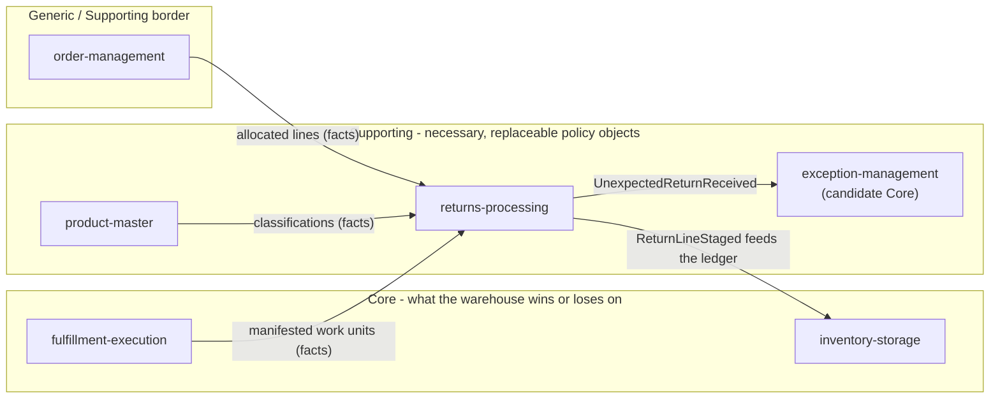

# Core domain chart

:::info[Synced from returns-processing]
This page is a copy of [`docs/docs/ddd/core-domain-chart.md`](https://github.com/IQVO/returns-processing/blob/develop/docs/docs/ddd/core-domain-chart.md) on `develop`, derived from that repository's code. Edit it there, then re-sync.
:::

The ddd-crew Core Domain Chart, drawn for the contexts returns-processing
touches. Colour says classification today ([ADR 0001](https://iqvo.github.io/returns-processing/docs/adr/0001-returns-processing-bounded-context)
fixes this context's own; the siblings' classifications are each one's own
ADR 0001, tallied on warehouse-docs' subdomain-classification page).

## Why supporting today

- Value recovery is material — returns run 20–30 % of e-commerce volume —
  but the differentiator is **the ledger it feeds**, not the returns logic
  itself (ADR 0001): a `RESTOCK` reuses inventory-storage's proven
  staged-receipt → stow seam unchanged.
- The disposition policy is **a replaceable policy object**: a versioned
  operator table, data and not code (ADR 0002). A bad table is rolled back
  by declaring a new version, never by redeploying.
- Four of the five outcomes (REFURBISH, LIQUIDATE, DISPOSE, RTV) are
  recorded for audit and touch no sibling; only RESTOCK has a downstream
  effect, and it asks inventory-storage to do the work.
- Every input is another context's fact (an allocated line, a manifested
  work unit, a classification) replicated into local copies (ADR 0003);
  delete the RMA, receipt and disposition rows and the forward flow keeps
  working — the facts keep arriving and the record rebuilds.

## What flips it to core

ADR 0001 declares no such condition and none is claimed here. The two
roadmap items are additive producer changes that complete the current
shape, not reclassify it:

1. order-management adding `quantity` to its released lines, which turns
   the shipped-quantity check from policy cap into a real check (ADR 0003);
2. inventory-storage promoting `ItemStowed` to its integration topic,
   which closes the restock loop this context deliberately leaves open
   (ADR 0001/0003).

Until then: invest for supporting — simple, fixed, well-tested; do not
gold-plate.
