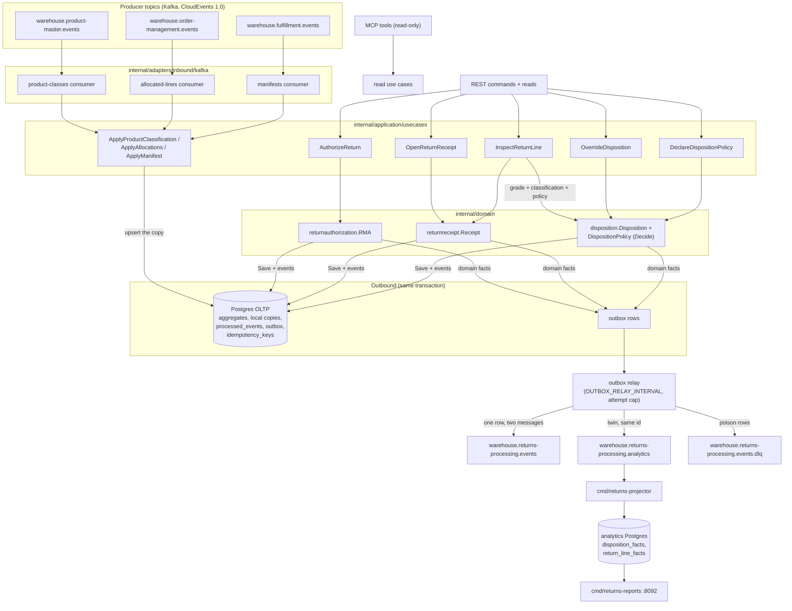

# Domain message flow

:::info[Synced from returns-processing]
This page is a copy of [`docs/docs/ddd/domain-message-flow.md`](https://github.com/IQVO/returns-processing/blob/develop/docs/docs/ddd/domain-message-flow.md) on `develop`, derived from that repository's code. Edit it there, then re-sync.
:::

One page, end to end: how another context's fact becomes an authorized
return, a graded line and an immutable decision. Every box below is a real
package in this repo.

The flow in words:

1. **A fact lands** on one of the three consumed topics; the consumer under
   its pinned group id decodes the CloudEvents envelope
   (`internal/adapters/kafka/cloudevents`) and dispatches on the FULL type;
   unknown types are ignored; a non-CloudEvent message is WARN + skip.
2. **Id claim first.** The CloudEvents `id` is claimed in the SAME Postgres
   transaction as the copy write (`processed_events`); a replayed id is a
   no-op that still commits the Kafka offset (`FetchMessage` +
   `CommitMessages` — offset only after a durable effect).
3. **The copies answer the decision.** `AuthorizeReturn` reads only the
   local copies: the allocations copy supplies the authoritative SKU, the
   manifested copy proves the line shipped, the current policy supplies the
   window and the cap. An empty or stale copy rejects
   (`LINE_NOT_MANIFESTED`), never a guess and never a live call (ADR 0003).
4. **A refusal persists nothing.** A request that fails an invariant returns
   the typed domain error (`ErrLineNotManifested`, `ErrWindowExpired`,
   `ErrOpenRMAExists`, `ErrQuantityExceedsPolicy`) mapped to the rejection
   code — no RMA row, no event. The domain's `Reject` path and the
   catalogued `ReturnAuthorizationRejected` exist for a future async
   decision path (ADR 0002 keeps `REQUESTED` for it).
5. **Arrival and grading.** `OpenReturnReceipt` records every line as
   MATCHED or explicitly UNEXPECTED (one `UnexpectedReturnReceived` per
   unexpected line, which exception-management opens a case on).
   `InspectReturnLine` grades a line exactly once and decides its
   disposition in the same unit of work: the pure `Decide(grade,
   classification, policy)` plus the RESTOCK guardrails.
6. **Everything leaves through the outbox** ([ADR 0005](https://iqvo.github.io/returns-processing/docs/adr/0005-transactional-outbox-and-relay)):
   the relay drains due rows, encodes to CloudEvents, deletes on publish,
   backs off exponentially, caps attempts (`OUTBOX_MAX_ATTEMPTS`) and
   dead-letters deterministic poison. Each drained row produces TWO
   messages — the integration event and its analytics twin (same `id`, only
   the dataschema differs, [ADR 0007](https://iqvo.github.io/returns-processing/docs/adr/0007-analytics-read-side)).
7. **The analytics twin feeds the read side**: `cmd/returns-projector`
   folds five of the seven event types into fact tables;
   `cmd/returns-reports` answers disposition-mix, value-recovery and
   return-cycle-time over them.
