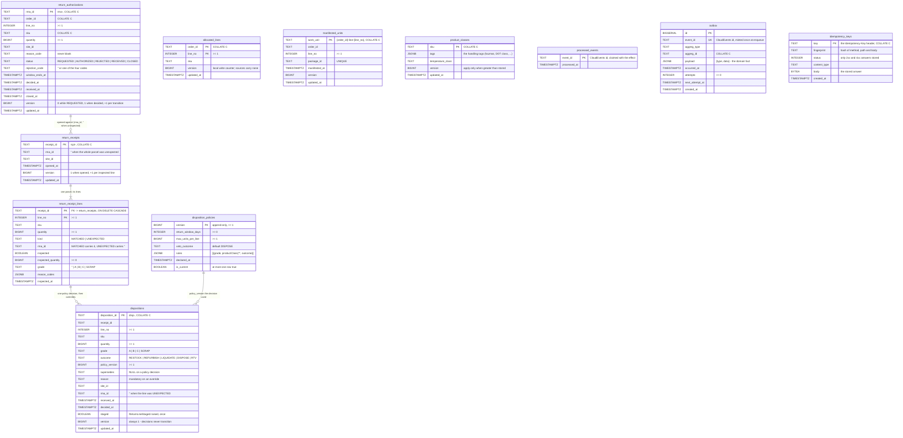
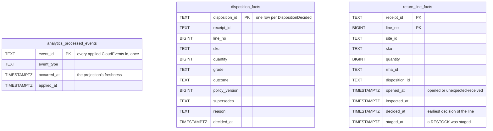

# Entity-relationship

:::info[Synced from returns-processing]
This page is a copy of [`docs/docs/ddd/entity-relationship.md`](https://github.com/IQVO/returns-processing/blob/develop/docs/docs/ddd/entity-relationship.md) on `develop`, derived from that repository's code. Edit it there, then re-sync.
:::

Two databases. The **OLTP schema** is two migrations
(`migrations/0001_returns-processing.up.sql`,
`migrations/0002_idempotency_keys.up.sql`), run embedded at boot by every
binary that touches it. The **analytics schema** is one migration
(`analytics/migrations/0001_returns_analytics.up.sql`) against a separate
database, written only by `cmd/returns-projector` and read only by
`cmd/returns-reports` ([ADR 0007](https://iqvo.github.io/returns-processing/docs/adr/0007-analytics-read-side)).

## OLTP

The three local-copy tables (`allocated_lines`, `manifested_units`,
`product_classes`) belong to no aggregate: they are read models fed by the
consumers (ADR 0003), and `processed_events`, `outbox` and
`idempotency_keys` are the fleet machinery tables.

## The constraints that matter

| Constraint | Enforces |
| --- | --- |
| `uq_rmas_one_open_per_order_line` — UNIQUE `(order_id, line_no) WHERE status IN ('REQUESTED','AUTHORIZED','RECEIVED')` | Invariant 1 (ADR 0002): at most one open RMA per order line across instances; the loser of a race becomes the use case's `ErrOpenRMAExists` / `ErrConcurrentModification` mapping. |
| `CHECK ((kind = 'MATCHED') = (rma_id <> ''))` on `return_receipt_lines` | The refused third state cannot even be stored: a MATCHED line carries its RMA, an UNEXPECTED one carries none. |
| `uq_dispositions_one_policy_decision_per_line` — UNIQUE `(receipt_id, line_no) WHERE supersedes IS NULL` | At most one POLICY decision per line; an override (supersedes set) is outside the index, so a line can be superseded any number of times. |
| `CHECK (version = 1)` on `dispositions` | Decisions never transition: the immutable aggregate's whole optimistic-concurrency story. |
| `PRIMARY KEY (version)` + `uq_disposition_policies_one_current` | Append-only policy versions, at most one current; `Save` clears the previous current and upserts the new one in one transaction. |
| `event_id UNIQUE` in `outbox` | A relay retry republishes the same CloudEvents id byte-identically; consumers dedupe on it. |
| `CHECK (status >= 200 AND status < 500)` on `idempotency_keys` | Only 2xx and 4xx answers are replayable; a 5xx is never stored, so the caller retries for real. |

## Indexes

- `idx_rmas_by_order (order_id, line_no)` — `FindOpenByOrderLine` and
  `ListByOrder`.
- `idx_dispositions_by_line (receipt_id, line_no, decided_at DESC)` — the
  line's latest decision and the audit trail.
- `idx_outbox_due (attempts, next_attempt_at)` — the relay's claim scan
  (`FOR UPDATE SKIP LOCKED`, up to 100 due rows).
- `uq_manifested_units_package (package_id)` — the manifest copy's second
  key.
- `idx_idempotency_keys_created_at` — store cleanup.

Text keys compared or ordered in Go (ids, SKUs, order refs, work units) use
the `C` collation so `ORDER BY` follows byte order, the same order the
in-memory adapters use.

## Analytics (ADR 0007)

Facts, not aggregates: every report number is counted from these rows over
the requested window. Each milestone column keeps the EARLIEST CloudEvents
time seen (`LEAST`, ignoring NULLs), so arrival order never matters; the
projection can be dropped and rebuilt by replaying the topic under a new
consumer group.

A line is OPEN from `opened_at` until `staged_at`; the return cycle time is
`staged_at - opened_at` and exists only when the projection saw both.
Indexes: per-milestone partial indexes on `return_line_facts`,
`decided_at` and `(receipt_id, line_no)` on `disposition_facts`, and
`occurred_at` on `analytics_processed_events` for the freshness report.
