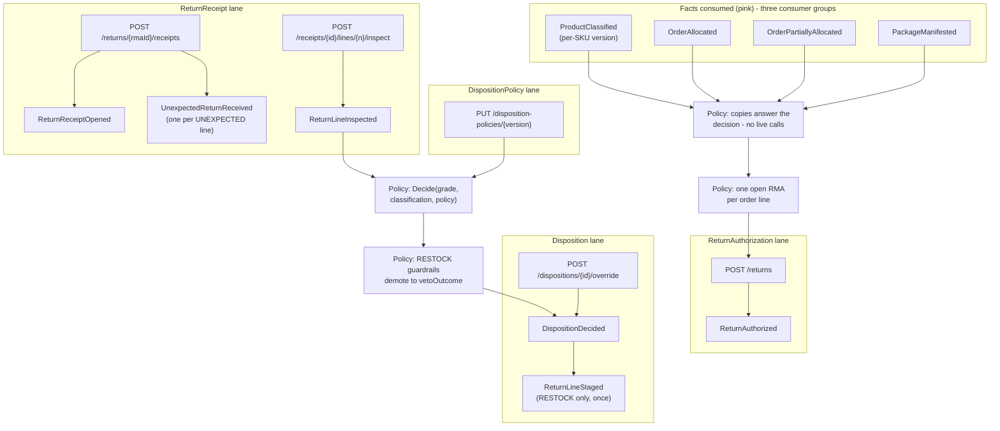

# EventStorming

:::info[Synced from returns-processing]
This page is a copy of [`docs/docs/ddd/eventstorming.md`](https://github.com/IQVO/returns-processing/blob/develop/docs/docs/ddd/eventstorming.md) on `develop`, derived from that repository's code. Edit it there, then re-sync.
:::

Big-picture view in the EventStorming colour convention: **domain events we
publish** (orange), **facts we consume** (pink), **commands** (blue),
**policies / automated rules** (purple). Time flows down; one lane per
aggregate.

## The timeline in words

| Step | Event | Caused by |
| --- | --- | --- |
| 0 | *(no event)* | A consumed fact refreshes a local copy: classification applied only when its version is newer, allocation upserted per (order, line), manifest inserted per work unit. The copies are read models, never evented. |
| 1 | *(no event — rejected)* | `POST /returns` against an unmanifested line, an expired window, an open sibling RMA or an over-cap quantity: the typed domain error is the whole answer; nothing persists, nothing publishes. |
| 1 | `ReturnAuthorized` | `POST /returns` on a manifested line inside the window and cap: the RMA is decided in one transaction. |
| — | *(no event)* | `PUT /disposition-policies/{version}` declares a policy version. The policy is data, read by `Decide`, never evented (ADR 0002). |
| 2 | `ReturnReceiptOpened` + `UnexpectedReturnReceived` | `POST /returns/{rmaId}/receipts`: every line is MATCHED or explicitly UNEXPECTED — one `UnexpectedReturnReceived` per unexpected line, which exception-management opens a case on. |
| 3 | `ReturnLineInspected` | `POST /receipts/{id}/lines/{n}/inspect`: the grade (A/B/C/SCRAP) and reason codes, exactly once per line. |
| 4 | `DispositionDecided` | The same unit of work as the inspection: the pure `Decide` over (grade × classification × current policy), with the guardrails demoting a RESTOCK to the veto outcome. Or an operator override — a NEW Disposition carrying `supersedes` and a mandatory reason. |
| 5 | `ReturnLineStaged` | Raised with a RESTOCK decision (policy or override), exactly once per disposition: the handover to inventory-storage. No other outcome touches a sibling. |

## Hotspots the model answers

- **A parcel with no RMA**: opened with unexpected lines only — the
  UNEXPECTED line is a first-class, auditable fact with its own event, not
  an error and not a silent match.
- **The refusal that must not leave a trace**: a rejected authorization
  persists nothing (no half-decided RMA to clean up); the rejection code is
  computed from the typed domain error at the HTTP edge.
- **How much was actually shipped?** Unknown today — the allocated lines
  carry no quantity, so the policy cap is the only ceiling (planned, not
  built: ADR 0003).
- **RESTOCK that must not happen** (grade C/SCRAP, DISPOSE-classified SKU,
  hazmat without a DOT rating): demoted to the policy's `vetoOutcome`,
  fail-closed — safety rules in code, not operator tuning.
- **A wrong grade**: never re-inspected (a line is inspected once); the
  correction is an override — a new, explained Disposition that supersedes.

## Pivotal events not modelled (deliberately)

- *ReturnAuthorizationRejected on the wire* — the domain's `Reject` and the
  catalogue entry exist (ADR 0004), but v1 decides synchronously in one
  transaction and a refusal persists nothing; the event gains a publisher
  with a future async decision path (ADR 0002 keeps `REQUESTED` for it).
- *RMA closed by the service* — `MarkReceived`/`Close` exist on the
  aggregate with repository support, but no v1 use case transitions an RMA
  past AUTHORIZED; the receipt carries the arrival fact instead.
- *Restock completed* — the stow is inventory-storage's RF action; its
  `ItemStowed` promotion is the planned loop closure (ADR 0001/0003).
- *Carrier label booked / refund issued* — excluded from v1 (ADR 0001):
  an external party and finance respectively.
