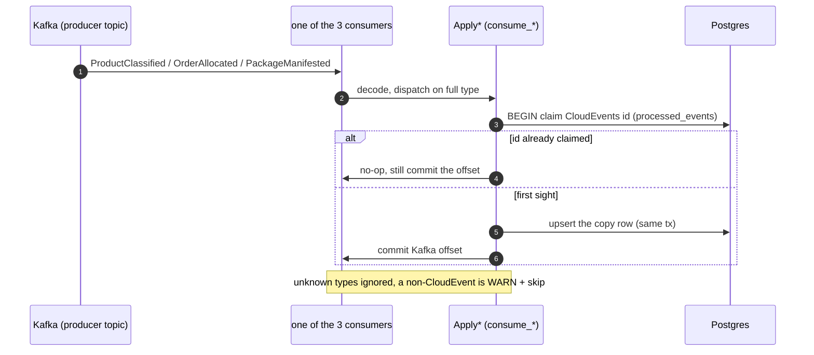
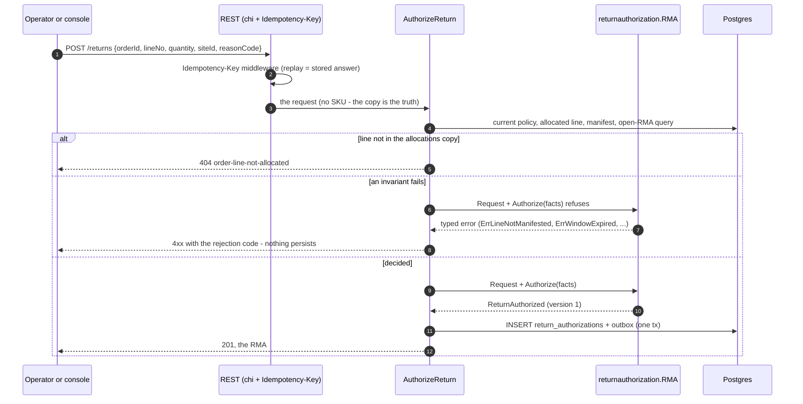
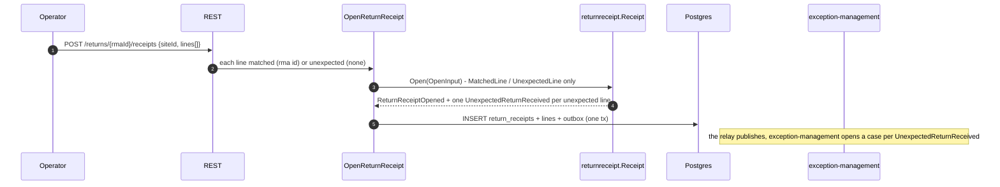
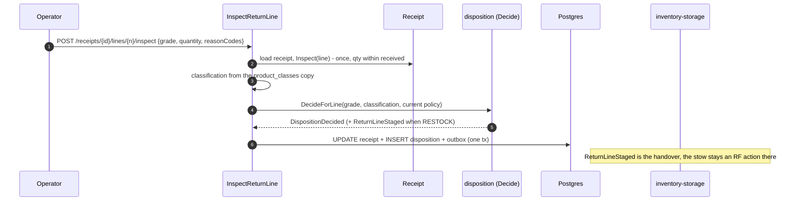
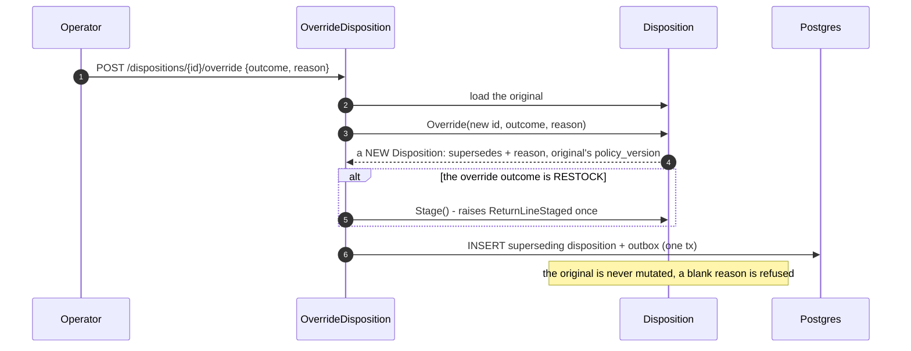
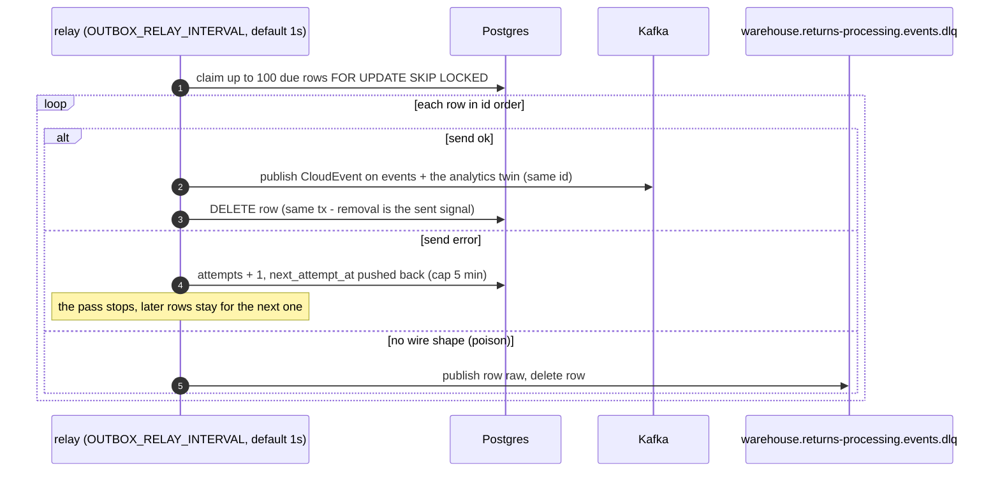
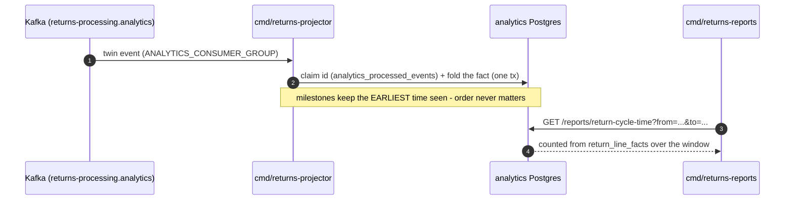

# Sequence diagrams

:::info[Synced from returns-processing]
This page is a copy of [`docs/docs/ddd/sequence-diagrams.md`](https://github.com/IQVO/returns-processing/blob/develop/docs/docs/ddd/sequence-diagrams.md) on `develop`, derived from that repository's code. Edit it there, then re-sync.
:::

## A producer fact refreshes a local copy

Version rules per copy (ADR 0003): a classification applies only when its
`version` is greater than the stored one; an allocation upserts per
(order_id, line_no) — a partial allocation refreshes only its own lines; a
manifest inserts per work unit `{order_id}-line-{line_no}` and is idempotent
on that key.

## Authorize a return

A refused request persists nothing and publishes nothing: the rejection code
is mapped from the typed domain error at the HTTP edge
(`RejectionCodeFor`). The partial unique index
`uq_rmas_one_open_per_order_line` decides a race the aggregate cannot see.

## A parcel arrives (matched and unexpected lines)

A line that is neither matched nor unexpected (no kind, or a kind with a
blank/absent counterpart) is refused by the constructor — there is no
silent third state. v1 does not move the RMA to RECEIVED here: the receipt
carries the arrival fact.

## Inspect, decide, stage

The guardrails run inside `Decide`: a table RESTOCK for grade C/SCRAP or a
hazmat SKU without a DOT rating comes back as the policy's `vetoOutcome` —
fail-closed, and the recorded `policy_version` explains every decision.

## An override supersedes

## Everything leaves through the outbox relay

A row reaching `OUTBOX_MAX_ATTEMPTS` (default 20) is excluded from the
claim, logged once at ERROR and stays in the outbox for inspection;
re-arming is a runbook operation
([Runbook](/contexts/returns-processing/runbook)). Delivery is at-least-once with a
stable id per occurrence — consumers dedupe on the CloudEvents `id`
([ADR 0005](https://iqvo.github.io/returns-processing/docs/adr/0005-transactional-outbox-and-relay)).

## The analytics twin becomes a report

Five of the seven event types fold into the model (`ReturnReceiptOpened`,
`UnexpectedReturnReceived`, `ReturnLineInspected`, `DispositionDecided`,
`ReturnLineStaged`); the two authorization twins are ignored by the
projector. Deterministic poison is dead-lettered to
`warehouse.returns-processing.analytics.dlq`
([ADR 0007](https://iqvo.github.io/returns-processing/docs/adr/0007-analytics-read-side)).
