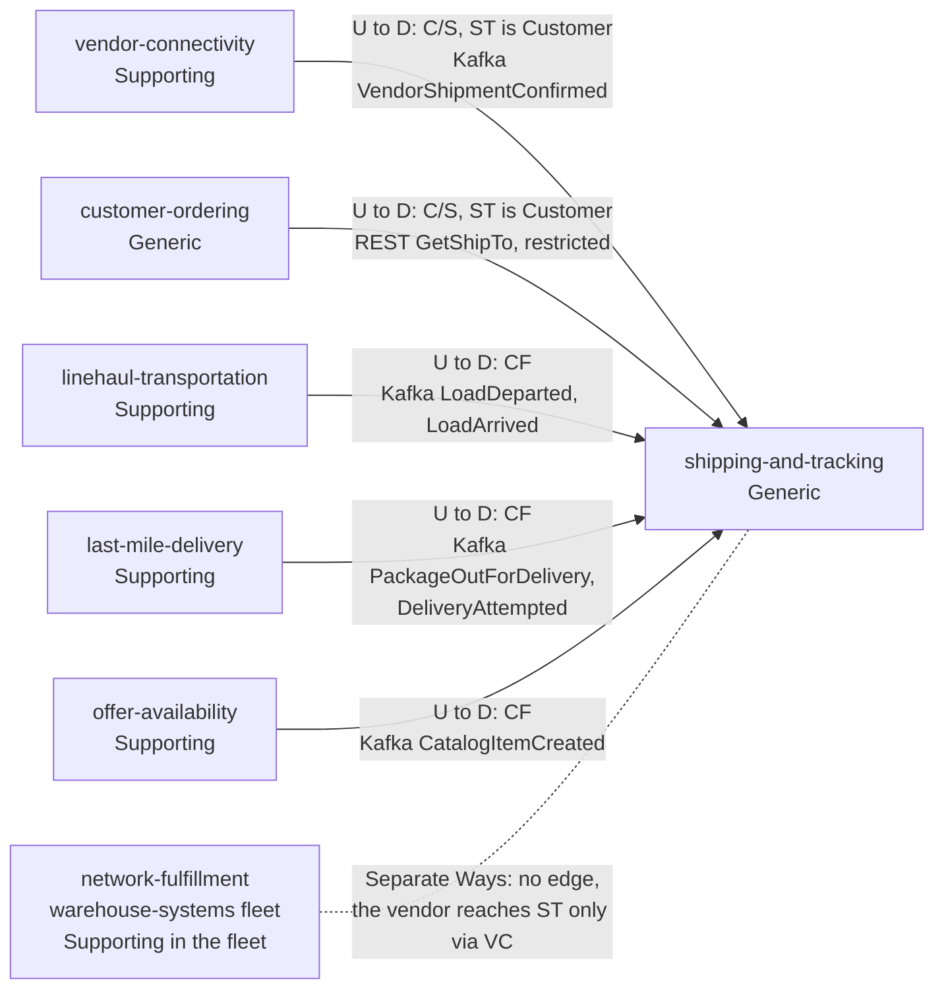
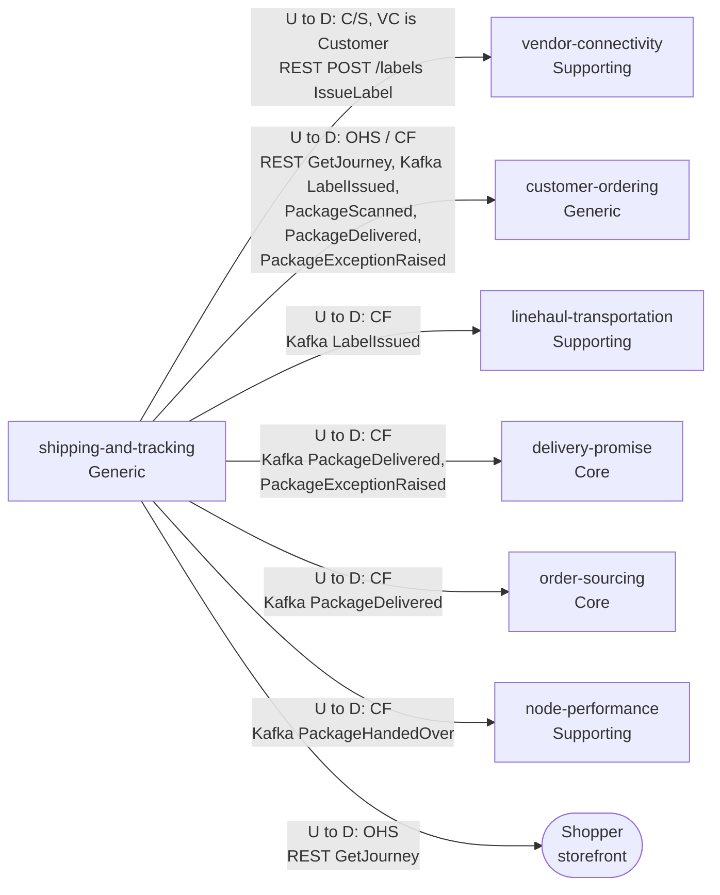

# Context Map

:::info[Proposed design]
Derived from [`model/model.yaml`](https://github.com/IQVO/retail-network-docs/blob/main/model/model.yaml). Nothing in this context is built yet; identifiers (`Err...` names, routes, CloudEvents types) are the names an implementation must use.
:::

Following ddd-crew [Context Mapping](https://github.com/ddd-crew/context-mapping).
This is **shipping-and-tracking's slice** of the
[domain-wide context map](/strategic-design/context-map): every relationship
this context has, with the upstream (U) and downstream (D) side, the pattern
and the channel. The map is split in two diagrams to stay readable.
Three neighbours appear in both, because the relationship differs per
message.

### Upstream: what shipping-and-tracking consumes or calls

Derived from: `model.yaml → contexts[shipping-and-tracking].inbound`, `.consumes`, `.sync_calls`; `meta.hard_boundary`.

### Downstream: who calls or consumes shipping-and-tracking

Derived from: `model.yaml → contexts[shipping-and-tracking].inbound`,
`.publishes`, `.consumes`, `.sync_calls`; the matching `inbound` rows of
`vendor-connectivity`, `customer-ordering`, `linehaul-transportation`,
`delivery-promise`, `order-sourcing` and `node-performance`;
`meta.hard_boundary`.

Legend: arrows point from upstream to downstream. CF = Conformist, C/S =
Customer/Supplier, OHS = Open Host Service. Path parameters are left out
inside the diagram. The dotted line without an arrow head is a relationship
that is deliberately absent.

Omitted: the callers of `POST /journeys/{trackingNumber}/scans` and
`POST /labels/{labelRef}:void`, which the model does not name (see the
[canvas open questions](/contexts/shipping-and-tracking/bounded-context-canvas));
analytics-only events (`LabelVoided`, `PackageReturned`, `PackageLost`);
Postgres and Kafka as infrastructure. `node-topology` has no edge here: this
context consumes no node event (a gap noted on the canvas).

## Edges

| Neighbour | Direction | Pattern | Channel | Messages | Why this pattern |
| --- | --- | --- | --- | --- | --- |
| `vendor-connectivity` (Supporting) | ST upstream, VC downstream | **Customer/Supplier** (VC is the Customer) | REST `POST /labels` (in-org) | `IssueLabel` | `vendor-connectivity` needs a label inside a vendor request; this context shapes the route for that one caller. Model: ST `inbound` row and VC `sync_calls`. |
| `vendor-connectivity` (Supporting) | VC upstream, ST downstream | **Customer/Supplier** (ST is the Customer) | Kafka `retailnetwork.vendor-connectivity.events` | `VendorShipmentConfirmed` | The vendor's shipment statement names the tracking numbers this context issued; the two sides agree the fields. Model: ST `inbound` row. |
| `customer-ordering` (Generic) | CO upstream, ST downstream | **Customer/Supplier** (ST is the Customer) | REST `GET /orders/{orderId}/ship-to` (in-org, restricted) | `GetShipTo` | A restricted route that exists only for this context, under [ADR 0006](/adr/0006-pii-confinement). Model: CO `inbound` row. |
| `customer-ordering` (Generic) | ST upstream, CO downstream | **Open Host Service** (query) / **Conformist** (events) | REST `GET /journeys/{trackingNumber}`; Kafka `retailnetwork.shipping-and-tracking.events` | `GetJourney`; `LabelIssued`, `PackageScanned`, `PackageDelivered`, `PackageExceptionRaised` | The journey route is open to any reader; `customer-ordering` takes the events as published into its `OrderTrackingView`. Model: ST `inbound` (`GetJourney`, OHS); CO `inbound` (Conformist). |
| `linehaul-transportation` (Supporting) | LH upstream, ST downstream | **Conformist** | Kafka `retailnetwork.linehaul-transportation.events` | `LoadDeparted`, `LoadArrived` | Linehaul publishes load facts for its own purposes; this context takes the shape as is. |
| `linehaul-transportation` (Supporting) | ST upstream, LH downstream | **Conformist** | Kafka `retailnetwork.shipping-and-tracking.events` | `LabelIssued` | Linehaul counts expected volume (`ExpectedVolumeView`) from labels as published. |
| `last-mile-delivery` (Supporting) | LM upstream, ST downstream | **Conformist** | Kafka `retailnetwork.last-mile-delivery.events` | `PackageOutForDelivery`, `DeliveryAttempted` | Route facts, one tracking number each; taken as published. |
| `offer-availability` (Supporting) | OA upstream, ST downstream | **Conformist** | Kafka `retailnetwork.offer-availability.events` | `CatalogItemCreated` | Item dimensions and handling flags for `CatalogDimensionsView`. |
| `delivery-promise` (Core) | ST upstream, DP downstream | **Conformist** | Kafka `retailnetwork.shipping-and-tracking.events` | `PackageDelivered`, `PackageExceptionRaised` | The Core context conforms to a Generic one's facts: `JudgeOnDelivery` and `RepromiseOnRisk` need only the fact and its time. |
| `order-sourcing` (Core) | ST upstream, OS downstream | **Conformist** | Kafka `retailnetwork.shipping-and-tracking.events` | `PackageDelivered` | Closes the assignment (`MarkDelivered`). |
| `node-performance` (Supporting) | ST upstream, NP downstream | **Conformist** | Kafka `retailnetwork.shipping-and-tracking.events` | `PackageHandedOver` | On-time handover is scored from this context's observed handover, never from the vendor's statement. |
| Shopper / storefront | ST upstream | **Open Host Service** | REST `GET /journeys/{trackingNumber}` | `GetJourney` | Any client may read a journey by tracking number. |
| `network-fulfillment` (Supporting in the fleet, other organization) | none | **Separate Ways** | none | none | The hard boundary: the fleet reaches the network only through the Vendor API of `vendor-connectivity` ([Vendor API](/integration/vendor-api)). |

## Notes on the patterns

- **Customer/Supplier in both directions with `vendor-connectivity`.** For the
  label this context is the Supplier; for the shipment statement it is the
  Customer. Neither side is Conformist: the label fields and the
  `trackingNumbers` on `VendorShipmentConfirmed` must agree.
- **Customer of `customer-ordering` for one restricted query.** This is the
  only synchronous call this context makes. It happens once per label, never
  on the tracking path.
- **Conformist downstream of the transport contexts.** Load and route events
  carry what linehaul and last-mile need. This context adapts (one load event
  becomes one scan per tracking number) instead of asking for a new shape.
- **No Shared Kernel, no shared tables.** Ids such as `trackingNumber`,
  `poNumber`, `orderId` and `nodeId` are values, not foreign keys.
