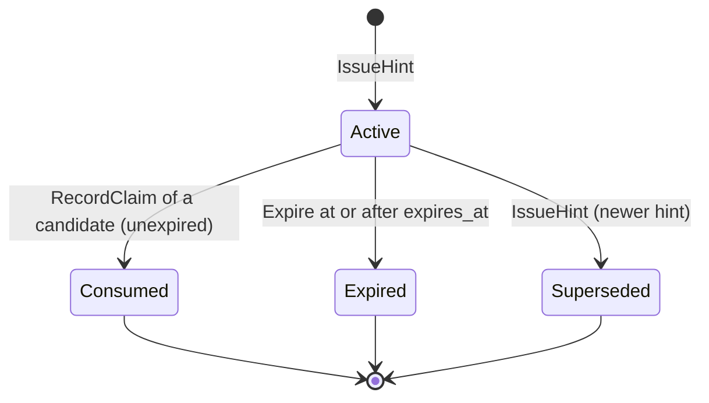

# Aggregate design canvas

:::info[Synced from task-interleaving]
This page is a copy of [`docs/docs/ddd/aggregate-design-canvas.md`](https://github.com/IQVO/task-interleaving/blob/develop/docs/docs/ddd/aggregate-design-canvas.md) on `develop`, derived from that repository's code. Edit it there, then re-sync.
:::

ddd-crew [Aggregate Design Canvas v1.1](https://github.com/ddd-crew/aggregate-design-canvas)
for the two aggregates, filled from `internal/domain/stationtrip`,
`internal/domain/policy` and [ADR 0002](https://iqvo.github.io/task-interleaving/docs/adr/0002-stationtrip-and-policy-aggregates).
Both aggregates are on `develop`, persisted by `internal/adapters/outbound/postgres` (the in-memory adapter is a test double).

## StationTrip

| Section | Content |
| --- | --- |
| **Name** | `StationTrip` (package `stationtrip`), root type `*StationTrip` |
| **Description** | Where one station stands (the end of the last completed task) and the most recent hint issued there. One per station. Dispatch in this fleet is per station and the hint is consumed by the same key. |
| **Identity** | `StationID`: a token of 1 to 64 runes, no whitespace, control characters or `/`. |
| **State** | `position` (site, location code, point when known), `lastTask`, `lastAt`, `hint` (most recent, in any state), `version`, and the not-yet-published `events`. |
| **Lifecycle of a hint** | `Active` goes to exactly one terminal state: `Consumed`, `Expired`, `Superseded`. |
| **Commands** | `RecordCompletion(task, at, Position)`, `IssueHint(id, candidates, Policy, now)`, `RecordClaim(task, now)`, `Expire(now)`. |
| **Events raised** | `HintIssued`, `HintConsumed`, `HintExpired`. Domain facts, not wire messages; the domain imports nothing from CloudEvents or Kafka. |
| **Version** | 0 for a new trip, +1 per accepted transition. A refused or ignored command changes nothing. |
| **Size** | Small and bounded: a position, one task, one hint with at most five candidates. |

Source: `internal/domain/stationtrip/values.go` (`HintState`, `Terminal`),
`internal/domain/stationtrip/trip.go` (`IssueHint`, `RecordClaim`, `Expire`).

### Invariants

| # | Invariant | Enforced by | Test |
| --- | --- | --- | --- |
| 1 | Position only moves forward in time: a completion not strictly newer than the recorded one returns `false`, with no event and no version change. A zero instant, blank task id or invalid position is an error, checked before ignoring. | `RecordCompletion` | `TestRecordCompletionIgnoresAnOlderOrEqualCompletion`, `TestRecordCompletionValidatesBeforeIgnoring` |
| 2 | At most one Active hint per station: `IssueHint` marks an Active hint `Superseded` and the new one `Active`. A terminal hint is not touched. | `IssueHint` | `TestAtMostOneActiveHintAcrossManyIssues`, `TestIssueHintDoesNotSupersedeATerminalHint` |
| 3 | A hint is valid: distinct candidates; the policy belongs to the station's site; each candidate's type is eligible and its detour is finite, not negative and at most `MaxDetourM`; `1 <= len <= MaxCandidates`; ranks are 1..n in `detour_m` then `task_id` order. An empty set issues no hint. A station with no recorded completion cannot be hinted. | `IssueHint`, `validateCandidates` | `TestIssueHintCandidateRules`, `TestIssueHintRefusesAnEmptyCandidateSet`, `TestIssueHintPreconditions` |
| 4 | A hint expires: `expires_at = now + HintTTL` at issue; `Expire(now)` marks an Active hint `Expired` at or after `expires_at`, and changes nothing before it. | `IssueHint`, `Expire` | `TestExpireMarksTheHintExpiredAtOrAfterItsExpiry`, `TestExpireBeforeExpiryChangesNothing` |
| 5 | Consumption: `RecordClaim` marks the Active hint `Consumed` only when the task is one of its candidates, the claim is not before the issue instant and `now` is strictly before `expires_at`; any other claim changes nothing. | `RecordClaim` | `TestRecordClaimTimeWindow`, `TestRecordClaimOfANonCandidateLeavesTheHintActive` |
| 6 | Terminal states are final: no transition leaves `Consumed`, `Expired` or `Superseded`. | state checks in `RecordClaim`, `Expire`, `IssueHint` | `TestRecordClaimConsumesAtMostOnce`, `TestExpireTwiceExpiresOnce` |

"The task is currently in the open-task pool" is a property of the recommender's
input, not of the aggregate: the aggregate re-checks the shape and bounds of what
it is handed.

### Concurrency and consistency

A `version` counter exists on the aggregate. Writers are told apart by the
repository: `Save(trip, loadedVersion)` updates `WHERE version = <loaded>` and a
lost race is `repository.ErrConcurrentModification` (`409 concurrent-modification`
on REST, a retry in a consumer). The unique partial index
`uq_hints_one_active_per_station` backs the one-Active-hint invariant in the
database. Hint events of one station share the station id as Kafka key, so they
stay ordered on one partition (ADR 0004; `events.Sink` sets the key).

## InterleavingPolicy

| Section | Content |
| --- | --- |
| **Name** | `Policy` (package `policy`); concept `InterleavingPolicy` |
| **Description** | The settings of one site, versioned and immutable. A site that never declared one is **inert**. |
| **Identity** | `SiteID`: a token of 1 to 64 runes, no whitespace, control characters or `/`. |
| **State** | `Settings{MaxDetourM, MaxCandidates, HintTTL, EligibleTaskTypes, VerticalWeight}` and `version`. |
| **Commands** | `New(site, Settings)` (version 1), `WithChanges(Settings)` (returns the next version, replacing all settings), `Restore(site, Settings, version)`. |
| **Events raised** | none in the package. The `DeclarePolicy` use case enqueues `InterleavingPolicyDeclared` (analytics only) through `EventSink.PublishPolicyDeclared`. |
| **Concurrency** | Replacing a policy requires `If-Match` with the current version over REST (`412 version-mismatch`), `409 concurrent-modification` on a lost race. Implemented in `usecases.DeclarePolicy` and the policy repository (`Save(rec, loadedVersion)`). |

| # | Invariant | Error |
| --- | --- | --- |
| 1 | `SiteID` is a valid token | `ErrInvalidSiteID` |
| 2 | `MaxDetourM` is finite and greater than 0 | `ErrInvalidMaxDetour` |
| 3 | `MaxCandidates` is between 1 and 5 | `ErrInvalidCandidates` |
| 4 | `HintTTL` is greater than 0 | `ErrInvalidHintTTL` |
| 5 | `EligibleTaskTypes` is a non-empty set of known types; duplicates collapse, order is normalised, an unknown value is refused | `ErrInvalidTaskTypes` |
| 6 | `VerticalWeight` is finite and at least 0 | `ErrInvalidWeight` |
| 7 | `Version >= 1`, +1 per change | `ErrInvalidVersion` (`Restore` only) |

Source: `internal/domain/policy/policy.go`, ADR 0002 field table.

## The recommender is not an aggregate

`recommend.Recommend(Input)` is pure domain logic: no state, no I/O, no clock, no
randomness. It reads the station's site, origin, the open-task pool, the policy, the
completed task id and a `travel.Model`, and returns the ranked candidates. The
aggregate `StationTrip` trusts but re-validates its output
(invariant 3). See [Use cases](/contexts/task-interleaving/use-cases) for the rules.
