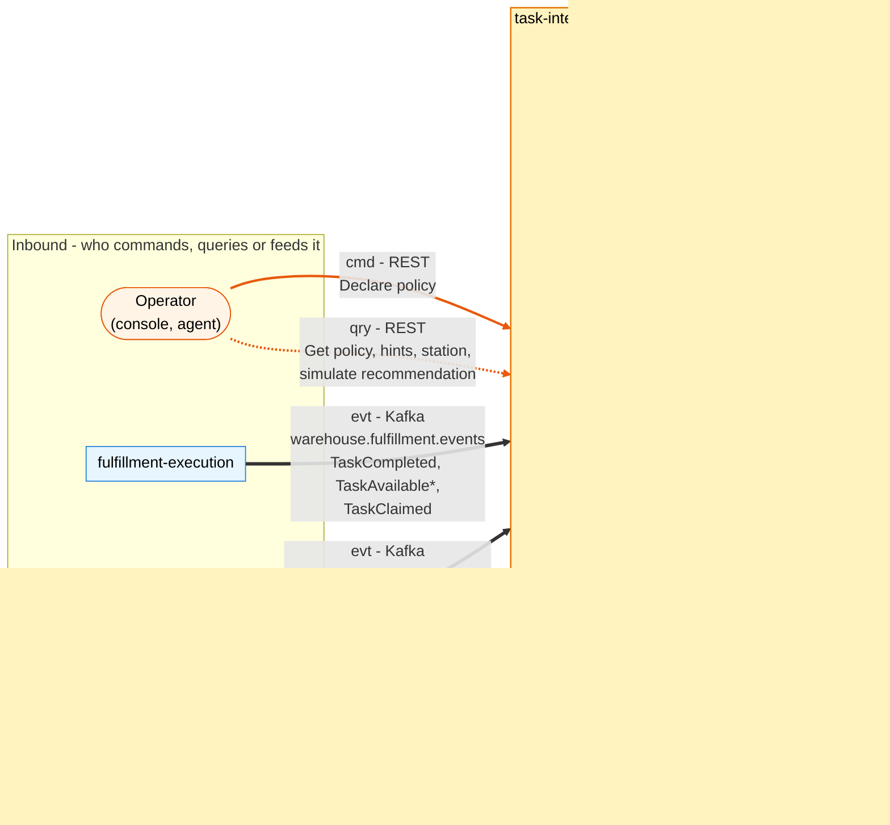
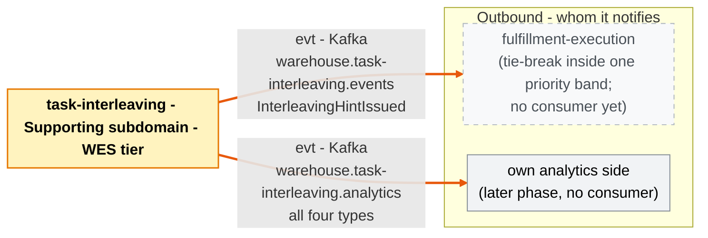

# Bounded context canvas

:::info[Synced from task-interleaving]
This page is a copy of [`docs/docs/ddd/bounded-context-canvas.md`](https://github.com/IQVO/task-interleaving/blob/develop/docs/docs/ddd/bounded-context-canvas.md) on `develop`, derived from that repository's code. Edit it there, then re-sync.
:::

ddd-crew [Bounded Context Canvas v5](https://github.com/ddd-crew/bounded-context-canvas),
filled from [ADR 0001](https://iqvo.github.io/task-interleaving/docs/adr/0001-task-interleaving-bounded-context) (which
carries its own canvas), the domain code and the contracts. Every message below is
carried by an adapter on `develop` (REST, Kafka consumers, outbox relay); see
[Integration](https://iqvo.github.io/task-interleaving/docs/ecosystem/integration) for whether the collaborator on the
other side has its half.

## Canvas at a glance

Arrows follow the message type: **solid blue** commands (`cmd`), **dotted green**
queries (`qry`), **thick orange** events (`evt`). Dashed boxes are edges whose other
side is not built.

### Inbound

`*` published by fulfillment-execution for RELOCATE and REPLENISH tasks only.

### Outbound

Source: the Inbound and Outbound Communication tables of this page, which follow
`docs/adr/0001-task-interleaving-bounded-context.md`, `apis/asyncapi.yaml` and the
adapters `internal/adapters/inbound/{http,kafka}` and
`internal/adapters/outbound/{events,outbox,kafka}`.

## Name

**task-interleaving**

## Purpose

After a station completes a task, recommend the few open tasks nearest to where the
operator now stands, as an advisory, expiring hint that `fulfillment-execution`
may use as a tie-break inside one priority band.

## Strategic classification

| Dimension | Value |
| --- | --- |
| Domain | **Supporting** ([Subdomain classification](https://iqvo.github.io/task-interleaving/docs/ddd/subdomain-classification)) |
| Tier | WES, CloudEvents subdomain `wes`, type prefix `com.warehouse.wes.task-interleaving.`, source `/warehouse/task-interleaving`, Kong path `/api/task-interleaving` |
| Business model | Cost reduction (less travel between tasks) |
| Evolution | Custom-built, genesis |

## Domain roles

- **Advisor**: computes hints (`recommend.Recommend`, `StationTrip.IssueHint`).
- **Policy holder**: per-site settings (`policy.Policy`).
- **Simulation**: a read-only what-if (`POST /recommendations`).

## Inbound communication

| Collaborator | Message | Kind | Channel | Status |
| --- | --- | --- | --- | --- |
| fulfillment-execution | `TaskCompleted` | event | `warehouse.fulfillment.events` | producer verified; consumer built (`FULFILLMENT_MODE=kafka`) |
| fulfillment-execution | `TaskAvailable` (RELOCATE and REPLENISH tasks only), `TaskClaimed` (every task type) | events | `warehouse.fulfillment.events` | producer verified (its ADR 0049 and ADR 0050); consumer built |
| facility-layout | `ZoneRegistered`, `LocationSlotRegistered`, `LocationSlotDecommissioned`, `LocationGeometryUpdated` | events | `warehouse.facility.events` | producer verified; consumer built (`LAYOUT_MODE=kafka`) |
| operator (console, agent) | Declare policy | command | `PUT /sites/{siteId}/policy` | built |
| operator (console, agent) | Get policy, list hints, get hint, get station, simulate | queries | `GET /sites/{siteId}/policy`, `GET /hints`, `GET /hints/{hintId}`, `GET /stations/{stationId}`, `POST /recommendations` | built |

## Outbound communication

| Message | Kind | Channel | Consumers |
| --- | --- | --- | --- |
| `InterleavingHintIssued` | event | `warehouse.task-interleaving.events` and `warehouse.task-interleaving.analytics` | none built: fulfillment-execution does not read it yet |
| `InterleavingHintConsumed`, `InterleavingHintExpired`, `InterleavingPolicyDeclared` | events | `warehouse.task-interleaving.analytics` only | none built (ADR 0004: a later phase) |

Source: `apis/asyncapi.yaml`, ADR 0004.

## Ubiquitous language

StationTrip, position, hint (Active, Consumed, Expired, Superseded), candidate,
detour, policy, travel model, open-task pool, priority band, tie-break, inert,
fail-open. Full glossary: [Ubiquitous language](/contexts/task-interleaving/ubiquitous-language).

## Business decisions

| Decision | Rule in code |
| --- | --- |
| Is a site served | only if it declared a policy; otherwise inert |
| How far | `MaxDetourM`, finite and greater than 0; a detour equal to the limit qualifies |
| How many | `MaxCandidates`, 1 to 5 |
| For how long | `HintTTL`, greater than 0; `expires_at = issued_at + TTL` |
| Which tasks | `EligibleTaskTypes`, non-empty subset of the six task types |
| How vertical travel weighs | `VerticalWeight`, at least 0 |
| Who is a candidate | same site, eligible type, not the completed task, known geometry, within the limit |
| Order | detour ascending, then task id ascending; distinct by task id |
| Hint count | at most one Active hint per station; a new hint supersedes it |
| Outcome | Consumed on a claim of a candidate while unexpired; Expired at `expires_at` |

## Assumptions

From ADR 0001 and ADR 0003:

- A station's position is the end location of its last completed task.
- A location's site is its zone's site.
- Geometry from facility-layout is in metres in one frame per site.
- The pool's `site_id` values equal facility-layout's `siteCode` values (one code
  space); to be checked on live data before the first live hint.
- The pool copy is as fresh as the events.

## Verification metrics

- Deterministic recommender: same pool in any order, same output
  (`TestRecommendIsIndependentOfPoolOrder`).
- Mutation gate: 90 / 90 on the four domain packages, measured 100% / 100%.
- Coverage gate: 90% over `internal/domain` and `internal/application`, measured
  99.9% on this commit (`make coverage`).
- BDD: 68 godog scenarios over the real use cases; integration: 55 testcontainers
  tests ([Testing](/contexts/task-interleaving/testing)).
- `TestEventCatalogueMatchesContract` keeps ADR 0004 and `apis/asyncapi.yaml` in
  step; golden CloudEvents bytes per published type live in
  `internal/adapters/outbound/events/testdata`.

## Open questions

- When does fulfillment-execution announce `TaskAvailable` for the task types it
  does not announce today (PICK, PACK, SLAM, REBIN: they carry no location there),
  and when does it consume `InterleavingHintIssued`? Until the first, the pool
  holds RELOCATE and REPLENISH tasks only; until the second, hints are published and
  observable only (ADR 0001; out of scope in fulfillment-execution's ADR 0049 and
  ADR 0050).
- Expiry is triggered by the hint-expiry worker (`HINT_EXPIRY_INTERVAL`); no ADR names
  it, so a future ADR should record the interval as a decision.
- Do the pool's `site_id` values equal the facility `siteCode` values, what share of
  pool locations has geometry, and is the frame the same per site (ADR 0003's
  live-data rule)?
