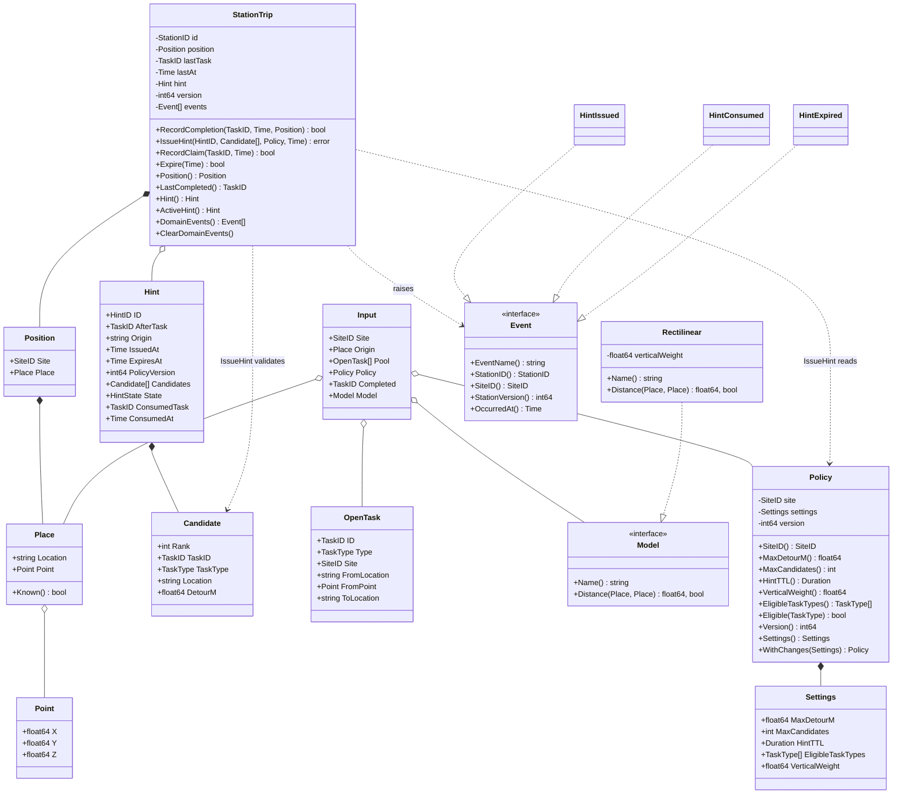

# Class diagrams

:::info[Synced from task-interleaving]
This page is a copy of [`docs/docs/ddd/class-diagram.md`](https://github.com/IQVO/task-interleaving/blob/develop/docs/docs/ddd/class-diagram.md) on `develop`, derived from that repository's code. Edit it there, then re-sync.
:::

UML class diagrams of the domain as it is in `internal/domain`, and of the
hexagonal ports with the adapters that exist. Types are Go types; "interface" marks
a Go interface.

## Domain types

Source: `internal/domain/policy/policy.go`, `internal/domain/travel/travel.go`,
`internal/domain/recommend/recommend.go`, `internal/domain/stationtrip/{trip,values,events}.go`.
Omits: the value types `SiteID`, `StationID`, `HintID`, `TaskID`, `TaskType`,
`HintState`, the `Header` embedded in every event, the error variables and the
functions `recommend.Recommend` and `recommend.RectilinearFor` (they have no
receiver). `Policy.Settings()` is both a field and an accessor in the code; the
diagram shows the accessor.

Hint states: `StateActive`, `StateConsumed`, `StateExpired`, `StateSuperseded`
(`HintState`, with `Valid()` and `Terminal()`).

## Ports and adapters

```mermaid
classDiagram
    class Model {
        <<interface>>
        +Name() string
        +Distance(Place, Place) float64, bool
    }
    class Rectilinear
    class PolicyRepo {
        <<port>>
        +Get(site) PolicyRecord
        +Save(rec, loadedVersion)
    }
    class StationTripRepo {
        <<port>>
        +Get(id) StationTrip
        +Save(trip, loadedVersion)
        +ExpiredActive(now, limit) StationID[]
        +GetHint(id) HintRecord
        +ListHints(filter, after, limit) HintRecord[]
    }
    class TaskPool {
        <<port>>
        +Get(id) Task
        +Save(task)
        +Available(siteID) Task[]
    }
    class LocationBook {
        <<port>>
        +Places(codes) Place map
        +SaveZone(zone)
        +SaveLocation(code, zoneID)
        +DecommissionLocation(code)
        +SaveGeometry(code, x, y, z)
    }
    class EventSink {
        <<port>>
        +PublishTripEvents(events)
        +PublishPolicyDeclared(declaration)
    }
    class ProcessedEvents {
        <<port>>
        +Claim(consumer, eventID) bool
    }
    class IdempotencyStore {
        <<port>>
        +Lookup(key) IdempotencyRecord
        +Save(record)
    }
    class UnitOfWork {
        <<port>>
        +Do(ctx, fn) error
    }
    class usecases {
        <<package application/usecases>>
        DeclarePolicy GetPolicy ListHints GetHint GetStation Recommend
        ApplyTaskAvailable ApplyTaskClaimed ApplyTaskCompleted
        ApplyZone ApplyLocationRegistered ApplyLocationDecommissioned ApplyGeometryUpdated
        ExpireHints
    }
    class httpAdapter {
        <<package inbound/http>>
        chi router, Idempotency middleware
    }
    class kafkaConsumers {
        <<package inbound/kafka>>
        fulfillment consumer, layout consumer
    }
    class expiryWorker {
        <<package inbound/expiry>>
    }
    class postgresAdapter {
        <<package outbound/postgres>>
    }
    class memoryAdapter {
        <<package outbound/memory>>
    }
    class eventsSink {
        <<package outbound/events>>
    }
    class outboxRelay {
        <<package outbound/outbox>>
    }
    class kafkaWriter {
        <<package outbound/kafka>>
        +NewWriter(brokers) Writer
        RelaySink
    }
    class cloudevents {
        <<package kafka/cloudevents>>
        +New(Spec) bytes
        +Decode(bytes) Event
        +ContentTypeHeader() Header
        +Type(entity, eventName) string
        +DataSchema(stream, eventName, version) string
    }
    Rectilinear ..|> Model
    httpAdapter ..> usecases : calls
    kafkaConsumers ..> usecases : calls
    expiryWorker ..> usecases : calls ExpireHints
    kafkaConsumers ..> cloudevents : decodes with
    usecases ..> PolicyRepo
    usecases ..> StationTripRepo
    usecases ..> TaskPool
    usecases ..> LocationBook
    usecases ..> EventSink
    usecases ..> ProcessedEvents
    usecases ..> UnitOfWork
    postgresAdapter ..|> PolicyRepo
    postgresAdapter ..|> StationTripRepo
    postgresAdapter ..|> TaskPool
    postgresAdapter ..|> LocationBook
    postgresAdapter ..|> ProcessedEvents
    postgresAdapter ..|> IdempotencyStore
    postgresAdapter ..|> UnitOfWork
    memoryAdapter ..|> PolicyRepo
    memoryAdapter ..|> StationTripRepo
    memoryAdapter ..|> TaskPool
    memoryAdapter ..|> LocationBook
    memoryAdapter ..|> ProcessedEvents
    memoryAdapter ..|> IdempotencyStore
    memoryAdapter ..|> UnitOfWork
    memoryAdapter ..|> EventSink
    eventsSink ..|> EventSink
    eventsSink ..> cloudevents : encodes with
    eventsSink ..> postgresAdapter : inserts outbox rows via cmd wiring
    outboxRelay ..> postgresAdapter : drains the outbox
    outboxRelay ..> kafkaWriter : sends with RelaySink
    httpAdapter ..> IdempotencyStore : middleware, wired by cmd
```

Source: `internal/application/ports/ports.go`, `clock.go`, `unit_of_work.go` (the
OUT ports), `internal/domain/travel/travel.go` (the port declared in the domain),
`internal/adapters/outbound/{postgres,memory}/ports_check.go` (compile-time
assertions that each adapter implements the ports), `cmd/api/adapters.go` and
`cmd/api/relay.go` (the wiring), `internal/adapters/kafka/cloudevents/cloudevents.go`,
`internal/adapters/outbound/kafka/{writer,relay_sink}.go`,
`internal/architecture/architecture_test.go` (the layer rules). `Clock` and
`IDGenerator` are the remaining ports; the system adapter
(`internal/adapters/outbound/system`) implements `Clock` (`Clock`) and
`IDGenerator` (`RandomIDs`) for the shipped binary.
The `eventsSink` writes through the `Inserter` interface that
`postgres.OutboxRepo` satisfies; adapters never import each other, `cmd/api` does
the wiring.
