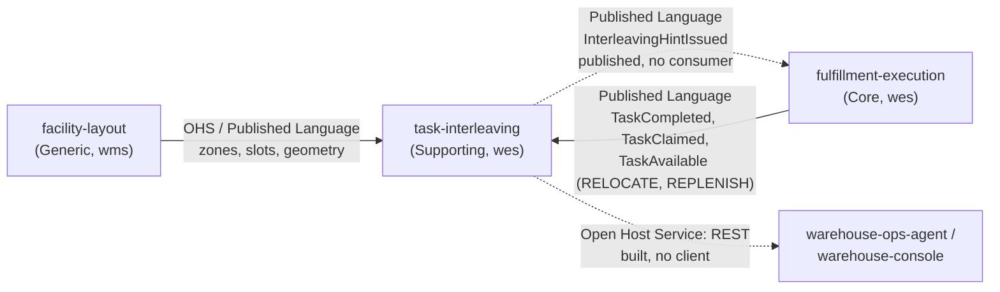

# Context map

:::info[Synced from task-interleaving]
This page is a copy of [`docs/docs/ddd/context-map.md`](https://github.com/IQVO/task-interleaving/blob/develop/docs/docs/ddd/context-map.md) on `develop`, derived from that repository's code. Edit it there, then re-sync.
:::

This context's slice of the fleet map, following
[Context Mapping](https://github.com/ddd-crew/context-mapping). Relationship
patterns come from [ADR 0001](https://iqvo.github.io/task-interleaving/docs/adr/0001-task-interleaving-bounded-context);
the **Status** column says, per edge, which side has code on its `origin/develop`
(checked 2026-10-17). The fleet-wide map lives in warehouse-docs.

Source: `docs/adr/0001-task-interleaving-bounded-context.md` (context map and edge
table), `docs/adr/0003-local-copies-and-consumed-contracts.md`, `apis/asyncapi.yaml`, and
fulfillment-execution's `apis/asyncapi.yaml` and ADRs 0049 and 0050 on its
`origin/develop` for the `TaskAvailable` scope.
Solid arrows have code on both sides (producer publishes, consumer built and
always on); dotted arrows have code on one side only. Omits the contexts this one deliberately has no edge to.

## Edges

| Edge | Relationship | Status |
| --- | --- | --- |
| facility-layout -> task-interleaving | Open Host Service / Published Language (`ZoneRegistered`, `LocationSlotRegistered`, `LocationSlotDecommissioned`, `LocationGeometryUpdated` on `warehouse.facility.events`); task-interleaving is a **Conformist** and keeps a local location copy | Producer contract present in `facility-layout`'s `apis/asyncapi.yaml` on `origin/develop`; consumer **built** (always on; group `LAYOUT_CONSUMER_GROUP`) |
| fulfillment-execution -> task-interleaving, `TaskCompleted` | Published Language (`warehouse.fulfillment.events`); **Conformist** | Producer contract present on `origin/develop`; consumer **built** (always on; group `FULFILLMENT_CONSUMER_GROUP`) |
| fulfillment-execution -> task-interleaving, `TaskAvailable` and `TaskClaimed` | Published Language; **Conformist** | Both published on `warehouse.fulfillment.events` by fulfillment-execution (its ADR 0049; ADR 0050 adds REPLENISH); consumer **built**. `TaskAvailable` is announced for **RELOCATE and REPLENISH tasks** (the only types that carry bins in fulfillment-execution), `TaskClaimed` for every task type. PICK, PACK, SLAM and REBIN tasks are not announced. |
| task-interleaving -> fulfillment-execution | Published Language (`InterleavingHintIssued`); fulfillment-execution is a **Conformist** to the payload but owns the decision to use it (tie-break inside one priority band, fail-open) | Published by this context; **no consumer** in fulfillment-execution's `origin/develop` (its ADR 0049 and ADR 0050 list consuming it as out of scope) |
| task-interleaving -> warehouse-ops-agent, warehouse-console | **Open Host Service** (REST) | REST API **built**; no known client and no `warehouse-infra` route |

## Deliberate non-edges

ADR 0001's *Exclusions*: no edge to `wes-work-planning`, `process-path-management`,
`order-management`, `inventory-storage` or `labor-performance` (priority bands and
CPT stay opaque; `priority_band` is carried and never interpreted); no edge to
`pick-face-replenishment` (`REPLENISH` tasks arrive as ordinary `TaskAvailable`
occurrences, announced since fulfillment-execution's ADR 0050); and no live cross-context lookup in either direction: no outbound
HTTP client, no MCP client, and no sibling calls this context on its hot path.

## Why a separate context at all

The ADR's own answer is the test a reviewer should apply: interleaving **could** be
a rule inside `claimNext`, and it stays a separate context only while the hint is
advisory, never issues an `assign` and owns no task state. If any of those three
properties is dropped, the logic belongs back in fulfillment-execution. See the
[Core domain chart](/contexts/task-interleaving/core-domain-chart).
