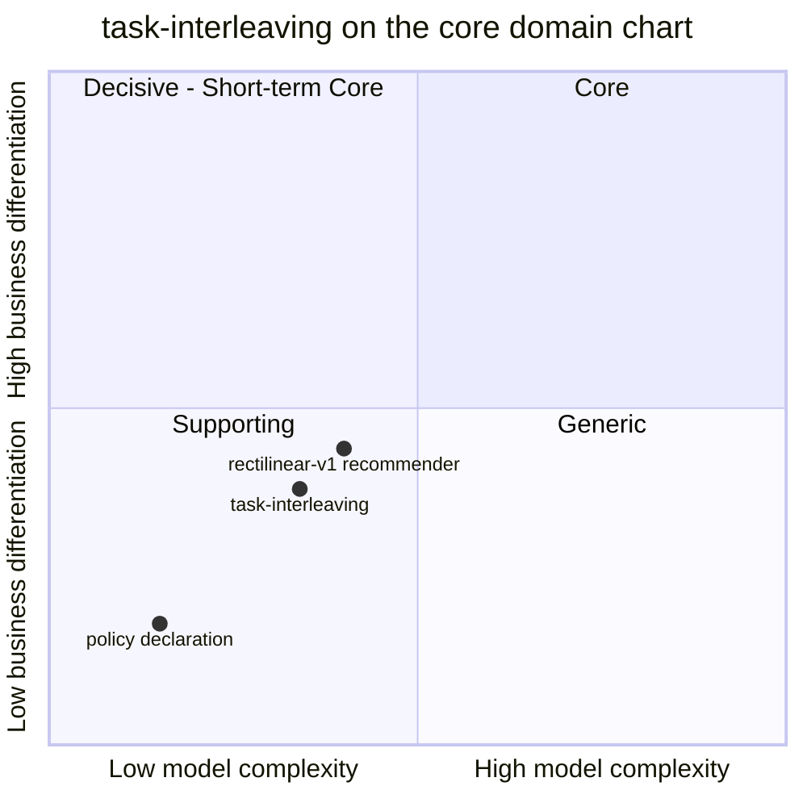

# Core domain chart

:::info[Synced from task-interleaving]
This page is a copy of [`docs/docs/ddd/core-domain-chart.md`](https://github.com/IQVO/task-interleaving/blob/develop/docs/docs/ddd/core-domain-chart.md) on `develop`, derived from that repository's code. Edit it there, then re-sync.
:::

Following the ddd-crew [Core Domain Charts](https://github.com/ddd-crew/core-domain-charts):
business differentiation on the vertical axis, model complexity on the horizontal
axis. Mermaid numbers the quadrants 1 = top-right (Core), 2 = top-left,
3 = bottom-left (Supporting), 4 = bottom-right (Generic).

The coordinates are a judgement made from the evidence below, not a measurement;
the class itself is the fleet verdict
([Subdomain classification](https://iqvo.github.io/task-interleaving/docs/ddd/subdomain-classification)).

Source: `docs/adr/0001-task-interleaving-bounded-context.md` (canvas, strategic
classification, the "fallback" argument), `docs/adr/0002-stationtrip-and-policy-aggregates.md`,
`internal/domain/{policy,travel,recommend,stationtrip}`. Omits the sibling
contexts (their own charts place them).

## Classification: Supporting

[ADR 0001](https://iqvo.github.io/task-interleaving/docs/adr/0001-task-interleaving-bounded-context) classifies the context
as a **Supporting subdomain**: the detour limits and the ranking are replaceable
policy objects (`travel.Model`, the recommender) that do not differentiate the
platform, while the conductor (`wes-work-planning`) and the task lifecycle
(`fulfillment-execution`) stay Core. The ADR is candid that the whole context
**could be a rule inside `claimNext`**, and names the three properties that keep a
separate context worth its network hop: the hint is advisory, it never issues an
`assign`, and it owns no task state. Drop any of them and the logic belongs back in
fulfillment-execution.

**Business differentiation is moderate-low (y = 0.38).** Travel is the largest share
of pick labour, so chaining nearby work matters, and detour limits differ per site,
so the context is not Generic. But interleaving (task chaining, dual command
cycling) is a standard WES technique and its output is a tie-break, not a
decision the fleet's promise to customers rests on.

**Model complexity is low (x = 0.34).** Evidence from the code:

- Two small aggregates: `Policy` (immutable, versioned, six validated settings) and
  `StationTrip` (a four-state hint lifecycle, five invariants, three events).
- One pure ranking function (`recommend.Recommend`, five exclusion rules, a stable
  order and a cut) and one port with one implementation (`travel.Rectilinear`).
- No cross-aggregate rule in the domain; the rest of the design is event-fed local
  copies, which are plumbing (`task_pool`, `zones`, `locations`, fed by the consumers).
- A 100% mutation score on four packages and 99.9% coverage over domain plus
  application against a 90% gate ([Testing](/contexts/task-interleaving/testing)).

The **recommender** alone sits a little higher (0.40, 0.44): it is where the
business rules live and where a better travel model would move the context up. The
**policy declaration** is plain settings with validation (0.15, 0.18).

## Evolution

**Custom-built, in genesis.** Scaffolded and decided on 2026-10-17 (ADRs 0001 to
0005); the service merged the same day. What would move it: a routing model (aisle
and cross-aisle, fixed structures) that measurably beats rectilinear distance and
that the WES relies on would push it towards Core; replacing the recommender with a
bought engine behind an anti-corruption layer would push it down to Generic.
Out of scope for v1 (ADR 0001): aisle routing, multi-stop batching, learned or ML
ranking, cross-station balancing, hints on the station UI itself.
