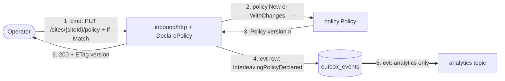
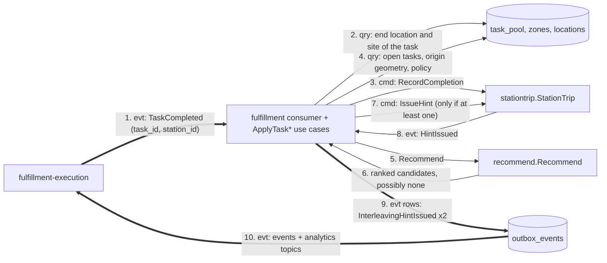
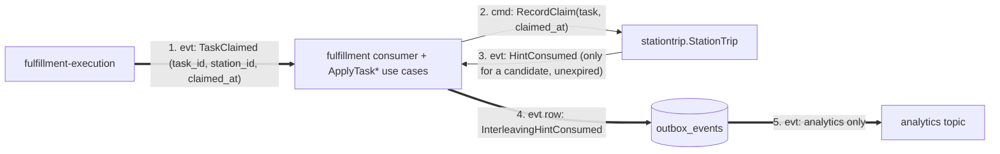
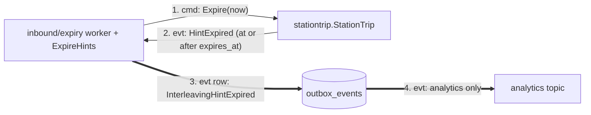
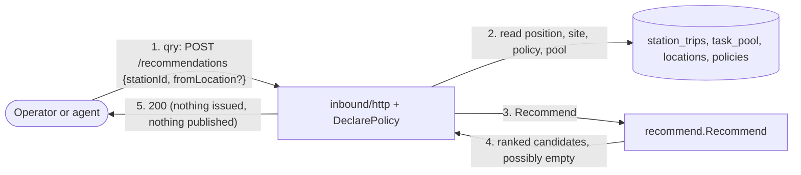

# Domain message flow

:::info[Synced from task-interleaving]
This page is a copy of [`docs/docs/ddd/domain-message-flow.md`](https://github.com/IQVO/task-interleaving/blob/develop/docs/docs/ddd/domain-message-flow.md) on `develop`, derived from that repository's code. Edit it there, then re-sync.
:::

[Domain Message Flow Modelling](https://github.com/ddd-crew/domain-message-flow-modelling)
of the key scenarios: commands, events and queries as numbered messages between
collaborators. Every collaborator is code on `develop`: the domain steps
(`policy`, `recommend`, `stationtrip`), the use cases, the REST handlers, the
consumers, the expiry worker and the outbox relay. On the sibling side,
fulfillment-execution publishes the events of flows 2 and 3 (`TaskAvailable` only
for RELOCATE tasks), and nothing in it consumes the hint published at the end of
flow 2.

## Flow 1 — declare a policy

Source: `internal/domain/policy/policy.go`,
`internal/application/usecases/declare_policy.go`, `apis/openapi.yaml`
(`declareInterleavingPolicy`), `apis/asyncapi.yaml`. The outbox row is written in
the same transaction as the policy. Failure branches: invalid
settings 400 `invalid-policy` or `invalid-task-type`; stale or missing `If-Match`
on an existing policy 412 `version-mismatch`; lost race 409 `concurrent-modification`.

## Flow 2 — a station completes a task, a hint is issued

Source: `internal/application/usecases/apply_task_completed.go`,
`internal/domain/stationtrip/trip.go`, `internal/domain/recommend/recommend.go`,
ADR 0002, ADR 0003, ADR 0004. Messages 2 to 9 run in one database transaction
together with the claim of the CloudEvents id. Branches:

- No candidate: step 7 does not happen; an older Active hint is **not** retracted
  and expires at its TTL.
- Origin without geometry: `ErrOriginUnknown`, no hint.
- A completion for a task the pool never saw, or without a `to_location` or site:
  recorded as completed, outcome `ignored`, no position, not dead-lettered.
- A duplicate CloudEvents id: outcome `duplicate`, nothing runs.
- A site with no policy: inert, no hint.
- The hint is advisory: fulfillment-execution may use it as a tie-break inside one
  priority band. It does not consume it yet (no code reads
  `warehouse.task-interleaving.events` there).

## Flow 3 — the hinted station claims a candidate

Source: `internal/application/usecases/apply_task_claimed.go`,
`StationTrip.RecordClaim`, ADR 0003. The task is also marked CLAIMED in the pool
copy, which removes it from later candidate lists. A claim of a non-candidate, a claim after
expiry or a claim with no Active hint changes nothing and publishes nothing.

## Flow 4 — a hint expires

Source: `internal/adapters/inbound/expiry/worker.go`,
`internal/application/usecases/expire_hints.go`, `StationTrip.Expire`,
`apis/openapi.yaml` ("the clock marks it Expired"). The worker sweeps every
`HINT_EXPIRY_INTERVAL` (default 5 s); the ADRs do not name the caller.

## Flow 5 — simulate a recommendation (query)

Source: `internal/application/usecases/recommend.go`, `apis/openapi.yaml`
(`recommendTasks`), `recommend.Recommend`. Branches:
`422 policy-not-declared`, `422 origin-unknown`, `422 station-position-unknown`
(no `fromLocation` and no recorded position), `400 idempotency-key-required` and
`422 idempotency-key-reused` in Postgres mode, where the Idempotency-Key is enforced.
