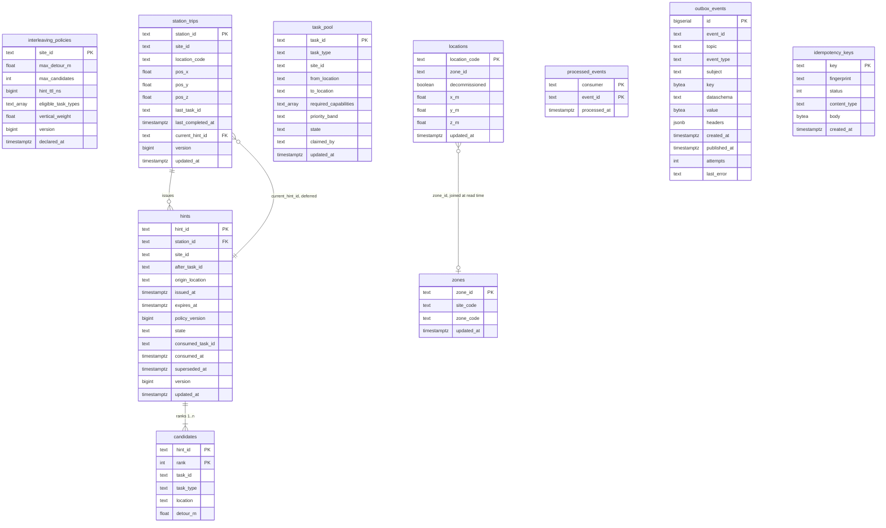
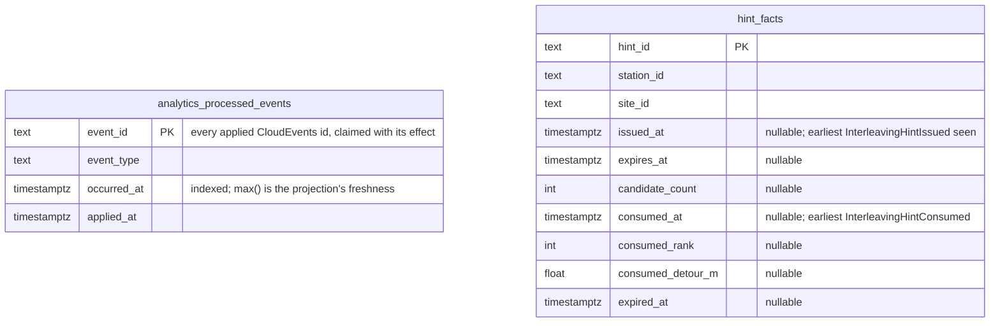

# Entity-relationship diagram

:::info[Synced from task-interleaving]
This page is a copy of [`docs/docs/ddd/entity-relationship.md`](https://github.com/IQVO/task-interleaving/blob/develop/docs/docs/ddd/entity-relationship.md) on `develop`, derived from that repository's code. Edit it there, then re-sync.
:::

The Postgres schema of the service as created by the single embedded migration,
`migrations/0001_interleaving_schema.up.sql` ([ADR 0005](https://iqvo.github.io/task-interleaving/docs/adr/0005-persistence-and-evaluation-semantics)).
Postgres is the only runtime ([ADR 0006](https://iqvo.github.io/task-interleaving/docs/adr/0006-postgres-and-kafka-are-the-only-runtime)); the in-memory test doubles keep the same shapes in process memory.

Source: `migrations/0001_interleaving_schema.up.sql` (every column, key and index
below), `internal/adapters/outbound/postgres/*.go` for the access paths. Types are
shortened (`text COLLATE "C"` is shown as `text`).

## Analytical database

The hint-adoption read model ([ADR 0008](https://iqvo.github.io/task-interleaving/docs/adr/0008-analytics-read-side))
is a separate database (`task_interleaving_analytics`), written only by
`cmd/ti-projector` from `warehouse.task-interleaving.analytics` and read by
`cmd/ti-reports`. Facts, not aggregates: it can be dropped and rebuilt by
replaying the topic under a new consumer group.

Each milestone column keeps the CloudEvents time of the earliest such event
(`LEAST` ignores NULLs), so arrival order never matters; a hint superseded by
a newer one has no event of its own and stays without a `consumed_at` or
`expired_at`. No foreign keys. Source: `analytics/migrations/0001_hint_adoption.up.sql`.

## Reading it

| Table | Kind | Notes |
| --- | --- | --- |
| `interleaving_policies` | aggregate root, one row per site | `version` starts at 1 and guards every update (`WHERE version = <loaded>`). `hint_ttl_ns` keeps the `time.Duration` exactly. A site without a row is **inert**. Checks: detour above 0, candidates 1 to 5, TTL above 0, at least one task type, weight at least 0. |
| `station_trips` | aggregate root, one row per station | Written only together with the first completion. The point `pos_x/y/z` is all-or-nothing (CHECK). `current_hint_id` points at the most recent hint in any state through a **deferrable** foreign key, so a trip and its new hint are written in one transaction in either order. |
| `hints` | the hint history | One row per hint ever issued; `state` is `Active`, `Consumed`, `Expired` or `Superseded` (CHECK). The unique partial index `uq_hints_one_active_per_station` allows at most one `Active` hint per station: the database's own guarantee behind the aggregate's invariant. `consumed_task_id` and `consumed_at` are set exactly when the state is `Consumed`. `expires_at > issued_at`. |
| `candidates` | value objects of a hint | Primary key `(hint_id, rank)`, unique `(hint_id, task_id)`, deleted with the hint (`ON DELETE CASCADE`), immutable once the hint exists. |
| `task_pool` | event-fed read model | Keyed by task id (ADR 0003). `state` is `AVAILABLE`, `CLAIMED` or `COMPLETED`. A task learned only from a claim or a completion is minimal (empty site and locations). `priority_band` is carried and never interpreted. Index `idx_task_pool_available (site_id, task_id) WHERE state = 'AVAILABLE'` serves the recommender. |
| `zones`, `locations` | event-fed read model | A location's site is found at read time through its zone, so zone, slot and geometry events may arrive in any order. `decommissioned` is irreversible and the row stays, so a late registration cannot bring the location back. The point `x_m/y_m/z_m` is all-or-nothing; a location with no point has an unknown distance. |
| `processed_events` | consumer idempotency | `(consumer, event_id)` is claimed with `INSERT ... ON CONFLICT DO NOTHING` in the **same** transaction as the effect, so a rollback un-claims it. |
| `outbox_events` | transactional outbox | One row per already-encoded Kafka message and destination topic; unique `(event_id, topic)`; partial index `idx_outbox_events_unpublished` keeps the relay's scan tiny. `attempts` and `last_error` carry the relay's failures. |
| `idempotency_keys` | stored answers | Only 2xx and 4xx answers are stored (CHECK `status` 200 to 499), first writer wins. |

The link from a policy to a trip is by site, not by a foreign key: `IssueHint`
refuses a policy whose site is not the station's site (`ErrSiteMismatch`), and the
use case supplies the policy. No code issues a `DELETE` on any table (the
`candidates` cascade only fires if an operator deletes a hint).
