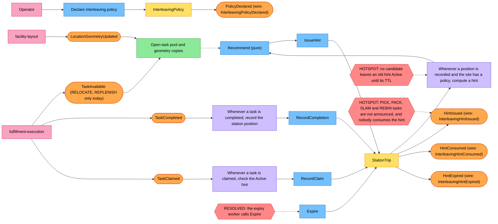

# EventStorming

:::info[Synced from task-interleaving]
This page is a copy of [`docs/docs/ddd/eventstorming.md`](https://github.com/IQVO/task-interleaving/blob/develop/docs/docs/ddd/eventstorming.md) on `develop`, derived from that repository's code. Edit it there, then re-sync.
:::

Design-level EventStorming of the hint flow, using the
[ddd-crew glossary](https://github.com/ddd-crew/eventstorming-glossary-cheat-sheet)
colours: orange domain events, blue commands, yellow aggregates, lilac policies,
pink external systems, green read models, red hotspots. The model was derived from
the code and ADRs, not from a workshop.

Source: `internal/domain/stationtrip/{trip,events}.go`, `internal/domain/policy/policy.go`,
`internal/domain/recommend/recommend.go`, `internal/application/usecases/*.go`
(`apply_task_completed.go`, `apply_task_claimed.go`, `expire_hints.go`),
`internal/adapters/inbound/expiry/worker.go`, `docs/adr/0001` to `0005`,
`apis/asyncapi.yaml`, and fulfillment-execution's `apis/asyncapi.yaml` on its
`origin/develop` for the `TaskAvailable` scope.
Each domain event name is the Go type; the wire name is the CloudEvents event name in
ADR 0004.

## Reading it

1. **Declare.** An operator declares a site policy. Until then the site is inert.
2. **Feed.** fulfillment-execution and facility-layout events fill the local copies
   (open-task pool, claims, geometry) through the opt-in consumers.
   fulfillment-execution publishes `TaskAvailable` today only for RELOCATE and REPLENISH tasks.
3. **Complete.** A `TaskCompleted` records the station's new position, taken from the
   completed task's `to_location` in the pool copy.
4. **Hint.** The recommender ranks the pool; when it yields at least one candidate,
   `IssueHint` supersedes any Active hint and raises `HintIssued`.
5. **Outcome.** A claim of a candidate while unexpired raises `HintConsumed`; the
   hint-expiry worker raises `HintExpired`; a newer hint supersedes silently.

## Hotspots

| # | Hotspot | State |
| --- | --- | --- |
| 1 | **Who calls `Expire`?** The `ExpireHints` use case, driven by the `inbound/expiry` worker every `HINT_EXPIRY_INTERVAL` (default 5 s). The aggregate still takes the instant from the caller. | Resolved in code (ADR text still silent) |
| 2 | **A completion with no candidate leaves an older Active hint in place** until its TTL (bounded staleness; the hint is advisory and fail-open). Retracting it would need an event for the retraction: a later ADR if the floor needs it (ADR 0002). | Accepted by ADR 0002 |
| 3 | **Announcement scope and the hint consumer.** fulfillment-execution publishes `TaskAvailable` only for RELOCATE and REPLENISH tasks (its ADR 0049 and ADR 0050), so the pool, and every candidate list, holds those two types only; PICK, PACK, SLAM and REBIN have no location there. And nothing in fulfillment-execution consumes `InterleavingHintIssued` (out of scope in both ADRs), so hints are published and acted on by nobody (ADR 0001). | Open, other contexts |
| 4 | **Site and geometry code spaces.** v1 assumes the pool's `site_id` equals facility-layout's `siteCode` and one geometry frame per site (ADR 0003, live-data rule). | Open until checked on live data |
| 5 | **Wording drift in the REST spec.** `apis/openapi.yaml` says a hint is `Superseded` by "a newer completion at the same station" and mentions `supersededAt`; ADR 0002 and the code supersede a hint only when a newer hint is issued (a completion with no candidate supersedes nothing). The code does keep `supersededAt` (`hints.superseded_at`), so only the "newer completion" wording differs. | Reported as a discrepancy |
