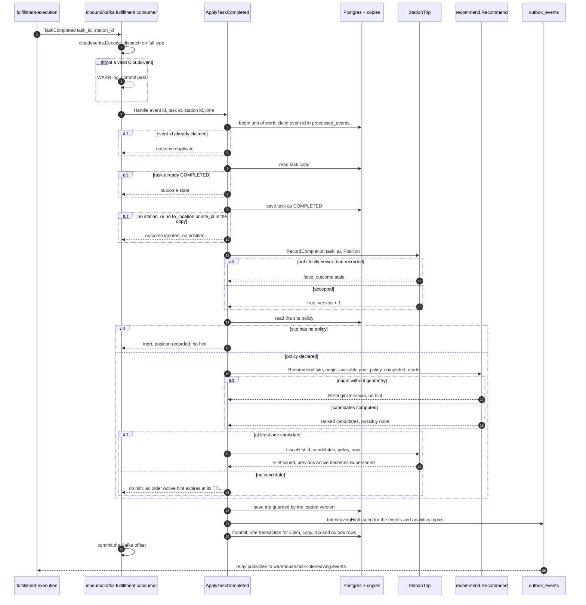
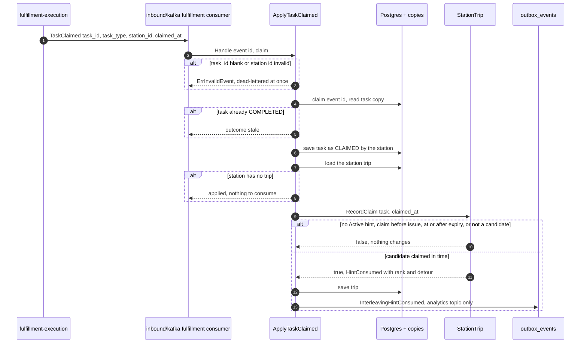
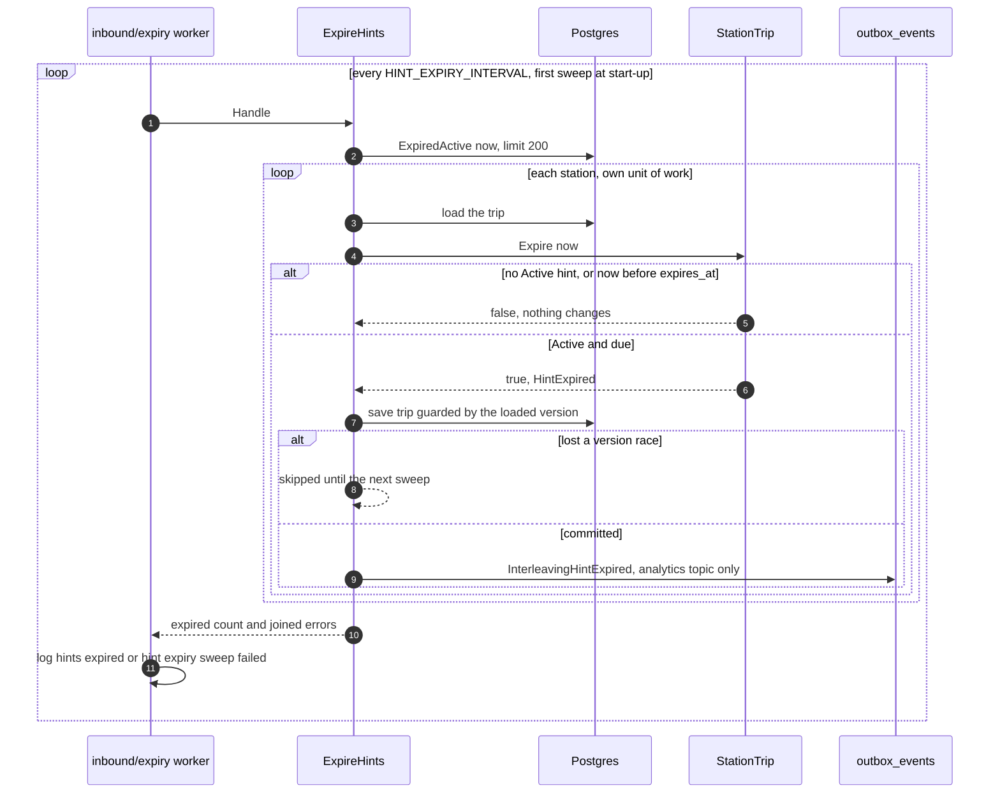
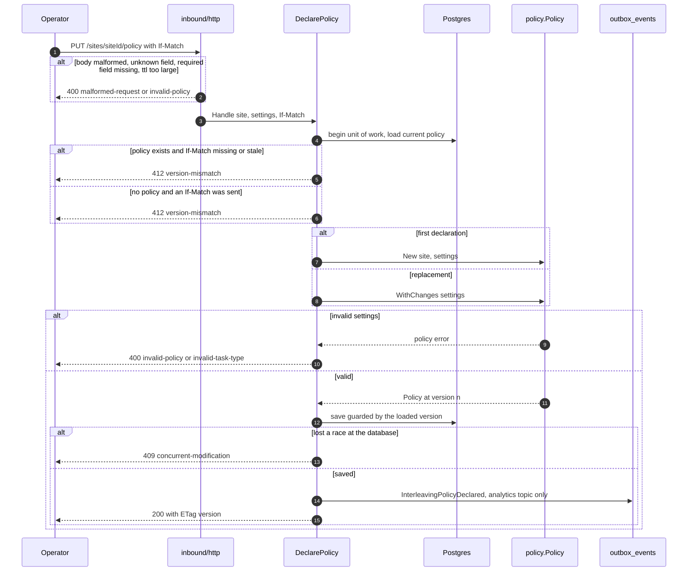
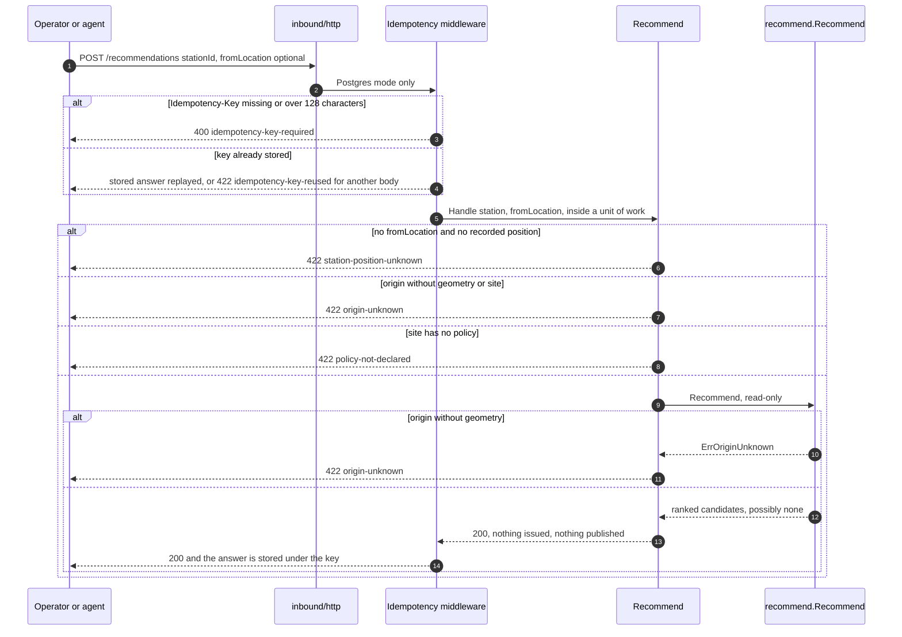

# Sequence diagrams

:::info[Synced from task-interleaving]
This page is a copy of [`docs/docs/ddd/sequence-diagrams.md`](https://github.com/IQVO/task-interleaving/blob/develop/docs/docs/ddd/sequence-diagrams.md) on `develop`, derived from that repository's code. Edit it there, then re-sync.
:::

UML sequence diagrams of the key scenarios, with error branches. Every participant
is code on `develop`; where a message names a Go function it is a function that
exists, and the order of steps follows the use cases in
`internal/application/usecases`.

## Complete a task, issue a hint

Source: `internal/application/usecases/apply_task_completed.go`, `intake.go`,
`ranker.go`, `StationTrip.RecordCompletion`, `StationTrip.IssueHint`,
`recommend.Recommend`, `internal/adapters/inbound/kafka/consumer.go`,
`internal/adapters/outbound/events/sink.go`. A transient failure rolls the unit of
work back (which un-claims the event id), the consumer retries the same message
with backoff and, after 5 attempts, publishes it to `warehouse.fulfillment.events.dlq`.
A save that loses a version race is such a transient failure. The relay publishes
only when `DATABASE_URL` and `KAFKA_BROKERS` are set.

## The hinted station claims a candidate

Source: `internal/application/usecases/apply_task_claimed.go`,
`StationTrip.RecordClaim`, `apis/asyncapi.yaml` (`TaskClaimed`) and fulfillment-execution's
`apis/asyncapi.yaml` (the producer, with `claimed_at`).

## A hint expires

Source: `internal/adapters/inbound/expiry/worker.go`,
`internal/application/usecases/expire_hints.go`, `StationTrip.Expire`. The worker
runs in both storage modes.

## Declare a policy

Source: `internal/application/usecases/declare_policy.go`,
`internal/adapters/inbound/http/policy_handlers.go`, `errors.go`, `policy.New`,
`Policy.WithChanges`, `apis/openapi.yaml` (`declareInterleavingPolicy`). The
`PUT` is not wrapped by the `Idempotency-Key` middleware; the version check is its
concurrency control.

## Simulate a recommendation

Source: `internal/application/usecases/recommend.go`,
`internal/adapters/inbound/http/recommend_handler.go`, `idempotency.go`,
`recommend.Recommend`, `apis/openapi.yaml` (`recommendTasks`). A 4xx answer is
rolled back and stored on its own so the same key replays the same rejection; a 5xx
is never stored. In-memory mode skips the middleware.
