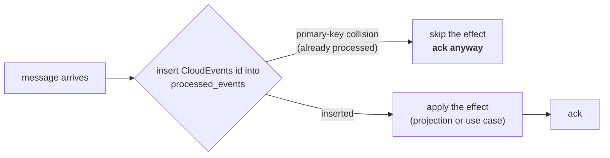

# Async API

Every warehouse-systems service shares **one Kafka broker**
(`localhost:9092` locally). This service does not run its own broker — it
connects to the shared one via `github.com/segmentio/kafka-go` (pure Go, no
cgo).

## The envelope: CloudEvents 1.0 (mandatory)

Every service exchanges CloudEvents 1.0 in structured content mode — the
fleet-wide, mandatory [Event Standard](/strategic-design/event-standard-cloudevents). Every message carries the Kafka header
`content-type: application/cloudevents+json; charset=UTF-8`:

```json
{
  "specversion": "1.0",
  "id": "uuid-v4",
  "source": "/warehouse/wes-work-planning",
  "type": "com.warehouse.wes.work-planning.workunit.WorkReleased",
  "subject": "...",
  "time": "2026-08-21T22:00:00Z",
  "datacontenttype": "application/json",
  "dataschema": "urn:warehouse:wes-work-planning:events:WorkReleased:v1",
  "data": { }
}
```

`id` is a UUID v4 minted once per domain event and persisted with the
outbox row, so a redelivery carries the same `id`; the CloudEvents `id` is the
consumer idempotency key. `time` comes from the **domain clock**, not from
publish time. `subject` is the aggregate instance id. `dataschema`
distinguishes the integration payload (`…:events:…`) from the analytics
payload (`…:analytics:…`) of the same occurrence. `data` is
event-type-specific.

Events are built, validated and (un)marshalled with the official
`github.com/cloudevents/sdk-go/v2/event` package, behind each service's own
`internal/adapters/kafka/cloudevents/` helper (transport stays
`segmentio/kafka-go`). Consumers dispatch on the **full** `type` string,
ignore unknown types, and DLQ/skip — never parse — anything that is not a
valid CloudEvent. There is no flat envelope and no envelope toggle. See the
[generated reference](/api-reference/async/wes-work-planning) for the full
spec document.

## Published

### Topic `warehouse.work-planning.events`

| `type` (suffix after `com.warehouse.wes.work-planning.`) | `data` | Published when | Consumed by |
|---|---|---|---|
| `workunit.WorkReleased` | `{"path_id","work_unit_id","cpt","ref"}` (+ optional `required_capabilities`, `fragile`, `gift_wrap`, and on the `RELOCATE` path a `relocation` object, ADR-0040; on the `REPLENISH` path a `replenishment` object, ADR-0042) | `ReleaseNextWork` releases a unit | **`fulfillment-execution`** → creates a `Task` (a `RELOCATE` task when `relocation` is present, a `REPLENISH` task when `replenishment` is present, its ADR 0050) |
| `workunit.WorkUnitCreated` | `{"path_id","work_unit_id"}` (+ optional `reference` and `line_no`, strictly additive, ADR-0041) | a work unit is admitted: `EnqueueWorkUnit`, the slot-plan intake that plans `RELOCATE` units, or the replenishment intake that plans `REPLENISH` units | **`order-management`** — its release-confirmation consumer (ADR 0043) reads only `reference` (the order id for order work) and `line_no` to confirm a released order line. Opt-in and off by default (`RELEASE_CONFIRMATION_MODE=kafka`), which the reference deployment does not set. `reference` is also published for transfer work (the demand id) and `RELOCATE` work (the plan id), and `line_no` only for order lines; each is omitted when unknown, and the analytics stream carries neither |
| `workpool.PathCapacityChanged` | `{"path_id","cutoff_at","remaining_units","known"}` | `SampleBacklog` is called with `cutoffAt` set (`GET /paths/{pathId}/telemetry?cutoffAt=…`, ADR-0018) | **`order-management`** — its `kafkapathcapacity` adapter (own per-process consumer group, filters for this one event type) caches remaining capacity keyed by path and cutoff instant. Also **`network-fulfillment`** (`pathcapacitycache`), wired but unused: it starts only with `CAPABILITY_OFFER_ENABLED=true`, which the reference deployment does not set |

```json
{
  "specversion": "1.0",
  "id": "1d7e4b90-3c58-4d22-9a6f-8b1c0e5d7a23",
  "source": "/warehouse/wes-work-planning",
  "type": "com.warehouse.wes.work-planning.workunit.WorkReleased",
  "subject": "wu-10231",
  "time": "2026-08-21T22:12:30Z",
  "datacontenttype": "application/json",
  "dataschema": "urn:warehouse:wes-work-planning:events:WorkReleased:v1",
  "data": {
    "path_id": "pick-to-tote",
    "work_unit_id": "wu-10231",
    "cpt": "2026-08-22T02:00:00Z",
    "ref": "order-88421-line-3"
  }
}
```

`PathCapacityChanged` reports the path's remaining admission capacity
(`wipLimit` minus current WIP, never negative), correlated against a CPT
cutoff **timestamp** rather than process-path-management's `cptId`.
`known=false` for a flow-fed path or a release-fed path with no WIP limit
provisioned. See
[ADR-0018](https://github.com/IQVO/wes-work-planning/blob/develop/docs/docs/adr/0018-path-capacity-changed.md).

The other eight domain events are also written to this topic by the
outbound adapter, with small payloads (most carry only `path_id`), but
nothing consumes them today — see [Domain Events](./domain-events). (Separately,
with `EVENT_PUBLISHER=kafka` a second publisher writes every domain event,
as CloudEvents with an `…:analytics:…` `dataschema`, to
`warehouse.wes.analytics` for the analytics data product —
[ADR-0011](https://github.com/IQVO/wes-work-planning/blob/develop/docs/docs/adr/0011-analytical-data-product.md).)

Set `EVENT_PUBLISHER=kafka` (with `KAFKA_BROKERS`) to publish here; the
default `log` publisher writes the same events to the log instead. Both
implement the same `ports.EventPublisher` interface, so the use cases
cannot tell which is wired. With `kafka` **and** `DATABASE_URL` set, the
publishers act only as encoders inside the use case's transaction: one
`outbox_events` row per event per topic, drained onto Kafka by an
in-process relay
([ADR-0014](https://github.com/IQVO/wes-work-planning/blob/develop/docs/docs/adr/0014-transactional-outbox.md)).
Without `DATABASE_URL` events are published directly.

## Consumed

Setting `KAFKA_BROKERS` starts the inbound consumer automatically,
**independent of `EVENT_PUBLISHER`**. It reads six topics concurrently,
one goroutine each (workforce, inventory, fulfillment, order-management,
network-inventory-planning and slotting-optimization), under the consumer
group `KAFKA_CONSUMER_GROUP`
(default `wes-work-planning`, shared by every deployed replica). A second
process against the shared broker — a developer's `go run`, the e2e
harness — must set a unique value, or the rebalance hands the single
partition to one member and the other consumes nothing while reporting
healthy. Each topic has its own `<topic>.dlq`.

With `PATH_CATALOGUE_SOURCE=kafka` a separate consumer replays
process-path-management's topic, with `PRODUCT_CLASSIFICATION_MODE=kafka`
another one keeps the product classification copy, and with
`REPLENISHMENT_MODE=kafka` a dedicated consumer reads
pick-face-replenishment's topic — see the sections below.

### `warehouse.workforce.events` — `ShiftPlanCommitted`, from `workforce-management`

```json
{
  "specversion": "1.0",
  "id": "...",
  "source": "/warehouse/workforce-management",
  "type": "com.warehouse.wes.workforce-management.shiftplan.ShiftPlanCommitted",
  "subject": "...",
  "time": "...",
  "datacontenttype": "application/json",
  "dataschema": "urn:warehouse:workforce-management:events:ShiftPlanCommitted:v1",
  "data": {
    "building_id": "BLD1", "shift_id": "S1", "path_id": "pick-a",
    "planned_heads": 7, "planned_rate": 95.5, "planned_hours": 8
  }
}
```

Projected into `LaborPlanObserved`, keyed by `path_id`, read at
`GET /paths/{pathId}/labor-plan-view`. Workforce publishes **one message
per path line** of its own shift plan, which is why the projection keys on
`path_id` with one row per path. **It is not fed into this service's own
`ShiftPlan` aggregate or `CommitShiftPlan` use case** — same word,
different bounded context.

### `warehouse.inventory.events` — `StockReserved`, `ReservationRevoked`, from `inventory-storage`

```json
{
  "specversion": "1.0",
  "id": "...",
  "source": "/warehouse/inventory-storage",
  "type": "com.warehouse.wms.inventory-storage.reservation.StockReserved",
  "subject": "...",
  "time": "...",
  "datacontenttype": "application/json",
  "dataschema": "urn:warehouse:inventory-storage:events:StockReserved:v1",
  "data": {"sku": "SKU-8891", "quantity": 4, "demand_ref": "order-88421"}
}
```

Both event types carry the same `data` shape. `StockReserved`
**decrements** the observed usable count for that SKU; `ReservationRevoked`
**increments** it back. Projected into `UsableInventoryObserved`, keyed by
**SKU** — deliberately not by path, because inventory reservations are
SKU-scoped and a SKU-to-path mapping does not exist in the domain. Read at
`GET /inventory-view/{sku}`.

### `warehouse.fulfillment.events` — `TaskCompleted`, from `fulfillment-execution`

```json
{
  "specversion": "1.0",
  "id": "...",
  "source": "/warehouse/fulfillment-execution",
  "type": "com.warehouse.wes.fulfillment-execution.task.TaskCompleted",
  "subject": "...",
  "time": "...",
  "datacontenttype": "application/json",
  "dataschema": "urn:warehouse:fulfillment-execution:events:TaskCompleted:v1",
  "data": {"task_id": "t-551", "station_id": "pack-3", "work_unit_id": "wu-10231"}
}
```

`data.work_unit_id` maps to `RecordCompletionRequest.WorkUnitId` and calls
the **existing** `RecordCompletion` use case — the exact code path
`POST /work-units/{id}/complete` uses. This closes the control loop's
feedback edge: WIP drops, and the next release call can proceed. For a
`RELOCATE` work unit (below) the completion also admits the moves of the same
slot plan that were waiting on it into the pool, in the same transaction.
`task_type` is optional on the wire and only logged, to explain a completion
for a work unit this context never planned (for example a PACK task
`fulfillment-execution` created itself, which names the order id); that
completion is skipped at INFO, not retried or dead-lettered. So is a
`TaskCompleted` with a NEW event id for a work unit that is already completed
(`TaskCompletedAlreadyCompleted`, ADR-0043): a stale fact, marked processed. A
`RELOCATE`
completion carries the additive `sku`, `from_bin`, `to_bin`, `quantity` and
`relocation_ref` fields (fulfillment-execution ADR-0047) for
`inventory-storage`, which this context ignores.

### `warehouse.order-management.events` — `OrderAllocated`, `OrderPartiallyAllocated`, from `order-management`

```json
{
  "specversion": "1.0",
  "id": "...",
  "source": "/warehouse/order-management",
  "type": "com.warehouse.wes.order-management.order.OrderAllocated",
  "subject": "...",
  "time": "...",
  "datacontenttype": "application/json",
  "dataschema": "urn:warehouse:order-management:events:OrderAllocated:v1",
  "data": {
    "order_id": "order-1", "promise_date": "2026-08-22T02:00:00Z",
    "lines": [{"line_no": 1, "sku": "SKU-1", "path_id": "pick-a", "gift_wrap": false}]
  }
}
```

Both event types share this identical `data` shape and are handled
identically — both mean "these lines are ready to enqueue." For each entry
in `lines`, the handler calls the **existing** `EnqueueWorkUnit` use case
directly, deriving a **deterministic** `work_unit_id` as
`"{order_id}-line-{line_no}"` — so the same order line always maps to the
same work unit, a second line of defense against duplicate enqueues on top
of the `processed_events` idempotency guard. This integration is
deliberately **fire-and-forget**: there is no reply event back to
order-management.

### `warehouse.network-inventory-planning.events` — `WorkDemandReleased`, from `network-inventory-planning`

`ApplyWorkDemandReleased` (ADR-0033) enqueues one transfer work unit per
released demand leg through the existing `EnqueueWorkUnit`, under the
deterministic work unit id `demand_id`. The payload carries `demand_id`,
`work_kind`, `transfer_ref`, `path_id`, `site_id`, `cpt`, `sku` and
`quantity`. An unknown `path_id` or an undeclared `work_kind` is
deterministic poison and ends in the topic's `.dlq`.

### `warehouse.slotting-optimization.events` — `SlotPlanApproved`, from `slotting-optimization`

```json
{
  "specversion": "1.0",
  "id": "...",
  "source": "/warehouse/slotting-optimization",
  "type": "com.warehouse.wms.slotting-optimization.slotplan.SlotPlanApproved",
  "subject": "plan-3b0e8d2a",
  "time": "...",
  "datacontenttype": "application/json",
  "dataschema": "urn:warehouse:slotting-optimization:events:SlotPlanApproved:v1",
  "data": {
    "plan_id": "plan-3b0e8d2a", "site_id": "WH1", "approved_at": "2026-10-14T12:00:00Z",
    "supersedes_plan_id": "plan-1f27c9d0",
    "assignments": [{"sku": "SKU-2", "slot": "WH1-FWD-A01-01-02-A"}],
    "moves": [{"sku": "SKU-2", "from_slot": "WH1-FWD-A02-03-01-A", "to_slot": "WH1-FWD-A01-01-02-A", "kind": "Relocate"}]
  }
}
```

Illustrative values in the contract's shape. The sixth stream is wired
unconditionally in `cmd/wes` (no mode flag), so it runs whenever the consumer
does, under the
same consumer group, with its own `warehouse.slotting-optimization.events.dlq`
(ADR-0040). Only `SlotPlanApproved` is handled; `SlotPlanGenerated`,
`SlotPlanRejected` and unknown types are ignored. The `assignments` map is
decoded away: the moves are what changes on the floor. `ApplySlotPlanApproved`
marks the CloudEvents `id` and writes everything in one transaction:

- one `RELOCATE` work unit per entry of `moves`, id `<plan_id>-move-<move_seq>`
  (`move_seq` = the 0-based index in `moves`), reference = the plan id, path
  `RELOCATE`, `work_kind = RELOCATE`, `cpt` = `approved_at` +
  `RELOCATION_CPT_HORIZON`. When the catalogue entry declares an `intake`
  (process-path-management ADR 0034) it must contain `SLOT_RELOCATION`;
- a move into a slot that another move vacates is created `Pending` with
  `blocked_by` set and stays out of the pool until that move's `TaskCompleted`;
- a plan older than the site's latest recorded plan (by `approved_at`, ties to
  the greater plan id) is recorded and plans nothing; otherwise the site's
  not-yet-released `RELOCATE` units of other plans are cancelled (state
  `Cancelled`, no event);
- a broken plan (missing ids, unknown `kind`, a slot the kind requires
  missing), an unknown `RELOCATE` path or an intake without
  `SLOT_RELOCATION` is retried 3 times and then dead-lettered. The
  `RELOCATE` path must therefore be in the process-path catalogue
  (process-path-management's seed) before plans arrive.

The released unit goes out as an ordinary `WorkReleased` v1 whose `data` gains
one optional `relocation` object (`plan_id`, `move_seq`, `kind`, `sku`,
`from_bin`, `to_bin`); `fulfillment-execution` turns it into a `RELOCATE`
task (its ADR-0047).

### `warehouse.pick-face-replenishment.events` — `ReplenishmentRequested`, `ReplenishmentCancelled`, from `pick-face-replenishment`

Consumed only when `REPLENISHMENT_MODE=kafka` (the default `permissive`
consumes nothing), under the stable group `REPLENISHMENT_CONSUMER_GROUP`
(unset, or without `KAFKA_BROKERS` or `DATABASE_URL`, is a boot error), with its
own `warehouse.pick-face-replenishment.events.dlq`
([ADR-0042](https://github.com/IQVO/wes-work-planning/blob/develop/docs/docs/adr/0042-pick-face-replenishment-work.md);
`internal/adapters/inbound/kafka/replenishment_consumer.go`, started from
`cmd/wes/replenishment.go`). The mirrored contract is in `apis/asyncapi.yaml`
(operation `consumeReplenishmentEvents`); this context reads `request_id`,
`site_id`, `sku`, `source_bin`, `forward_bin`, `quantity`, `priority` and
`requested_at` and ignores `policy_min` and `policy_max`.

- Each `ReplenishmentRequested` becomes exactly ONE `REPLENISH` work unit: id
  `replenish-<request_id>`, `ref` and the REST `reference` = the request id, path
  `REPLENISH`, `work_kind = REPLENISH`. A redelivery of the same CloudEvents `id`
  or a second, different event for an already-planned request id is a no-op.
- Priority is expressed through the CPT, because the unit has no priority
  field: `requested_at` + `REPLENISHMENT_CPT_HORIZON` (default `8h`) for
  `NORMAL`, + `REPLENISHMENT_URGENT_CPT_HORIZON` (default `1h`, capped at the
  normal horizon) for `URGENT`.
- `ReplenishmentCancelled` cancels the request's unit only while it is still
  `Pending`; released or completed work runs to completion, and a cancellation
  for an unknown request is a no-op. `ReplenishmentCompleted` and every other
  type are ignored.
- The released unit goes out as an ordinary `WorkReleased` v1 whose `data` gains
  one optional `replenishment` object (`request_id`, `sku`, `from_bin` = the
  event's `source_bin`, `to_bin` = its `forward_bin`, `quantity`, `priority`),
  present only on `REPLENISH` units, which never carry `relocation`.
  `fulfillment-execution` turns it into a `REPLENISH` task (its ADR 0050).
- The `REPLENISH` path must be in the process-path catalogue first
  (process-path-management ADR 0036, intake `REPLENISHMENT`), or requests are
  dead-lettered until it is. The CloudEvents `id` claim and the effect commit in
  one transaction; invalid CloudEvents are WARN-skipped; a payload that can
  never be applied is dead-lettered at once, other failures after the retries.

The reference deployment does not set `REPLENISHMENT_MODE`
(`warehouse-infra` `develop`), so this consumer is off there.

### `warehouse.process-path-management.events` — the process-path catalogue, from `process-path-management`

Consumed only when `PATH_CATALOGUE_SOURCE=kafka` (the default `file` source
reads the same catalogue from YAML instead). The
`internal/adapters/outbound/kafkacatalog` consumer replays the topic from
the beginning under its **own per-process consumer group** — not
`KAFKA_CONSUMER_GROUP` — folding `ProcessPathCreated`,
`ProcessPathUpdated` and `ProcessPathDeactivated` into the in-memory
catalogue that validates every `pathId`
([ADR-0012](https://github.com/IQVO/wes-work-planning/blob/develop/docs/docs/adr/0012-process-path-catalogue-validation.md)).
Startup blocks until the replay has caught up, then the consumer keeps
following the topic live. It is a state rebuild, not an effect, so it does
not use `processed_events`.

### `warehouse.product-master.events` — `ProductClassified`, from `product-master`

Consumed only when `PRODUCT_CLASSIFICATION_MODE=kafka`, under the stable
consumer group `PRODUCT_CLASSIFICATION_CONSUMER_GROUP` shared by every
replica ([ADR-0035](https://github.com/IQVO/wes-work-planning/blob/develop/docs/docs/adr/0035-product-classification-local-copy.md);
`internal/adapters/inbound/kafka/product_classification_consumer.go`). It
keeps one row per SKU in `product_classification_copy`, claiming the
CloudEvents `id` and applying the classification in one transaction, and
overwrites a stored row only when the incoming `version` is greater. Every
other type on the topic is ignored; an invalid CloudEvent or payload is
WARN-logged and skipped. `ReleaseNextWork` reads the copy to stamp
`required_capabilities` (`hazmat`) and `fragile` on `WorkReleased`; nothing
calls `inventory-storage` or `product-master` at release time. The default
`permissive` mode reads no copy and adds no hint, and `http` (the former
`GET /products/{sku}/classification` call to `inventory-storage`) fails the
boot. The reference deployment sets `kafka`
(`warehouse-infra` `terraform/locals.tf` `sync_edge_env`), and `cmd/mcp` reads
the same copy read-only.

## Idempotency

Kafka is at-least-once, so redelivery is normal, not exceptional. Every
integration-event consumer path is idempotent by construction. The
`processed_events` mark commits atomically with the effect
([ADR-0028](https://github.com/IQVO/wes-work-planning/blob/develop/docs/docs/adr/0028-processed-event-mark-atomic-with-handling.md)).
A message that is not a valid CloudEvent goes straight to `<topic>.dlq`; a
handler error is tried 3 times in total with exponential backoff and then
dead-lettered to `<topic>.dlq`; unknown types are ignored.



- **Postgres**: table `processed_events (event_id TEXT PRIMARY KEY,
  processed_at TIMESTAMPTZ)` — the column keeps its name and is populated
  from the CloudEvents `id`. The primary-key violation *is* the duplicate
  check — no read-then-write race between two consumers processing the same
  redelivery.
- **In-memory**: a mutex-guarded `map[string]struct{}` with identical
  semantics.

Both sit behind one port, `ProcessedEventRepo.TryMarkProcessed(ctx, eventId,
at) (alreadyProcessed bool, err error)`.

| Redelivered event | Effect |
|---|---|
| `StockReserved` | usable quantity is **not** double-decremented |
| `ReservationRevoked` | usable quantity is **not** double-incremented |
| `ShiftPlanCommitted` | the labour projection is **not** re-written |
| `TaskCompleted` | `RecordCompletion` is **not** called a second time |
| `OrderAllocated` / `OrderPartiallyAllocated` | `EnqueueWorkUnit` is **not** called a second time per line |
| `WorkDemandReleased` | the demand leg is **not** enqueued twice (work unit id = `demand_id`) |
| `SlotPlanApproved` | the plan's `RELOCATE` units are **not** planned twice (ids are `<plan_id>-move-<move_seq>`; the same plan under a new event id is a no-op) |
| `ReplenishmentRequested` | no second `REPLENISH` unit: the id is `replenish-<request_id>`, and a different event for a planned request id is a no-op |
| `ProductClassified` | the copy is **not** rewritten; an older `version` is a no-op even with a new `id` |

The `TaskCompleted` case matters operationally beyond the dedup table
itself: `WorkUnit.Complete` already rejects double-completion with
`ErrAlreadyCompleted`, so the aggregate would be safe regardless. But
without the `id` check, every redelivery would surface a domain error
from a perfectly normal Kafka behaviour — deduplicating first keeps
`ErrAlreadyCompleted` meaning what it says, rather than becoming an error
nobody reads.

## Configuration

| Env var | Default | Effect |
|---|---|---|
| `KAFKA_BROKERS` | *(unset)* | Comma-separated brokers. **Setting it starts the inbound consumer.** |
| `KAFKA_CONSUMER_GROUP` | `wes-work-planning` | Consumer group of the integration-event consumer; set a unique value for any second process on the shared broker. |
| `EVENT_PUBLISHER` | `log` | `kafka` switches the outbound publisher; requires `KAFKA_BROKERS`. With `DATABASE_URL` also set, events go through the transactional outbox. |
| `OUTBOX_RELAY_INTERVAL` | `1s` | How long the outbox relay sleeps between empty passes (outbox mode only). |
| `PRODUCT_CLASSIFICATION_MODE` | `permissive` | `kafka` keeps the local copy of product-master's classification; `http` is rejected at boot (ADR-0035). |
| `PRODUCT_CLASSIFICATION_CONSUMER_GROUP` | *(none)* | Required with `kafka`: the stable consumer group of the classification copy. |
| `PATH_CATALOGUE_SOURCE` | `file` | `kafka` replays `warehouse.process-path-management.events` into the catalogue; requires `KAFKA_BROKERS`. |
| `RELOCATION_CPT_HORIZON` | `24h` | Go duration added to a slot plan's `approved_at` to give its `RELOCATE` work units a CPT (ADR-0040). |
| `REPLENISHMENT_MODE` | `permissive` | `kafka` runs the pick-face-replenishment consumer; any value other than `kafka` or `permissive` is a boot error (ADR-0042). |
| `REPLENISHMENT_CONSUMER_GROUP` | *(none)* | Required with `kafka`: the stable consumer group, shared by every replica. |
| `REPLENISHMENT_CPT_HORIZON` | `8h` | CPT of a `NORMAL` request = `requested_at` + this Go duration. |
| `REPLENISHMENT_URGENT_CPT_HORIZON` | `1h` | CPT of an `URGENT` request; capped at the normal horizon. |

## Generated reference

For the full AsyncAPI 2.6.0 document — every channel, every message schema,
linted in CI by Spectral — see the
[generated Async API reference](/api-reference/async/wes-work-planning),
built directly from `apis/asyncapi.yaml` in the source repository.
