# Cross-context incident runbook: a stuck order

Every context runbook stops at its own boundary. This page follows one
order across the three contexts that move it to the dock:
**order-management** (intake, allocation, release),
**wes-work-planning** (work units, release to the floor) and
**fulfillment-execution** (tasks, packages). It tells you which hop to
check first and links to the context runbook that owns the fix.

Everything here works on the local kind cluster: Kong on
`http://localhost:8000` (every context under `/api/<context>`), Grafana on
`http://localhost:3000`, Prometheus on `http://localhost:9090`, the Kafka
broker `kafka-controller-0` (container `kafka`) in namespace
`warehouse-systems`.

## The path an order takes

```mermaid
flowchart LR
    A["POST /orders<br/>order-management"] --> B["Allocate via<br/>inventory-storage REST"]
    B --> C["Release in the same call<br/>OrderAllocated to outbox"]
    C --> D["Relay publishes on<br/>warehouse.order-management.events"]
    D --> E["wes-work-planning consumer<br/>one WorkUnit per line"]
    E --> F["POST /paths/pathId/release<br/>WorkReleased to outbox"]
    F --> G["Relay publishes on<br/>warehouse.work-planning.events"]
    G --> H["fulfillment-execution consumer<br/>one Task per work unit"]
    H --> I["Station claims and completes<br/>TaskCompleted to outbox"]
    I --> J["Relay publishes on<br/>warehouse.fulfillment.events"]
    J --> K["wes-work-planning frees the WIP slot<br/>order-management re-promises"]
```



Identifiers you carry from hop to hop:

| Hop | Key | Where it comes from |
| --- | --- | --- |
| order-management | order id | `POST /orders` response |
| wes-work-planning | work unit `<orderId>-line-<lineNo>`, `reference` = order id | `ApplyOrderAllocated` (one work unit per allocated line) |
| fulfillment-execution | task `orderRef` = the work unit id `<orderId>-line-<lineNo>` | `ConsumeWorkReleased`; Pack tasks fulfillment-execution creates itself carry the order id |

Every hop goes through a transactional outbox and a Kafka topic, so a
stuck order is almost always one of four things: the producer's outbox is
not draining, the consumer is not reading, the consumer dead-lettered the
message, or the next step waits for a person or a station.

## 1. Start from the alerts

Open Prometheus `/alerts` (or the `ALERTS` series in Grafana) and filter on
the three contexts. The [alert catalogue](./alert-catalogue.md) lists every
rule.

| Firing alert | Likely hop | Go to |
| --- | --- | --- |
| `WarehouseOutboxLagHigh` for `order-management` | allocated orders are not reaching Kafka | [step 3](#3-order-management-did-the-event-leave) |
| `WarehouseOutboxLagHigh` for `wes-work-planning` | released work is not reaching Kafka | [step 5](#5-wes-work-planning-was-the-work-released-and-did-workreleased-leave) |
| `WarehouseKong5xxRatioHigh` for one of the three | the API itself fails (often a dependency: inventory-storage behind the order-management breaker, Postgres) | that context's troubleshooting page |
| `WarehousePodRestarting` for one of the three | a binary exits on purpose (projector consumer stopped, boot retry exhausted, migration failed) or is OOM-killed | `kubectl logs --previous` on the pod, then the context runbook |
| nothing fires | consumer lag, a dead-lettered message, or work that waits for a release or a station | follow steps 2 to 7 in order |

fulfillment-execution exports no outbox-lag gauge and no context exports
consumer lag, so a stuck order can be silent. Steps 2 to 7 do not depend on
an alert.

## 2. order-management: what state is the order in?

```bash
curl -s http://localhost:8000/api/order-management/orders/<orderId>
```

| Order / line status | Meaning | Next |
| --- | --- | --- |
| `Received`, lines `Pending` | allocation never happened (permissive inventory client, or a hard failure at intake) | [order-management troubleshooting](/contexts/order-management/troubleshooting#circuit-breaker-and-allocation): cancel and resubmit with a new `Idempotency-Key` |
| `Backordered` lines | inventory-storage answered `409` (no usable stock): a business fact | `POST /orders/<orderId>/retry-allocation` once stock exists |
| `Allocated` / `PartiallyAllocated`, not released | held at intake (ship-complete rule or network hold) | `POST /orders/<orderId>/release` when the hold reason is gone |
| `Released` / `PartiallyReleased` | order-management is done; the order is in wes-work-planning's hands | step 3 |
| `Cancelled` | nothing downstream should happen | none |

## 3. order-management: did the event leave?

`Released` lines are announced through the outbox
(`OrderAllocated` / `OrderPartiallyAllocated` on
`warehouse.order-management.events`). In order-management's database:

```sql
SELECT id, topic, event_type, key, attempts, last_error, created_at
FROM outbox_events
WHERE published_at IS NULL
ORDER BY id
LIMIT 20;
```

- **Rows with a growing `attempts` and a `last_error`**: Kafka is
  unreachable or one row fails every pass. Fix the cause in `last_error`;
  the relay resumes on its own.
- **A row with `attempts >= 20`** (`OUTBOX_MAX_ATTEMPTS`, default 20): the
  relay parked it and logged
  `outbox relay: row reached the attempt cap and is no longer claimed` at
  ERROR. Later rows, even for the same order, have overtaken it. Fix the
  cause, then re-arm it with
  `UPDATE outbox_events SET attempts = 0 WHERE id = <id>;`
  ([order-management runbook](/contexts/order-management/runbook#re-publish-events-stuck-in-the-outbox)).
- **No unpublished row for the order**: the event left. Go to step 4.

Since the gap-fix wave (D27) the outbox row stores the request's W3C trace
context and the relay sends it as Kafka headers, so a consumer that
extracts it continues the trace of the `POST /orders` call. Search Jaeger
for the order-management trace first; when it ends at the relay, the event
was not consumed yet.

## 4. wes-work-planning: did it read the order?

```bash
curl -s "http://localhost:8000/api/wes-work-planning/work-units?reference=<orderId>"
```

An **empty array** means no work unit exists for the order. Check, in
order:

1. **Consumer lag** of the integration consumer group (default
   `wes-work-planning`):

   ```bash
   kubectl -n warehouse-systems exec kafka-controller-0 -c kafka -- \
     kafka-consumer-groups.sh --bootstrap-server localhost:9092 \
     --describe --group wes-work-planning
   ```

   Lag on `warehouse.order-management.events` with no progress means the
   consumer stopped. The loop exits on purpose when a DLQ publish or an
   offset commit fails (log `kafka consumer stopped`); nothing is lost,
   restart the pod after fixing the broker.
2. **Dead letters** on `warehouse.order-management.events.dlq`: the
   handler failed 3 times. The usual cause is a line whose `path_id` is
   not in the process-path catalogue (the whole event fails). Read the
   `x-dlq-error` header, declare the path in process-path-management, then
   [replay the message](/contexts/wes-work-planning/runbook#replay-a-dead-lettered-message).
3. **`processed_events`** already holds the CloudEvents `id`: the event was
   applied and every line was a duplicate. Look the work unit up by id
   instead: `GET /work-units/<orderId>-line-<lineNo>`.

## 5. wes-work-planning: was the work released, and did `WorkReleased` leave?

Each work unit has a `state`: `Pending` → `Released` → `Completed`.

- **`Pending`**: nothing releases it on its own. Work is released by a
  call to `POST /paths/<pathId>/release` (REST, the MCP tool
  `release_next_work`, or the console), earliest CPT first. The call
  answers `409 wip-limit-reached` when the path is at its WIP limit:
  that happens when completions from fulfillment-execution stop arriving
  (step 7), because only `RecordCompletion` frees a slot. Check the path
  with `GET /paths/<pathId>/telemetry`.
- **`Released`**: `WorkReleased` went into wes-work-planning's outbox.
  Run the same `outbox_events` query as in step 3 against
  wes-work-planning's database, and re-arm a parked row the same way
  ([wes-work-planning runbook](/contexts/wes-work-planning/runbook#re-arm-an-outbox-row-that-hit-the-attempt-cap)).
  `wes_outbox_lag_seconds` on the
  `warehouse-wes-work-planning` dashboard shows the same thing as a gauge.

## 6. fulfillment-execution: did it create the task?

```bash
curl -s "http://localhost:8000/api/fulfillment-execution/tasks?orderRef=<orderId>-line-<lineNo>"
```

An **empty array** means `WorkReleased` never became a task. The
[fulfillment-execution troubleshooting page](/contexts/fulfillment-execution/troubleshooting#where-released-work-can-get-lost)
has the full decision tree; the common causes are:

- **A new consumer group** (`WORK_RELEASED_CONSUMER_GROUP`, default
  `fulfillment-execution`) starts at the **latest** offset: events
  released before the group existed are never read. Re-release the work.
- **Unknown `path_id`** in fulfillment-execution's catalogue: 3 attempts,
  then `warehouse.work-planning.events.dlq`. Define the path, then replay.
- **Not ready yet**: with `PATH_CATALOGUE_SOURCE=kafka` the HTTP listener
  starts before the catalogue replay and `/readyz` answers `503` until the
  replay has caught up (ADR 0044).

Check the group the same way as in step 4 with
`--group fulfillment-execution`.

## 7. fulfillment-execution: is the task moving?

| Task state | Meaning | Next |
| --- | --- | --- |
| `PENDING` | no station has pulled it | stations must call `POST /stations/<stationId>/claim-next`; `GET /queues/<taskType>/depth` shows the backlog. Too few stations with the required capability, or none checked in |
| `CLAIMED` | a station holds the lease | an expired lease goes back to `PENDING` on the next lease-expiry sweep (`POST /tasks/expire-leases`, called every minute by the `<release>-expire-leases` CronJob) |
| `COMPLETED` | `TaskCompleted` went into the outbox | check fulfillment-execution's `outbox_events` as in step 3; this context has no outbox-lag gauge, so the SQL query and the log line `outbox relay pass failed` are the only signals |

When `TaskCompleted` is published, wes-work-planning applies it and marks
the work unit `Completed` (which frees the WIP slot), and order-management
uses `PackageManifested` and `TaskCPTMissed` from the same topic to
re-promise. A work unit stuck in `Released` while its task is `COMPLETED`
means wes-work-planning is not consuming `warehouse.fulfillment.events`:
check its consumer group (step 4) or complete the unit by hand with
`POST /work-units/<id>/complete`.

## 8. After the incident

- Re-armed outbox rows publish out of order relative to rows with the same
  key that overtook them. Consumers dedupe on the CloudEvents `id`, but a
  state-carrying consumer may need the context's own read-model rebuild
  procedure (see each runbook).
- A DLQ message is never retried by itself. Replay it only after the cause
  is fixed, or it lands in the DLQ again.
- Record what happened against the [Fleet SLOs](./slos.md): a stuck outbox
  row or a stopped consumer is an event-delivery SLO breach even when no
  HTTP call failed.
