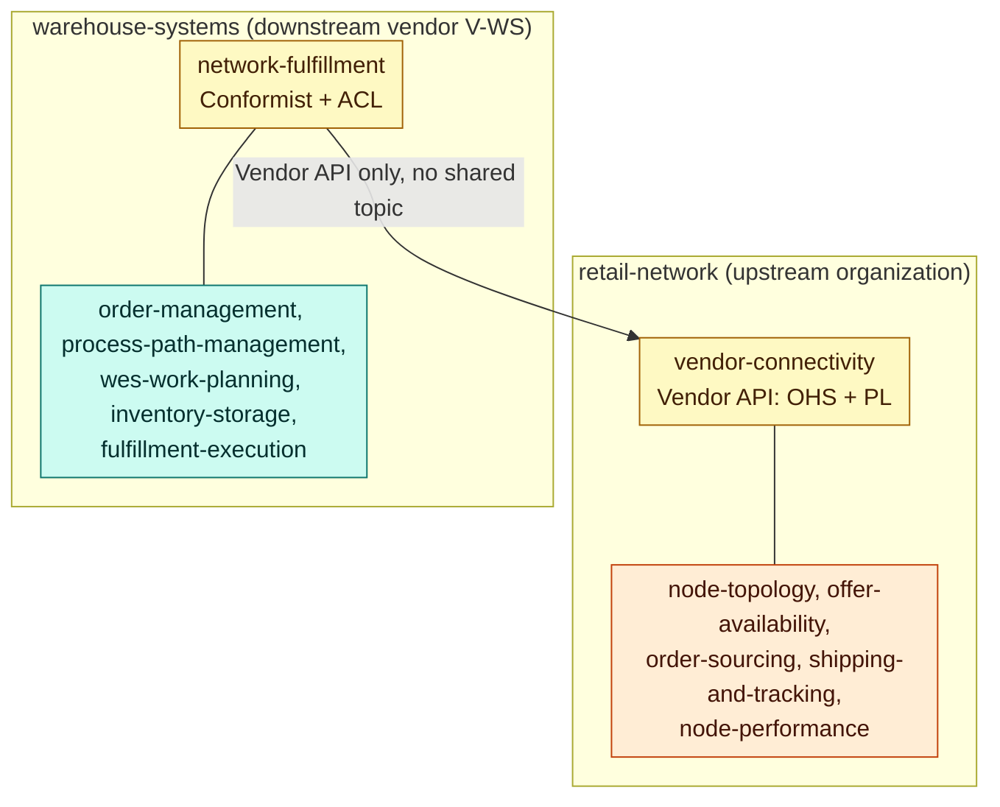
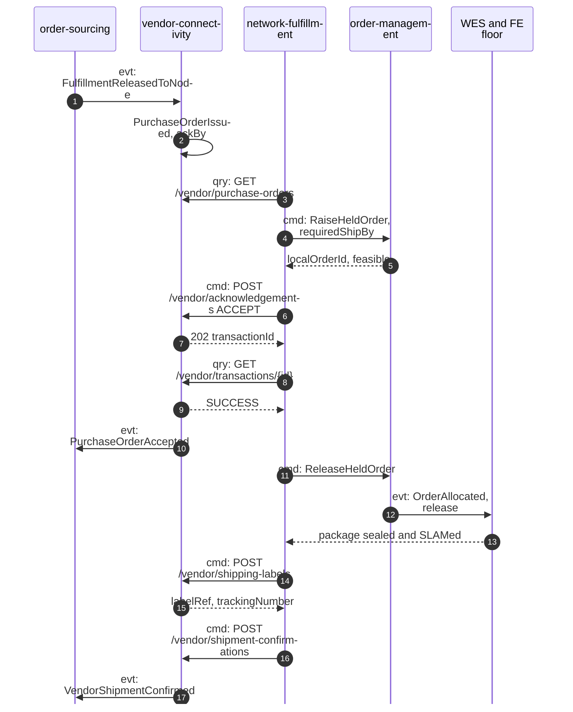

# How the warehouse-systems fleet connects

:::info[Fact and model]
Statements about the **fleet** are read from the IQVO repositories on
`origin/develop` (2026-10-22) and cite a path. Statements about the
**network** are the proposed model on this site.
:::

## The shape of the seam

Derived from: `model.yaml` → `meta.hard_boundary`,
`contexts[vendor-connectivity].inbound`, `sync_calls`; fleet side from
`IQVO/network-fulfillment` `internal/application/ports/ports.go`. Lines inside
each organization stand for that side's own integrations (detailed on the
[Context Map](/strategic-design/context-map) and in
[warehouse-docs](https://iqvo.github.io/warehouse-docs/strategic-design/context-map)).

| Side | Context | Role at the seam | Pattern |
| --- | --- | --- | --- |
| network | `vendor-connectivity` | publishes the Vendor API and its schemas | Open Host Service + Published Language |
| fleet | `network-fulfillment` | the only fleet caller; translates both ways | Conformist + Anti-Corruption Layer |
| both | Kafka | no topic shared in either direction | Separate Ways |

Hard rules, both directions:

1. No network context consumes a `warehouse.*` topic, calls a fleet service or
   reads fleet data (`model.yaml` → `meta.hard_boundary`).
2. No fleet context except `network-fulfillment` knows the network exists.
   `network-fulfillment`'s `NetworkGateway` port is "the ONLY route to the
   external network" and "expressed entirely in OUR vocabulary"
   (`internal/application/ports/ports.go`).
3. No ship-to PII crosses the seam. The fleet side already decided this
   ("No ship-to PII reaches this context at all", `network-fulfillment`
   `docs/adr/0009-retail-network-not-amazon-counterpart.md` §3); the network
   side keeps the address in `customer-ordering` and `shipping-and-tracking`
   ([ADR 0006](/adr/0006-pii-confinement)).
4. Identifiers are mapped, never parsed: the fleet persists
   `siteCode ↔ nodeId` and `NetworkRef ↔ poNumber`; it never builds one from
   the other by string convention (`network-fulfillment`
   `docs/adr/0009-retail-network-not-amazon-counterpart.md` §5, "correlation
   as a persisted mapping", and its ADR 0014, which refused to correlate
   `PackageManifested` by string).

## What the fleet declares, and where each number comes from

| The network asks for | Network field | The fleet's source of truth | Fleet evidence |
| --- | --- | --- | --- |
| Which nodes exist | `POST /vendor/nodes` (`vendorNodeCode`, type, subtype) | `facility-layout` `Site` + `siteRole` | `IQVO/facility-layout` `docs/docs/adr/0037-site-role-and-siterolechanged-cloudevents.md` |
| When the node hands over | `cutoffs[].localTime` | `process-path-management` `CPTScheduleChanged` | `network-fulfillment` port `ProcessPathCapability.NextCutoff` |
| How long a release takes | `handlingTime` | eligible path `cycleTimeP95` | `network-fulfillment` `docs/adr/0017-cycle-time-p95-path-eligibility.md` |
| How many orders per cutoff | `cutoffs[].maxOrders`, `throughputCap` | `wes-work-planning` `PathCapacityChanged` | port `PathCapacity.RemainingCapacity` |
| What can ship | `POST /vendor/inventory` lines `{listingId, availableQty, basis}` | `CapabilityOffer{advertisedQuantity, basis}` = min(usable, throughput-feasible) | `internal/domain/capabilityoffer/capability_offer.go` (`PHYSICAL`, `THROUGHPUT_CONSTRAINED`) |

The fleet's own CPT **is** the network's pickup cutoff at that node. That is
what makes the two promises line up: the network's `requiredShipBy` for a
purchase order at `N-VWS-AUS3` is a cutoff the fleet itself declared, so
`order-management`'s `PromisePolicy.FeasibleBy(now, order, deadline)`
(`internal/domain/order/promise_policy.go`) answers a question about a
departure it already plans around.

## What the fleet commits

| Network message | Fleet behaviour today (`origin/develop`) |
| --- | --- |
| Purchase order poll `GET /vendor/purchase-orders` | `NetworkGateway.PollDemand(since)`; inbound is a poll, not a push (port doc comment, ADR 0001 §5) |
| Acknowledgement, fill-or-kill, before `ackBy` | `RaiseHeldOrder` creates an `order-management` order with `releaseOnAllocation=false` and returns whether `requiredShipBy` is feasible (port `FulfillmentPlanner`); `SubmitAcknowledgement(ref, accepted)` "has no middle answer"; a held order must be ship-complete (`ErrHeldOrderMustBeShipComplete`, `order-management` `internal/adapters/inbound/http/errors.go`) |
| Transaction reconciliation | `SubmissionStatus(ref)`: "a 200 on the original submit call is never itself a completed commitment" (port doc comment) |
| Release to the floor after acceptance | `ReleaseHeldOrder` after reconciliation; `CancelHeldOrder` on rejection |
| Label | `RequestLabel(ref)` returns `{labelRef, trackingNumber, carrier}` only |
| Shipment confirmation | explicit `POST /network-orders/{networkRef}/shipment-confirmation` (`network-fulfillment` `docs/adr/0014-explicit-shipment-confirmation-endpoint.md`) calling `SubmitShipmentConfirmation` |

## End to end

Derived from: `model.yaml` → `contexts[vendor-connectivity]`,
`contexts[order-sourcing]`; fleet steps from the `network-fulfillment` ports
named above. Step 13 (how the fleet learns the package is ready) is the open
gap on [Fleet changes](/integration/fleet-changes).

## Translation table

The canonical term-by-term translation is on
[Ubiquitous Language](/strategic-design/ubiquitous-language) under
"Translation to the warehouse-systems fleet". Two rows decide most of the
design:

- **Promise.** The network's delivery promise never reaches the fleet. The
  fleet sees `requiredShipBy` only; its own promise stays a CPT window
  (`order-management` ADR 0014).
- **Reject reasons.** `CANNOT_MEET_SHIP_BY` ↔ `INFEASIBLE_DEADLINE`,
  `UNKNOWN_LISTING` ↔ `UNTRANSLATABLE_SKU`; an expired purchase order ↔
  `ACKNOWLEDGEMENT_DEADLINE_MISSED`.

## Parcel nodes in the fleet's master data

The fleet's `facility-layout` also has sites with roles `SORTATION_CENTER`,
`DELIVERY_STATION` and `AIR_HUB_GATEWAY`. In this model those buildings are
network-operated. The fleet never registers them through the Vendor API, and
the network never reads the fleet's rows; they are reference mirrors so fleet
screens can name the building a package left for. See
[Node model](/network-model/node-model).
