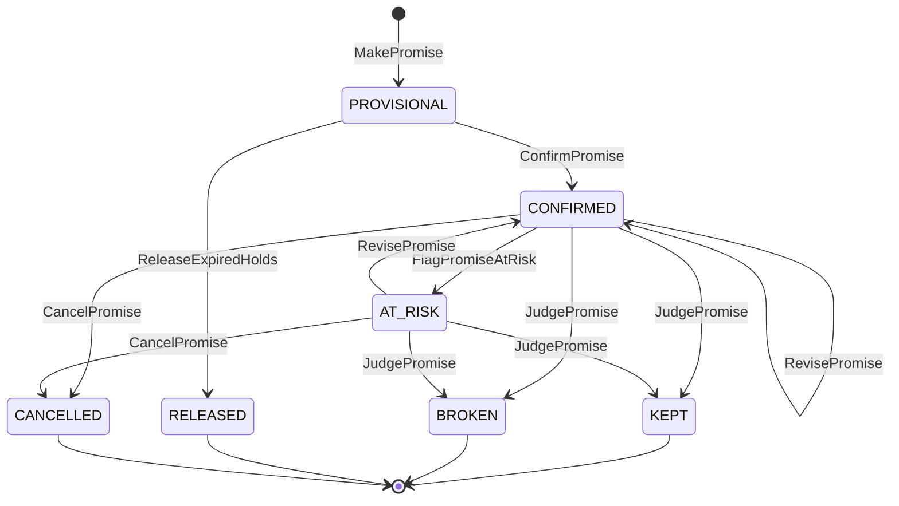

# Promise model

:::info[Proposed design]
Derived from [`model/model.yaml`](https://github.com/IQVO/retail-network-docs/blob/main/model/model.yaml)
→ `contexts[delivery-promise]`, `service_tiers`. Owner:
[`delivery-promise`](/contexts/delivery-promise) (Core). The public facts it
rests on (a promise from network state and a feasible path; assignment later
and possibly elsewhere; a policy that shapes peak demand) are on
[The Amazon logistics network](/research/amazon-logistics-network). The
algorithm below is this site's proposal.
:::

## The promise in one line

```text
DeliveryPromise = ShipPromise (vendor node: ready by the pickup cutoff)
                ⊕ Transit (network: pickup, sort, linehaul departures)
                ⊕ LastMile (network: a delivery wave with stops left)
```

The warehouse-systems fleet already owns the first term inside its own
buildings: `order-management` promises a CPT window from
`process-path-management`'s schedule and `wes-work-planning`'s capacity
(order-management ADR 0014). It could never own the other two: it does not
know the network's departures or delivery waves. The network owns the whole
sum, and tells the vendor only the first term, as `requiredShipBy`.

## Inputs: all local, all event-fed

The promise is on the shopper's critical path (every product page and cart).
It makes **no synchronous call**: every input is a read model kept from
events.

| Input (read model) | Fed by | Answers |
| --- | --- | --- |
| `RegionAndServiceAreaView` | `node-topology` `ServiceAreaAssigned`, `RegionDefined` | which delivery station and region serve this postal prefix |
| `NodeProfileView` | `node-topology` `NodeRegistered`, `NodeOperationalProfileDeclared`, `NodeActivated`, `NodeSuspended`, `NodeRetired` | which fulfillment nodes are ACTIVE; their hours, holidays, cutoffs, handling time, caps |
| `AvailabilityView` | `offer-availability` `ListingAvailabilityChanged` and siblings | how many units each node claims, and on what basis |
| `LaneView`, `DepartureView` | `node-topology` lanes; `linehaul-transportation` `DepartureScheduled`, `DepartureCapacityChanged`, `DepartureCancelled` | which departures exist, when, with how much room |
| `DeliveryWaveView` | `last-mile-delivery` `DeliveryWaveScheduled`, `DeliveryWaveCapacityChanged` | when packages must reach the station, the window, stops left |
| `ScorecardView` | `node-performance` `NodeScorecardUpdated` | the node's grade |
| `PromiseBook` (own aggregate) | own commands | how many orders are already promised onto each node cutoff |

A cold or stale read model is not a reason to guess. Fast tiers require every
input (see [ADR 0008](/adr/0008-capacity-held-at-promise-time)); only
`STANDARD` may fall back to nominal lane times, and the promise then records
`basis = NOMINAL`.

## The search

```text
quote(item, qty, postalPrefix, tiers, now):
  area   = serviceArea(postalPrefix)            else constraint DESTINATION_NOT_SERVED
  ds     = area.deliveryStation ; region = area.region
  nodes  = ACTIVE FULFILLMENT_CENTER nodes with OUTBOUND
           and availableQty(item, node) - provisionalHolds >= qty
                                                else constraint ITEM_QUANTITY_NOT_AVAILABLE
  for node in nodes:
     ready   = addBusinessTime(now, node.handlingTime, node.hours, node.holidays)
     ready   = handicap(ready, node, grade(node))           # ScorecardHandicap
     pickup  = first PICKUP departure from node with cutoffAt >= ready
               and remaining > 0 and book(node, pickup).room > 0
                                                else skip node (NODE_CAPACITY_EXHAUSTED)
     arrival = earliestArrival(pickup.arrivesAt at pickup.destination -> ds)
               # time-expanded graph: at each parcel node add its sortDwell,
               # then take the first departure on an OPEN lane with
               # cutoffAt >= that instant and remaining > 0
     wave    = first wave at ds with inductCutoffAt >= arrival and remainingStops > 0
     candidate(node, shipBy = pickup.cutoffAt,
               window = [wave.windowStart, wave.windowEnd],
               witness = {node, pickup, legs, wave})
  for tier in tiers:
     best = candidate with min(window.end) that satisfies tier,
            ties: in-region, then fewer legs, then better grade
     if none: constraint DELIVERY_SLA_UNAVAILABLE for that tier
     if tier == STANDARD and some input is missing:
            nominal candidate from LaneView transit times, basis NOMINAL
  offer.expiresAt = min(now + offerTtl, best.pickup.cutoffAt - best.node.handlingTime)
```

Derived from: `model.yaml` → `contexts[delivery-promise].policies[PromisePolicy]`,
`aggregates[DeliveryOffer]`.

The scorecard handicap (`ScorecardHandicap`):

| Grade | Effect on `ready` |
| --- | --- |
| A, or no scorecard yet | none |
| B | handling time × 1.25 |
| C | skip to the next cutoff after the first feasible one |
| D | skip two cutoffs |
| PROVISIONAL (too few observations) | none; the node is new, not bad |

A handicapped node is still offered, later. The network never silently drops a
node because of its grade; suspension is a separate, human decision in
`node-topology`.

## From offer to promise: holding capacity

A quote is free and expires in minutes. A **promise** takes capacity:



Derived from: `model.yaml` → `contexts[delivery-promise].aggregates[Promise].transitions`.

1. **MakePromise** (checkout, per shipment group) re-validates the offer's
   witness path against current read models, then places a provisional hold
   on the `PromiseBook` of `(node, pickup cutoff)`. If the book is full
   (`ErrPromiseCapacityExhausted`) the shopper is re-quoted.
2. **ConfirmPromise** happens when `customer-ordering` publishes
   `CustomerOrderPlaced`; the hold becomes confirmed.
3. A provisional hold not confirmed before `holdExpiresAt` is released by
   `ReleaseExpiredHolds` (cart abandoned).
4. **RevisePromise** moves a confirmed promise later, never earlier
   (`ErrRevisionMovesEarlier`), when its path stops being feasible:
   `FulfillmentUnsourceable`, `PackageExceptionRaised`, or a cancelled
   departure on the witness path.
5. **JudgePromise** on `PackageDelivered`: delivered on or before
   `deliverByLatest` is `KEPT`, else `BROKEN{lateBy}`. Both feed
   `node-performance`.

The `PromiseBook` invariant `provisional + confirmed <= share` is what makes
the promise honest about capacity: the network never promises more orders onto
a vendor's 18:00 pickup than that vendor said it can ship by 18:00.

## Shipment groups

A cart can hold items no single node has. `ShipmentGrouping` prefers one node
for the whole cart; it splits only when no node covers every line, and then
minimises the number of groups. Each group is a separate promise with its own
window, and later a separate purchase order to one node (fill-or-kill per
group). This is the same rule the fleet's `order-management` applies to
`AllowPartialShipment` orders (its ADR 0017), one level up.

## Tiers and the order deadline

| Tier | Max calendar days | Nominal fallback | Extra rule |
| --- | --- | --- | --- |
| `SAME_DAY` | 0 | no | origin must be a `SUB_SAME_DAY` or `MICRO` fulfillment centre with a direct lane to the destination station |
| `NEXT_DAY` | 1 | no | |
| `TWO_DAY` | 2 | no | |
| `STANDARD` | 7 | yes (`basis NOMINAL`) | |

`TierOrderDeadline` adds a policy-versioned local deadline per tier and region
(for example "order by 23:59 for NEXT_DAY"). At peak the network can move the
deadline earlier to slow the arrival of new work, the use of a promise policy
described in the MIT thesis cited on the research page. Every promise records
its `policyVersion`.

## Worked example

Thursday 2026-10-22, 14:05 in Austin. A shopper in postal prefix `787` views
`ci-1001`, quantity 2. All numbers are illustrative.

**Inputs.**

| Fact | Value | Source read model |
| --- | --- | --- |
| Service area `787` | station `N-DAU1`, region `R-SC` | `RegionAndServiceAreaView` |
| `N-VWS-AUS3` (vendor V-WS) | ACTIVE, handling 95 min, cutoffs 11:00 and 18:00, grade A | `NodeProfileView`, `ScorecardView` |
| `N-VX-DFW7` (vendor X) | ACTIVE, handling 240 min, cutoff 16:00, grade C | same |
| Availability `ci-1001` | AUS3: 37 (`THROUGHPUT_CONSTRAINED`); DFW7: 120 (`PHYSICAL`) | `AvailabilityView` |
| Book `(AUS3, 18:00)` | share 2,500; provisional 310; confirmed 2,050 | `PromiseBook` |
| Pickup `dep-AUS3-1800` | AUS3 → sortation centre `N-SAU1`, cutoff 18:00, arrives 19:15, 40 packages left | `DepartureView` |
| `N-SAU1` sort dwell | 120 min | `NodeProfileView` |
| Linehaul `dep-SAU1-DAU1-2200` | cutoff 22:00, arrives `N-DAU1` 23:30, 140 left | `DepartureView` |
| Wave `W-DAU1-1023-A` | induct cutoff Fri 06:00, window Fri 09:00-21:00, 320 stops left | `DeliveryWaveView` |

**AUS3.** ready = 14:05 + 95 min = 15:40 (inside 06:00-22:00); grade A adds
nothing. The first pickup with cutoff ≥ 15:40 is 18:00; the book has 140 orders
of room. The package reaches `N-SAU1` at 19:15, is sorted by 21:15, makes the
22:00 linehaul, reaches `N-DAU1` at 23:30, and joins wave A (induct cutoff Fri
06:00). Window: **Fri 09:00-21:00**, one calendar day: `NEXT_DAY`.

**DFW7.** ready = 14:05 + 240 min = 18:05, past today's 16:00 cutoff, so the
first feasible cutoff is Friday 16:00; grade C skips one more cutoff, to
Saturday 16:00. Its best window is Monday: fine for `STANDARD`, not for
`NEXT_DAY`.

**Offers returned.**

| Tier | Offer | Witness | Expires |
| --- | --- | --- | --- |
| `SAME_DAY` | none: `DELIVERY_SLA_UNAVAILABLE` | no `SUB_SAME_DAY` node in region | - |
| `NEXT_DAY` | Fri 09:00-21:00 | AUS3 → SAU1 → DAU1, wave A | 14:15 (TTL 10 min; the cutoff would allow until 16:25) |
| `STANDARD` | Mon 09:00-21:00 | DFW7 path, `basis SCHEDULED` | 14:15 |

**Checkout at 14:09.** `MakePromise` re-checks the AUS3 path, holds 1 on book
`(AUS3, 18:00)` (provisional 311), `holdExpiresAt` 14:24. The order is placed
at 14:10; `CustomerOrderPlaced` confirms it (confirmed 2,051). The promise says
`shipBy` 18:00 CDT at `N-VWS-AUS3`, `deliverBy` Fri 09:00-21:00.

What happens next (which node really fulfils, and when it locks) is
[Order assignment model](/network-model/order-assignment-model).

## What can go wrong, and what the model does

| Situation | Signal | Reaction |
| --- | --- | --- |
| The vendor rejects or lets the purchase order expire, and no other node meets `deliverByLatest` | `FulfillmentUnsourceable` | `RevisePromise` to the next feasible window; `PromiseRevised` to the customer order and to sourcing |
| The 22:00 linehaul is cancelled | `DepartureCancelled` | if a locked group's path used it: recompute, `PromiseAtRisk`, then `PromiseRevised` |
| A package stops scanning | `PackageExceptionRaised` | `PromiseAtRisk`, re-promise if the window is no longer reachable |
| The vendor ships late (the fleet's `TaskCPTMissed` inside the building) | the package misses its pickup; no handover scan by `requiredShipBy` | judged `BROKEN` if delivery is late; `node-performance` lowers the on-time handover rate; the next promise from that node is handicapped |
| Checkout after the offer expired | `ErrOfferNotQuotable` | re-quote, show the new window before placing |
