# Business Capability Map

Capabilities are named as abilities (nouns that survive a change of method),
not processes. Level 1 is the business area, level 2 the capability, level 3
the concrete ability. Every L3 is realized by exactly one bounded context.

```mermaid
%%{init: {"flowchart": {"nodeSpacing": 10, "rankSpacing": 22, "padding": 4}}}%%
flowchart TB
    classDef l1 fill:#c2410c,stroke:#7c2d12,color:#fff
    classDef core fill:#1e3a8a,stroke:#1e3a8a,color:#fff
    classDef sup fill:#dbeafe,stroke:#1e40af,color:#172554
    classDef gen fill:#f1f5f9,stroke:#64748b,color:#0f172a
    subgraph C1["Commerce"]
        direction TB
        P["Delivery Promising"]:::core
        S["Fulfillment Sourcing"]:::core
        A["Selection and Availability"]:::sup
        O["Order Capture"]:::gen
    end
    subgraph C2["Network Logistics"]
        direction TB
        T["Network Design and Topology"]:::sup
        M["Middle-Mile Transportation"]:::sup
        L["Last-Mile Delivery"]:::sup
        K["Shipping and Tracking"]:::gen
    end
    subgraph C3["Partner Management"]
        direction TB
        V["Vendor Integration"]:::sup
        N["Node Performance Management"]:::sup
    end
```

Derived from: the table below. Dark = Core, blue = Supporting, grey =
Generic.

| L1 | L2 capability | L3 abilities | Realized by |
| --- | --- | --- | --- |
| Commerce | Delivery Promising | quote delivery offers per tier; prove feasibility with a witness path; hold capacity per node cutoff; handicap by grade; re-promise; judge kept or broken; shape peak demand with tier deadlines | `delivery-promise` |
| Commerce | Fulfillment Sourcing | queue shipment groups; re-optimize by cost; release to a node; reassign on refusal; lock on commitment; report unsourceable | `order-sourcing` |
| Commerce | Selection and Availability | maintain the catalogue; list items per node; apply full and partial inventory feeds; keep the availability basis; suppress unsellable listings | `offer-availability` |
| Commerce | Order Capture | check out a cart; record the order and ship-to; show status and tracking; cancel before lock | `customer-ordering` |
| Network Logistics | Network Design and Topology | register nodes; enforce operator rules; version operational profiles; open and close lanes; define regions; assign service areas | `node-topology` |
| Network Logistics | Middle-Mile Transportation | generate pickups from cutoffs; schedule departures from lane templates; keep departure capacity; build and dispatch loads; report arrivals | `linehaul-transportation` |
| Network Logistics | Last-Mile Delivery | schedule delivery waves; induct arrived packages; plan routes for partners; record attempts; retry on the next wave | `last-mile-delivery` |
| Network Logistics | Shipping and Tracking | issue labels and tracking numbers; consolidate scans into a journey; raise exceptions on silence | `shipping-and-tracking` |
| Partner Management | Vendor Integration | onboard vendors; publish the Vendor API; issue purchase orders; enforce fill-or-kill and the ack window; process asynchronous transactions; rate-limit | `vendor-connectivity` |
| Partner Management | Node Performance Management | record observations; compute rolling scorecards; grade nodes; alert on thresholds | `node-performance` |
| Network Logistics | Inventory Placement (future) | decide which node should hold which item; propose inbound placement | `inventory-placement` (future) |
| Commerce | Returns (future) | authorize returns; route to a returns centre | `customer-returns` (future) |

## Heat: where investment goes

| Capability | Differentiation | Change rate | Invest |
| --- | --- | --- | --- |
| Delivery Promising | high | high (policies change weekly) | build, best team |
| Fulfillment Sourcing | high | high (cost function tuning) | build, best team |
| Middle-Mile Transportation | medium | medium | build lean, keep optimization behind a port |
| Network Design and Topology | medium | low | build lean |
| Vendor Integration | medium | low (a stable contract is the point) | build once, version carefully |
| Node Performance Management | medium | low | build lean |
| Last-Mile Delivery | medium | medium | build lean, routing replaceable |
| Selection and Availability | low-medium | medium | build lean |
| Order Capture | low | low | keep thin or buy |
| Shipping and Tracking | low | low | buy or keep thin |
