# Context Map

This is the fleet-wide [ddd-crew Context Map](https://github.com/ddd-crew/context-mapping)
of the nineteen contexts documented on this site: eighteen domain bounded
contexts plus `warehouse-ops-agent`, which is every backend service in the
fleet. `product-master`, decided on 2026-10-06, and its four `ProductClassified`
consumers are merged and run in the reference deployment (K20, deployed
2026-10-07). `inbound-receiving` and `slotting-optimization`, decided on
2026-10-08, are the fourth and fifth `wms` contexts, and both are built.
`inbound-receiving` runs in the reference deployment: its local copies, the
`ReceiptLineReceived` handover to `inventory-storage` and the agent's MCP
client are live (K22 to K24, A13). `slotting-optimization` is registered in
`warehouse-infra` `develop` (values file, Kong route, ArgoCD application), so
its three local-copy edges are **live** (K25 to K27). Its slot-plan execution
chain is built in the five contexts it touches (`slotting-optimization`,
`process-path-management`, `wes-work-planning`, `fulfillment-execution`,
`inventory-storage`) and wired in `warehouse-infra`, so it is **live** too:
`SlotPlanApproved` to `wes-work-planning` (K29), the RELOCATE `TaskCompleted`
from `fulfillment-execution` to `inventory-storage` (K37) and `StockRelocated`
back to `slotting-optimization` (K38). Of the two edges that needed a
consumer-side ADR first, K28 (`inbound-receiving` to `warehouse-planning`) is
now **live**: `warehouse-planning` ADR 0017 (merged 2026-10-20, deployed
2026-10-20/21) consumes the dock-appointment events, and the same ADR adds K49,
the observed-capacity feedback from `fulfillment-execution`.

`pick-face-replenishment` (`wms`, Supporting), decided and merged on 2026-10-17, is the sixth `wms`
context and is documented on this site. Its service is built and, since 2026-10-20/21, deployed in the
reference cluster (ArgoCD application `pick-face-replenishment`, with MCP, analytics and web remote;
`warehouse-infra#116` and `#121`). Its four inbound edges (K39 and K40, plus K42 and K43) are **live**, and
so is its outbound edge K44 (`ReplenishmentRequested` into `wes-work-planning`): the whole replenishment
chain is built, hop by hop. `wes-work-planning` ADR 0042 consumes the request and plans a `REPLENISH`
work unit (`REPLENISHMENT_MODE=kafka` is set in `warehouse-infra`), `process-path-management` ADR 0036
declares the `REPLENISH` path (created by `seed_catalogue.py`, an operator step), `fulfillment-execution`
ADR 0050 runs the task and `inventory-storage` ADR 0041 records the move. No replenishment request has
been traced through all five hops on the cluster yet.

`task-interleaving` (`wes`, Supporting) merged its service on `develop` on 2026-10-17 (REST API,
Postgres, outbox publisher, two consumers, hint-expiry worker), is documented on this site and, since
2026-10-20/21, deployed in the reference cluster (ArgoCD application `task-interleaving`, with MCP,
analytics and web remote). Its three inbound edges (K41, K45 and K46) are **live**. Its one outbound edge K47
(`InterleavingHintIssued` into `fulfillment-execution`) is **live** too: `fulfillment-execution` ADR 0051
(`fulfillment-execution#224`) consumes the hint as a tie-break inside one `claimNext` priority band, and
`TASK_INTERLEAVING_MODE=kafka` is set in `warehouse-infra`.
`network-inventory-planning` (NIP)
plans and orchestrates inter-warehouse transfers; its edges are K30 to K36 and
A15 below.

`returns-processing` (`wms`, Supporting) and `exception-management` (`wes`,
Supporting), decided 2026-10-20 and merged on `develop` 2026-10-20/21 (each
with a service PR #2 and a packaging + read-only-MCP PR #3), are the newest
contexts. Neither is registered in `warehouse-infra`, so none of their edges
runs. All the code on both ends IS built: their three and six inbound
consumers, `inventory-storage` ADR 0044 (the `ReturnLineStaged` handover into
the staged-receipt seam), and — promoted onto their producers' integration
topics on 2026-10-21 — `PackageDiverted` and `WeightDiscrepancyDetected`
(fulfillment-execution) and `DiscrepancyDetected` and `ItemUnlocated`
(inventory-storage). Their edges are K50 to K59, all
**wired-but-unused**, plus the two dashed planned edges K60 and K61. Their
repositories ship no ddd-crew pack yet, so there is no per-context map page
to link; the source for their rows is each ADR 0001's context map plus the
code on `develop`.

Each context's repository has its own context map, synced to this
site and grounded in that repo's code. This page
puts those maps together. Where two contexts' maps describe the same edge
differently, this page checked the code and the reference deployment
(`warehouse-infra` on `develop`) and records the difference under
[Where the per-context maps disagree](#where-the-per-context-maps-disagree).

Per-context maps (the source for every row below):
[order-management](/contexts/order-management/context-map) ·
[inventory-storage](/contexts/inventory-storage/context-map) ·
[wes-work-planning](/contexts/wes-work-planning/context-map) ·
[fulfillment-execution](/contexts/fulfillment-execution/context-map) ·
[workforce-management](/contexts/workforce-management/context-map) ·
[facility-layout](/contexts/facility-layout/context-map) ·
[process-path-management](/contexts/process-path-management/context-map) ·
[labor-performance](/contexts/labor-performance/context-map) ·
[warehouse-ops-agent](/contexts/warehouse-ops-agent/context-map) ·
[network-fulfillment](/contexts/network-fulfillment/context-map) ·
[warehouse-planning](/contexts/warehouse-planning/context-map) ·
[product-master](/contexts/product-master/context-map) ·
[network-inventory-planning](/contexts/network-inventory-planning/context-map) ·
[inbound-receiving](/contexts/inbound-receiving/context-map) ·
[slotting-optimization](/contexts/slotting-optimization/context-map) ·
[pick-face-replenishment](/contexts/pick-face-replenishment/context-map) ·
[task-interleaving](/contexts/task-interleaving/context-map)

**Pattern legend:** **U/D** upstream/downstream · **OHS** Open Host Service ·
**PL** Published Language · **CF** Conformist · **ACL** Anti-Corruption Layer ·
**C/S** Customer/Supplier · **SW** Separate Ways. No Partnership and no
Shared Kernel exist anywhere in the fleet. Every context is its own Go module,
no context imports a sibling's types, and every per-context map says so.

**Status legend:**

- **live**: real producer and real consumer (or a real client calling a real
  endpoint), switched on in the reference deployment.
- **wired-but-unused**: the code exists on both sides, but nothing exercises
  it today. Either the client sits behind a flag the reference deployment
  leaves off, or it is a rollback path, or a publisher has no consumer, or a
  client is built but no use case calls it.
- **absent-planned**: a relationship the domain needs or an ADR names, with
  no wire yet. One end may exist (K47: the publisher is built, but the
  consumer an ADR names is not), but a leg stays absent-planned while the code
  of either end is missing.
- **deliberately absent**: no relationship, by decision (Separate Ways).
- **retired**: the code for the edge was removed and the consumer rejects
  the old mode at boot; the row stays for traceability.

Many consumers ship with a `permissive` / `file` / `log` binary default and
are switched on per deployment. When a per-context page calls an edge
"opt-in", this page marks it **live** if the reference deployment switches it
on (`warehouse-infra` `terraform/locals.tf` `sync_edge_env`,
`terraform/services.tf`, `helm-values/*.yaml`) and **wired-but-unused** if it
does not.

## The whole map

Arrows point from **upstream to downstream**, the direction the model flows.
That is not always the direction of the network call. For example,
`order-management` calls `POST /reservations`, but it is downstream of
`inventory-storage`.

```mermaid
flowchart LR
    subgraph EXTERNAL["Outside the fleet"]
        RN["retail-network<br/>external network role<br/>stub only"]
        WCS["WCS / equipment<br/>not built"]
    end

    subgraph WMS["wms subdomain"]
        FL["facility-layout<br/>Generic"]
        INV["inventory-storage<br/>Core"]
        PM["product-master<br/>Supporting"]
        INB["inbound-receiving<br/>Supporting"]
        SLOT["slotting-optimization<br/>Supporting"]
        PFR["pick-face-replenishment<br/>Supporting"]
        RP["returns-processing<br/>Supporting"]
    end

    subgraph WES["wes subdomain"]
        OM["order-management<br/>Generic/Supporting"]
        PPM["process-path-management<br/>Generic"]
        WP["wes-work-planning<br/>Core"]
        FE["fulfillment-execution<br/>Core"]
        WFM["workforce-management<br/>Supporting"]
        LP["labor-performance<br/>Supporting"]
        WPL["warehouse-planning<br/>Core"]
        NIP["network-inventory-planning<br/>Core"]
        NF["network-fulfillment<br/>Supporting"]
        OA["warehouse-ops-agent<br/>Supporting"]
        TI["task-interleaving<br/>Supporting"]
        EM["exception-management<br/>Supporting"]
    end

    CON["warehouse-console<br/>frontend shell, not a context"]
    NOSUB(["no consumer"])

    OM ==>|"Kafka OrderAllocated,<br/>OrderPartiallyAllocated"| WP
    OM ==>|"Kafka OrderAllocated,<br/>OrderPartiallyAllocated"| WPL
    INV ==>|"Kafka StockReserved,<br/>ReservationRevoked"| WP
    FL ==>|"Kafka ZoneRegistered,<br/>LocationSlot events"| INV
    FL ==>|"Kafka LocationSlot events"| WPL
    WFM ==>|"Kafka ShiftPlanCommitted"| WP
    WFM ==>|"Kafka ShiftPlanCommitted"| WPL
    PPM ==>|"Kafka ProcessPath events"| FE
    PPM ==>|"Kafka ProcessPath events"| WP
    PPM ==>|"Kafka ProcessPath events"| WFM
    PPM ==>|"Kafka ProcessPath events,<br/>CPTScheduleChanged"| OM
    WP ==>|"Kafka WorkReleased,<br/>incl. RELOCATE work"| FE
    WP ==>|"Kafka PathCapacityChanged"| OM
    FE ==>|"Kafka TaskCompleted"| WP
    FE ==>|"Kafka TaskCompleted"| LP
    FE ==>|"Kafka TaskCPTMissed,<br/>PackageManifested"| OM
    LP ==>|"Kafka TaskPerformanceRecorded"| WFM
    WPL ==>|"Kafka CapacityPlan events"| OM

    INV -->|"REST reservations"| OM
    FL -->|"REST distance"| WP
    FE -->|"REST installed capacity"| WFM
    OM -->|"REST held orders, release, cancel"| NF

    INV -->|"MCP, REST, reports"| OA
    WP -->|"MCP, REST, reports"| OA
    FE -->|"MCP, REST, reports"| OA
    WFM -->|"MCP, reports"| OA
    LP -->|"MCP, reports"| OA
    FL -->|"MCP, reports"| OA
    WPL -->|"MCP"| OA
    OM -->|"REST, reports"| OA
    PM -->|"MCP list_products"| OA
    OA -->|"REST console BFF"| CON

    PPM -.->|"Kafka, opt-in cache"| NF
    WP -.->|"Kafka PathCapacityChanged,<br/>opt-in cache"| NF
    INV -.->|"REST usable inventory, opt-in"| NF
    FL -.->|"REST classification, rollback"| INV
    FL -.->|"REST location role, opt-in"| FE
    LP -.->|"REST task-type performance"| WFM
    OM -.->|"MCP get_order, wired only"| OA
    PPM -.->|"MCP, wired only"| OA
    NF -.->|"Kafka networkorder events"| NOSUB
    RN -.->|"Vendor API, planned"| NF
    FE -.-x|"deliberately absent"| WCS

    %% product-master (ADR 0001, 0003). The four Published Language edges are
    %% live in the reference deployment: every consumer keeps a version-guarded
    %% local copy (INV ADR 0034, OM ADR 0036, WP ADR 0035, FE ADR 0039). They
    %% replaced the REST classification lookups R2, R3 and R4. Delete the
    %% INV -.-> PM migration edge at stage E, when the legacy importer is
    %% removed.
    PM ==>|"Kafka ProductClassified,<br/>local copy"| INV
    PM ==>|"Kafka ProductClassified,<br/>local copy"| OM
    PM ==>|"Kafka ProductClassified,<br/>local copy"| WP
    PM ==>|"Kafka ProductClassified,<br/>local copy"| FE
    INV -.->|"Kafka legacy ProductClassified,<br/>Conformist, migration only"| PM

    %% inbound-receiving and slotting-optimization (decided 2026-10-08, both
    %% built). inbound-receiving runs in the reference deployment in kafka mode
    %% (helm-values/inbound-receiving.yaml), and inventory-storage sets its
    %% inbound-receipt consumer group, so K22 to K24 are thick. slotting-
    %% optimization is registered in warehouse-infra develop with all four
    %% consumer modes on (helm-values/slotting-optimization.yaml), so K25 to K27
    %% and the execution chain are thick: SLOT -> WP (SlotPlanApproved, K29),
    %% FE -> INV (TaskCompleted RELOCATE, K37) and INV -> SLOT (StockRelocated,
    %% K38, the WP -> FE hop is the WorkReleased edge above). Only INB -> WPL
    %% stays dotted: it needs an inbound process path in warehouse-planning.
    PM ==>|"Kafka ProductRegistered,<br/>local copy"| INB
    FL ==>|"Kafka LocationSlot events,<br/>local copy"| INB
    INB ==>|"Kafka ReceiptLineReceived,<br/>handover"| INV
    INB -->|"MCP list_asns, list_appointments,<br/>list_receipts"| OA
    PM ==>|"Kafka ProductClassified, ProductDimensionsDeclared,<br/>ProductMeasured"| SLOT
    FL ==>|"Kafka ZoneRegistered,<br/>LocationSlot events"| SLOT
    OM ==>|"Kafka SiteSkuDemandChanged"| SLOT
    INB ==>|"Kafka DockAppointmentBooked,<br/>DockAppointmentCancelled"| WPL
    FE ==>|"Kafka TaskCompleted,<br/>observed capacity"| WPL
    SLOT ==>|"Kafka SlotPlanApproved,<br/>one RELOCATE work unit per move"| WP
    FE ==>|"Kafka TaskCompleted,<br/>PICK confirm-pick and RELOCATE"| INV
    INV ==>|"Kafka StockRelocated,<br/>execution progress"| SLOT

    %% network-inventory-planning (ADRs 0002, 0003, 0005, 0008, 0010). Edges are
    %% configured in warehouse-infra develop (terraform/network-inventory-planning.tf,
    %% helm-values/inventory-storage.yaml). The dispatch leg of NIP -> WP needs the
    %% path transfer-dispatch to exist in the process-path catalogue.
    FL ==>|"Kafka SiteCapabilityChanged"| NIP
    OM ==>|"Kafka SiteSkuDemandChanged"| NIP
    WPL ==>|"Kafka CapacityPlanPublished"| NIP
    NIP ==>|"Kafka TransferAllocationRequested"| INV
    INV ==>|"Kafka TransferStockAllocated, Rejected,<br/>TransferReceiptStaged, TransferStockStowed"| NIP
    NIP ==>|"Kafka WorkDemandReleased"| WP
    FE ==>|"Kafka TransferPicked, Dispatched,<br/>TransferArrived (reserved)"| NIP
    NIP -->|"MCP read tools"| OA

    %% K48: order-management ADR 0043 release confirmation. Both ends are built
    %% (wes-work-planning ADR 0041 adds reference and line_no to WorkUnitCreated;
    %% the OM consumer ships dark), but warehouse-infra does not set
    %% RELEASE_CONFIRMATION_MODE, so the edge is wired-but-unused.
    WP -.->|"Kafka WorkUnitCreated,<br/>release confirmation, opt-in"| OM

    %% pick-face-replenishment (wms) and task-interleaving (wes). Both services
    %% are registered in warehouse-infra develop (#116, #121) and run on the kind
    %% cluster since 2026-10-20/21 with their consumer groups set, so every leg
    %% is a thick arrow. Not traced end to end on the cluster.
    SLOT ==>|"Kafka SlotPlanApproved, forward map"| PFR
    FL ==>|"Kafka ZoneRegistered, LocationSlot events"| PFR
    INV ==>|"Kafka BinStockLevelChanged,<br/>StockRelocated REPLENISHMENT"| PFR
    PFR ==>|"Kafka ReplenishmentRequested, ReplenishmentCancelled,<br/>REPLENISH work"| WP
    FL ==>|"Kafka LocationSlot events, LocationGeometryUpdated"| TI
    FE ==>|"Kafka TaskAvailable (RELOCATE, REPLENISH), TaskClaimed,<br/>TaskCompleted"| TI
    TI ==>|"Kafka InterleavingHintIssued,<br/>advisory tie-break"| FE

    %% returns-processing (wms) and exception-management (wes), both built on
    %% develop 2026-10-20/21, neither registered in warehouse-infra. Every leg
    %% is dotted wired-but-unused (code on both ends, nothing runs) except the
    %% workforce-management and network-inventory-planning fact sources, which
    %% are analytics-only on their producers today (K60, K61: planned, not
    %% built, no consumer exists).
    PM -.->|"Kafka ProductClassified,<br/>local copy"| RP
    OM -.->|"Kafka OrderAllocated,<br/>OrderPartiallyAllocated"| RP
    FE -.->|"Kafka PackageManifested"| RP
    RP -.->|"Kafka ReturnLineStaged,<br/>staged receipt"| INV
    RP -.->|"Kafka UnexpectedReturnReceived"| EM
    FE -.->|"Kafka TaskCPTMissed, PackageDiverted,<br/>WeightDiscrepancyDetected"| EM
    WP -.->|"Kafka BacklogThresholdBreached"| EM
    NF -.->|"Kafka AcknowledgementDeadlineAtRisk,<br/>OrphanedHoldCancelled"| EM
    OM -.->|"Kafka OrderRepromised,<br/>auto-resolve correlation"| EM
    INV -.->|"Kafka DiscrepancyDetected,<br/>ItemUnlocated"| EM
    WFM -.->|"PathUnderstaffed (planned,<br/>analytics-only today)"| EM
    NIP -.->|"TransferStuckDetected (planned,<br/>analytics-only today)"| EM

    classDef core fill:#1e3a8a,stroke:#1e293b,color:#fff;
    classDef supp fill:#6d28d9,stroke:#4c1d95,color:#fff;
    classDef gen fill:#475569,stroke:#94a3b8,color:#fff;
    classDef ext fill:#f1f5f9,stroke:#64748b,color:#334155,stroke-dasharray: 5 5;
    class INV,WP,FE,WPL,NIP core;
    class OM,WFM,LP,NF,OA,PM,INB,SLOT,PFR,TI,RP,EM supp;
    class FL,PPM gen;
    class RN,WCS,CON,NOSUB ext;
```

**How to read it.** Thick arrows are live Kafka edges (CloudEvents 1.0
structured mode on one shared broker). Thin solid arrows are live synchronous
REST or MCP reads. Every REST and MCP surface in the fleet is unauthenticated.
Dotted arrows are wired-but-unused or absent-planned, as the table states.
The four thick `product-master` edges are K20; the dotted
`inventory-storage` → `product-master` edge is the migration-only legacy
import (K21). The thin `product-master` → `warehouse-ops-agent` edge is A12.
The seven thick `network-inventory-planning` edges are K30 to K36; the thin
one to the agent is A15. The three thick `inbound-receiving` edges are K22
to K24 and its thin one to the agent is A13. The three thick edges into
`slotting-optimization` are K25 to K27 and its execution chain is the thick
K29, K37 and K38 (the `wes-work-planning` → `fulfillment-execution` hop is
K11). The thick edges K39 to K47 belong to `pick-face-replenishment` and
`task-interleaving` (merged on `develop` 2026-10-17, deployed 2026-10-20/21;
K44 is the replenishment chain, built end to end, K47 is `fulfillment-execution`'s
hint consumer). K28 and K49 are the two thick edges into `warehouse-planning`
from `inbound-receiving` and `fulfillment-execution`.
The dashed K48 is the
opt-in `WorkUnitCreated` release confirmation into `order-management`
(wired-but-unused). The twelve dashed edges K50 to K61 belong to
`returns-processing` and `exception-management` (merged on `develop`
2026-10-20/21, not deployed): K50 to K59 are wired-but-unused — the code on
both ends is built, including `inventory-storage` ADR 0044 and the four
2026-10-21 producer promotions — and K60 and K61 (`PathUnderstaffed`,
`TransferStuckDetected`) are absent-planned: their producers publish them on
analytics topics only, so no consumer can exist yet.
The crossed edge is deliberately absent. `order-management` is coloured with
the Supporting contexts because it is classified Generic/Supporting (see
[Subdomain Classification](/strategic-design/subdomain-classification)).
Separate Ways relationships are not drawn. They are listed in
[Separate Ways](#separate-ways).

Omitted from the diagram:

- each context's own analytics topic (`warehouse.<ctx>.analytics`) and
  projector, which are internal to that context;
- the `.dlq` topics;
- every context's own Module Federation remote in `warehouse-console`
  (see [The console](#the-console));
- `warehouse-ops-agent`'s two non-context upstreams: Prometheus/Loki (live)
  and the Anthropic Messages API, which is off by default (`LLM_MODE=off`).

## Edge table

### Kafka (integration topics)

| # | Upstream → Downstream | Pattern (U / D) | Technology | Status | Source |
| --- | --- | --- | --- | --- | --- |
| K1 | `order-management` → `wes-work-planning` | PL / CF per OM, ACL per WP; C/S | `warehouse.order-management.events`: `OrderAllocated`, `OrderPartiallyAllocated` | **live** | [OM](/contexts/order-management/context-map), [WP](/contexts/wes-work-planning/context-map) |
| K2 | `order-management` → `warehouse-planning` | OHS + PL / ACL | same topic and types, read into an expected-demand model | **live**. It is opt-in (`DEMAND_CONSUMER_GROUP`, WPL ADR 0004), and the reference deployment sets it (`helm-values/warehouse-planning.yaml`, `demand.consumerGroup`) | [WPL](/contexts/warehouse-planning/context-map) |
| K3 | `inventory-storage` → `wes-work-planning` | OHS + PL / CF per INV, ACL per WP | `warehouse.inventory.events`: `StockReserved`, `ReservationRevoked` | **live**. Projected, but per WP the projection feeds no decision yet | [INV](/contexts/inventory-storage/context-map), [WP](/contexts/wes-work-planning/context-map) |
| K4 | `facility-layout` → `inventory-storage` | OHS + PL / CF (+ ACL per FL) | `warehouse.facility.events`: `ZoneRegistered`, `LocationSlotRegistered`, `LocationSlotDecommissioned` | **live** with `LOCATION_LOOKUP_MODE=kafka`, which the reference deployment sets | [FL](/contexts/facility-layout/context-map), [INV](/contexts/inventory-storage/context-map) |
| K5 | `facility-layout` → `warehouse-planning` | OHS + PL / ACL (folded into a position and station tally) | `warehouse.facility.events`: `LocationSlotRegistered`, `LocationSlotDecommissioned` | **live** | [FL](/contexts/facility-layout/context-map), [WPL](/contexts/warehouse-planning/context-map) |
| K6 | `workforce-management` → `wes-work-planning` | C/S, PL / ACL (translated into `LaborPlanObserved`) | `warehouse.workforce.events`: `ShiftPlanCommitted` | **live** | [WFM](/contexts/workforce-management/context-map), [WP](/contexts/wes-work-planning/context-map) |
| K7 | `workforce-management` → `warehouse-planning` | C/S, PL / ACL (a LABOR capacity constraint) | `warehouse.workforce.events`: `ShiftPlanCommitted` | **live** | [WFM](/contexts/workforce-management/context-map), [WPL](/contexts/warehouse-planning/context-map) |
| K8 | `process-path-management` → `fulfillment-execution`, `wes-work-planning`, `workforce-management` | OHS + PL / CF | `warehouse.process-path-management.events`: `ProcessPathCreated`, `ProcessPathUpdated`, `ProcessPathDeactivated` | **live**. Each consumer's binary default is a YAML file (`PATH_CATALOGUE_SOURCE=file`), and the reference deployment injects `PATH_CATALOGUE_SOURCE=kafka` (`deploy_process_path_kafka_source`, default `true`) | [PPM](/contexts/process-path-management/context-map), [FE](/contexts/fulfillment-execution/context-map), [WP](/contexts/wes-work-planning/context-map), [WFM](/contexts/workforce-management/context-map) |
| K9 | `process-path-management` → `order-management` | OHS + PL / ACL (local read model) | same topic: the three `processpath.*` types plus `CPTScheduleChanged` | **live** with `PATH_CATALOGUE_SOURCE=kafka` (`deploy_order_management_path_catalogue_kafka`, default `true`) | [PPM](/contexts/process-path-management/context-map), [OM](/contexts/order-management/context-map) |
| K10 | `process-path-management` → `network-fulfillment` | OHS + PL / CF | same topic: `processpath.*` plus `CPTScheduleChanged`, read into the `processpathcache` | **wired-but-unused**. Started only when `CAPABILITY_OFFER_ENABLED=true`, which the reference deployment does not set | [PPM](/contexts/process-path-management/context-map), [NF](/contexts/network-fulfillment/context-map) |
| K11 | `wes-work-planning` → `fulfillment-execution` | C/S; OHS + PL / ACL | `warehouse.work-planning.events`: `WorkReleased`, and for slot-plan moves (K29) the same type with the additive `relocation` object on the `RELOCATE` path (fulfillment-execution ADR 0047). `fulfillment-execution` also accepts the additive `replenishment` object on a `REPLENISH` path (its ADR 0050), and `wes-work-planning` now produces it for the work units it plans from K44 (its ADR 0042: `WorkReleased` stays v1, the object is present only on `REPLENISH` units) | **live** (for `RELOCATE` and ordinary work). The `REPLENISH` variant is **live** since 2026-10-20/21: `wes-work-planning` runs K44's consumer (`REPLENISHMENT_MODE=kafka`); no `REPLENISH` unit has been traced through the chain yet | [WP](/contexts/wes-work-planning/context-map), [FE](/contexts/fulfillment-execution/context-map) |
| K12 | `wes-work-planning` → `order-management` | C/S; OHS + PL / ACL | `warehouse.work-planning.events`: `PathCapacityChanged` | **live** | [WP](/contexts/wes-work-planning/context-map), [OM](/contexts/order-management/context-map) |
| K13 | `wes-work-planning` → `network-fulfillment` | OHS + PL / CF | `warehouse.work-planning.events`: `PathCapacityChanged` | **wired-but-unused**, behind the same `CAPABILITY_OFFER_ENABLED` gate as K10 | [WP](/contexts/wes-work-planning/context-map), [NF](/contexts/network-fulfillment/context-map) |
| K14 | `fulfillment-execution` → `wes-work-planning` | C/S feedback edge; OHS + PL / CF per FE, ACL per WP | `warehouse.fulfillment.events`: `TaskCompleted` | **live**. This edge closes the release/complete control loop | [FE](/contexts/fulfillment-execution/context-map), [WP](/contexts/wes-work-planning/context-map) |
| K15 | `fulfillment-execution` → `labor-performance` | OHS + PL / CF (C/S with no influence) | `warehouse.fulfillment.events`: `TaskCompleted`, same fan-out topic, own consumer group | **live** | [FE](/contexts/fulfillment-execution/context-map), [LP](/contexts/labor-performance/context-map) |
| K16 | `fulfillment-execution` → `order-management` | OHS + PL / CF per FE, ACL per OM | `warehouse.fulfillment.events`: `TaskCPTMissed`, `PackageManifested` (re-promise loop) | **live** | [FE](/contexts/fulfillment-execution/context-map), [OM](/contexts/order-management/context-map) |
| K17 | `labor-performance` → `workforce-management` | OHS + PL / CF + ACL | `warehouse.labor-performance.events`: `TaskPerformanceRecorded` (measured rate and idle share) | **live** with `LABOR_PERFORMANCE_MODE=kafka-cache`, which the reference deployment sets | [LP](/contexts/labor-performance/context-map), [WFM](/contexts/workforce-management/context-map) |
| K18 | `warehouse-planning` → `order-management` | OHS + PL / ACL (local read model) | `warehouse.warehouse-planning.events`: `CapacityPlanCreated`, `CapacityPlanPublished`, `CapacityShortageDetected`. `BottleneckDetected` is ignored | **live**. It is opt-in (`PLANNED_CAPACITY_CONSUMER_GROUP`, OM ADR 0031), and the reference deployment sets it (`helm-values/order-management.yaml`, `plannedCapacity.consumerGroup`). The read model only annotates orders and serves `GET /planned-capacity`. No promise moves | [WPL](/contexts/warehouse-planning/context-map), [OM](/contexts/order-management/context-map) |
| K19 | `network-fulfillment` → any subscriber | OHS + PL / — | `warehouse.network-fulfillment.events`: `networkorder.*` | **wired-but-unused**. Published only with `EVENT_PUBLISHER=kafka` (chart default `log`); `warehouse-infra` `develop` sets `config.eventPublisher = "kafka"` for it since #92 (a `terraform apply` is pending), so the topic exists once applied, and no consumer exists in the fleet by decision | [NF](/contexts/network-fulfillment/context-map) |
| K20 | `product-master` → `inventory-storage`, `order-management`, `wes-work-planning`, `fulfillment-execution` | PL / local copy per consumer (one row per SKU, applied only when the event `version` is newer) | `warehouse.product-master.events`: `ProductClassified` | **live** (deployed 2026-10-07). INV ADR 0034, consumer group `PRODUCT_MASTER_CONSUMER_GROUP` (`helm-values/inventory-storage.yaml`, `productMasterConsumerGroup`); OM ADR 0036, WP ADR 0035 and FE ADR 0039, `PRODUCT_CLASSIFICATION_MODE=kafka` with `PRODUCT_CLASSIFICATION_CONSUMER_GROUP` (OM: `helm-values/order-management.yaml`, `productClassification`; WP and FE: `sync_edge_env`). It replaced the classification lookups R2, R3 and R4 (product-master ADR 0003, stages C and D) | [PM](/contexts/product-master/context-map), [INV](/contexts/inventory-storage/context-map), [OM](/contexts/order-management/context-map), [WP](/contexts/wes-work-planning/context-map), [FE](/contexts/fulfillment-execution/context-map) |
| K21 | `inventory-storage` → `product-master` | CF, migration only | `warehouse.inventory.events`: `com.warehouse.wms.inventory-storage.product.ProductClassified`, read by product-master's legacy importer (`LEGACY_IMPORT_CONSUMER_GROUP`) | **live, migration only**. The reference deployment starts the importer (`helm-values/product-master.yaml`, `legacyImportConsumerGroup`). `inventory-storage` emits the legacy type only from its one-shot `republish-product-classifications` backfill, run once on 2026-10-07. Removed at stage E together with the importer (product-master ADR 0003) | [PM](/contexts/product-master/context-map) |
| K22 | `product-master` → `inbound-receiving` | PL / local copy (one row per SKU: existence check for ASN lines) | `warehouse.product-master.events`: `ProductRegistered` | **live**. Consumer mode defaults to `permissive`; the reference deployment sets `PRODUCT_MODE=kafka` (group `inbound-receiving-product`, `helm-values/inbound-receiving.yaml`) | [inbound-receiving](/contexts/inbound-receiving/context-map) |
| K23 | `facility-layout` → `inbound-receiving` | OHS + PL / ACL (local copy of dock doors) | `warehouse.facility.events`: `LocationSlotRegistered`, `LocationSlotDecommissioned` | **live**. `DOCK_DOOR_MODE=kafka` (group `inbound-receiving-dock-doors`) in the reference deployment; only `role=Dock` slots with an inbound `dockFlow` are kept | [inbound-receiving](/contexts/inbound-receiving/context-map) |
| K24 | `inbound-receiving` → `inventory-storage` | PL; the receiving handover. inventory-storage is the Conformist and runs its existing `ReceiveStock` use case for condition `Good` | `warehouse.inbound-receiving.events`: `receipt.ReceiptLineReceived` | **live**. inventory-storage ADR 0037; the reference deployment sets `INBOUND_RECEIPT_CONSUMER_GROUP` (`inventory-storage-inbound-receipts`, `helm-values/inventory-storage.yaml`). No synchronous call in either direction. Damaged units are not booked as stock in v1 | [inbound-receiving](/contexts/inbound-receiving/context-map), [INV](/contexts/inventory-storage/context-map) |
| K25 | `product-master` → `slotting-optimization` | PL / local copy (classification and effective physical profile per SKU) | `warehouse.product-master.events`: `ProductClassified`, `ProductDimensionsDeclared`, `ProductMeasured` | **live**. `PRODUCT_MODE=kafka`, group `slotting-optimization-product` (`helm-values/slotting-optimization.yaml`), applied only when `version` is newer. This also makes the physical-profile types consumed (hotspot H34) | [slotting-optimization](/contexts/slotting-optimization/context-map) |
| K26 | `facility-layout` → `slotting-optimization` | OHS + PL / ACL (local copy of zones and slots) | `warehouse.facility.events`: `ZoneRegistered`, `LocationSlotRegistered`, `LocationSlotDecommissioned` | **live**. `LAYOUT_MODE=kafka`, group `slotting-optimization-layout`. slotting-optimization's own map names this edge Conformist | [slotting-optimization](/contexts/slotting-optimization/context-map) |
| K27 | `order-management` → `slotting-optimization` | PL / ACL (pick velocity from the demand feed) | `warehouse.order-management.events`: `siteskudemand.SiteSkuDemandChanged` | **live**. `DEMAND_MODE=kafka`, group `slotting-optimization-demand`, last writer wins per order line. slotting-optimization's own map names this edge Conformist | [slotting-optimization](/contexts/slotting-optimization/context-map) |
| K28 | `inbound-receiving` → `warehouse-planning` | PL, inbound-labor demand | `warehouse.inbound-receiving.events`: `dockappointment.DockAppointmentBooked` | **live**, since `warehouse-planning` ADR 0017 (`warehouse-planning#79`, merged 2026-10-20; deployed 2026-10-20/21). `InboundDemandConsumer` reads `DockAppointmentBooked` and `DockAppointmentCancelled` into `inbound_appointments` (group `INBOUND_DEMAND_CONSUMER_GROUP`, running on the cluster as `warehouse-planning-inbound-demand`). The labour is a declared `InboundLabourStandard` (minutes per appointment plus minutes per ASN, attributed to the configured `DEMAND_SITE_ID`), read through `/inbound-labour-standards` and `/inbound-demand`. No standard is declared on the cluster yet, so no appointment adds labour there | [inbound-receiving](/contexts/inbound-receiving/context-map) |
| K29 | `slotting-optimization` → `wes-work-planning` | PL / ACL (unexported structs in the consumer hold the foreign shape), RELOCATE work execution | `warehouse.slotting-optimization.events`: `slotplan.SlotPlanApproved` (carries the full forward-pick map and the moves, so a consumer needs no lookup) | **live**. wes-work-planning ADR 0040: its inbound consumer reads the topic whenever `KAFKA_BROKERS` is set (`kafka.enabled` in `helm-values/wes-work-planning.yaml`), under its existing group, and plans one `RELOCATE` work unit per move (sequenced, superseded by a newer plan, CPT = approval time + `RELOCATION_CPT_HORIZON`, default 24 h). slotting-optimization publishes with `EVENT_PUBLISHER=kafka`. The `RELOCATE` process path (process-path-management ADR 0033, intake `SLOT_RELOCATION`, ADR 0034) must be seeded first (`warehouse-infra` post-deploy step 1), or the plan is retried and dead-lettered to `warehouse.slotting-optimization.events.dlq`. Slotting ADR 0010 decides it and supersedes ADR 0007 | [slotting-optimization](/contexts/slotting-optimization/context-map), [WP](/contexts/wes-work-planning/context-map) |
| K30 | `facility-layout` → `network-inventory-planning` | OHS + PL / ACL (a last-writer-wins `site_capability` row) | `warehouse.facility.events`: `SiteCapabilityChanged` | **live**. Opt-in (`SITE_CAPABILITY_CONSUMER_GROUP`, NIP ADR 0002), and the reference deployment sets it (`terraform/network-inventory-planning.tf`). `facility-layout`'s own code names no consumer | [NIP](/contexts/network-inventory-planning/context-map) |
| K31 | `order-management` → `network-inventory-planning` | OHS + PL / ACL (a `site_sku_demand` row per order line, `REMOVED` tombstones it) | `warehouse.order-management.events`: `SiteSkuDemandChanged` | **live**. Opt-in (`SITE_SKU_DEMAND_CONSUMER_GROUP`), set in the reference deployment. `order-management`'s own code names no consumer | [NIP](/contexts/network-inventory-planning/context-map) |
| K32 | `warehouse-planning` → `network-inventory-planning` | OHS + PL / ACL (a `published_capacity_plan` row per plan, legacy events without the additive `site_id` excluded) | `warehouse.warehouse-planning.events`: `CapacityPlanPublished` | **live**. Opt-in (`CAPACITY_PLAN_CONSUMER_GROUP`), set in the reference deployment | [NIP](/contexts/network-inventory-planning/context-map), [WPL](/contexts/warehouse-planning/context-map) |
| K33 | `network-inventory-planning` → `inventory-storage` | C/S: the command carries exactly the five fields inventory-storage's consumer defines | `warehouse.network-inventory-planning.events`: `TransferAllocationRequested`, key `transfer_line_id` | **live**. Consumer opt-in (`TRANSFER_ALLOCATION_CONSUMER_MODE=kafka`, default `off`), set in `helm-values/inventory-storage.yaml`; INV ADR 0030 | [NIP](/contexts/network-inventory-planning/context-map), [INV](/contexts/inventory-storage/context-map) |
| K34 | `inventory-storage` → `network-inventory-planning` | OHS + PL / ACL (closed rejection vocabulary, hand-mirrored payloads) | `warehouse.inventory.events`: `TransferStockAllocated`, `TransferStockAllocationRejected`, `TransferReceiptStaged`, `TransferStockStowed` | **live**. Opt-in (`TRANSFER_REPLY_CONSUMER_GROUP`), set in the reference deployment. Drives `ALLOCATING` to `ALLOCATED` or `UNFULFILLABLE`, then `ARRIVED` and `RECEIVED` | [NIP](/contexts/network-inventory-planning/context-map), [INV](/contexts/inventory-storage/context-map) |
| K35 | `network-inventory-planning` → `wes-work-planning` | C/S: the payload mirrors WES's consumed contract | `warehouse.network-inventory-planning.events`: `WorkDemandReleased` (pick and dispatch legs) | **live** on the consumer side: the fifth topic of `wes-work-planning`'s always-on consumer (K29 is the sixth), with a `.dlq` per topic (WP ADR 0033). The pick path is `pick`; the dispatch path `transfer-dispatch` is **not seeded** and must be created in `process-path-management` first (comment in `terraform/network-inventory-planning.tf`), so until then a dispatch demand is dead-lettered | [NIP](/contexts/network-inventory-planning/context-map), [WP](/contexts/wes-work-planning/context-map) |
| K36 | `fulfillment-execution` → `network-inventory-planning` | OHS + PL / ACL (hand-mirrored `TransferFactData`) | `warehouse.fulfillment.events`: `TransferPicked`, `TransferDispatched`, `TransferArrived` (reserved, scan-driven receiving can bypass it) | **live**. Opt-in (`TRANSFER_FACT_CONSUMER_GROUP`), set in the reference deployment | [NIP](/contexts/network-inventory-planning/context-map), [FE](/contexts/fulfillment-execution/context-map) |
| K37 | `fulfillment-execution` → `inventory-storage` | OHS + PL / CF | `warehouse.fulfillment.events`: `TaskCompleted`. A `PICK` completion confirms the picked line's reservation (INV ADR 0035 and 0036). A `RELOCATE` completion carries the additive `sku`, `from_bin`, `to_bin`, `quantity` and `relocation_ref` (`<plan_id>:<move_seq>`, FE ADR 0047) and runs `RelocateStock`, the same use case as `POST /relocations` (INV ADR 0039). A `REPLENISH` completion carries the same fields plus the additive `request_ref` (FE ADR 0050) and runs `RelocateStock` with reason `REPLENISHMENT` (INV ADR 0041, K43; `apply_replenish_task.go` on the same consumer); a `REPLENISH` task exists only when K44's work is planned and released (off in the reference deployment) | **live**. Opt-in (`TASK_COMPLETED_CONSUMER_MODE`, default `off`), set to `kafka` in `helm-values/inventory-storage.yaml` (`taskCompletedConsumerMode`, group `inventory-storage-confirm-pick`). Poison messages go to `warehouse.fulfillment.events.dlq`. Without the mode, completed slot-plan moves never reach the stock ledger | [FE](/contexts/fulfillment-execution/context-map), [INV](/contexts/inventory-storage/context-map) |
| K38 | `inventory-storage` → `slotting-optimization` | OHS + PL / CF (execution-progress read model) | `warehouse.inventory.events`: `stock.StockRelocated` (raised by `POST /relocations` and by K37) | **live**. `RELOCATION_MODE=kafka`, group `slotting-optimization-relocation` (`helm-values/slotting-optimization.yaml`). A relocation is matched to a plan's move by `source_ref` = `<plan_id>:<move_seq>` (else by site, SKU and bins on the current Approved plan) and recorded once per `relocation_id`; unmatched ones are counted, never dead-lettered. Shown as `execution` on `GET /slot-plans/{planId}` (slotting ADR 0010, INV ADR 0039) | [INV](/contexts/inventory-storage/context-map), [slotting-optimization](/contexts/slotting-optimization/context-map) |
| K39 | `slotting-optimization` → `pick-face-replenishment` | PL / ACL (local copy of the site's forward-pick map); C/S | `warehouse.slotting-optimization.events`: `slotplan.SlotPlanApproved`. `assignments` is the full forward map, replaced wholesale per site. A newer plan that no longer assigns a SKU to its forward bin cancels the open request (`ASSIGNMENT_CHANGED`) | **live** (deployed 2026-10-20/21; not traced end to end). Both ends run: `slotting-optimization` publishes `SlotPlanApproved` (K29, live) and `pick-face-replenishment` runs the `forward_assignments` consumer (`SLOTTING_CONSUMER_GROUP=pick-face-replenishment-slotting` is set on the pod) | [PFR](/contexts/pick-face-replenishment/context-map) |
| K40 | `facility-layout` → `pick-face-replenishment` | OHS + PL / ACL (local copy of zones and slots, to tell reserve bins from forward bins); C/S | `warehouse.facility.events`: `ZoneRegistered`, `LocationSlotRegistered`, `LocationSlotDecommissioned` | **live** (deployed 2026-10-20/21; not traced end to end). The layout consumer runs (`LAYOUT_CONSUMER_GROUP=pick-face-replenishment-layout` is set on the pod; reserve zones from `RESERVE_ZONE_CODES`, default `RSV`) and the three types are published by `facility-layout` (K4 and K26 read them) | [PFR](/contexts/pick-face-replenishment/context-map) |
| K41 | `facility-layout` → `task-interleaving` | OHS + PL / ACL (local copy of location geometry, input of the `rectilinear-v1` travel model); C/S | `warehouse.facility.events`: `LocationSlotRegistered`, `LocationSlotDecommissioned`, `LocationGeometryUpdated`, plus `ZoneRegistered` for the site of a location | **live** (deployed 2026-10-20/21; not traced end to end). `facility-layout` publishes the four types and `task-interleaving` runs the layout consumer (`internal/adapters/inbound/kafka/layout_consumer.go`; `LAYOUT_CONSUMER_GROUP=task-interleaving-layout` is set on the pod) | [TI](/contexts/task-interleaving/context-map) |
| K42 | `inventory-storage` → `pick-face-replenishment` | OHS + PL / ACL (per-bin level read model, highest `version` wins); C/S | `warehouse.inventory.events`: `stock.BinStockLevelChanged`, key `<bin>:<sku>` | **live** (deployed 2026-10-20/21; not traced end to end). `inventory-storage` publishes `BinStockLevelChanged` (its ADR 0040: `internal/adapters/outbound/kafka/publisher.go`, payload `site_code`, `bin`, `sku`, `on_hand`, `reserved`, `version`, `reason`, key `<bin>:<sku>`) and the consumer is on (`INVENTORY_CONSUMER_GROUP=pick-face-replenishment-inventory` is set on the pod) | [PFR](/contexts/pick-face-replenishment/context-map) |
| K43 | `inventory-storage` → `pick-face-replenishment` | OHS + PL / ACL (closes the request); C/S | `warehouse.inventory.events`: `stock.StockRelocated`. Acted on only when `reason == REPLENISHMENT` and `source_ref` is the request id; every other reason is ignored | **live** (deployed 2026-10-20/21; no `REPLENISHMENT` relocation traced yet). `inventory-storage` records a completed `REPLENISH` task as `RelocateStock` with reason `REPLENISHMENT` and `source_ref` = the task's `request_ref` (its ADR 0041: `apply_replenish_task.go`, wired in `cmd/inventory/confirmpick.go` on the `TaskCompleted` consumer that K37 enables), and `StockRelocated` carries `REPLENISHMENT` in its reason enum (`apis/asyncapi.yaml`). `pick-face-replenishment` acts only on that reason. The risk that `slotting-optimization`'s K38 consumer would record a `REPLENISHMENT` move as a plan move's execution is **resolved**: since its PR #35 only reason `SLOTTING` executes a slot-plan move and every other reason (`REPLENISHMENT`, `MANUAL`, `CONSOLIDATION`) is unmatched (`internal/application/usecases/record_relocation.go`, `internal/domain/slotplan/execution.go`) | [PFR](/contexts/pick-face-replenishment/context-map) |
| K44 | `pick-face-replenishment` → `wes-work-planning` | C/S; PL / ACL on the WP side | `warehouse.pick-face-replenishment.events`: `replenishment.ReplenishmentRequested` and `replenishment.ReplenishmentCancelled` (`ReplenishmentCompleted` is ignored). `wes-work-planning` plans ONE `REPLENISH` work unit per request id (`replenish-<request_id>`, reference = request id), released on the `REPLENISH` process path; a cancel withdraws it only while it is still Pending. It then releases it to `fulfillment-execution` (`WorkReleased` with the additive `replenishment` object, FE ADR 0050), and `inventory-storage` applies the move as `RelocateStock` with reason `REPLENISHMENT` (K43), the same shape as K29, K11, K37 and K38 | **live** (deployed 2026-10-20/21; not traced end to end). Every hop of the chain is built, each with a file or ADR to cite: (1) `pick-face-replenishment` writes the request through its outbox relay (`internal/adapters/outbound/events/encoder.go`, topic `warehouse.pick-face-replenishment.events`); (2) `wes-work-planning` consumes it (ADR 0042: `internal/adapters/inbound/kafka/replenishment_consumer.go`, started from `cmd/wes/replenishment.go`, own group `REPLENISHMENT_CONSUMER_GROUP` and `.dlq`, `apply_replenishment_requested.go`, migration `0015`); (3) `process-path-management` declares the path (ADR 0036: the `REPLENISH` entry in `catalogue/paths.json`, `matchPrefix` `replenish`, capability `replenish`, intake `REPLENISHMENT`, applied by `scripts/seed_catalogue.py`); (4) `wes-work-planning` releases it with the `replenishment` object on `WorkReleased` (ADR 0042 section 6, `internal/domain/workunit/replenishment.go`) and `fulfillment-execution` creates the `REPLENISH` task from it (ADR 0050: `internal/adapters/inbound/kafka/consumer.go` `WorkReleasedReplenishment`, `ErrReplenishmentMoveMissing`); (5) `fulfillment-execution` announces it on `TaskAvailable` and publishes `TaskCompleted` with `request_ref`, and `inventory-storage` applies that (K37, K43; INV ADR 0041). On the cluster `wes-work-planning` runs with `REPLENISHMENT_MODE=kafka` and group `wes-work-planning-replenishment`, and `GET /process-paths` on `process-path-management` lists `REPLENISH` (the infra README still lists five paths). The `REPLENISH` path reaches a cluster only when `seed_catalogue.py` runs from `process-path-management`'s `develop`: without it requests are dead-lettered by the consumer (WP ADR 0042), so a rebuilt cluster needs the seed step again (gap 49 on the [gaps tracker](/fleet-health/ecosystem-gaps)) | [PFR](/contexts/pick-face-replenishment/context-map), [WP](/contexts/wes-work-planning/context-map) |
| K45 | `fulfillment-execution` → `task-interleaving` | OHS + PL / ACL (open-task pool and claim read model); C/S | `warehouse.fulfillment.events`: `task.TaskAvailable`, `task.TaskClaimed` | **live** (deployed 2026-10-20/21; not traced end to end). `fulfillment-execution` publishes both on the integration topic since its ADR 0049 (`internal/adapters/outbound/kafka/task_pool_events.go`; `TaskClaimed` for every task type, `TaskAvailable` only for tasks that carry bins, which are `RELOCATE` and, since ADR 0050, `REPLENISH`; a `PICK`, `PACK`, `SLAM` or `REBIN` task is not announced), and `task-interleaving` runs the consumer (`fulfillment_consumer.go`; `FULFILLMENT_CONSUMER_GROUP=task-interleaving-fulfillment` is set on the pod) | [TI](/contexts/task-interleaving/context-map) |
| K46 | `fulfillment-execution` → `task-interleaving` | OHS + PL / ACL (advances the station position) | `warehouse.fulfillment.events`: `task.TaskCompleted` (K14, K15 and K37 already read it; only `task_id` and `station_id` are used, the end position comes from the local pool copy) | **live** (deployed 2026-10-20/21; not traced end to end). The type is live for other consumers and `task-interleaving` runs the consumer (same group as K45). A completion of a task that was never announced (anything but `RELOCATE` or `REPLENISH`) is recorded and ignored | [TI](/contexts/task-interleaving/context-map) |
| K47 | `task-interleaving` → `fulfillment-execution` | C/S, advisory; PL / ACL on the FE side | `warehouse.task-interleaving.events`: `stationtrip.InterleavingHintIssued`. `fulfillment-execution` would store it locally and use it only as a tie-break inside one priority band, never across a CPT or priority boundary, fail-open when absent or expired. `claimNext` stays the only claim path and there is no `assign` | **live** (code merged 2026-10-18; deployed 2026-10-20/21). `fulfillment-execution` ADR 0051 (`fulfillment-execution#224`, `cmd/execution/interleaving.go`): a local one-active-hint-per-station table (migration 0021) and a tie-break inside one `claimNext` priority band, never across a CPT or priority boundary, fail-open when absent or expired; the consumer runs when `TASK_INTERLEAVING_MODE=kafka` (set on the pod, group `fulfillment-execution-interleaving`; the default `permissive` wires nothing). Whether the running consumer has processed a hint was not checked | [TI](/contexts/task-interleaving/context-map) |
| K48 | `wes-work-planning` → `order-management` | PL (optional additive `reference` and `line_no`) / ACL (the consumer reads only those two fields); C/S | `warehouse.work-planning.events`: `workunit.WorkUnitCreated`. OM matches the order line a released unit belongs to and marks it confirmed; a line never confirmed within `RELEASE_CONFIRMATION_TIMEOUT` raises the analytics-only `OrderReleaseUnconfirmed`, never a cancel or a retry (OM ADR 0043; WP ADR 0041 adds the two fields) | **wired-but-unused**. Both ends are built on `develop`: `wes-work-planning` publishes `reference` and `line_no`, and the `order-management` consumer ships dark (`RELEASE_CONFIRMATION_MODE=kafka` with a database and `EVENT_PUBLISHER=kafka`; the chart default is empty). `warehouse-infra` `develop` does not set `RELEASE_CONFIRMATION_MODE`. Flip to **live** when it does. The chart warns against enabling it before the deployed `wes-work-planning` carries ADR 0041, or every event is ignored and every line is flagged | [OM](/contexts/order-management/context-map), [WP](/contexts/wes-work-planning/context-map) |
| K49 | `fulfillment-execution` → `warehouse-planning` | C/S; PL / ACL (task completions into a local read model, advisory) | `warehouse.fulfillment.events`: `task.TaskCompleted` (attributed by `task_type` to the one configured `DEMAND_SITE_ID`) | **live** (code merged 2026-10-20, `warehouse-planning#79`, ADR 0017; deployed 2026-10-20/21: group `warehouse-planning-observed-capacity` is running). `GET /capacity-plans/{id}/variance` returns planned versus observed tasks; it is advisory and never changes or republishes a plan | [WPL](/contexts/warehouse-planning/context-map) |
| K50 | `product-master` → `returns-processing` | OHS + PL / CF (version-guarded local copy of the classification) | `warehouse.product-master.events`: `ProductClassified` | **wired-but-unused**. The consumer is built and always on (group from the required `PRODUCT_CLASSIFICATION_CONSUMER_GROUP`; its integration test applies, dedupes and version-gates on real Kafka), the producer is live (K20), and `returns-processing` is not deployed | [returns-processing](/contexts/returns-processing/async-api) |
| K51 | `order-management` → `returns-processing` | OHS + PL / CF (local copy of the allocated lines; the lines carry no quantity) | `warehouse.order-management.events`: `OrderAllocated`, `OrderPartiallyAllocated` | **wired-but-unused**. Consumer built (group `ORDER_LINES_CONSUMER_GROUP`, one claim per event covering every line), producer live (K1), service not deployed | [returns-processing](/contexts/returns-processing/async-api) |
| K52 | `fulfillment-execution` → `returns-processing` | OHS + PL / CF (local copy of the manifested work units) | `warehouse.fulfillment.events`: `PackageManifested` (`order_ref` = the work unit id, reversed into the (order, line) key) | **wired-but-unused**. Consumer built (group `MANIFEST_CONSUMER_GROUP`), producer live (K16), service not deployed | [returns-processing](/contexts/returns-processing/async-api) |
| K53 | `returns-processing` → `inventory-storage` | PL, the returns handover; inventory-storage is the Conformist and runs its existing staged-receipt use case (`BookReturnLine` in front of `ReceiveStock`) | `warehouse.returns-processing.events`: `disposition.ReturnLineStaged` (raised once per RESTOCK disposition; `condition` is the constant `Good`) | **wired-but-unused**, both ends built on `develop`: the producer (service PR #2) and the consumer (inventory-storage ADR 0044, `return_line_consumer.go`, group from the required `RETURN_LINE_CONSUMER_GROUP`, claim name `return-line-staged`; every other type on the topic is ignored). No synchronous call in either direction and no acknowledgement event | [INV](/contexts/inventory-storage/context-map), [returns-processing](/contexts/returns-processing/domain-events) |
| K54 | `returns-processing` → `exception-management` | PL / CF (frozen copy of the source payload on the case) | `warehouse.returns-processing.events`: `returnreceipt.UnexpectedReturnReceived` | **wired-but-unused**. Both services merged 2026-10-20/21; the consumer (group `RETURNS_EXCEPTIONS_CONSUMER_GROUP`) opens one case per receipt line; neither is deployed | [exception-management](/contexts/exception-management/domain-events) |
| K55 | `fulfillment-execution` → `exception-management` | OHS + PL / CF (frozen copies; repeats touch the open case) | `warehouse.fulfillment.events`: `TaskCPTMissed` (re-fired every sweep tick by design), `PackageDiverted`, `WeightDiscrepancyDetected` (both promoted onto the integration topic 2026-10-21) | **wired-but-unused**. Consumer built (group `FULFILLMENT_EXCEPTIONS_CONSUMER_GROUP`); `TaskCPTMissed` is live on the topic (K16) and the two package types are published since their promotion; service not deployed | [exception-management](/contexts/exception-management/domain-events) |
| K56 | `wes-work-planning` → `exception-management` | OHS + PL / CF (one case per path while the alarm re-fires) | `warehouse.work-planning.events`: `BacklogThresholdBreached` | **wired-but-unused**. Consumer built (group `WORK_PLANNING_EXCEPTIONS_CONSUMER_GROUP`); the producer publishes the type on its live topic; service not deployed | [exception-management](/contexts/exception-management/domain-events) |
| K57 | `network-fulfillment` → `exception-management` | OHS + PL / CF (re-fires on every sweep pass touch the open case) | `warehouse.network-fulfillment.events`: `AcknowledgementDeadlineAtRisk`, `OrphanedHoldCancelled` | **wired-but-unused**. Consumer built (group `NETWORK_FULFILLMENT_EXCEPTIONS_CONSUMER_GROUP`). The producer side is itself wired-but-unused today (K19: `EVENT_PUBLISHER=kafka` is set in `warehouse-infra` `develop` with an apply pending), so this edge needs that apply plus a deployment of `exception-management` | [exception-management](/contexts/exception-management/domain-events) |
| K58 | `order-management` → `exception-management` | PL, correlation only (never a case source); CF on the consumer | `warehouse.order-management.events`: `OrderRepromised` | **wired-but-unused**. Consumer built (group `ORDER_CORRELATION_CONSUMER_GROUP`): the auto-resolve rule matches the repromised `order_id` against the order behind a `TaskCPTMissed` case's frozen `order_ref` (`{order_id}-line-{line_no}`, order-level, inclusive window), `rule_id` = `<sourceType>-><onType>`; no match fails soft. The type previously had no consumer (see below) | [exception-management](/contexts/exception-management/domain-events) |
| K59 | `inventory-storage` → `exception-management` | OHS + PL / CF (frozen copies; a short count and unlocated stock each open or touch their own case) | `warehouse.inventory.events`: `bin.DiscrepancyDetected`, `stock.ItemUnlocated` (both promoted onto the integration topic 2026-10-21, inventory-storage ADR 0043) | **wired-but-unused**. Consumer built (group `INVENTORY_EXCEPTIONS_CONSUMER_GROUP`); the producer publishes both types on its live topic since the promotion; service not deployed | [exception-management](/contexts/exception-management/domain-events) |
| K60 | `workforce-management` → `exception-management` | PL, planned; CF on the consumer | `warehouse.workforce.analytics`: `shiftplan.PathUnderstaffed` (analytics-only on the producer today) | **absent-planned**. Named by exception-management's ADR 0001 and ADR 0003; the producer must promote the type onto its integration topic first (its own PR), and no consumer for it exists | [exception-management](/contexts/exception-management/bounded-context-canvas) |
| K61 | `network-inventory-planning` → `exception-management` | PL, planned; CF on the consumer | `warehouse.network-inventory-planning.analytics`: `saga.TransferStuckDetected` (analytics-only on the producer today, its ADR 0007 health ticker) | **absent-planned**. Named by exception-management's ADR 0001 and ADR 0003; the producer must promote the type onto its integration topic first (its own PR), and no consumer for it exists | [exception-management](/contexts/exception-management/bounded-context-canvas) |

`pick-face-replenishment` and `task-interleaving`: both merged on `develop`
2026-10-17 and registered in `warehouse-infra` (`#116`, `#121`); both run on the
kind cluster since 2026-10-20/21 with their consumer groups set, so K39 to K47
are live wires. No flow through them has been traced end to end on the cluster.
Both are Supporting, neither makes a synchronous call to a sibling, and no
sibling calls them (the ops agent has no client for either).

`returns-processing` and `exception-management`: both merged on `develop`
2026-10-20/21 and NOT registered in `warehouse-infra`, so K50 to K59 are
wired-but-unused wires and K60/K61 stay dashed planned. Both are Supporting,
neither makes a synchronous call to a sibling, and no sibling calls them (the
ops agent has no client for either; each ships a read-only MCP server that is
default-off in its chart and has no caller).

Published types with no consumer, as stated by their owners:

- eight of the eleven types on `warehouse.work-planning.events` (all except
  `WorkReleased`, `PathCapacityChanged` and `WorkUnitCreated`; the last is read
  by `order-management` only when `RELEASE_CONFIRMATION_MODE=kafka`, K48,
  wired-but-unused);
- nine of the twelve types on `warehouse.facility.events`;
- `OrderRepromised` on `warehouse.order-management.events` had no consumer
  until `exception-management` built its correlation consumer (K58,
  wired-but-unused: it exists on `develop` but neither service is deployed,
  so nothing reads the type today);
- `BottleneckDetected` on `warehouse.warehouse-planning.events`;
- `TransferPlanApproved` on `warehouse.network-inventory-planning.events`;
- `ProductRegistered`, `ProductDescriptionChanged`,
  `ProductDimensionsDeclared` and `ProductMeasured` on
  `warehouse.product-master.events` have no live consumer except
  `ProductRegistered` (K22, live). The two physical-profile types are
  consumed by `slotting-optimization` (K25, live), and
  `ProductDescriptionChanged` has none;
- every `warehouse.inbound-receiving.events` type except
  `ReceiptLineReceived` (K24, live) and `DockAppointmentBooked` and
  `DockAppointmentCancelled` (K28, live since `warehouse-planning` ADR 0017):
  `ASNRegistered`, `ASNCancelled`,
  `DockAppointmentCheckedIn`,
  `DockAppointmentCompleted`, `ReceiptOpened` and `ReceiptClosed`;
- two of the three `warehouse.slotting-optimization.events` types:
  `SlotPlanGenerated` and `SlotPlanRejected`. `SlotPlanApproved` is consumed
  by `wes-work-planning` (K29, live).
- `ReplenishmentCompleted` on `warehouse.pick-face-replenishment.events`
  (`wes-work-planning` reads the topic for K44 but deliberately ignores it, WP
  ADR 0042; `pick-face-replenishment` closes its request from K43 instead), plus
  the whole `warehouse.pick-face-replenishment.analytics` stream (read only by
  its own analytics projector). `ReplenishmentRequested` and
  `ReplenishmentCancelled` are consumed by `wes-work-planning` (K44, live);
- the `warehouse.task-interleaving.analytics` stream (`InterleavingHintIssued`
  again, `InterleavingHintConsumed`, `InterleavingHintExpired` and
  `InterleavingPolicyDeclared`; read only by its own analytics projector).
  `InterleavingHintIssued` on `warehouse.task-interleaving.events` is consumed
  by `fulfillment-execution` (K47, live);
- six of the seven types on `warehouse.returns-processing.events`: only
  `ReturnLineStaged` (inventory-storage ADR 0044, K53) and
  `UnexpectedReturnReceived` (`exception-management`, K54) have consumers, and
  both are built-but-not-deployed, so nothing reads the topic today. The
  analytics mirror is planned, not built;
- all seven types on `warehouse.exception-management.events` plus the whole
  `warehouse.exception-management.analytics` stream: no consumer exists in any
  repository (`labor-performance` may read `ExceptionResolved` later, named by
  its ADR 0001, not built).

No other context consumes `inbound-receiving` events (**not consumed yet**),
apart from K24, and none other consumes `slotting-optimization` events, apart
from K29. K28 is live. `inbound-receiving`'s analytics stream
(`warehouse.inbound-receiving.analytics`) is read only by its own projector.

`product-master` also serves REST, a read-only MCP server (its ADR 0005)
and a master data quality report (its ADR 0006) as an Open Host Service for
operators, `warehouse-console` (its own `productmaster_mfe` remote) and
`warehouse-ops-agent` (A12). No sibling context reads it at request time.

### REST (context to context)

| # | Upstream → Downstream (caller) | Pattern (U / D) | Technology | Status | Source |
| --- | --- | --- | --- | --- | --- |
| R1 | `inventory-storage` → `order-management` | OHS + PL / C/S + ACL | `POST /reservations` (with `Idempotency-Key`), `DELETE /reservations/{id}` | **live** (`INVENTORY_STORAGE_MODE=http`) | [INV](/contexts/inventory-storage/context-map), [OM](/contexts/order-management/context-map) |
| R2 | `inventory-storage` → `order-management` | OHS + PL / C/S + ACL | `GET /products/{sku}/classification` (fail-open routing hint) | **retired** by OM ADR 0036: the `http` mode is removed and rejected at boot, replaced by K20 | [OM](/contexts/order-management/context-map), [INV](/contexts/inventory-storage/context-map) |
| R3 | `inventory-storage` → `wes-work-planning` | OHS / CF | `GET /products/{sku}/classification` at release | **retired** by WP ADR 0035: the `http` mode is removed and rejected at boot, replaced by K20 | [INV](/contexts/inventory-storage/context-map), [WP](/contexts/wes-work-planning/context-map) |
| R4 | `inventory-storage` → `fulfillment-execution` | OHS / ACL | `GET /products/{sku}/classification` at seal time | **retired** by FE ADR 0039: the `http` mode is removed and rejected at boot, replaced by K20 | [INV](/contexts/inventory-storage/context-map), [FE](/contexts/fulfillment-execution/context-map) |
| R5 | `inventory-storage` → `network-fulfillment` | OHS / CF | `GET /inventory/{sku}/usable` | **wired-but-unused**. The client is built only inside the `CAPABILITY_OFFER_ENABLED` wiring | [NF](/contexts/network-fulfillment/context-map), [INV](/contexts/inventory-storage/context-map) |
| R6 | `facility-layout` → `inventory-storage` | OHS / ACL | `GET /locations/{locationCode}/classification` | **wired-but-unused**. This is the rollback for K4 (`LOCATION_LOOKUP_MODE=http`) | [FL](/contexts/facility-layout/context-map), [INV](/contexts/inventory-storage/context-map) |
| R7 | `facility-layout` → `wes-work-planning` | OHS + PL / CF | `GET /distance?from=&to=` at shift-plan commit | **live** (`TRAVEL_DISTANCE_MODE=http` in `sync_edge_env`) | [FL](/contexts/facility-layout/context-map), [WP](/contexts/wes-work-planning/context-map) |
| R8 | `facility-layout` → `fulfillment-execution` | OHS / ACL | `GET /locations/{locationCode}` (station role check) | **live** in `warehouse-infra` `develop` (`LOCATION_ROLE_MODE=http` and `FACILITY_LAYOUT_BASE_URL` in `local.sync_edge_env` since #92, with a `terraform apply` pending). `RegisterStation` rejects a supplied location whose known role is not WorkCenter; an unknown location passes (fail-open), and it runs at registration only | [FL](/contexts/facility-layout/context-map), [FE](/contexts/fulfillment-execution/context-map) |
| R9 | `fulfillment-execution` → `workforce-management` | OHS / CF | `GET /capacity/{capability}` (fail-loud ceiling on committed heads) | **live** (`INSTALLED_CAPACITY_MODE=http`) | [FE](/contexts/fulfillment-execution/context-map), [WFM](/contexts/workforce-management/context-map) |
| R10 | `labor-performance` → `workforce-management` | OHS / CF + ACL | `GET /task-types/{taskType}/performance` | **wired-but-unused**. `LABOR_PERFORMANCE_MODE=http` is the alternative to K17 | [LP](/contexts/labor-performance/context-map), [WFM](/contexts/workforce-management/context-map) |
| R11 | `order-management` → `network-fulfillment` | OHS / C/S (NF is the Customer, and OM ADR 0020 changed the Supplier for it) | `POST /orders` (held, `requiredShipBy`), `POST /orders/{id}/release`, `DELETE /orders/{id}` | **live** | [OM](/contexts/order-management/context-map), [NF](/contexts/network-fulfillment/context-map) |
| R12 | `retail-network` → `network-fulfillment` | OHS / CF + ACL | `ports.NetworkGateway`: `PollDemand`, `SubmitAcknowledgement`, `SubmissionStatus`, `SubmitShipmentConfirmation` | **absent-planned**. Only `StubGateway` exists, and `NETWORK_MODE=live` refuses to boot. See [retail-network](#upstream-retail-network-planned) | [NF](/contexts/network-fulfillment/context-map) |

### warehouse-ops-agent (MCP Customer and console BFF)

`warehouse-ops-agent` is downstream of every edge below. It is the Customer and
the Conformist, and every edge is a read. Its zero-write rule is enforced in
CI. It has no Kafka integration at all. The per-tool split between live and
wired comes from the agent's own map and was re-checked against which client
methods its use cases call on `develop`.

| # | Upstream | MCP tools: live (called by a use case) | MCP tools: wired-but-unused | REST | Status |
| --- | --- | --- | --- | --- | --- |
| A1 | `inventory-storage` | `check_availability`, `get_bin_occupancy` | — | `GET /reservations?demandRef=`, flow-accuracy report | **live** |
| A2 | `wes-work-planning` | `get_backlog_telemetry`, `get_rebalance_recommendation` | — | `GET /work-units?reference=`, throughput report | **live** |
| A3 | `fulfillment-execution` | `get_queue_status`, `diagnose_stuck_tasks` | `find_claimable_work` | `GET /tasks?orderRef=`, throughput report | **live** |
| A4 | `workforce-management` | `get_staffing_gap` | `propose_path_heads` | labor report | **live** |
| A5 | `labor-performance` | `get_task_type_utilization` | `get_associate_scorecard`, `get_task_type_performance`, `get_labor_standard` | performance report | **live** |
| A6 | `facility-layout` | `list_sites`, `estimate_travel_distance` | `get_site_layout`, `get_zone_grid` | catalog-growth report | **live** |
| A7 | `warehouse-planning` | `get_process_path_capacity` | `get_capacity_plan`, `get_storage_capacity`, `list_station_standards` | — | **live** (`WAREHOUSE_PLANNING_MCP_ENDPOINT`, set in the reference deployment) |
| A8 | `order-management` | — | `get_order` | `GET /orders/{id}`, funnel report | REST **live**. MCP: the daily brief's promise health calls the client (`GetPromiseHealth`, `promise_health.go:43`; `warehouse-ops-agent#151`, #153) - **live in code on `develop`**, not in the running image (the agent on the cluster is `local-75b7ee6`, older than #151) |
| A9 | `process-path-management` | — | — | — | The client was **removed** (`warehouse-ops-agent#151`): the agent has no process-path-management client |
| A10 | `network-fulfillment` | — | — | — | **deliberately absent**. NF serves read-only MCP tools, but the agent has no client for them |
| A11 | `warehouse-ops-agent` → `warehouse-console` | C/S: the agent is the BFF Supplier | — | `/console/orders/{id}/lifecycle`, `/console/reports/wms`, `/console/reports/wes`, `/daily-brief` | **live** |
| A12 | `product-master` | `list_products` (the `find_master_data_gaps` tool and `GET /master-data-gaps`, OA ADR 0020) | `get_product`, `get_product_classification`, `get_physical_profile` | — | **live** (`PRODUCT_MASTER_MCP_ENDPOINT`, set in the reference deployment by `terraform/ops-agent.tf`) |
| A13 | `inbound-receiving` | `list_asns`, `list_appointments`, `list_receipts` (the inbound-outlook use case, OA ADR 0021) | `get_asn`, `get_appointment`, `get_receipt`, `list_docks` | — | **live** (`INBOUND_RECEIVING_MCP_ENDPOINT`, set in the reference deployment by `terraform/ops-agent.tf` when MCP servers are deployed; the context's `cmd/mcp`, its ADR 0005) |
| A14 | `slotting-optimization` | — | — | — | **live in code, not in the running image**. The agent has the client and a slot-plan watch in the daily brief (`cmd/agent/main.go:193`, ops-agent ADR 0024, `warehouse-ops-agent#151`). The server is on in kind (`mcp.enabled: true` and the Kong route in `helm-values/slotting-optimization.yaml`) and `SLOTTING_OPTIMIZATION_MCP_ENDPOINT` is set on the agent pod, but the running image predates #151 |
| A15 | `network-inventory-planning` | `get_transfer`, `find_stuck_transfers`, `simulate_transfer_options` (the transfer-watch use case, OA ADR 0019; the client port also exposes `list_transfers`) | — | — | **live** (`NETWORK_INVENTORY_PLANNING_MCP_ENDPOINT`, set in the reference deployment by `terraform/ops-agent.tf` when MCP servers are deployed) |

The Order Lifecycle screen fans out to four contexts' OLTP APIs: OM, INV, WP
and FE. The `/console/reports/*` endpoints read seven contexts' `*-reports`
binaries.

### Deliberately absent edges with a named seam

| # | Edge | Why | Source |
| --- | --- | --- | --- |
| X1 | `fulfillment-execution` → WCS / equipment | `ports.EquipmentCommandPort` declares no methods and has no adapter (FE ADR-0015) | [FE](/contexts/fulfillment-execution/context-map) |
| X2 | `fulfillment-execution` → `network-fulfillment` (`PackageManifested`) | No persisted `WorkUnitId -> NetworkRef` mapping exists, so shipment confirmation is an explicit REST call to NF instead (NF ADR 0014) | [NF](/contexts/network-fulfillment/context-map) |
| X3 | `order-management` → `wes-work-planning` synchronous `POST /paths/{pathId}/work-units` | Replaced by K1 choreography (OM ADR 0005, WP ADR-0031). No reply event exists; since OM ADR 0043 the opt-in K48 consumer reads wes-work-planning's existing `WorkUnitCreated` to confirm a release instead | [OM](/contexts/order-management/context-map), [WP](/contexts/wes-work-planning/context-map) |
| X4 | `fulfillment-execution`, `wes-work-planning`, `network-fulfillment` → `warehouse-planning` (network demand part) | Network demand from `wes-work-planning` and `network-fulfillment` is still **absent-planned**: no consumer. The observed-capacity part from `fulfillment-execution` is built as K49 (`warehouse-planning` ADR 0017, which reads only task completions) | [WPL](/contexts/warehouse-planning/context-map) |

## Separate Ways

The context maps declare these pairs as having no relationship, by decision:

- **`inventory-storage` ↔ `workforce-management`.** Worker identity must
  never leak into the stock system of record. `inventory-storage` also has no
  relationship with `process-path-management`, `labor-performance` or
  `warehouse-planning`. It consumes `warehouse.fulfillment.events` for
  `TaskCompleted` only (K37, where an inventory-storage consumer confirms
  picks and applies RELOCATE moves), and still has no other edge to
  `fulfillment-execution`. Its `POST /reservations/{id}/confirm-pick` keeps
  no sibling caller: confirmation arrives on K37 instead.
- **`workforce-management` ↔ `fulfillment-execution` at the task level**
  (WFM ADR 0002, "stop at the path boundary"). The one live edge between them
  is R9, which carries capacity, not tasks. WFM also has no edge to
  `facility-layout` ("Conformist, unexercised").
- **`facility-layout` calls nobody and consumes nothing.** It has no
  relationship with `order-management`, `process-path-management`,
  `labor-performance` or `network-fulfillment`. `process-path-management`
  keeps local copies of `LocationRole` and `SiteId`, kept in sync by convention.
- **`process-path-management` and `labor-performance` make no REST or MCP
  call to any sibling.** PPM's build fails if an outbound adapter imports
  `net/http` (`TestNoSiblingContextOutboundCalls`). LP has no outbound client
  package (its ADR 0003). PPM consumes no sibling topic. LP's only input is K15.
- **`wes-work-planning` ↔ `labor-performance`** and
  **`wes-work-planning` ↔ `warehouse-planning`** have no runtime relationship.
- **`warehouse-planning` ↔ `process-path-management`** (WPL ADR 0001
  Addendum): WPL declares its own `ProcessPath` and shares the `path_id`
  string only as a human cross-reference. **`warehouse-planning` ↔
  `inventory-storage`**: "stock is not capacity".
- **`fulfillment-execution` does not consume the inventory, facility or order
  topics.** Those facts reach it only through what `wes-work-planning`
  releases, plus R8; classifications reach it from `product-master` (K20).
- **`network-fulfillment` ↔ `facility-layout`, `workforce-management`,
  `labor-performance`, `warehouse-planning`, `warehouse-ops-agent`.**
- **`network-inventory-planning` ↔ `workforce-management`, `labor-performance`,
  `process-path-management`, `network-fulfillment`, `product-master`.** None of
  their `internal`, `cmd` or `apis` on `develop` names it, and it names none of
  them. The one indirect dependency is configuration: its pick and dispatch
  `path_id` values must exist in `wes-work-planning`'s catalogue, which
  `process-path-management` feeds (see K35).

- **`inbound-receiving` and `slotting-optimization` ↔ every other context
  not named in K22 to K29, K37 and K38.** Neither makes a synchronous call to any
  sibling (only `warehouse-ops-agent` reads `inbound-receiving`, over MCP,
  A13), and they have no relationship with each other: slotting does not
  read receipts, and receiving does not read slot plans. Their local copies
  are built only from the topics named above.

- **`pick-face-replenishment` and `task-interleaving` ↔ every context not
  named in K39 to K47.** Neither makes a synchronous
  call to a sibling, in either direction (event-fed local copies only). They
  have no relationship with each other: replenishment does not read hints, and
  interleaving does not read replenishment requests, although a `REPLENISH`
  task reaches `task-interleaving` through K45 and K46 like any other task
  (FE ADR 0050).
  `pick-face-replenishment` never creates floor work (that is
  `wes-work-planning` and `fulfillment-execution`) and never writes the stock
  ledger (that is `inventory-storage`). `task-interleaving` never assigns work:
  `claimNext` stays the only claim path. `warehouse-ops-agent` has no client
  for either.

- **`returns-processing` and `exception-management` ↔ every context not
  named in K50 to K61.** Neither makes a synchronous call to a sibling, in
  either direction. They have no relationship with each other beyond K54: the
  returns context does not read cases, and the exceptions context consumes
  exactly one returns type (`UnexpectedReturnReceived`) and ignores the rest.
  `returns-processing` never writes the stock ledger (that is
  `inventory-storage`, K53) and `exception-management` never writes to any
  producer: a resolution is a fact other contexts may read. Both consume
  `warehouse.fulfillment.events` but disjoint type sets (K52 vs K55).
  `warehouse-ops-agent` has no client for either.

## Where the per-context maps disagree

The rows above follow the code and the reference deployment. These are the
places where two synced pages describe the same edge differently.

**Status disagreements**, resolved against code:

| Edge | Page A says | Page B says | Resolution |
| --- | --- | --- | --- |
| K10 `process-path-management` → `network-fulfillment` | PPM: **Live** | NF: **Wired, opt-in** | NF is correct. `network-fulfillment`'s `cmd/netfulfil/main.go` starts the cache only inside `wireCapabilityOffer`, which returns early unless `CAPABILITY_OFFER_ENABLED=true` (default false). The reference deployment does not set it |
| K13 `wes-work-planning` → `network-fulfillment` | WP: **Live** (behind NF's `CAPABILITY_OFFER_ENABLED`) | NF: **Wired, opt-in** | Same gate as K10, so **wired-but-unused** |
| R5 `inventory-storage` → `network-fulfillment` | INV: **Live**, "no mode switch" | NF: **Wired, opt-in** | NF is correct. `wireInventoryClient()` is called only from `wireCapabilityOffer` |
| R2, R3, R4 product-classification lookups | older synced INV, WP and FE pages: live or opt-in over REST | product-master, OM, WP, FE ADRs: replaced by a Kafka local copy | The consumers' `develop` code wins: each rejects `PRODUCT_CLASSIFICATION_MODE=http` at boot, so all three are **retired** and K20 carries the classification; the reference deployment runs every consumer in `kafka` mode. The reservation calls (R1) are live |
| A12 `product-master` → `warehouse-ops-agent` | PM: "named by ADR 0001, not built" | OA: a `product-master` MCP client (OA ADR 0020) | OA is correct. `product-master` ships `cmd/mcp` (its ADR 0005), the agent's `MasterDataGaps` use case calls `list_products`, and `terraform/ops-agent.tf` sets the endpoint. PM's synced page predates both |
| R7 (WP's distance lookup) | WP: **Wired**, the default `permissive` never calls out | FL: **Live** | **live** in the reference deployment (`sync_edge_env["wes-work-planning"]`). WP's page describes the binary default |
| K8 for FE | FE: **Opt-in** | PPM: live | **live** in the reference deployment. FE's page describes the binary default |
| R8 `facility-layout` → `fulfillment-execution` | FE's and FL's synced pages: opt-in, `LOCATION_ROLE_MODE` off by default | `warehouse-infra` `develop` (#92): `LOCATION_ROLE_MODE=http` in `sync_edge_env` | **live** (apply pending). The synced pages describe the binary default |
| A3–A6 per-tool status | FE, WFM, FL, LP each list all their tools as consumed by the agent | OA: some tools are wired only | OA is correct. On `develop`, its use cases call only the tools listed as live in A1–A9 |
| K2 `order-management` → `warehouse-planning` | WPL: wired, opt-in | OM's map does not list WPL as a consumer of its topic | WPL's consumer exists and the reference deployment enables it, so **live** |
| K25 to K27, K38 and the deployment of `slotting-optimization` | slotting-optimization's synced runbook and EventStorming pages: edge route "planned, not wired", "no consumer, no Kong route, no chart" | `warehouse-infra` `develop`: a `local.services` entry (Kong route, ArgoCD application, database), `helm-values/slotting-optimization.yaml` with `DEMAND_MODE`, `PRODUCT_MODE`, `LAYOUT_MODE` and `RELOCATION_MODE` all `kafka`, and `terraform/mcp.tf` | `warehouse-infra` is correct for edge status, so the rows are **live**. The repository's pages describe the service repo, not the cluster. One more gap: `helm-values/slotting-optimization.yaml` and the `locals.tf` comment say the MCP server stays off, while `mcp.tf` lists the context in `mcp_services` (`mcp.enabled = var.deploy_mcp_servers`); nothing in `warehouse-ops-agent` calls it, so A14 stays **absent-planned** |
| K30 to K32 `facility-layout`, `order-management`, `warehouse-planning` → `network-inventory-planning` | `warehouse-planning`'s own synced context map lists `network-inventory-planning` as "No relationship ... Absent"; the other two producers' maps do not mention it | NIP's code and AsyncAPI consume all three topics | NIP is correct. `network-inventory-planning` reads `CapacityPlanPublished` and relies on `warehouse-planning`'s additive `site_id` (which `warehouse-planning` publishes on `develop`). The producers are unaware of the consumer, which is normal for a Published Language edge; the upstream map rows are an upstream follow-up |
| K48 `wes-work-planning` → `order-management` | WP's synced domain-events page: `WorkUnitCreated` consumed by "—" (no consumer) | OM: the release-confirmation consumer reads it (ADR 0043, opt-in) | OM is correct about the code, and the consumer is off in the reference deployment, so **wired-but-unused**. WP's page predates the consumer; fix upstream in `wes-work-planning` |
| K45 `fulfillment-execution` → `task-interleaving`, `TaskAvailable` | TI's pages before its PR #11: announced for "RELOCATE tasks only" | FE `develop`: ADR 0050 announces `REPLENISH` tasks too (`apis/asyncapi.yaml`, "today only RELOCATE and REPLENISH tasks carry bins") | FE is correct. **Fixed at source** by `task-interleaving` PR #11 (merged 2026-10-17); the re-synced copies here say RELOCATE and REPLENISH |
| K42, K43 `inventory-storage` → `pick-face-replenishment` | PFR's pages before its PR #9: `inventory-storage` does not publish `BinStockLevelChanged` (P1) and has no `REPLENISHMENT` reason (P4), `fulfillment-execution` has no `REPLENISH` task (P3) | INV `develop`: ADR 0040 and ADR 0041; FE `develop`: ADR 0050 | INV and FE are correct. **Fixed at source** by `pick-face-replenishment` PR #9 (merged 2026-10-17); the re-synced copies here no longer say it |
| K44 `pick-face-replenishment` → `wes-work-planning` | PFR's synced pages (as of its `develop` 63abb12): `wes-work-planning` has no consumer and emits no `replenishment` object, P3 and P3b open, "nobody consumes ReplenishmentRequested" (`docs/docs/ddd/bounded-context-canvas.md`, `ddd/context-map.md`, `ddd/domain-message-flow.md`, `ddd/eventstorming.md`; also `ddd/subdomain-classification.md` and `ecosystem/integration.md`, which are not synced here) | WP `develop`: ADR 0042 and `internal/adapters/inbound/kafka/replenishment_consumer.go`; PPM `develop`: ADR 0036 and the `REPLENISH` entry in `catalogue/paths.json` | WP and PPM are correct (both merged after PFR's last docs pass). **Fix upstream in `pick-face-replenishment`**: the synced copies on this site still carry the old statements and are not hand-edited |

**Pattern disagreements** (judgement, not code). The two pages name a
different pattern for the downstream side. The edge table shows both:

- K1 OM → WP, K3 INV → WP, K14 FE → WP: the upstream page says Conformist.
  `wes-work-planning` says it has an ACL: unexported structs in its Kafka
  consumer hold the foreign shape and never leave the adapter.
- K9 PPM → OM and K16 FE → OM: the upstream page says Conformist.
  `order-management` says ACL (a local read model).
- K7 WFM → WPL: WFM says C/S + PL. WPL says ACL and states that it has no
  Conformist relationship with anyone.
- A7 WPL → OA: WPL says "Customer with an ACL". OA says Conformist.

**Corrections to this page's previous version:**

- `returns-processing` and `exception-management` (decided 2026-10-20, merged
  2026-10-20/21) are added with edges K50 to K61 and two nodes in the diagram.
  K50 to K59 are wired-but-unused: every consumer and both handovers are built
  (`inventory-storage` ADR 0044 for K53; the `exception-management` consumers
  for K54 to K59), and the four types that were analytics-only on
  2026-10-20 — `PackageDiverted` and `WeightDiscrepancyDetected`
  (fulfillment-execution), `DiscrepancyDetected` and `ItemUnlocated`
  (inventory-storage, its ADR 0043) — were promoted onto their producers'
  integration topics on 2026-10-21. K60 and K61 (`PathUnderstaffed`,
  `TransferStuckDetected`) are absent-planned: both are analytics-topic-only
  on their producers today and stay dashed planned, never faked as live.

- `inbound-receiving` and `slotting-optimization` (decided 2026-10-08) were
  added with edges K22 to K29 and A13 and A14, all absent-planned. Since then
  `inbound-receiving` is deployed and K22 to K24 and A13 are **live**;
  `slotting-optimization` is registered in `warehouse-infra` `develop` with
  all four consumers on, so K25 to K27 are **live**, and its execution chain
  (K29, plus the new K37 and K38) is built in every context it touches and
  **live**. K29 was absent-planned "MOVE and REPLENISH work"; the decision
  (slotting ADR 0010, which supersedes ADR 0007) chose RELOCATE work. Both now
  have synced per-context maps.
- `pick-face-replenishment` and `task-interleaving` (scaffolded 2026-10-17)
  were added as planned contexts with edges K39 to K47. Since then both
  services merged on `develop` (not yet deployed at that point), and `inventory-storage`
  (ADR 0040, ADR 0041) and `fulfillment-execution` (ADR 0049, ADR 0050)
  shipped their ends. K39 to K43, K45 and K46 are now **wired-but-unused**
  (K41, K45 and K46 were absent-planned; K42 and K43 were absent-planned
  because the producer lacked the type and the reason); K47 stays
  **absent-planned**, because `fulfillment-execution` has no hint consumer.
  K44 was absent-planned at that point (`wes-work-planning` had no `REPLENISH`
  work unit or consumer and `process-path-management` no path); both merged later
  on 2026-10-17 (WP ADR 0042, PPM ADR 0036), so K44 was **wired-but-unused** until the
  2026-10-20/21 deploy: `pick-face-replenishment` and the setting were then registered in `warehouse-infra` (`#116`, `#121`) and K39 to K47 became **live**. K47 was absent-planned until
  `fulfillment-execution#224` (ADR 0051). K28 was absent-planned until `warehouse-planning` ADR 0017. K43's warning that
  `slotting-optimization` needed a reason filter is closed by its PR #35. K48 (`WorkUnitCreated` release confirmation,
  OM ADR 0043) was missing and is added as **wired-but-unused**. K29's "MOVE and
  REPLENISH work" history is unchanged: replenishment is now owned by
  `pick-face-replenishment` rather than by
  `slotting-optimization`.
- K20 was marked live "in code" only, with the reference deployment
  behind. Since 2026-10-07 `warehouse-infra` deploys `product-master` and
  runs all four consumers in `kafka` mode, so K20 is live by the same rule
  as every other row. A12 (`product-master` → `warehouse-ops-agent` over
  MCP) was missing.
- The `product-master` edges were "planned / in progress". All four
  `ProductClassified` consumers are merged (K20), the REST classification
  lookups R2, R3 and R4 are retired, and the legacy import (K21) is wired
  for the migration.
- FE → WP was labelled **Partnership**. Both FE's and WP's maps call it
  Customer/Supplier with a feedback edge. FE's page explains why the WES
  tier is deliberately not a Partnership.
- `warehouse-planning` → `order-management` was "planned, not live". The OM
  consumer exists (OM ADR 0031) and is enabled in the reference deployment
  (K18).
- `warehouse-ops-agent` was said to have no `warehouse-planning` client. It
  has one (OA ADR 0013, A7).
- `network-fulfillment` was said to publish no events. It ships an outbox
  publisher to `warehouse.network-fulfillment.events` behind
  `EVENT_PUBLISHER=kafka` (K19, set in `warehouse-infra` `develop` since #92), and nothing consumes it.
- `network-fulfillment` was missing as a downstream of PPM, WP and INV
  (K10, K13, R5). Those edges exist, but none is enabled.
- OM → WPL demand (K2) and LP → WFM REST (R10) were missing.
- `network-inventory-planning` was missing altogether. Its seven Kafka edges
  (K30 to K36) and the agent's transfer-watch client (A15) are added. Their status
  follows the reference deployment's configuration on `develop`
  (`terraform/network-inventory-planning.tf`, `helm-values/inventory-storage.yaml`,
  `terraform/ops-agent.tf`); that configuration was read, not observed on a
  running cluster.
- The retail-network ADR is `network-fulfillment` ADR **0009**. It was
  renumbered from 0002, and 0002 is now a "Moved" stub.

## Upstream: retail-network (planned)

`retail-network` is not one of the fleet's bounded contexts. It plays the role
of an external retail fulfillment network. `network-fulfillment` is
**Conformist** to it and acts as an **Anti-Corruption Layer** for the fleet:
the network's vocabulary stops at `internal/adapters/outbound/network/`, and
the rest of the fleet sees only SKUs, quantities and a deadline. Today only
`StubGateway` exists, and `NETWORK_MODE=live` refuses to boot because there is
no adapter. The reference deployment pins `networkMode = "stub"`. The
relationship is decided in
[`network-fulfillment` ADR 0009](https://github.com/IQVO/network-fulfillment/blob/develop/docs/adr/0009-retail-network-not-a-real-network-counterpart.md)
(Accepted). Its companion `retail-network` ADR 0001 is still a draft at
`docs/planning/retail-network-adr-0001-DRAFT-for-new-repo.md` in
`network-fulfillment`, and no `retail-network` repository exists yet.

## The console

`warehouse-console` is a Module Federation shell, not a bounded context. Most
contexts ship their own remote in their `web/` directory: `order-mgmt-mfe`,
`inventory-mfe`, `facility-mfe`, `workforce_mfe`, `labor_mfe`,
`process_path_mfe`, `capacity_mfe` (warehouse-planning),
`productmaster_mfe` (product-master, the Product Master tile), `nip_mfe`
(network-inventory-planning, route `/network-inventory/*`), `inbound_mfe`
(inbound-receiving, route `/inbound-receiving/*`, served at
`/mfes/inbound-receiving/`), and the
network-fulfillment, fulfillment-execution and wes-work-planning remotes.
`slotting-optimization` plans its own remote and console tile, which are not
built yet.
Each remote calls only its own context's REST API. That is presentation
composition, not a domain edge, so the diagram leaves it out. The one
cross-context read path for the console is `warehouse-ops-agent`'s BFF (A11).
