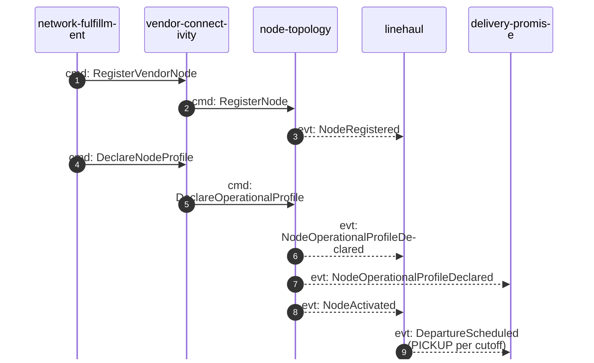
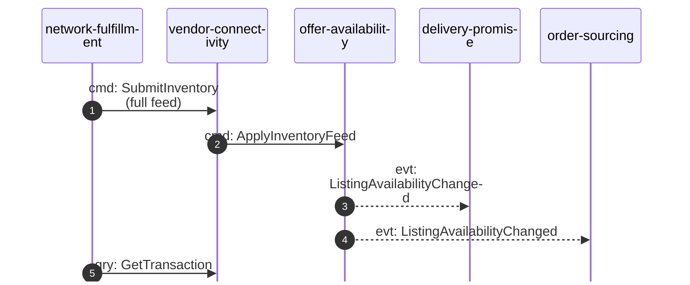
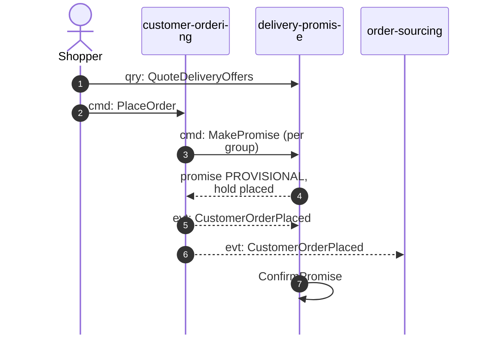
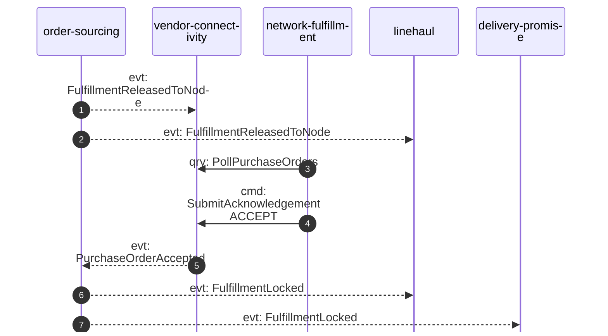
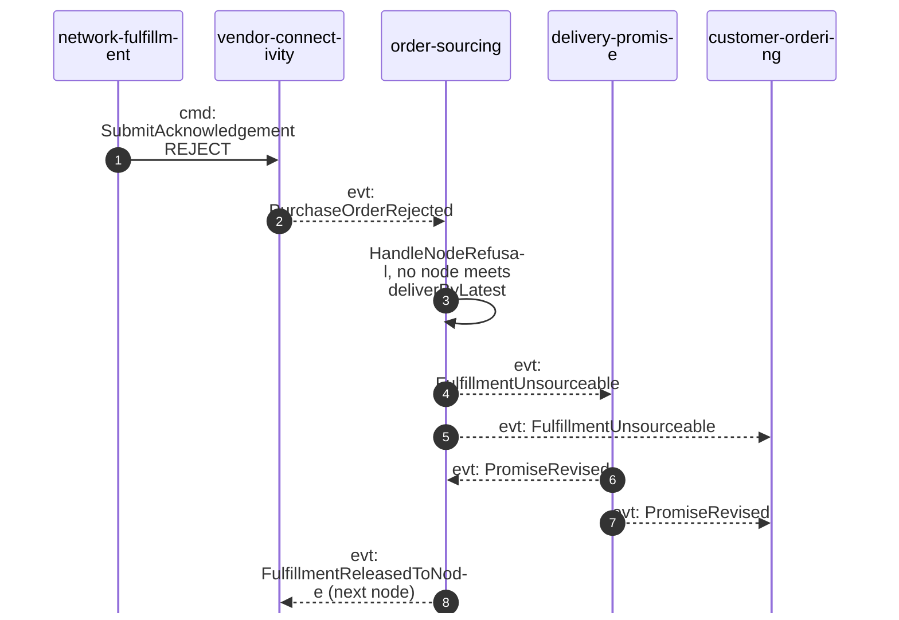
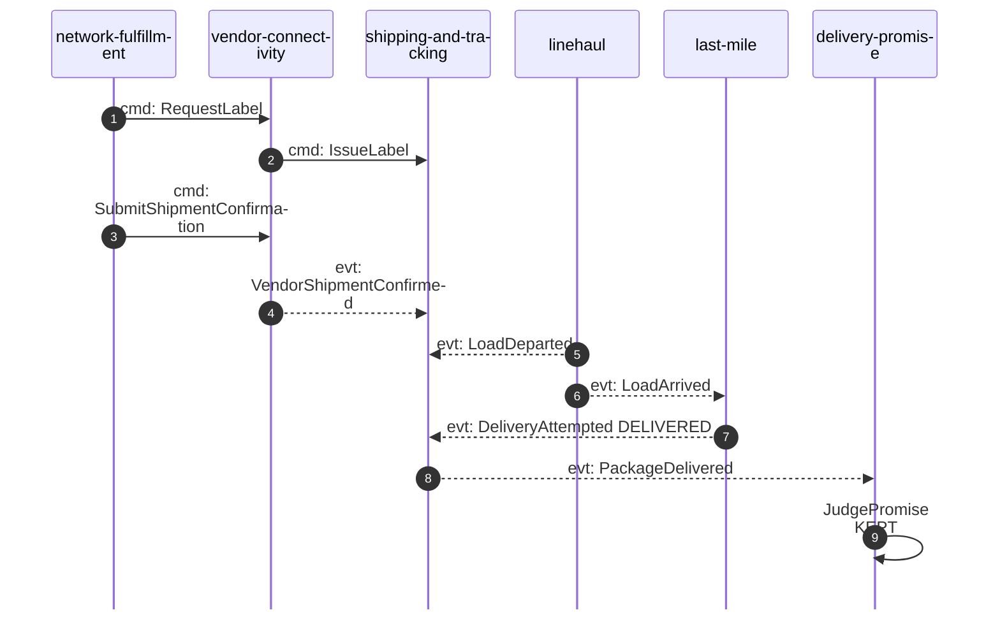

# Domain Message Flows

Following the ddd-crew
[Domain Message Flow Modelling](https://github.com/ddd-crew/domain-message-flow-modelling)
notation: each arrow is one message, prefixed `cmd:` (command), `evt:`
(event) or `qry:` (query). Only messages from the model appear. Each context's
own page adds its internal flows.

## 1. A vendor node is registered and declares its profile

## 2. Availability reaches the promise

## 3. Quote, checkout, promise

## 4. Release, commit, lock

## 5. Refusal and re-promise

## 6. Ship, move, deliver, judge

Derived from (all six): `model.yaml` → `contexts[*].publishes[*].consumers`,
`contexts[*].sync_calls`, `contexts[vendor-connectivity].inbound`. Omitted:
analytics-only events, idempotency and retries (on each context's
sequence-diagrams page), and `node-performance`, which observes flows 4 to 6
(`PurchaseOrderAccepted`, `PackageHandedOver`, `PromiseKept`).
