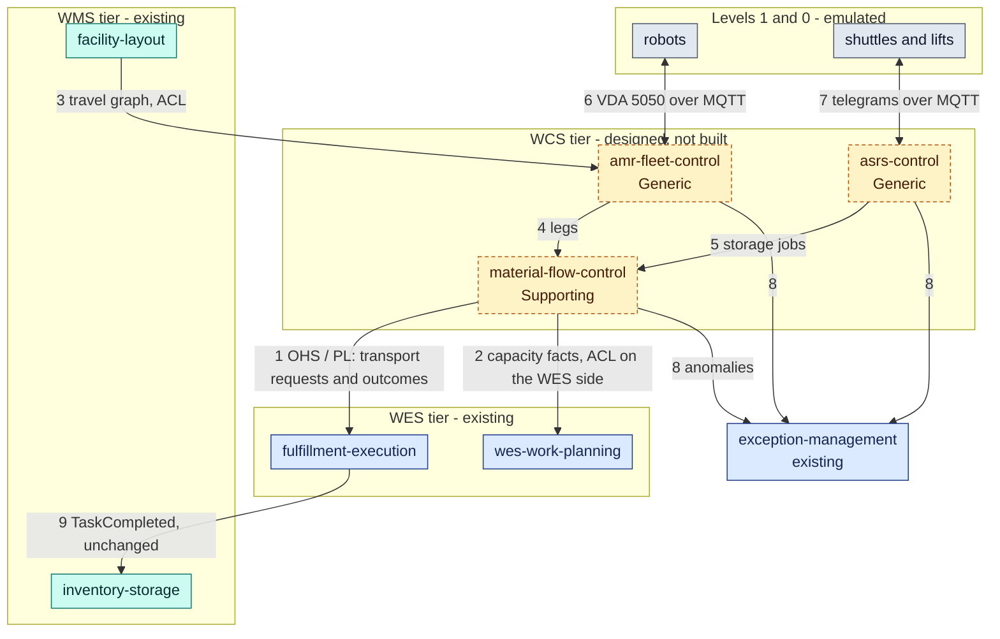

{/* drift-allow-file: the WCS tier is designed, not built; every route on this page is a design proposal with no OpenAPI on develop yet */}

# WCS context map

This page is the **Connect** step for the WCS tier: every relationship between
the three WCS contexts, the existing fleet and the emulated equipment, drawn with
ddd-crew's [context-mapping](https://github.com/ddd-crew/context-mapping)
patterns. Upstream (U) is the side whose model the other side depends on.

Arrows point from upstream to downstream.

## Relationships

| # | Upstream → downstream | Pattern | Channel | What crosses |
| --- | --- | --- | --- | --- |
| 1 | `material-flow-control` → `fulfillment-execution` | **Customer/Supplier.** The WCS supplies an **Open Host Service** with a **Published Language**; `fulfillment-execution` is the customer, and its `EquipmentCommandPort` (ADR-0015) is the **Anti-Corruption Layer** on its side. | REST command `POST /transport-requests` with `Idempotency-Key`; outcomes as events on `warehouse.material-flow-control.events` | Request: container, source, destination, purpose, priority, due. Facts back: `TransportAccepted`, `TransportRejected`, `ContainerArrivedAtStation`, `TransportCompleted`, `TransportFailed`. |
| 2 | `material-flow-control` → `wes-work-planning` | **Customer/Supplier**, with an **ACL** on the WES side that translates equipment capacity into a release constraint. | Kafka events | `SubsystemCapacityChanged`: AMRs available, AS/RS retrieval rate, station queue depth. |
| 3 | `facility-layout` → `amr-fleet-control` | **Conformist through an ACL**: the travel graph and station and dock locations are translated into a VDA 5050 node and edge map. | `facility-layout`'s existing events and REST reads | Waypoints, edges, stations, dock doors, handoff points. |
| 4 | `amr-fleet-control` → `material-flow-control` | **Customer/Supplier** inside the WCS; `material-flow-control` is the customer. The supplier offers the subsystem-controller interface. | REST command and Kafka events | One transport leg; robot assigned; leg completed or failed; fleet capacity. |
| 5 | `asrs-control` → `material-flow-control` | **Customer/Supplier** inside the WCS, the same subsystem-controller interface. | REST command and Kafka events | Store or retrieve a container; container presented at a port; equipment state; AS/RS capacity. |
| 6 | robots → `amr-fleet-control` | **Conformist** to **VDA 5050 v3**. | MQTT with JSON | `order`, `instantActions`, `state`, `connection`, `factsheet`. |
| 7 | AS/RS PLC → `asrs-control` | **Conformist** to a fleet-defined telegram protocol with a handshake. No public standard exists; SAP EWM's telegrams are the model. | MQTT | Move and storage telegrams and their acknowledgements. |
| 8 | WCS contexts → `exception-management` | **Conformist**: `exception-management` already conforms to every producer it consumes. | Kafka events | Clarification, robot blocked, deadlock, AS/RS fault. |
| 9 | `fulfillment-execution` → `inventory-storage` | **Unchanged.** The stock ledger stays the single writer. | The existing `TaskCompleted` | Picks and putaways, including stows into the AS/RS logical location. |

## Rules the map enforces

- **One door to the WES.** Only `material-flow-control` faces the WES. The WES
  never addresses a robot, a node, a shuttle or a rack position. That is
  ADR-0015's vocabulary rule, enforced from the WCS side.
- **No WCS link to the stock ledger.** There is no relationship from any WCS
  context to `inventory-storage`. The WCS never needs to know what is inside a
  container, and the ledger learns about moves only through
  `fulfillment-execution`'s existing `TaskCompleted`.
- **MQTT stays inside the WCS.** Relationships 6 and 7 are the only MQTT edges.
  Everything that crosses to the WMS or the WES is a CloudEvents 1.0 event on
  Kafka (see [seam decision 5](/wcs/seam-decisions#decision-5-the-cloudevents-segment-is-wes)).
- **Subsystem controllers are interchangeable.** Relationships 4 and 5 use one
  subsystem-controller interface, so a vendor controller behind an adapter can
  replace either context without changing `material-flow-control`.
- **Read-only consumers are not drawn.** `warehouse-ops-agent` and
  `warehouse-console` will read equipment state and container position the way
  they read every other context.

## Why a REST command at relationship 1

`fulfillment-execution` needs an immediate accept or reject: an unknown
container, a busy container or an unreachable destination must fail the request
at once, not minutes later through an event. Progress after acceptance is
asynchronous and goes on events, which is how `order-management` already calls
`inventory-storage` for reservations. Relationships 4 and 5 use the same shape so
that the three WCS contexts follow one pattern.
