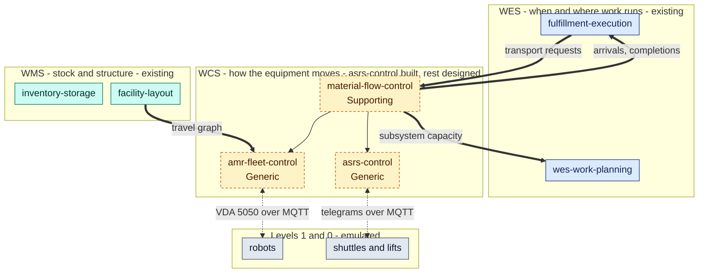

# Warehouse Control System (WCS)

:::warning[Status: one of three contexts built]
This section is the **strategic design** of the WCS tier. `asrs-control` is now
BUILT: [IQVO/asrs-control](https://github.com/IQVO/asrs-control) on `develop`
(merged 2026-11-20, plan WCS-02) with its OpenAPI, AsyncAPI,
`warehouse.asrs-control.events` and `.analytics` topics, and the telegram
protocol v1 MQTT adapter against `equipment-emulator`. `amr-fleet-control` and
`material-flow-control` remain design proposals: no repository, service, topic
or route exists for them yet. `fulfillment-execution` still keeps its empty
`EquipmentCommandPort` reserved (ADR-0015) - asrs-control is not wired into the
WES until plan 04 builds `material-flow-control`.
:::

A warehouse runs on a stack of software categories. The **WMS** keeps the
inventory and the transactions, the **WES** decides when and where work runs,
and the **WCS** drives the equipment (see the
[industry reference](/wms-wes/industry-reference)). The fleet has a WMS tier and
an embedded WES. This section designs the missing third tier for two kinds of
automation, an **AMR fleet** and an **AS/RS** (shuttle storage), across four
flows: goods-to-person picking, putaway into the AS/RS, replenishment moves and
outbound transport to pack and dock.

The design follows the fleet's method, ddd-crew's
[DDD Starter Modelling Process](/strategic-design/ddd-starter-modelling-process),
for the steps that come before code: Understand (the
[industry reference](/wcs/industry-reference)), Decompose and Strategize
([subdomains](/wcs/subdomains)), Connect ([context map](/wcs/context-map),
[message flows](/wcs/message-flows)) and Define (one page per context).

## The WCS in the stack

## The design in brief

- **Three bounded contexts**, split the way the sources split the layer, as a
  material flow controller over subsystem controllers:
  [`material-flow-control`](/wcs/material-flow-control) (Supporting),
  [`amr-fleet-control`](/wcs/amr-fleet-control) (Generic, VDA 5050 master
  control) and [`asrs-control`](/wcs/asrs-control) (Generic).
- **One door to the WES.** Only `material-flow-control` faces the WES. It is an
  Open Host Service whose Published Language is transport requests and container
  arrivals. The WES never addresses a robot, a shuttle or a rack position.
- **The WCS owns no inventory.** `inventory-storage` owns a container's identity
  and contents. The WCS owns where the container physically is and how it moves
  ([seam decision 1](/wcs/seam-decisions#decision-1-the-container-belongs-to-the-wms)).
- **The AS/RS is one logical location to the WMS.** Rack positions, reshuffles
  and internal moves stay inside `asrs-control` and never touch the stock ledger
  ([seam decision 2](/wcs/seam-decisions#decision-2-the-asrs-is-one-logical-location)).
- **The WES becomes automation-aware.** `material-flow-control` publishes
  subsystem capacity, and `wes-work-planning` releases against it. That meets
  Interact Analysis's first WES criterion, release "based on the utilization
  status of the automation equipment", which the fleet cannot meet today.
- **MQTT stays inside the WCS.** Robots and the AS/RS emulator speak MQTT to
  their controllers. Everything that crosses to the WMS or the WES is a
  CloudEvents 1.0 event on Kafka with the `wes` segment.
- **Generic, built to a standard.** The fleet's verdict that equipment control
  is Generic holds. The study project builds the Generic parts anyway, behind
  VDA 5050 and a subsystem-controller interface, so that a vendor product could
  replace either one without changing `material-flow-control`.

## Pages in this section

| Page | What it answers |
| --- | --- |
| [Industry reference](/wcs/industry-reference) | What a WCS is, owns and does not own, according to MHI, vendors, VDA 5050, the OPC UA companion specifications, SAP EWM and Bartholdi and Hackman. Where the sources disagree. |
| [Subdomains](/wcs/subdomains) | The WCS problem space split into subdomains, classified Core, Supporting or Generic, with a Core Domain Chart. |
| [Context map](/wcs/context-map) | The three contexts and every relationship to the fleet, with its pattern and channel. |
| [material-flow-control](/wcs/material-flow-control) | Purpose, capabilities, invariants, language and published facts of the WES-facing context. |
| [amr-fleet-control](/wcs/amr-fleet-control) | The same for VDA 5050 master control of the AMR fleet. |
| [asrs-control](/wcs/asrs-control) | The same for the AS/RS controller. |
| [Seam decisions](/wcs/seam-decisions) | The five decisions at the seams: container ownership, the AS/RS location, the WES-WCS contract, the transport purposes and the event segment. |
| [Message flows](/wcs/message-flows) | The four flows end to end, the failure path and the capacity loop. |
| [Ecosystem impact](/wcs/ecosystem-impact) | What changes in each existing context, the ADRs to write, and the infrastructure. |
| [Implementation handoff](/wcs/implementation-handoff) | Build order, emulator scope, acceptance criteria per flow and open questions. |

Related: [WMS and WES](/wms-wes) (where the existing contexts sit),
[Subdomain Classification](/strategic-design/subdomain-classification) and the
[Event Standard](/strategic-design/event-standard-cloudevents).
