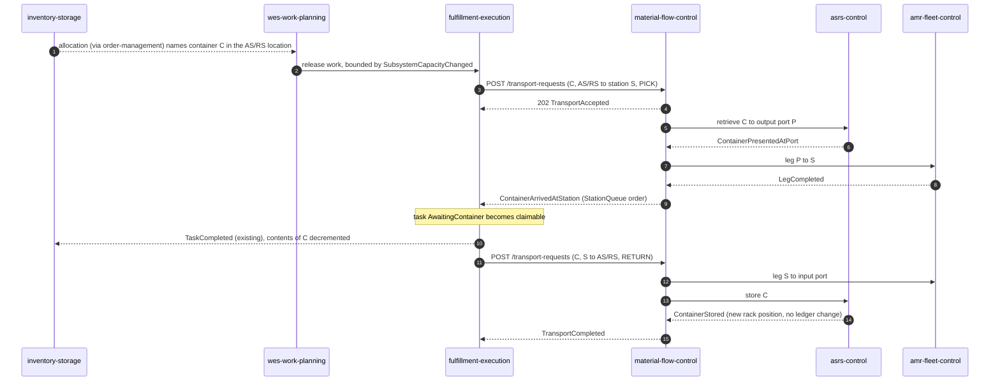
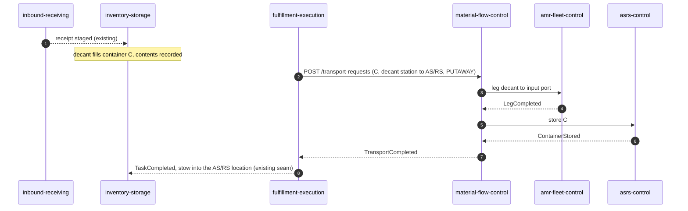
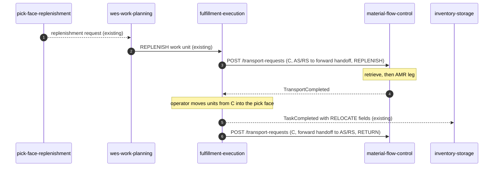
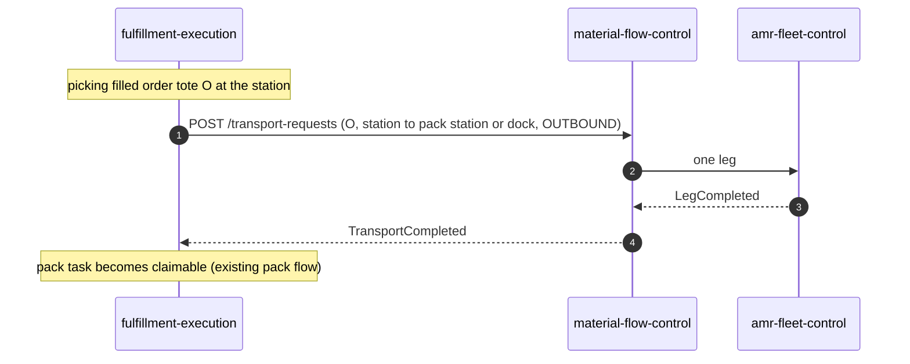
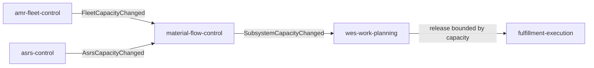

{/* drift-allow-file: strategic design page, not a spec mirror - the built contexts' authoritative contracts are each repository's apis/openapi.yaml and apis/asyncapi.yaml on develop */}

# WCS message flows

This page is ddd-crew's
[Domain Message Flow Modelling](https://github.com/ddd-crew/domain-message-flow-modelling)
for the four flows in scope. Steps marked *(existing)* run in the fleet today;
the WCS contexts they cross are built as well (plans WCS-02 through WCS-06).

## Flow 1: goods-to-person picking

1. *(existing)* `order-management` allocates; `inventory-storage` answers with
   the location and now also the container, which sits in the AS/RS logical
   location.
2. *(existing)* `wes-work-planning` releases the work. **New:** it bounds
   goods-to-person release by the latest `SubsystemCapacityChanged`.
3. `fulfillment-execution` creates the pick task in a new state,
   **AwaitingContainer**, and requests the transport.
4. `material-flow-control` plans two legs: an AS/RS retrieve to an output port,
   then an AMR leg to the station.
5. On `ContainerArrivedAtStation` the task becomes claimable. The picker picks;
   `TaskCompleted` updates the ledger *(existing)*.
6. `fulfillment-execution` requests the return. The new rack position is chosen
   by `asrs-control` and never reaches the ledger.

## Flow 2: putaway into the AS/RS

## Flow 3: replenishment

## Flow 4: outbound transport to pack and dock

## The failure path

| Situation | Who handles it | Outcome |
| --- | --- | --- |
| Container unknown or mismatched at a handoff (the no-read case) | `material-flow-control` | `ContainerSentToClarification`; the container goes to a clarification point; `exception-management` opens a case; the transport ends `Failed` with `CLARIFICATION`. |
| Robot blocked or deadlocked | `amr-fleet-control` re-routes; if it cannot, `LegFailed` | `material-flow-control` retries with another robot up to a limit, then `TransportFailed` with `SUBSYSTEM_FAULT`. |
| Shuttle or lift fault | `asrs-control` holds the unit (`EquipmentStateChanged` to Held) | `material-flow-control` re-plans through another aisle if the container is reachable; otherwise the request fails and the capacity drop reaches the WES. |
| Station buffer full | `material-flow-control` | The next leg waits upstream; no arrival is dropped. A persistent backlog lowers the capacity reported to the WES. |
| `TransportFailed` received | `fulfillment-execution` | The task returns to pending or is re-allocated under its existing retry and exception rules. The WES never retries a physical move itself. |

## The capacity loop

`material-flow-control` aggregates the subsystems' capacity facts, with station
queue depth, into one `SubsystemCapacityChanged` per subsystem and station.
`wes-work-planning` consumes it through an ACL as a release constraint. Release
then reacts to the utilisation of the automation, Interact Analysis's first WES
criterion: "dynamically release orders to the warehouse based on the utilization
status of the automation equipment" (see the
[fleet industry reference](/wms-wes/industry-reference)).
