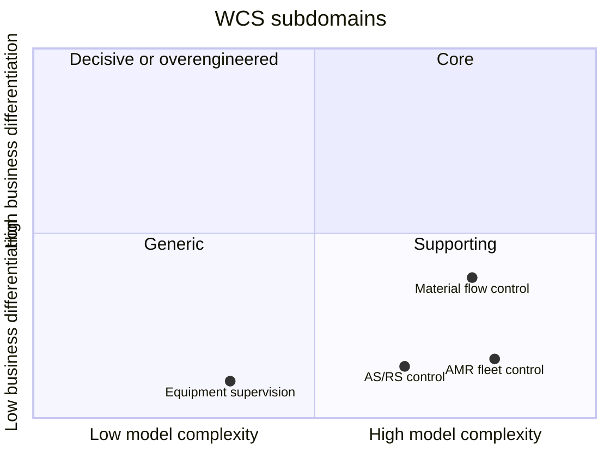

# WCS subdomains and classification

This page is the **Decompose** and **Strategize** steps of the
[DDD Starter Modelling Process](/strategic-design/ddd-starter-modelling-process)
for the WCS tier. The problem space is the automation in scope: an **AMR fleet**
and an **AS/RS** (shuttle storage), serving four flows: goods-to-person picking,
putaway into the AS/RS, replenishment moves and outbound transport to pack and
dock.

## Subdomains

| Subdomain | The problem it solves | Classification | Bounded context |
| --- | --- | --- | --- |
| **Material flow control** | Turn a WES request ("bring container C to station S by T") into legs across subsystems, track where every container physically is, sequence arrivals at stations, and handle exceptions. | **Supporting** | [`material-flow-control`](/wcs/material-flow-control) |
| **AMR fleet control** | Assign missions to robots, control traffic on the node and edge map, resolve deadlocks, manage charging. | **Generic** | [`amr-fleet-control`](/wcs/amr-fleet-control) |
| **AS/RS control** | Schedule shuttles, lifts and aisles, choose the rack position of each tote, sequence retrievals to the ports. | **Generic** | [`asrs-control`](/wcs/asrs-control) |
| **Equipment supervision** | Track each subsystem's state (PackML-style), its faults and alarms, and the capacity it can offer. | **Generic** | No context of its own: each subsystem context publishes its own state, and `material-flow-control` aggregates the view the WES consumes. |
| *Equipment emulation* | Stand in for the robots and the AS/RS PLCs, which this study project does not have. | *Not a domain* | `equipment-emulator`, test infrastructure at levels 1 and 0 |

### Why the line is drawn there

- **The material flow controller and the subsystem controllers change for
  different reasons.** Material flow control changes when the site's flows
  change (a new station, a new purpose, a new handoff). A subsystem controller
  changes when its equipment changes, on a capital-project cadence. Swisslog,
  SSI Schaefer and SAP all describe this split; VDA 5050 draws the same line
  between fleet control and robots (see the
  [industry reference](/wcs/industry-reference#the-layers-internal-structure)).
- **The two subsystems speak different languages.** AMR fleet control speaks
  nodes, edges, base and horizon (VDA 5050). AS/RS control speaks aisles,
  levels, rack positions, shuttles and lifts. One model for both would force a
  shared vocabulary neither needs.
- **Equipment supervision is not split out.** Its data is produced by each
  subsystem, and its one consumer that matters, the WES capacity view, is
  aggregated where the cross-subsystem picture already lives. A separate SCADA
  context is deferred until something other than the WES needs it.

## Classification

| Subdomain | Classification | Business differentiation | Model complexity | Why |
| --- | --- | --- | --- | --- |
| Material flow control | Supporting | medium-low | high | It is specific to this site's layout and its four flows, and it is the fleet's own seam to the WES. But nobody chooses a warehouse for how it routes a tote; the competitive core stays the WES conductor (`wes-work-planning`) and the task lifecycle (`fulfillment-execution`). |
| AMR fleet control | Generic | low | high | VDA 5050 master control is a product category; the standard exists so that fleet control can be bought. |
| AS/RS control | Generic | low | medium-high | AS/RS controllers ship with the hardware. |
| Equipment supervision | Generic | low | low-medium | Machine state models are standardised (PackML). |

### Core Domain Chart

### The fleet's Core set does not change

The fleet's Core contexts stay `inventory-storage`, `wes-work-planning`,
`fulfillment-execution`, `warehouse-planning` and `network-inventory-planning`
(see [Subdomain Classification](/strategic-design/subdomain-classification)).
The WCS contexts will be added to that table only when their repositories exist
on `develop`.

## Building a Generic subdomain on purpose

`fulfillment-execution`'s ADR-0015 files WCS equipment control as **Generic,
"buy, don't build"**, and its Core Domain Chart places it at low differentiation
and high complexity. This design keeps that verdict. What changes is the
decision to **build** the Generic parts as part of the study project, under
three rules that keep them replaceable:

1. **Build to the standard.** `amr-fleet-control` speaks VDA 5050 to its robots,
   so any VDA 5050 fleet controller could replace it. `asrs-control` exposes the
   same subsystem-controller interface `material-flow-control` uses for the AMR
   fleet (store or move a container, report state), so a vendor AS/RS controller
   behind an adapter could replace it.
2. **Keep the Supporting part thin and fleet-owned.** Only
   `material-flow-control` holds fleet-specific rules, and only it faces the WES.
3. **No equipment vocabulary crosses the seam.** The WES sees containers,
   stations, locations and transport outcomes, never a robot, node, shuttle or
   rack position. That is ADR-0015's rule, enforced from the WCS side.

The payoff for the fleet is the capacity loop: with equipment state available,
`wes-work-planning` can release work against automation utilisation, which
completes Interact Analysis's three WES criteria for this fleet (see
[message flows](/wcs/message-flows#the-capacity-loop)).
