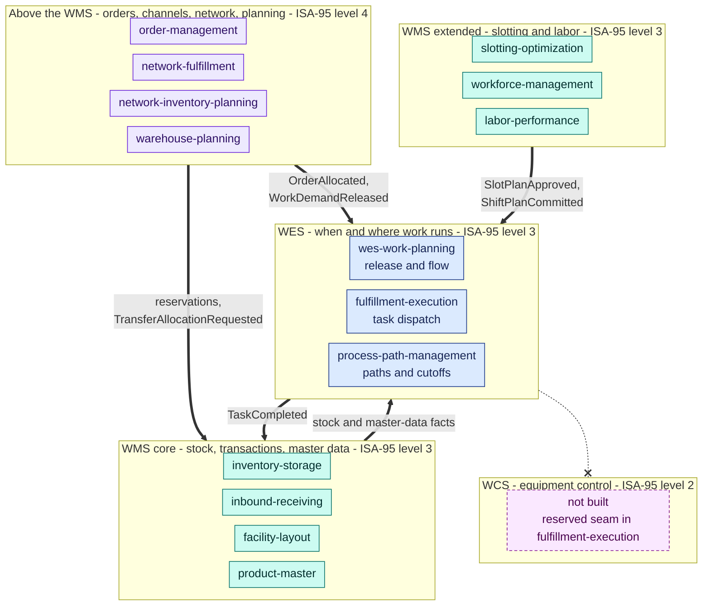

# WMS and WES

A warehouse runs on a stack of software categories: a **warehouse management
system (WMS)** keeps the inventory and the transactions, a **warehouse
execution system (WES)** decides when and where work runs, and a **warehouse
control system (WCS)** drives the equipment. This section explains those
categories from industry sources, then qualifies each of the seventeen bounded
contexts on this site against them. Two of them, `pick-face-replenishment` and
`task-interleaving`, are listed but not yet qualified: both are built and
deployed, but nobody has run the industry tests on them.

## The fleet in the stack

`warehouse-ops-agent` is not drawn: it is a read-only decision-support layer
over all of these tiers. `pick-face-replenishment` (`wms`, built and deployed in
the reference cluster) and `task-interleaving` (`wes`, built and deployed) are
not drawn either, because their industry category is not yet qualified (see
[the qualification](/wms-wes/qualification)). Thick arrows are Kafka events (CloudEvents 1.0); the
order-management to inventory-storage reservation is a REST call. Each arrow
stands for the event families listed on the tier pages.

## What the qualification found

- **WMS: the core is complete, and the two classic functions that were missing now have owners.**
  Receive, put away, store, count, allocate, pick, pack and ship-verify all
  exist, plus the item and location masters, slotting and labor management.
  Replenishment of forward pick slots is owned by `pick-face-replenishment`, a
  request generator that is built and deployed in the reference cluster; its
  whole execution chain is built (`wes-work-planning` plans one `REPLENISH`
  work unit per request and its consumer runs with `REPLENISHMENT_MODE=kafka`,
  `fulfillment-execution` runs the task, `inventory-storage` moves the stock).
  Task interleaving is owned by `task-interleaving`, an advisory hint that is
  built and deployed, and `fulfillment-execution` now reads the hint as a
  tie-break (its ADR 0051). Neither chain has been exercised end to end on the
  cluster, and the `REPLENISH` path is still an operator seed step. Wave
  planning is replaced on purpose by waveless release.
- **WES, real and equipment-free.** `wes-work-planning` and
  `fulfillment-execution` release, balance and dispatch work the way the
  industry describes a WES, an *embedded* WES in Interact Analysis's terms.
  There is no WCS, so release reacts to backlog and capacity, not to equipment
  state.
- **The fleet's `wes` label is wider than the industry's WES.** Of the eleven
  contexts publishing under `wes`, three are WES software; seven are labor
  management, systems above the WMS, or the agent; `task-interleaving` is not
  yet qualified. The label stays, since it
  is part of every event `type`; the tier pages give both names.
- **Four contexts go beyond one building.** Order promising, channel
  integration, capacity planning and network rebalancing are planning and
  order-tier capabilities that a single-site WMS or WES does not own.

## Pages in this section

| Page | What it answers |
| --- | --- |
| [Industry reference](/wms-wes/industry-reference) | What WMS, WES and WCS mean, according to Gartner, MHI, Interact Analysis, Modern Materials Handling, KNAPP, APQC and O'Reilly titles, and the five tests derived from them. |
| [Qualification of the 17 contexts](/wms-wes/qualification) | The verdict per context: industry category, ISA-95 level, decision horizon, WES criteria, and where it differs from the fleet tier. |
| [WMS tier](/wms-wes/wms-tier) | One card per `wms` context, with the WMS functions it owns and its inputs and outputs. |
| [WES tier](/wms-wes/wes-tier) | One card per `wes` context, grouped as WES, labor management, above the WMS, and decision support. |
| [Tier interactions](/wms-wes/tier-interactions) | Inbound, outbound and transfer flows drawn across the tiers. |

Related: [Subdomain Classification](/strategic-design/subdomain-classification)
(Core, Supporting, Generic), the [Event Standard](/strategic-design/event-standard-cloudevents)
(where the `wms`/`wes` segment comes from), and
[Business Capability Architecture](/business-capability-architecture) (the same
fleet seen as L1, L2 and L3 business capabilities).
