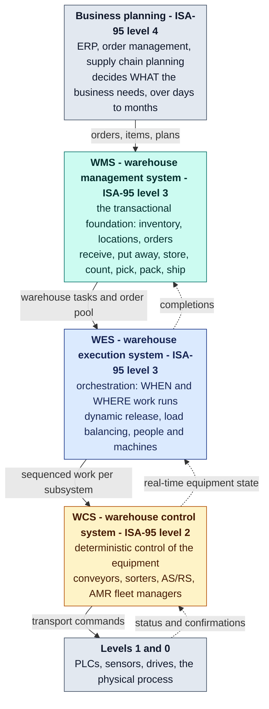

# WMS, WES and WCS — the industry reference

This page records what the industry means by **WMS**, **WES** and **WCS**
before the [qualification](/wms-wes/qualification) applies those definitions
to the sixteen contexts of this fleet. Every definition below comes from a
named source, listed under [Sources](#sources) at the end of the page. Where
the sources disagree, the page says so.

:::note[Scope of the research]
Sources: analyst firms (Gartner, Interact Analysis), the US material-handling
trade association (MHI), the trade press (Modern Materials Handling), an
automation vendor's definitions paper (KNAPP), the APQC Process
Classification Framework, and O'Reilly titles. The O'Reilly chapters were read
through the public chapter previews on oreilly.com. A full-text O'Reilly
subscription was not available to this research, so no claim below rests on
O'Reilly text beyond those previews.
:::

## There is no standard, only market categories

The three acronyms are market categories, not levels set by a standard.
KNAPP's definitions paper says so directly: "the terms WMS/WES/WCS are system
categories driven by the market and not centrally standardized levels".[9] It
adds that "Neither the ISO, IEC nor the VDI have published standards clearly
defining these system classes and authoritatively describing their data
objects, message flows or responsibilities."[9] The nearest anchors are the
German guideline VDI 3601 for the WMS alone ("The VDI 3601 defines what a WMS
is and what it must be able to do.") and the ISA-95 functional levels, which
KNAPP maps the three categories onto.[9]

MHI describes the same blur from the buyer's side. The WMS is the oldest
category, the WCS "manages the material handling machines and equipment
deployed in a facility", and the WES is the newest one, which "sometimes
incorporates aspects of both WMS and WCS" depending on the vendor.[3] So
classifying a piece of software as WMS or WES is a judgement made against
criteria. The criteria this site uses are at the end of this page.

## The stack

The level assignments follow KNAPP's mapping onto ISA-95: level 3 "can be
handled by a WMS", a WES "would be equivalent to level 3 in ISA-95", and the
WCS, being "responsible for technical control and deterministic execution", is
level 2.[9] The placement of the WES between the WMS and the WCS is the same in
MHI ("Sitting between the WMS, which is responsible for overall management, and
the machine control or in some cases the warehouse control system (WCS)
levels")[5] and in Modern Materials Handling ("WES sits between the WMS layer that
manages warehouse transactions and manual workflows and the traditional
warehouse control system (WCS) that controls and monitors automated
systems.").[7] The arrow labels are this site's summary of those descriptions.

## Warehouse management system (WMS)

**Definition.** Gartner defines a WMS as "a software application that helps
manage and intelligently execute the operations of a warehouse, distribution
center (DC) or fulfillment center (FC)".[1] It is the transactional foundation:
mobile devices, bar codes and scanning give "directed work activity" and
near-real-time accurate information.[1]

**Core and extended capabilities.** Gartner separates a core from an extended
set. "Core WMS capabilities address, among others, the needs to receive, put
away, store, count and pick, pack and ship goods."[1] The extended set "can
include more advanced capabilities, such as managing labor or optimizing the
locating of inventory within a facility", that is, labor management and
slotting.[1] Gartner's longer 2015 list names "receiving, put­away, stock
locating, inventory management, cycle counting, task interleaving, wave
planning, order allocation, order picking, replenishment, packing, shipping,
labor management and automated materials­handling equipment interfaces".[2]
The same report puts labor management, slotting optimization, yard management
and dock/appointment scheduling in the category of specialist components that
"supplement a WMS".[2]

**What a WMS is not.** KNAPP: a WMS "does not make any control decisions in
seconds for the automated part of a warehouse, because a WMS is decoupled from
the actual execution."[9] In the supply-chain taxonomy the WMS belongs to
supply chain *execution*, not planning: "The Warehouse Management System, or
WMS, is part of the SCE strategy."[13]

**O'Reilly perspectives.** *Pattern-Oriented Software Architecture, Volume 4*
uses warehouse management process control as its running architecture example,
and scopes it as systems that "provide logistics support to manage the flow of
items and assets in, and across, warehouse storage facilities".[10] CSCMP's
*Definitive Guide to Warehousing* warns that "Operational goals and corporate
goals must be well defined and understood before selecting a WMS."[11]
Frazelle's *World-Class Warehousing and Material Handling* reports the
industry's recurring top three WMS priorities: "(1) paperless communication,
(2) live inventory, and (3) productivity tracking."[12]

## Warehouse execution system (WES)

**Definition.** MHI: "WES software is designed to optimize the flow of goods
through a warehouse or distribution center."[4] A WES "is responsible for
orchestrating the timing and location of order processing to optimize
throughput and provide real time visibility to save labor."[5] Interact
Analysis uses the same wording for the execution layer, which optimizes
workflows "by controlling the timing and location of order processing".[6]

**Why it exists.** Modern Materials Handling: "WES grew out of the need to do
smart order release across various zones of automation to create a level flow
of work across a DC in a way most warehouse control systems (WCS), or for that
matter higher-level warehouse management systems (WMS), could not."[8] A vendor
quoted there puts it more bluntly: "The WMS and WCS layers of software were
never really intended for this orchestration role."[8] Interact Analysis traces
it to waveless picking, where "individual orders are released to the warehouse
based on the throughput of the downstream order consolidation".[6]

**What it typically does.** "Not all WES are alike, but generally, they
provide functionality such as load balancing and automation-aware order
release."[7] The scope has been growing into labor: "It’s all about getting the
right work to the right employees considering current and projected demand by
process area."[8]

**The three-criteria test.** Interact Analysis gives the most usable
definition, because it can be checked: "We have three criteria for a system to
be described as a WES: 1) it must be able to dynamically release orders to the
warehouse based on the utilization status of the automation equipment, 2) it
must be able to orchestrate multiple sub-systems, and 3) it must be able to
orchestrate both man and machine".[6] This site applies those three criteria to
every context that claims to be execution software.

**Two kinds of WES.** A control WES (cWES) grew out of a WCS. An embedded WES
(eWES) sits above the WCS and does not drive the equipment: "We therefore
define WES solutions that sit above the WCS as ‘embedded WES’ (or eWES)
solutions."[6] This fleet has no WCS (see the next section), so any WES behaviour
in it is necessarily of the eWES kind.

## Warehouse control system (WCS)

The WCS "manages the material handling machines and equipment deployed in a
facility" and "connects automation equipment functions to the directions from
the WMS".[3] KNAPP classifies it at ISA-95 level 2 because it is "responsible
for technical control and deterministic execution".[9] Modern Materials Handling
describes it as the layer "that controls and monitors automated systems".[7]

## Adjacent systems a warehouse fleet also touches

The fleet contains contexts that are neither WMS nor WES in the strict sense.
The sources name the neighbouring categories:

| Neighbour | What the sources say | Where it sits |
| --- | --- | --- |
| Labor management (LMS) | Gartner counts "managing labor" as an *extended* WMS capability[1] and lists workforce/labor management among the specialist components that supplement a WMS[2]. WES vendors are stretching into labor orchestration[8]. | WMS-extended, with a WES overlap |
| Slotting optimization | "optimizing the locating of inventory within a facility" is extended WMS[1]; slotting optimization is a specialist WMS component[2]. | WMS-extended |
| Replenishment | Gartner's longer 2015 list names "replenishment" among WMS functions[2]. It does not say whether that is core or extended. In this fleet, forward pick-face replenishment is owned by `pick-face-replenishment` (built, not deployed). | WMS function; core or extended not yet qualified |
| Yard and dock appointment scheduling | Listed with labor and slotting as components that "supplement a WMS".[2] | WMS-extended |
| Order management, ERP | ERP and order systems sit above the WMS and hand it orders. MHI notes WES integrations with ERP as well as WMS.[4] | Planning and order tier (ISA-95 level 4) |
| Network inventory deployment and warehouse transfers | APQC files these under "Operate warehousing": "4.4.3.1  Manage and track inventory deployment" and "4.4.3. 8 Manage warehouse transfers (20957)".[14] Deciding *where* stock should be across sites spans more than one warehouse, so it is above any single WMS. | Network tier, above the WMS |
| Returns | APQC: "4.4.2.4  Manage flow of returned products (10352)".[14] | WMS (inbound flow) |

## The tests this site applies

The [qualification](/wms-wes/qualification) gives every context the answers to
five questions, derived from the definitions above:

1. **WMS core.** Does the context own one of Gartner's core transactions:
   receive, put away, store, count, pick, pack, ship?[1] Master data those
   transactions depend on (items, locations) counts here too.
2. **WMS extended.** Does it own labor management, slotting, or yard/dock
   scheduling?[1][2]
3. **WES.** Does it decide the timing and location of work?[5][6] If so, how
   many of Interact Analysis's three criteria does it meet?[6]
4. **WCS.** Does it control equipment deterministically (ISA-95 level 2)?[9]
5. **Above the WMS.** Does it work across sites, across channels or over a
   planning horizon, which no single WMS owns?[13][14]

The answers go into one table, one card per context, and the decision diagram
on the [qualification page](/wms-wes/qualification).

## Sources

- **[1]** [Gartner Peer Insights — Warehouse Management Systems market definition](https://www.gartner.com/reviews/market/warehouse-management-systems)
- **[2]** [Gartner, Magic Quadrant for Warehouse Management Systems (2015 reprint hosted by Oracle)](http://oracle.com/us/corporate/analystreports/gartner-magic-quadrant-wms-2884695.pdf)
- **[3]** [MHI — Warehouse Software: Discerning the Differences Between WMS, WCS and WES (2021)](https://mhi.org/blog/125930/warehouse-software-discerning-the-differences-between-wms-wcs-and-wes)
- **[4]** [MHI — Warehouse Execution Systems (WES) Software Explained (2023)](https://mhi.org/blog/126046/warehouse-execution-systems-wes-software-explained)
- **[5]** [MHI — Cloud vs On-Prem WES (2023)](https://mhi.org/blog/126074/cloud-vs-on-prem-wes)
- **[6]** [Interact Analysis — De-Mystifying the Warehouse Execution System Market (2023)](https://interactanalysis.com/insight/de-mystifying-the-warehouse-execution-system-market)
- **[7]** [Modern Materials Handling — WES: Blending human-centered workflows with automation (2024)](https://mmh.com/article/warehouse_execution_system_wms_blending_human_centered_workflows_with_automation)
- **[8]** [Modern Materials Handling — WES stretches to encompass labor (2023)](https://mmh.com/article/warehouse_execution_systems_wes_stretches_to_encompass_labor)
- **[9]** [KNAPP — From Term Chaos to Order: WMS, WES and WCS defined](https://www.knapp.com/en/insights/blog/from-term-chaos-to-order-wms-wes-and-wcs-defined)
- **[10]** [O'Reilly — Buschmann, Henney, Schmidt: Pattern-Oriented Software Architecture Vol. 4, ch. 4 Warehouse Management Process Control](https://oreilly.com/library/view/pattern-oriented-software-architecture/9780470059029/ch04.html)
- **[11]** [O'Reilly — CSCMP: The Definitive Guide to Warehousing, ch. 14 Equipment and Information Technology](https://oreilly.com/library/view/the-definitive-guide/9780133448931/ch14.html)
- **[12]** [O'Reilly — Frazelle: World-Class Warehousing and Material Handling, 2nd ed., ch. 10](https://oreilly.com/library/view/world-class-warehousing-and/9780071842839/ch10.html)
- **[13]** [O'Reilly — Sustainability in Supply Chain Management, ch. 2 Warehouse Management System](https://oreilly.com/library/view/sustainability-in-supply/9780133480696/book1_ch02.html)
- **[14]** [APQC Process Classification Framework, Cross-Industry v7.4 (PDF)](https://solutions.ifrc.org/sites/default/files/2024-10/K014750_APQC%20Process%20Classification%20Framework%20%28PCF%29%20-%20Cross%20Industry%20-%20PDF%20Version%207.4.pdf)
