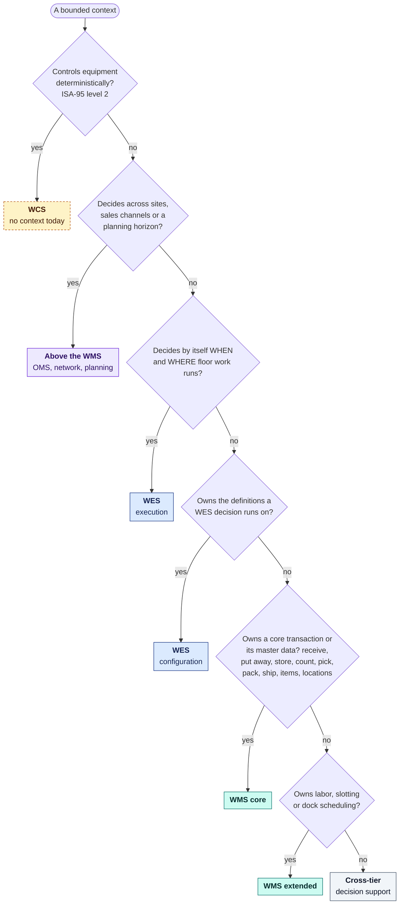
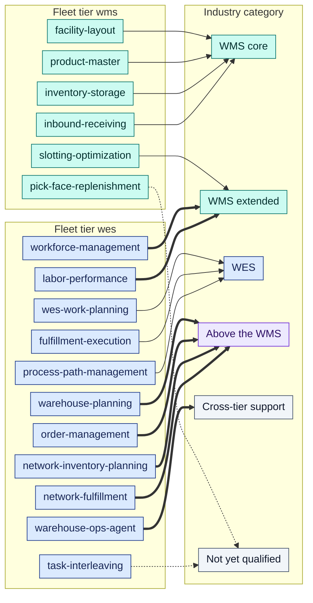
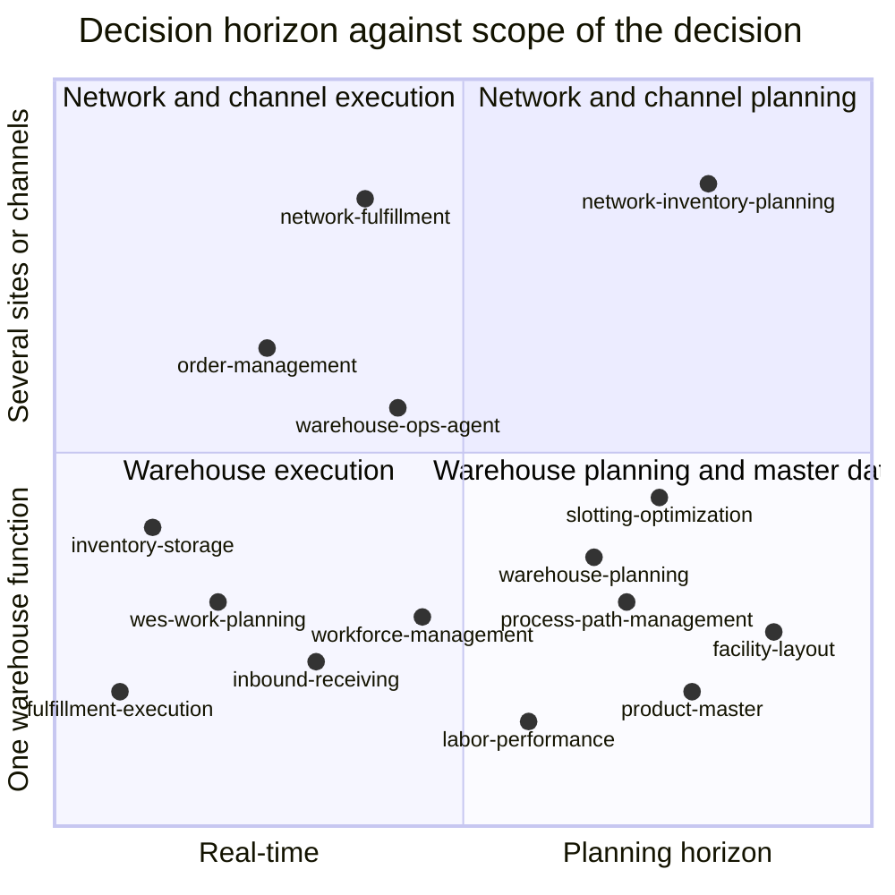

# Qualifying each bounded context as WMS or WES

This page applies the five tests from the
[industry reference](/wms-wes/industry-reference#the-tests-this-site-applies)
to the seventeen contexts on this site. Every verdict is backed by code on
`develop` (routes, events, domain packages), except for
`pick-face-replenishment` and `task-interleaving`, whose rows are marked
**not yet qualified**: no verdict has been derived for them yet. The detailed evidence for each
context is in its card on [WMS tier](/wms-wes/wms-tier) or
[WES tier](/wms-wes/wes-tier).

Two labels appear side by side throughout this section. Do not confuse them:

- **Fleet tier.** The `<subdomain>` segment of every CloudEvents `type` the
  context publishes, `com.warehouse.<subdomain>.<context>.<entity>.<Event>`.
  `wms` is facility-layout, inventory-storage, product-master,
  inbound-receiving, slotting-optimization and
  pick-face-replenishment (built and deployed); `wes` is every other context,
  `task-interleaving` (built and deployed) among them. The
  [Event Standard](/strategic-design/event-standard-cloudevents#what-the-subdomain-segment-means)
  defines it as a fixed contract label, not an industry category: `wms` is the
  item, location and inventory masters plus the contexts that keep stock in
  place, `wes` is everything else.
- **Industry category.** What Gartner, MHI and Interact Analysis would call
  the software, using the tests below.

## The decision path

The order of the questions matters. A context that runs pick and pack
transactions *and* decides which station gets which task
(`fulfillment-execution`) stops at WES, because orchestration is the
narrower, rarer property. The sources describe the WES as the layer that
decides "the timing and location of order processing".[5][6]

## The verdicts

| Bounded context | Fleet tier | Industry category | ISA-95 level | Decision horizon | DDD class | Tier match? |
| --- | --- | --- | --- | --- | --- | --- |
| [`facility-layout`](/wms-wes/wms-tier#facility-layout) | `wms` | **WMS core**: location master | 3 | days to months | Generic | yes |
| [`product-master`](/wms-wes/wms-tier#product-master) | `wms` | **WMS core**: item master | 3 | days | Supporting | yes |
| [`inventory-storage`](/wms-wes/wms-tier#inventory-storage) | `wms` | **WMS core**: put away, store, count, allocate, move | 3 | seconds (per transaction) | Core | yes |
| [`inbound-receiving`](/wms-wes/wms-tier#inbound-receiving) | `wms` | **WMS core**: receive; plus WMS-extended dock scheduling | 3 | hours | Supporting | yes |
| [`slotting-optimization`](/wms-wes/wms-tier#slotting-optimization) | `wms` | **WMS extended**: slotting | 3 | days to weeks | Supporting | yes |
| [`pick-face-replenishment`](/contexts/pick-face-replenishment) | `wms` | **not yet qualified**: Gartner's 2015 list names replenishment among WMS functions[2], but core or extended is not decided | not yet qualified | not yet qualified | Supporting | not yet qualified |
| [`task-interleaving`](/contexts/task-interleaving) | `wes` | **not yet qualified**: Gartner's 2015 list names task interleaving among WMS functions[2], but core or extended is not decided, and the context only advises: it never decides itself when or where floor work runs | not yet qualified | not yet qualified | Supporting | not yet qualified |
| [`wes-work-planning`](/wms-wes/wes-tier#wes-work-planning) | `wes` | **WES**: dynamic release and flow balancing | 3 | minutes | Core | yes |
| [`fulfillment-execution`](/wms-wes/wes-tier#fulfillment-execution) | `wes` | **WES**: task dispatch to stations; runs the WMS pick, pack and ship-verify transactions | 3 | seconds to minutes | Core | yes |
| [`process-path-management`](/wms-wes/wes-tier#process-path-management) | `wes` | **WES configuration**: process paths and shipping cutoffs | 3 | days | Generic | yes |
| [`workforce-management`](/wms-wes/wes-tier#workforce-management) | `wes` | **WMS extended**: labor management | 3 | a shift | Supporting | no |
| [`labor-performance`](/wms-wes/wes-tier#labor-performance) | `wes` | **WMS extended**: labor standards and performance | 3 | after the fact | Supporting | no |
| [`warehouse-planning`](/wms-wes/wes-tier#warehouse-planning) | `wes` | **Above the WMS**: capacity planning | 3 to 4 | days to weeks | Core | no |
| [`order-management`](/wms-wes/wes-tier#order-management) | `wes` | **Above the WMS**: order management; plus the WMS order-allocation step | 4, allocation at 3 | seconds to hours | Generic/Supporting | no |
| [`network-inventory-planning`](/wms-wes/wes-tier#network-inventory-planning) | `wes` | **Above the WMS**: network inventory deployment and transfers | 4 | days | Core | no |
| [`network-fulfillment`](/wms-wes/wes-tier#network-fulfillment) | `wes` | **Above the WMS**: sales-channel integration (anti-corruption layer) | 4 | hours | Supporting | no |
| [`warehouse-ops-agent`](/wms-wes/wes-tier#warehouse-ops-agent) | `wes` (publishes no events) | **Cross-tier decision support**: read-only, spans WMS and WES | spans 3 | minutes to hours | Supporting | no |
| WCS | none | **WCS** | 2 | seconds | none | not built |

The ISA-95 levels follow KNAPP's mapping of the categories onto ISA-95.[9] The
decision horizon is how far ahead the context's own decisions look, read from
its commands and events. It is an indicator for comparison, not a measured
latency. The DDD class column repeats the
[Subdomain Classification](/strategic-design/subdomain-classification).

### Count

| Industry category | Contexts |
| --- | --- |
| WMS core | 4: facility-layout, product-master, inventory-storage, inbound-receiving |
| WMS extended | 3: slotting-optimization, workforce-management, labor-performance |
| WES (execution and configuration) | 3: wes-work-planning, fulfillment-execution, process-path-management |
| Above the WMS | 4: warehouse-planning, order-management, network-inventory-planning, network-fulfillment |
| Cross-tier decision support | 1: warehouse-ops-agent |
| Not yet qualified | 2: pick-face-replenishment, task-interleaving |
| WCS | 0: the seam is reserved in fulfillment-execution, nothing implements it |

## The picture: industry category against fleet tier

Thin arrows: the industry category matches the fleet tier. Thick arrows: it
does not. The dotted arrow marks a context with no verdict yet. Five of the six `wms` contexts are WMS software by the industry tests;
`pick-face-replenishment` is not yet qualified. Of
the eleven `wes` contexts, three are WES software and `task-interleaving` is
not yet qualified. The other seven are labor
management (an extended WMS capability for Gartner[1][2]), software above the
WMS, or the read-only agent.

## Placement by horizon and scope

The bottom-left quadrant is the WES and the transactional WMS. The bottom-right
quadrant is the slower WMS: master data, labor standards, slotting and
capacity plans. The top half is everything that looks beyond one warehouse's
floor. The positions are qualitative, chosen from the horizons in the verdict
table. `pick-face-replenishment` and `task-interleaving` are not placed because their horizons are not yet qualified.

## WES criteria, applied

Interact Analysis's three criteria[6], checked against the two contexts that
decide when and where work runs:

| Criterion | `wes-work-planning` | `fulfillment-execution` |
| --- | --- | --- |
| 1. Dynamic release based on the utilization of the automation equipment | **Partly.** Release is continuous and priority-ordered (earliest CPT first), and a release-fed pool enforces a WIP limit (`internal/domain/release/work_pool.go`). Flow balancing throttles a path (`PathThrottled`, `rebalance_decision.go`). The signal is backlog and path capacity, because the fleet has no automation equipment to read utilization from. | Not its job. It receives already-released work (`WorkReleased`). |
| 2. Orchestrates multiple sub-systems | **Yes, at process-path level.** One work pool per process path in the catalogue, and flow balancing compares the paths' backlog and rates against each other. | **Yes, at station level.** Pull dispatch hands the best-fit pending task to any registered station by capability (`claim_next.go`). |
| 3. Orchestrates both people and machines | **Modelled through labor only.** Path capacity comes from the labor plan Workforce Management commits (`ShiftPlanCommitted`, `GET /paths/{pathId}/labor-plan-view`). Machines appear only as stations in fulfillment-execution. | **Modelled, not exercised.** A station is "occupied by at most one worker/robot at a time" (`internal/domain/station/station.go`), but no robot or equipment integration exists. |

Verdict: the two contexts together are an **embedded WES** (eWES) in Interact
Analysis's terms: a WES that sits above the control layer and does not drive
equipment itself.[6] The WCS seam is deliberate:
`fulfillment-execution/internal/application/ports/equipment.go` declares an
`EquipmentCommandPort` reserved "toward a future WCS / equipment-control
tier", with no methods until an integration is commissioned.

## What this means for the fleet

1. **Five of the six `wms` contexts are WMS software.** The fleet's `wms` label
   and the industry agree for those five. `pick-face-replenishment` is not yet
   qualified.
2. **`wes` means everything outside the WMS master-data and inventory tier**,
   not a warehouse execution system in the industry's narrow sense. Seven of the eleven `wes`
   contexts are labor management, planning, network or channel software, or the
   agent, three are WES software and `task-interleaving` is not yet qualified. The Event Standard defines the segment exactly that way
   (2026-10-17): a fixed contract label, never renamed, because it is part of
   every published CloudEvents `type` and a rename would break every producer
   and consumer while telling no consumer anything new. The industry category
   lives on this page instead.
3. **The WES is real but equipment-free.** Release, flow balancing and pull
   dispatch exist. Criterion 1 is met on backlog and capacity signals, not on
   equipment utilization, because no WCS exists.
4. **Four contexts sit above the WMS.** Order promising, channel integration,
   capacity planning and network rebalancing are planning or order-tier
   capabilities (ISA-95 level 4). APQC files network deployment and warehouse
   transfers as distinct processes.[14] These four are where this fleet goes
   further than a single-building WMS and WES.

The capability view of the same fleet is on
[Business Capability Architecture](/business-capability-architecture).

## Sources

- **[1]** [Gartner Peer Insights — Warehouse Management Systems market definition](https://www.gartner.com/reviews/market/warehouse-management-systems)
- **[2]** [Gartner, Magic Quadrant for Warehouse Management Systems (2015 reprint hosted by Oracle)](http://oracle.com/us/corporate/analystreports/gartner-magic-quadrant-wms-2884695.pdf)
- **[5]** [MHI — Cloud vs On-Prem WES (2023)](https://mhi.org/blog/126074/cloud-vs-on-prem-wes)
- **[6]** [Interact Analysis — De-Mystifying the Warehouse Execution System Market (2023)](https://interactanalysis.com/insight/de-mystifying-the-warehouse-execution-system-market)
- **[9]** [KNAPP — From Term Chaos to Order: WMS, WES and WCS defined](https://www.knapp.com/en/insights/blog/from-term-chaos-to-order-wms-wes-and-wcs-defined)
- **[14]** [APQC Process Classification Framework, Cross-Industry v7.4 (PDF)](https://solutions.ifrc.org/sites/default/files/2024-10/K014750_APQC%20Process%20Classification%20Framework%20%28PCF%29%20-%20Cross%20Industry%20-%20PDF%20Version%207.4.pdf)
