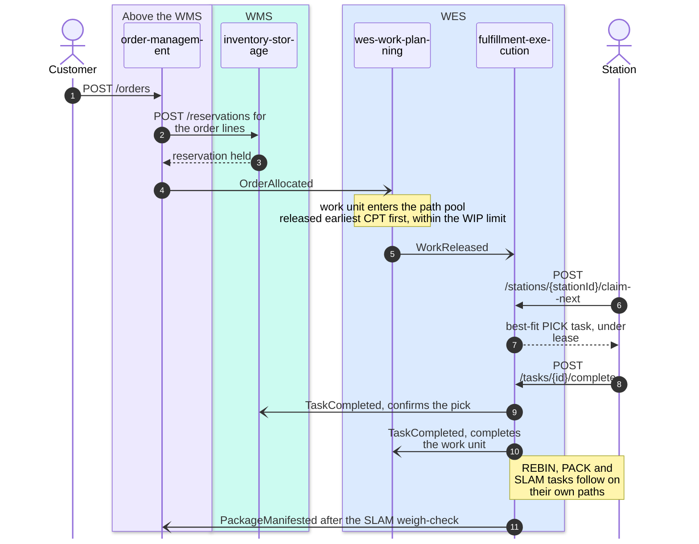
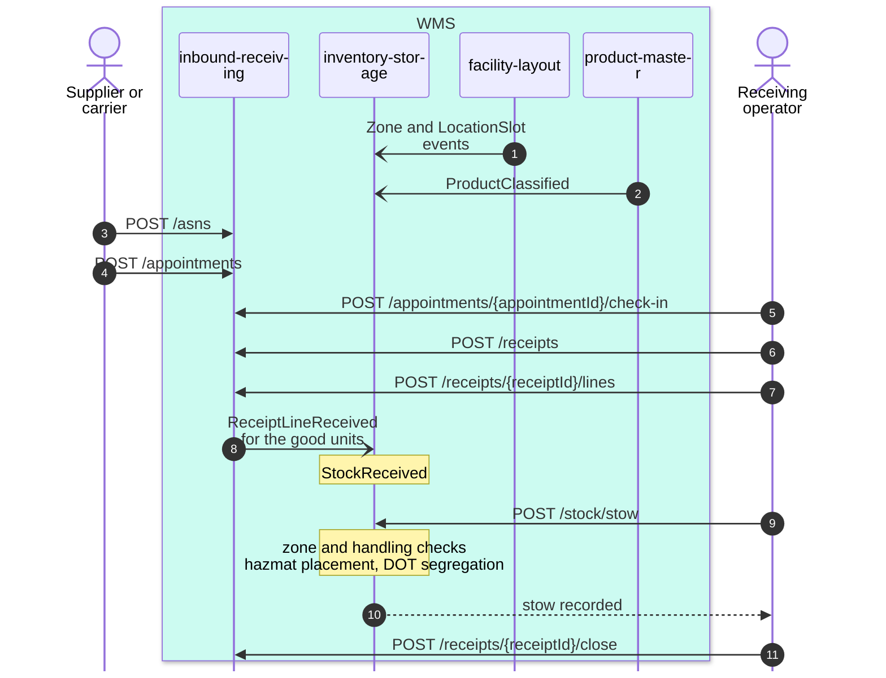
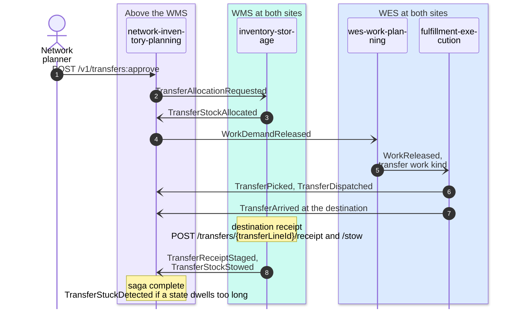

# How the WMS and WES tiers work together

The three flows below are drawn with each participant grouped by its
industry category from the [qualification](/wms-wes/qualification). The
messages are the real routes and CloudEvents types on `develop`. Solid arrows
are synchronous REST calls; open arrows (`-)`) are Kafka events. Each flow
shows the happy path; the failure branches are on each context's own
sequence-diagram page.

## Outbound: order to shipped package

The WES decides *when* (wes-work-planning releases) and *where*
(fulfillment-execution hands a task to a station). The WMS keeps the stock
true at both ends: the reservation before release and the pick confirmation
after completion. If a task misses its cutoff, fulfillment-execution
publishes `TaskCPTMissed` and order-management re-promises the order.

## Inbound: advance ship notice to stowed stock

Inbound is entirely WMS. The first two messages are the local copies that
let inventory-storage validate a stow without calling another context. No WES
is involved, because put-away is not released as WES work in this fleet.

## Network transfer: rebalance between two warehouses

The network context never moves stock. It asks the WMS to allocate, the WES
to release and dispatch the floor work, and the destination WMS to receive
and stow, and it follows the saga from the facts each one publishes.
