# The WES tier — ten contexts, qualified

The ten contexts whose events carry the `wes` segment
(`com.warehouse.wes.<context>.…`; `warehouse-ops-agent` publishes no events
but is filed here). The industry tests on the
[industry reference](/wms-wes/industry-reference#the-tests-this-site-applies)
split them into four groups, and this page follows that split. An
eleventh `wes` context, `task-interleaving` (built and deployed in the reference cluster), is **not yet
qualified** and has no card here yet; see the
[qualification](/wms-wes/qualification). A twelfth, `exception-management`
(built on `develop` 2026-10-20/21 and wired in `warehouse-infra` `develop` since 2026-10-22 — the Problem Solve case
lifecycle over the anomaly facts six producers publish), is likewise
**not yet qualified** and has no card here yet:

| Group | Contexts |
| --- | --- |
| [WES: execution and configuration](#wes-execution-and-configuration) | wes-work-planning, fulfillment-execution, process-path-management |
| [WMS extended: labor management](#wms-extended-labor-management) | workforce-management, labor-performance |
| [Above the WMS](#above-the-wms) | warehouse-planning, order-management, network-inventory-planning, network-fulfillment |
| [Cross-tier decision support](#cross-tier-decision-support) | warehouse-ops-agent |

## Coverage of the WES functions

The sources describe a WES by what it decides: "the timing and location of
order processing"[5], "load balancing and automation-aware order release"[7],
and, increasingly, "getting the right work to the right employees considering
current and projected demand by process area".[8] This diagram maps those
functions to the contexts that own them.

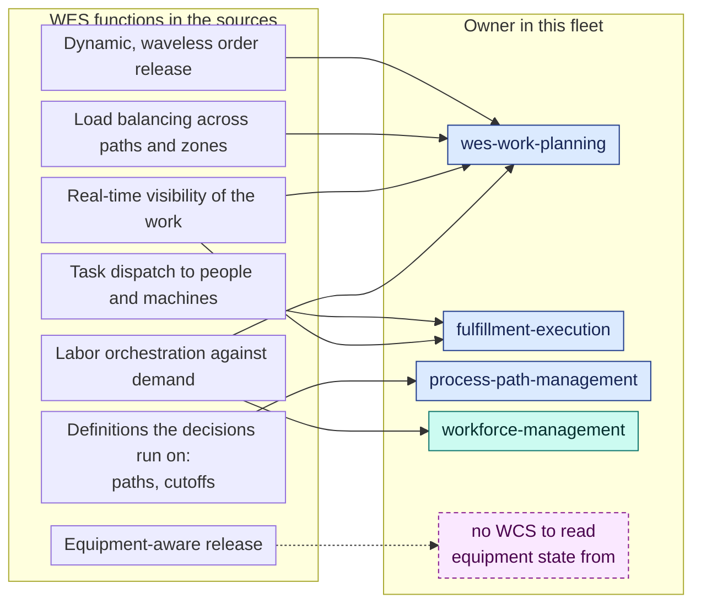

`workforce-management` is coloured as WMS extended: it records labor
decisions, and `wes-work-planning` turns its labor plan into path capacity.
Equipment-aware release, Interact Analysis's first criterion in its strict
form[6], has no owner because there is no equipment layer.

## WES: execution and configuration

### wes-work-planning

| | |
| --- | --- |
| Fleet tier | `wes` (type segment `work-planning`) |
| Industry category | **WES**: dynamic release and flow balancing |
| ISA-95 level | 3 |
| Decision horizon | minutes |
| DDD class | Core |
| Interact Analysis criteria[6] | 1 partly, 2 yes, 3 through labor only ([details](/wms-wes/qualification#wes-criteria-applied)) |

**Why WES.** It is the conductor. Work enters a pool per process path from
allocated orders (`OrderAllocated`), transfer demand (`WorkDemandReleased`)
and approved slot plans (`SlotPlanApproved`), or directly
(`POST /paths/{pathId}/work-units`). It is released continuously in priority
order, earliest CPT first, with a WIP limit on release-fed pools
(`POST /paths/{pathId}/release`, `PUT /paths/{pathId}/pool`, `WorkReleased`).
Flow balancing watches backlog and rates and recommends or throttles
(`GET /paths/{pathId}/telemetry`, `GET /paths/{pathId}/rebalance`,
`BacklogThresholdBreached`, `RateDeviationDetected`, `PathThrottled`,
`LaborReassignmentFlagged`). That is the "smart order release … to create a
level flow of work" the trade press describes as the reason WES exists.[8]

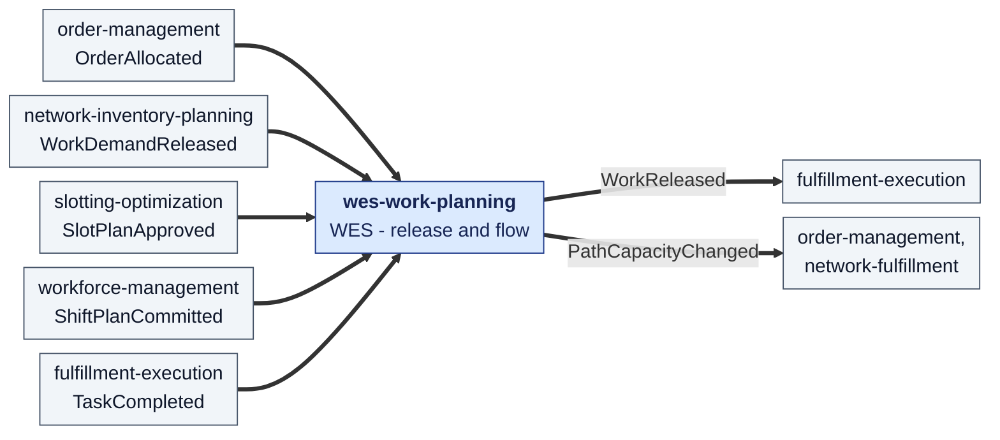

### fulfillment-execution

| | |
| --- | --- |
| Fleet tier | `wes` |
| Industry category | **WES**: task dispatch; it also runs the WMS pick, pack and ship-verify transactions |
| ISA-95 level | 3 |
| Decision horizon | seconds to minutes |
| DDD class | Core |
| Interact Analysis criteria[6] | 2 yes, 3 modelled; 1 belongs to wes-work-planning |

**Why WES.** It decides *where* released work runs. Released work becomes a
task (`WorkReleased`, `POST /tasks`), and a station pulls the best-fit pending
task for its capability, earliest CPT first, under a lease
(`POST /stations/{stationId}/claim-next`, `POST /tasks/{id}/renew-lease`,
`POST /tasks/expire-leases`). It sweeps tasks that missed their cutoff
(`POST /tasks/sweep-cpt-misses`, `TaskCPTMissed`).

**Why it also carries WMS core functions.** Gartner's pick, pack and ship
happen here as task types: `PICK`, `REBIN` consolidation
(`POST /rebin/arrivals`), `PACK` (`POST /tasks/{id}/seal-package` with a
segregation check), and `SLAM`, the scan, label, apply and manifest weigh-check
(`POST /packages/{id}/slam`, `PackageManifested`).[1] The transfer task kinds
(`TransferPicked`, `TransferDispatched`, `TransferArrived`) and slot-plan
`RELOCATE` tasks run the same way.

**Why not WCS.** `internal/application/ports/equipment.go` reserves an
`EquipmentCommandPort` for a future WCS and declares no methods. Stations are
occupied by "worker/robot", but nothing drives equipment.

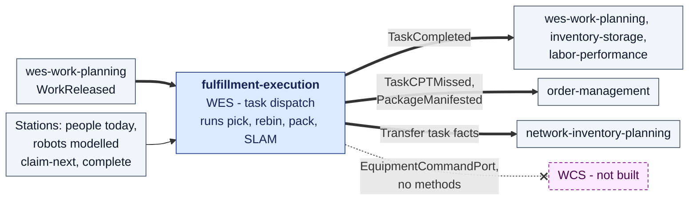

### process-path-management

| | |
| --- | --- |
| Fleet tier | `wes` |
| Industry category | **WES configuration**: process paths and shipping cutoffs |
| ISA-95 level | 3 |
| Decision horizon | days: configuration |
| DDD class | Generic |

**Why WES.** A process path (match prefix, required station capabilities,
p95 cycle time, eligibility, intake) and a site's CPT schedule are exactly the
"process area" and cutoff vocabulary the WES decides with.[8]
(`POST /process-paths`, `PUT /process-paths/{pathId}`,
`DELETE /process-paths/{pathId}`, `PUT /sites/{siteId}/cpt-schedule`).

**Why "configuration".** It decides nothing about dispatch, routing or
assignment. It is the catalogue the deciders read from their local copies.
It makes no REST or MCP call to a sibling (fleet rule).

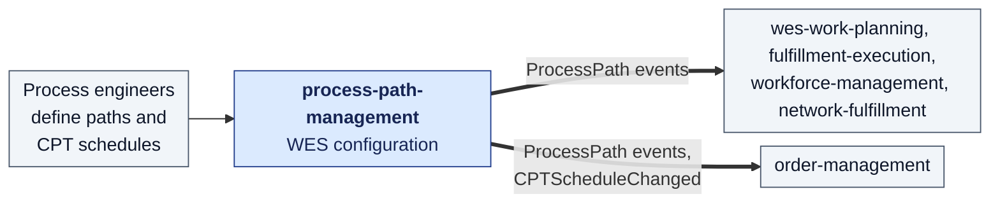

## WMS extended: labor management

Gartner counts "managing labor" as an extended WMS capability[1] and
workforce/labor management as a specialist component that supplements a
WMS.[2] Both contexts below fit that description. The trade press reports WES
vendors moving into labor orchestration[8], which is why the fleet's `wes`
label is understandable here, but neither context decides when or where work
runs.

### workforce-management

| | |
| --- | --- |
| Fleet tier | `wes` |
| Industry category | **WMS extended**: labor management |
| ISA-95 level | 3 |
| Decision horizon | a shift |
| DDD class | Supporting |

**Why WMS extended.** It owns the associate (certifications, shifts, breaks:
`POST /associates/{id}/certifications`, `/start-shift`, `/break/start`), the
shift plan that splits headcount across process paths
(`POST /paths/{pathId}/plan/propose`, `POST /shift-plans`,
`ShiftPlanCommitted`), the staffing gap per path
(`GET /sites/{siteCode}/shifts/{shiftId}/staffing-gap`, `PathUnderstaffed`) and
assignments (`POST /associates/{id}/assignments`, `LaborAssigned`). The plan is
capped by installed station capacity read from fulfillment-execution.

**Why not WES.** Rebalancing is a human decision it records, not one it makes.
Its output, the committed plan, is an *input* to the WES
(`wes-work-planning` reads `ShiftPlanCommitted`).

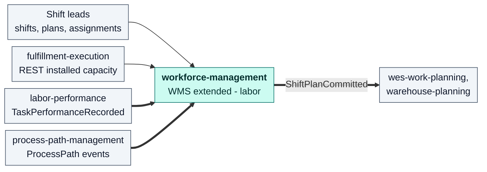

### labor-performance

| | |
| --- | --- |
| Fleet tier | `wes` |
| Industry category | **WMS extended**: engineered labor standards and performance |
| ISA-95 level | 3 |
| Decision horizon | after the fact: it measures finished work |
| DDD class | Supporting |

**Why WMS extended.** Engineered labor standards per task type
(`POST /standards`), actual-against-standard scoring per associate and per task
type (`GET /associates/{associateId}/scorecard`,
`GET /task-types/{taskType}/performance`) and idle-gap utilization
(`GET /task-types/{taskType}/utilization`). This is the "productivity tracking"
that Frazelle's survey ranks among the top three WMS priorities.[12]

**Why not WES.** It is a pure downstream observer of `TaskCompleted`. It makes
no REST or MCP call to a sibling (fleet rule).

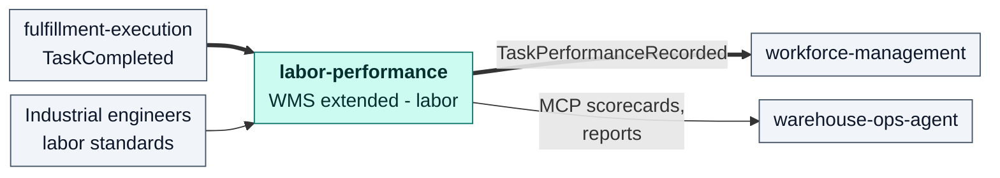

## Above the WMS

These four contexts decide across a planning horizon, across sites or across
sales channels. No single-building WMS or WES owns those decisions. In the
supply-chain taxonomy the WMS is part of execution,[13] and APQC lists
inventory deployment and warehouse transfers as processes of their own.[14]

### warehouse-planning

| | |
| --- | --- |
| Fleet tier | `wes` |
| Industry category | **Above the WMS**: warehouse capacity planning |
| ISA-95 level | 3 to 4 |
| Decision horizon | days to weeks |
| DDD class | Core |

**Why above the WMS.** It answers whether the warehouse *can* process the
demand assigned to it, before the work exists. It composes capacity
constraints and station standards (`POST /process-capacities`,
`PUT /station-standards/{location}/{process_type}`), expected demand
(`GET /demand`, from `OrderAllocated`), committed labor (`ShiftPlanCommitted`)
and storage positions (`GET /storage-capacity`) into a capacity plan with
shortage and bottleneck detection (`POST /capacity-plans`,
`POST /capacity-plans/{id}/publish`, `CapacityShortageDetected`,
`BottleneckDetected`, `CapacityPlanPublished`).

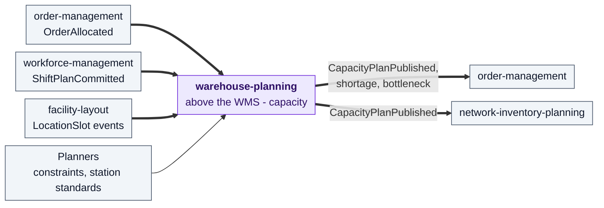

### order-management

| | |
| --- | --- |
| Fleet tier | `wes` |
| Industry category | **Above the WMS**: order management. It also performs the WMS order-allocation step |
| ISA-95 level | 4 for intake and promise; 3 for allocation |
| Decision horizon | seconds for intake, hours for the ship promise |
| DDD class | Generic/Supporting |

**Why above the WMS.** It is the front door for customer demand: order intake
(`POST /orders`), hold and release (`POST /orders/{id}/release`), cancellation
(`DELETE /orders/{id}`), a ship promise derived from the CPT schedule, path
capacity and published capacity plans (`GET /planned-capacity`), and
re-promising when a task misses its cutoff (`OrderRepromised`). It also
publishes the demand signal (`SiteSkuDemandChanged`) that slotting and network
planning read.

**The WMS part.** Gartner lists order allocation as a WMS capability.[2] Here
it is a reservation against inventory-storage's usable stock
(`POST /reservations`), with backorder retry
(`POST /orders/{id}/retry-allocation`).

**Why not WES.** It hands allocated orders to the WES (`OrderAllocated`) but
does not decide when they are released.

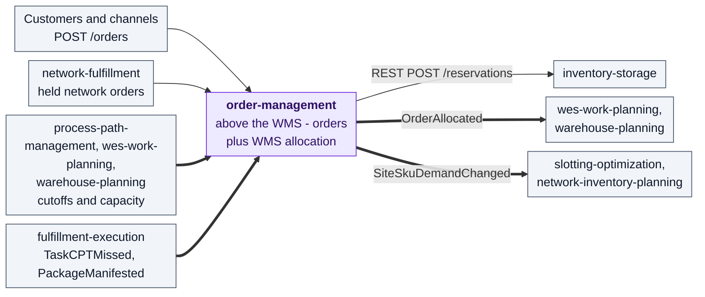

### network-inventory-planning

| | |
| --- | --- |
| Fleet tier | `wes` |
| Industry category | **Above the WMS**: network inventory deployment and warehouse transfers |
| ISA-95 level | 4 |
| Decision horizon | days |
| DDD class | Core |

**Why above the WMS.** It decides whether stock should move *between*
warehouses, which APQC files as "Manage and track inventory deployment" and
"Manage warehouse transfers".[14] It proposes and simulates transfers
(`POST /v1/transfer-proposals:generate`, `GET /v1/transfer-simulations`), runs
scheduled rebalances under a policy and lane catalogue
(`PUT /v1/rebalance-policies`, `PUT /v1/transfer-lanes`), and carries an
approved transfer as a saga (`POST /v1/transfers:approve`,
`TransferAllocationRequested`, `WorkDemandReleased`, `TransferStuckDetected`)
without ever moving stock itself: the WMS and WES contexts at each site do the
physical work.

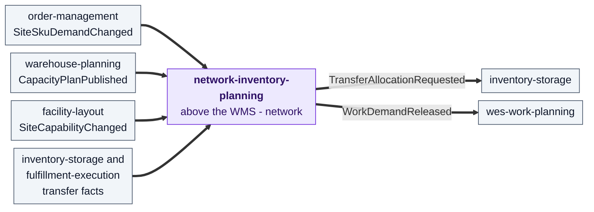

### network-fulfillment

| | |
| --- | --- |
| Fleet tier | `wes` |
| Industry category | **Above the WMS**: sales-channel integration, an anti-corruption layer to an external fulfillment network |
| ISA-95 level | 4 |
| Decision horizon | hours: the acknowledgement deadline |
| DDD class | Supporting |

**Why above the WMS.** It sells the building's capability through an external
network and honours that network's obligations: it polls network demand
(`GET /inbound-status`, `NetworkOrderReceived`), places it with
order-management as a held order (`NetworkOrderSubmitted`), acknowledges or
rejects within a deadline (`NetworkOrderAcknowledged`,
`AcknowledgementDeadlineAtRisk`), advertises capability offers
(`GET /capability-offers`) and confirms shipment
(`POST /network-orders/{networkRef}/shipment-confirmation`). That is order
and channel management: it sits in the order tier that hands work to the
warehouse, and it never touches stock or floor work itself.

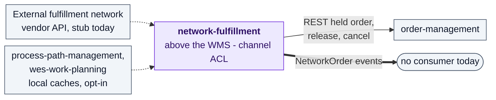

## Cross-tier decision support

### warehouse-ops-agent

| | |
| --- | --- |
| Fleet tier | `wes` (it publishes no events) |
| Industry category | **Cross-tier decision support**: a read-only correlation layer over WMS and WES |
| ISA-95 level | spans level 3 |
| Decision horizon | minutes to hours |
| DDD class | Supporting |

**Why cross-tier.** It owns no aggregate, no database and no Kafka. It
correlates what twelve contexts expose through their MCP tools, REST and
reports (one MCP client per context under
`internal/adapters/outbound/mcpclient/`) into a daily brief and exception lists (`get_daily_brief`,
`list_open_exceptions`, `get_flow_balance_exception`,
`detect_stranded_reservation`, `find_master_data_gaps`, `get_inbound_outlook`,
`explain_network_imbalance`, `triage_stuck_transfers`). It has zero write
tools: it recommends, people decide.

**Why neither WMS nor WES.** It executes no transaction and releases no work.

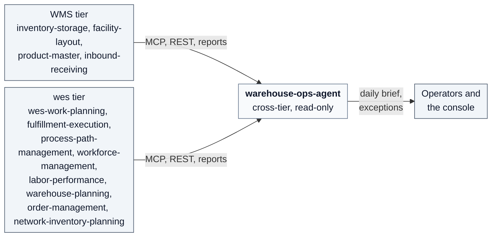

## Sources

- **[1]** [Gartner Peer Insights — Warehouse Management Systems market definition](https://www.gartner.com/reviews/market/warehouse-management-systems)
- **[2]** [Gartner, Magic Quadrant for Warehouse Management Systems (2015 reprint hosted by Oracle)](http://oracle.com/us/corporate/analystreports/gartner-magic-quadrant-wms-2884695.pdf)
- **[5]** [MHI — Cloud vs On-Prem WES (2023)](https://mhi.org/blog/126074/cloud-vs-on-prem-wes)
- **[6]** [Interact Analysis — De-Mystifying the Warehouse Execution System Market (2023)](https://interactanalysis.com/insight/de-mystifying-the-warehouse-execution-system-market)
- **[7]** [Modern Materials Handling — WES: Blending human-centered workflows with automation (2024)](https://mmh.com/article/warehouse_execution_system_wms_blending_human_centered_workflows_with_automation)
- **[8]** [Modern Materials Handling — WES stretches to encompass labor (2023)](https://mmh.com/article/warehouse_execution_systems_wes_stretches_to_encompass_labor)
- **[12]** [O'Reilly — Frazelle: World-Class Warehousing and Material Handling, 2nd ed., ch. 10](https://oreilly.com/library/view/world-class-warehousing-and/9780071842839/ch10.html)
- **[13]** [O'Reilly — Sustainability in Supply Chain Management, ch. 2 Warehouse Management System](https://oreilly.com/library/view/sustainability-in-supply/9780133480696/book1_ch02.html)
- **[14]** [APQC Process Classification Framework, Cross-Industry v7.4 (PDF)](https://solutions.ifrc.org/sites/default/files/2024-10/K014750_APQC%20Process%20Classification%20Framework%20%28PCF%29%20-%20Cross%20Industry%20-%20PDF%20Version%207.4.pdf)
