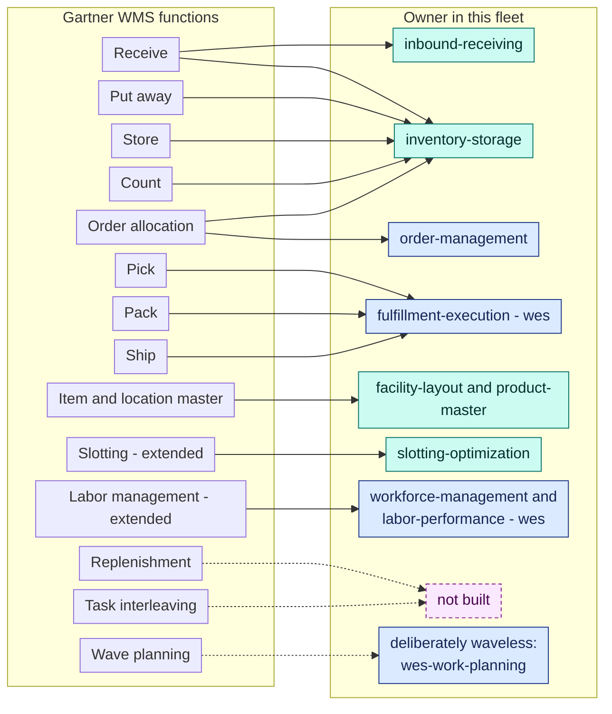
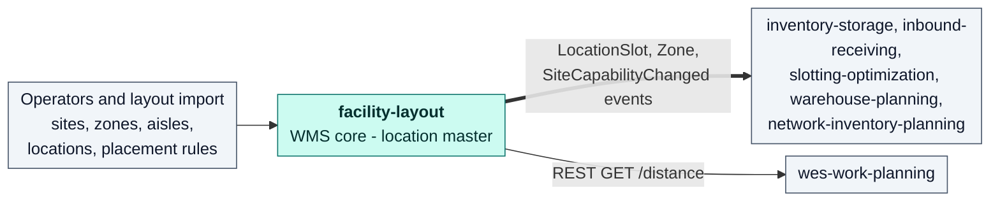
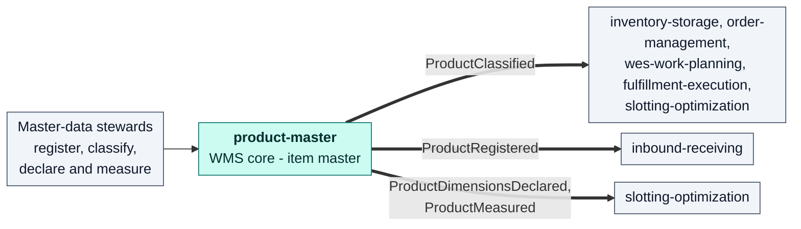
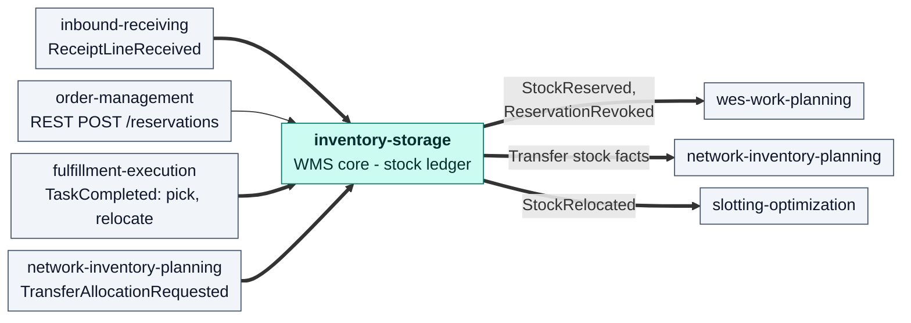
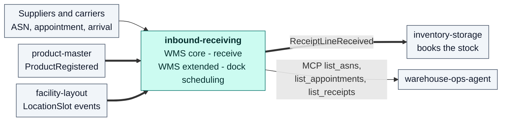
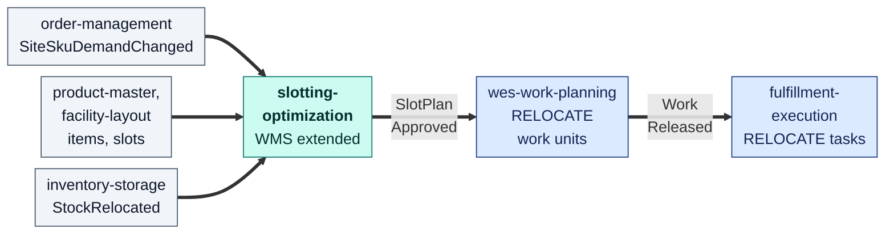

# The WMS tier — five contexts, qualified

Six contexts publish events with the `wms` segment
(`com.warehouse.wms.<context>.…`). This page has a card for each of the five
that are qualified. All five pass the industry WMS tests on the
[industry reference](/wms-wes/industry-reference#the-tests-this-site-applies).
Four are WMS core and one is WMS extended. The sixth,
`pick-face-replenishment` (built, not deployed), is **not yet qualified** and
has no card here yet; see the [qualification](/wms-wes/qualification).

## Coverage of the WMS functions

Gartner's core WMS functions are "receive, put away, store, count and pick,
pack and ship".[1] Its longer list adds order allocation, replenishment, wave
planning, task interleaving and labor management, among others.[2] This diagram
shows which context owns each function today. Pick, pack and ship run in
`fulfillment-execution`, a `wes` context. The fleet runs those core WMS
transactions as WES tasks. Its card is on the [WES tier](/wms-wes/wes-tier).

Dotted arrows are functions this fleet does not run as a WMS would. Wave
planning is replaced by design: `wes-work-planning` releases work
continuously, one unit at a time, which is the waveless model Interact
Analysis describes as the reason the execution layer emerged.[6] Replenishment
of forward pick slots and task interleaving are not in production. Replenishment
now has an owner that is built but not deployed, `pick-face-replenishment`
(`wms`), which raises replenishment requests. The stock-ledger end
(`inventory-storage`: the `BinStockLevelChanged` producer and the
`REPLENISHMENT` relocation) and the task end (`fulfillment-execution`: the
`REPLENISH` task) of its execution chain are built, and so is the planner
(`wes-work-planning` ADR 0042 plans one `REPLENISH` work unit per request on the
`REPLENISH` path of `process-path-management`'s ADR 0036). Its consumer is
opt-in and off in the reference deployment. Task interleaving has an
owner that is built but not deployed, `task-interleaving` (`wes`), which
issues an advisory hint after each completed task; `fulfillment-execution`
does not consume the hint yet. See the
[context map](/strategic-design/context-map). Until they run,
`warehouse-planning` knows `REPLENISHMENT` only as a type of capacity
constraint. `ship` stops at the SLAM weigh-check, label and manifest event in
`fulfillment-execution`: there is no carrier or transport integration.

## facility-layout

| | |
| --- | --- |
| Fleet tier | `wms` |
| Industry category | **WMS core**: the location master |
| ISA-95 level | 3 |
| Decision horizon | days to months: structure changes rarely |
| DDD class | Generic |

**Why WMS core.** Every WMS function that touches a place needs a location
master, and Gartner's "store" capability presumes one.[1] This context owns
the physical model: sites and their network role, zones, aisles and
cross-aisles, fixed structures, location types, coded location slots with
geometry and functional roles (dock, yard, staging, QC, consolidation,
shipping), and placement rules that say which location types are legal in
which zone (`POST /sites`, `POST /sites/{siteCode}/zones`, `POST /locations`,
`POST /locations/import`, `POST /placement-rules`). It also derives a travel
graph and shortest travel distance (`GET /zones/{zoneId}/travel-graph`,
`GET /distance`).

**Why not WES.** It decides nothing about when or where work runs. It answers
questions (distance, location classification) and publishes structure changes.
`wes-work-planning` uses its distance answer for travel-aware decisions.

## product-master

| | |
| --- | --- |
| Fleet tier | `wms` |
| Industry category | **WMS core**: the item master |
| ISA-95 level | 3 |
| Decision horizon | days: master data |
| DDD class | Supporting |

**Why WMS core.** Receiving, put-away and picking all depend on knowing what
an item is and how it must be handled. This context is the single source of
truth for the SKU: registration and description, the handling classification
(handling tags such as Hazmat, Fragile, TemperatureSensitive, Oversized and
HighValue, a temperature class and a DOT hazard class) and the declared and
measured physical profile (`PUT /products/{sku}`, `PUT /products/{sku}/classification`,
`PUT /products/{sku}/dimensions/declared`,
`PUT /products/{sku}/dimensions/measured`). inventory-storage,
order-management, wes-work-planning and fulfillment-execution keep a
version-guarded local copy of `ProductClassified`, and slotting-optimization
consumes it too.

**Why not WES.** Master data only. No release, dispatch or sequencing
decision reads anything it owns at decision time except through those local
copies.

## inventory-storage

| | |
| --- | --- |
| Fleet tier | `wms` |
| Industry category | **WMS core**: put away, store, count, allocate, move |
| ISA-95 level | 3 |
| Decision horizon | seconds: each transaction is decided when it arrives |
| DDD class | Core |

**Why WMS core.** It is the stock ledger, and it owns four of Gartner's core
functions:[1]

- **Receive and put away.** Books received stock (`POST /stock/receive`, and
  `ReceiptLineReceived` from inbound-receiving), then stows it into a bin
  (`POST /stock/stow`). The stow is validated against the zone and location
  attributes it keeps from facility-layout's events and the handling
  classification it keeps from product-master, including hazmat placement and
  DOT segregation.
- **Store.** Bins with capacity and occupancy (`PUT /bins/{binId}`,
  `GET /bins/{binId}`) and the usable-inventory answer every promise rests on
  (`GET /inventory/{sku}/usable`).
- **Count.** Cycle counts and discrepancies
  (`POST /bins/{binId}/cycle-count`, `CycleCountCompleted`,
  `DiscrepancyDetected`).
- **Allocate.** Revocable reservations against usable inventory
  (`POST /reservations`, `DELETE /reservations/{id}`), confirmed on pick
  (`POST /reservations/{id}/confirm-pick`, or the `TaskCompleted` consumer).

It also moves stock inside a site (`POST /relocations`, `StockRelocated`,
including the completion of slot-plan `RELOCATE` tasks) and handles the
inventory legs of an inter-warehouse transfer (allocation on
`TransferAllocationRequested`, then `POST /transfers/{transferLineId}/receipt`
and `/stow` at the destination).

**Why not WES.** It does not decide when work happens. It answers
*is there stock, and may it go here?* when asked, and records what happened.

## inbound-receiving

| | |
| --- | --- |
| Fleet tier | `wms` |
| Industry category | **WMS core**: receive. **WMS extended**: dock appointment scheduling |
| ISA-95 level | 3 |
| Decision horizon | hours: appointments and receipts |
| DDD class | Supporting |

**Why WMS core.** "Receive" is the first of Gartner's core functions.[1] This
context owns everything before the first stow: the advance ship notice
(`POST /asns`), the receipt and its lines with discrepancies (short, over,
damaged) (`POST /receipts`, `POST /receipts/{receiptId}/lines`,
`POST /receipts/{receiptId}/close`), and the handover of good units to
inventory-storage as `ReceiptLineReceived`. Its dock appointments
(`POST /appointments`, `POST /appointments/{appointmentId}/check-in`, `GET /docks`)
are what Gartner lists as a dock/appointment scheduling component that
supplements a WMS, so that part is WMS extended.[2]

**Why not WES.** It records arrivals and books doors. It does not sequence
put-away work. Stowing happens in inventory-storage.

## slotting-optimization

| | |
| --- | --- |
| Fleet tier | `wms` |
| Industry category | **WMS extended**: slotting |
| ISA-95 level | 3 |
| Decision horizon | days to weeks: slot plans |
| DDD class | Supporting |

**Why WMS extended.** Gartner names "optimizing the locating of inventory
within a facility" as an extended WMS capability[1], and "slotting
optimization" as a specialist component that supplements a WMS.[2] This
context ranks SKUs by pick velocity (`GET /sku-velocity`, fed by
`SiteSkuDemandChanged`), proposes a slot plan under the `abc-velocity-v1`
policy (`POST /slot-plans`), lets a human approve or reject it
(`POST /slot-plans/{planId}/approve`, `/reject`) and publishes the approved
forward-pick map (`GET /forward-slots`, `SlotPlanApproved`).

**Why not WES.** It plans where stock should live; it does not execute the
moves. `wes-work-planning` turns `SlotPlanApproved` into sequenced `RELOCATE`
work units, `fulfillment-execution` dispatches them as `RELOCATE` tasks, and
inventory-storage records each completed relocation.

## Sources

- **[1]** [Gartner Peer Insights — Warehouse Management Systems market definition](https://www.gartner.com/reviews/market/warehouse-management-systems)
- **[2]** [Gartner, Magic Quadrant for Warehouse Management Systems (2015 reprint hosted by Oracle)](http://oracle.com/us/corporate/analystreports/gartner-magic-quadrant-wms-2884695.pdf)
- **[6]** [Interact Analysis — De-Mystifying the Warehouse Execution System Market (2023)](https://interactanalysis.com/insight/de-mystifying-the-warehouse-execution-system-market)
