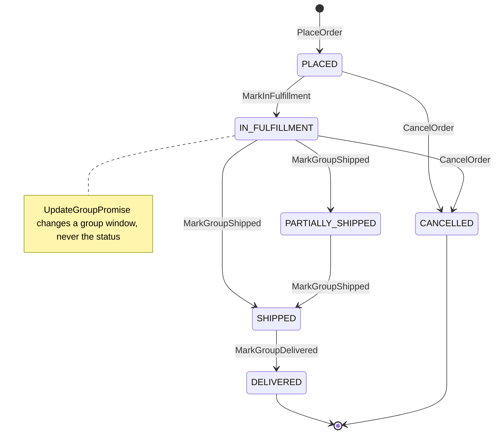
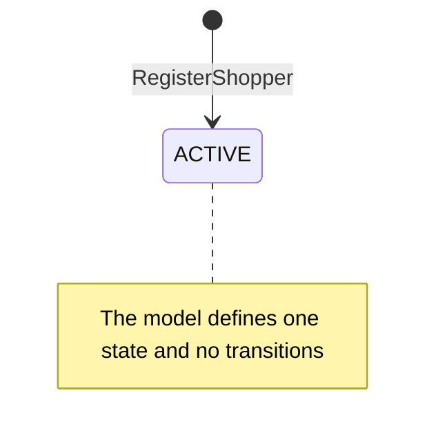

# Aggregate Design Canvas

:::info[Proposed design]
Derived from [`model/model.yaml`](https://github.com/IQVO/retail-network-docs/blob/main/model/model.yaml). Nothing in this context is built yet; identifiers (`Err...` names, routes, CloudEvents types) are the names an implementation must use.
:::

Following the ddd-crew [Aggregate Design Canvas v1.1](https://github.com/ddd-crew/aggregate-design-canvas).
The model has two aggregate roots in this context, **CustomerOrder** and
**Shopper**, and one read model, **OrderTrackingView**. Proposed Go
packages: `internal/domain/order` and `internal/domain/shopper`.

## CustomerOrder

### 1. Name

`CustomerOrder` (`order.CustomerOrder`), identified by `orderId`.

### 2. Description

A shopper's order: lines, ship-to (PII), the promise per shipment group and
the customer-facing status. It holds three value objects:

| Value object | Fields | Note |
| --- | --- | --- |
| `ShipTo` | `name`, `line1`, `line2`, `city`, `region`, `postalCode`, `countryCode`, `phone` | PII, synthetic. Read outside this context only through `GET /orders/{orderId}/ship-to`. |
| `OrderLine` | `lineNo`, `catalogItemId`, `quantity` | One per cart line. |
| `GroupPromise` | `groupNo`, `promiseId`, `deliverByEarliest`, `deliverByLatest`, `lineNos[]` | The order's snapshot of one group's promise. `UpdateGroupPromise` refreshes the window. |

The aggregate also has to remember, per group, what `CustomerOrderPlaced`
publishes (`tier`, `witnessNodeId`, `shipBy`) and what the consumed events
report (`assignmentId` and `lockedAt` from `FulfillmentLocked`,
`trackingNumbers` and `shippedAt` from `FulfillmentShipped`, `deliveredAt`
from `PackageDelivered`). Without these it cannot enforce
`ErrCancelAfterLock` or choose between `PARTIALLY_SHIPPED` and `SHIPPED`.
The model's `GroupPromise` does not list these fields. The pages carry them
under their event field names and record the omission as a model gap.

### 3. State Transitions

Derived from: `model.yaml → contexts[customer-ordering].aggregates[CustomerOrder].states`,
`.transitions`, `.commands`.

The entry arrow `[*] --> PLACED` is the creating command `PlaceOrder`; the
model lists transitions between states only. Omitted: the no-op cases where
a command leaves the status unchanged. Examples are `MarkInFulfillment` for a
second group while already `IN_FULFILLMENT`, and `MarkGroupDelivered` for one
group while others are still on their way. `IN_FULFILLMENT → SHIPPED` applies
when the shipped group is the last one not yet shipped. `→ PARTIALLY_SHIPPED`
applies otherwise.

Two consequences of the model as written, both listed as open questions on
the [canvas](/network/contexts/customer-ordering/bounded-context-canvas):

- If `MarkInFulfillment` runs on the first `FulfillmentLocked`, every order in
  `IN_FULFILLMENT` has a locked group. `IN_FULFILLMENT → CANCELLED` then
  always fails `ErrCancelAfterLock`.
- There is no transition out of `PARTIALLY_SHIPPED` for a delivery, so a
  group delivered before its sibling ships changes no status.

### 4. Enforced Invariants

| Invariant | Enforced by |
| --- | --- |
| Every line is in exactly one group, and every group has a promise | `PlaceOrder` → `ErrLineWithoutPromise` |
| The promise's destination postal prefix matches the ship-to | `PlaceOrder` → `ErrPromiseDestinationMismatch` |
| Cancel only while no group is locked | `CancelOrder` → `ErrCancelAfterLock` |
| Status moves forward only | `MarkInFulfillment`, `MarkGroupShipped`, `MarkGroupDelivered`, `CancelOrder` → `ErrStatusRegression` |

Derived from: `model.yaml → contexts[customer-ordering].aggregates[CustomerOrder].invariants`.

Not invariants of this aggregate, but errors `PlaceOrder` can receive from
`delivery-promise` during checkout (that context's identifiers):
`ErrOfferNotQuotable` (offer expired or consumed), `ErrPromiseCapacityExhausted`,
`ErrBookClosed`, `ErrGroupSpansNodes`. They stop the checkout before the
aggregate exists; see [Use Cases](/network/contexts/customer-ordering/use-cases).

### 5. Corrective Policies

| Policy | Owner | Rule | Effect on this aggregate |
| --- | --- | --- | --- |
| `CheckoutPromising` | this context | For each shipment group call `MakePromise` with the offer the shopper saw; if the offer expired, re-quote and show the new window before placing. | No order is created until every group has a promise; an expired offer returns new offers to the shopper instead. |
| `CancelOnUnfulfillable` | this context | When a group is unsourceable and no revised promise is feasible, cancel the group and the order if nothing remains. | `CancelOrder` for that group; `CustomerOrderCancelled` with its `groupNos`. The model gives no signal for "no revised promise is feasible" (open question). |
| `ReleaseExpiredHolds` | `delivery-promise` | A `PROVISIONAL` promise not confirmed before `holdExpiresAt` is `RELEASED`. | Cleans up the promises of a checkout that failed after some `MakePromise` calls succeeded. This context sends nothing. |
| `ConfirmPromise` on `CustomerOrderPlaced` | `delivery-promise` | The provisional promise of each group becomes `CONFIRMED`. | None; the order is already `PLACED`. |
| `RepromiseOnRisk` | `delivery-promise` | On `FulfillmentUnsourceable` and other risks, recompute and `RevisePromise`. | `PromiseRevised` → `UpdateGroupPromise` (later window, same status). |
| `CancelPromise` / `CancelAssignment` on `CustomerOrderCancelled` | `delivery-promise` / `order-sourcing` | Release the promise and the assignment of the cancelled groups. | None; the order is already `CANCELLED`. |
| Idempotent consumption | this context | Every consumed event is applied once (inbox on the CloudEvents `id`); a status-regressing event is recorded and skipped. | `ErrStatusRegression` never fails a consumer. |

### 6. Handled Commands

| Command | Trigger | Transition |
| --- | --- | --- |
| `PlaceOrder` | Shopper, REST `POST /checkout` | `[*] → PLACED` |
| `MarkInFulfillment` | Kafka `FulfillmentLocked` (`order-sourcing`) | `PLACED → IN_FULFILLMENT` (a later group: no status change) |
| `MarkGroupShipped` | Kafka `FulfillmentShipped` (`order-sourcing`) | `IN_FULFILLMENT → PARTIALLY_SHIPPED` or `→ SHIPPED`; `PARTIALLY_SHIPPED → SHIPPED` |
| `MarkGroupDelivered` | Kafka `PackageDelivered` (`shipping-and-tracking`) | `SHIPPED → DELIVERED` once every group is delivered |
| `CancelOrder` | Shopper, REST `POST /orders/{orderId}:cancel`; or the `CancelOnUnfulfillable` policy on `FulfillmentUnsourceable` | `PLACED → CANCELLED`, `IN_FULFILLMENT → CANCELLED` |
| `UpdateGroupPromise` | Kafka `PromiseRevised` (`delivery-promise`) | none (the group's window changes) |

Derived from: `model.yaml → contexts[customer-ordering].aggregates[CustomerOrder].commands`,
`.inbound`, `.consumes`. The event-to-command mapping is this page's
reading. The model lists the events and the commands but does not pair them.

### 7. Created Events

| Event | Raised when | Full CloudEvents type |
| --- | --- | --- |
| `CustomerOrderPlaced` | `PlaceOrder` is saved (status `PLACED`) | `com.retailnetwork.commerce.customer-ordering.customerorder.CustomerOrderPlaced` |
| `CustomerOrderCancelled` | `CancelOrder` is saved | `com.retailnetwork.commerce.customer-ordering.customerorder.CustomerOrderCancelled` |

`MarkInFulfillment`, `MarkGroupShipped`, `MarkGroupDelivered` and
`UpdateGroupPromise` raise no integration event: the facts they record were
published by their owners first. Both events leave through the transactional
outbox in the same transaction as the save.

### 8. Throughput

*Estimate.* The model says "medium". One `PlaceOrder` per checkout, then
roughly three to five consumed-event writes per shipment group (lock,
shipment, delivery, perhaps a revision). Contention on one order is low,
but it is real. Events for different groups of the same order arrive on
different Kafka partitions (`order-sourcing` keys by `assignmentId`), so two
consumers can update one order at once. Every save is guarded by an
optimistic-concurrency `version`. A conflict is retried from the inbox.

### 9. Size

*Estimate.* The model says "one row per order + lines". One root row with the
ship-to, a handful of lines, one group row per shipment group (most orders
have one), and the tracking numbers per group. Two events at most in its
life (`CustomerOrderPlaced`, then possibly `CustomerOrderCancelled`). It
lives from checkout until delivery or cancellation (days), then stays as a
record.

## Shopper

### 1. Name

`Shopper` (`shopper.Shopper`), identified by `shopperId`.

### 2. Description

A synthetic customer account with saved addresses. Its address entries have
the shape of `ShipTo`. Checkout names the `shopperId`, and
`CustomerOrderPlaced` carries it.

### 3. State Transitions

Derived from: `model.yaml → contexts[customer-ordering].aggregates[Shopper].states`,
`.commands`.

Omitted: nothing; the model gives this aggregate no lifecycle beyond
registration.

### 4. Enforced Invariants

| Invariant | Enforced by |
| --- | --- |
| Email unique | `RegisterShopper` → `ErrShopperExists` |

### 5. Corrective Policies

None in the model. A duplicate registration is refused, not merged.

### 6. Handled Commands

| Command | Trigger | Transition |
| --- | --- | --- |
| `RegisterShopper` | REST `POST /shoppers` (caller not named in `inbound`; assumed the storefront) | `[*] → ACTIVE` |

### 7. Created Events

None (`events: []`). No other context needs to know a shopper exists:
`shopperId` travels inside `CustomerOrderPlaced`.

### 8. Throughput

*Estimate.* The model says "low": one write per registration.

### 9. Size

*Estimate.* The model says "small": one row, plus its saved addresses.

## Read models

| Read model | Source events | Serves | Why it is not an aggregate |
| --- | --- | --- | --- |
| `OrderTrackingView` | `shipping-and-tracking` `LabelIssued`, `PackageScanned`, `PackageDelivered`, `PackageExceptionRaised`; `order-sourcing` `FulfillmentLocked`, `FulfillmentShipped`; `delivery-promise` `PromiseAtRisk`, `PromiseRevised`, `PromiseKept`, `PromiseBroken` | `GET /orders/{orderId}/tracking` (`GetTracking`) | It protects no invariant and takes no command. It is a projection of facts other contexts own. It can be dropped and rebuilt by replaying the three topics. `LabelIssued` and `PackageScanned` carry no `orderId`; the projector links them through `assignmentId` (from `FulfillmentLocked`) and `trackingNumber` (from `FulfillmentShipped` or `LabelIssued`). |

Derived from: `model.yaml → contexts[customer-ordering].read_models`.
`FulfillmentUnsourceable` is consumed but is not a listed source of the view.
It drives `CancelOnUnfulfillable` only.
