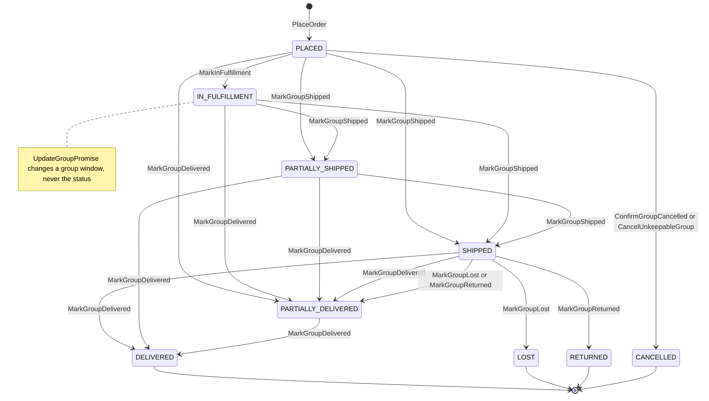
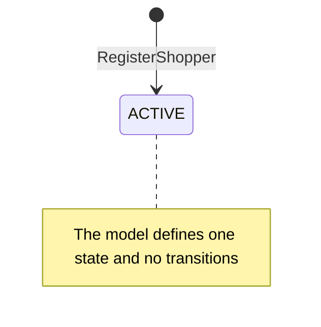

# Aggregate Design Canvas

:::info[As built]
Derived from [`network/model/model.yaml`](https://github.com/IQVO/warehouse-docs/blob/main/network/model/model.yaml). This context's service is built; the model carries its as-built contracts, and identifiers (`Err...` names, routes, CloudEvents types) are the names the service uses.
:::

Following the ddd-crew [Aggregate Design Canvas v1.1](https://github.com/ddd-crew/aggregate-design-canvas).
The model has two aggregate roots in this context, **CustomerOrder** and
**Shopper**, and one read model, **OrderTrackingView**. Proposed Go
packages: `internal/domain/order` and `internal/domain/shopper`.

## CustomerOrder

### 1. Name

`CustomerOrder` (`order.CustomerOrder`), identified by `orderId`.

### 2. Description

A shopper's order: lines, ship-to (PII), the promise per shipment group and
the customer-facing status. It holds three value objects:

| Value object | Fields | Note |
| --- | --- | --- |
| `ShipTo` | `name`, `line1`, `line2`, `city`, `region`, `postalCode`, `countryCode`, `phone` | PII, synthetic. Read outside this context only through `GET /orders/{orderId}/ship-to`. |
| `OrderLine` | `lineNo`, `catalogItemId`, `quantity` | One per cart line. |
| `GroupPromise` | `groupNo`, `promiseId`, `tier` (five values, `CONSOLIDATED` included), `deliverByEarliest`, `deliverByLatest`, `lineNos[]`, optional `chosenDeliveryDay` and `consolidationEligible` (`CONSOLIDATED` only) | The order's snapshot of one group's promise. `UpdateGroupPromise` refreshes the window; the chosen day records the shopper's choice and is NOT recomputed by a later revision. |
| `ConsolidationKey` | empty, or 64 lower-case hex characters | The keyed hash of shopper and ship-to; rows written before it read back empty and never merge. |

The aggregate also has to remember, per group, what `CustomerOrderPlaced`
publishes (`tier`, `witnessNodeId`, `shipBy`) and what the consumed events
report (`assignmentId` and `lockedAt` from `FulfillmentLocked`,
`trackingNumbers` and `shippedAt` from `FulfillmentShipped`, `deliveredAt`
from `PackageDelivered`). Without these it cannot enforce
`ErrCancelAfterLock` or choose between `PARTIALLY_SHIPPED` and `SHIPPED`.
The model's `GroupPromise` does not list these fields. The pages carry them
under their event field names and record the omission as a model gap.

### 3. State Transitions

The order status is not set by a command: it is DERIVED from the states of the
groups that are not `CANCELLED` after every command (ADR 0002 A1, A23). Group
states: `PROMISED` (no node locked), `LOCKED`, `SHIPPED`, `DELIVERED`, `LOST`,
`RETURNED`, `CANCELLATION_REQUESTED`, `CANCELLED`.

Derived from: `model.yaml → contexts[customer-ordering].aggregates[CustomerOrder].states`,
`.transitions`, `.commands`, `.policies[OrderStatusDerivedFromGroups]`.

The entry arrow `[*] --> PLACED` is the creating command `PlaceOrder`. Omitted:
the no-op cases where a command leaves the status unchanged, and any
transition whose source differs only by which groups are still open (the
derivation table below is the complete rule). `CancelOrder` itself is not an
arrow: it only moves every `PROMISED` group to `CANCELLATION_REQUESTED`, so the
order status does not change until `order-sourcing` answers
(`FulfillmentCancelled` makes the group `CANCELLED`; `FulfillmentCancelRefused`
returns it to `LOCKED`).

Derivation, read top to bottom over the groups that are not `CANCELLED`, first
match wins:

| Remaining groups | Order status |
| --- | --- |
| none | `CANCELLED` |
| every group closed (`DELIVERED`, `LOST`, `RETURNED`), all `DELIVERED` | `DELIVERED` |
| every group closed, some `DELIVERED` | `PARTIALLY_DELIVERED` |
| every group closed, none delivered, some `LOST` | `LOST` |
| every group closed, none delivered, none lost | `RETURNED` |
| (some group still open) some `DELIVERED` | `PARTIALLY_DELIVERED` |
| every group `SHIPPED`, `LOST` or `RETURNED` | `SHIPPED` |
| some group `SHIPPED`, `LOST` or `RETURNED` | `PARTIALLY_SHIPPED` |
| some `LOCKED` | `IN_FULFILLMENT` |
| otherwise | `PLACED` |

A derived status that ranks below the current one is refused with
`ErrStatusRegression`. A `LOST` or `RETURNED` group did ship, so beside open
groups it counts as shipped progress. A group can only be cancelled while
unlocked, so an order with a locked, shipped or delivered group is never
`CANCELLED` and `PLACED → CANCELLED` is the only reachable cancellation (ADR
0002).

Consequences of the as-built rules:

- `MarkGroupShipped` accepts a group that is still `PROMISED`, so a shipment on
  a `PLACED` order is valid (the lock event may arrive late), and a vendor
  that ships wins over a pending cancel request.
- A delivery on a `PARTIALLY_SHIPPED` order is recorded and moves the order to
  `PARTIALLY_DELIVERED`.

### 4. Enforced Invariants

| Invariant | Enforced by |
| --- | --- |
| Every line is in exactly one group, and every group has a promise | `PlaceOrder` → `ErrLineWithoutPromise` |
| The promise's destination postal prefix matches the ship-to | `PlaceOrder` → `ErrPromiseDestinationMismatch` |
| The checkout's shopper is registered | `PlaceOrder` use case → `ErrValidation` (422 `validation-failed`) |
| Cancel only while a group is unlocked (advisory; `order-sourcing` decides) | `CancelOrder` → `ErrCancelAfterLock` |
| Status moves forward only | `MarkInFulfillment`, `MarkGroupShipped`, `CancelOrder`, `ConfirmGroupCancelled` → `ErrStatusRegression` (the consumer records the event and skips it) |
| `chosenDeliveryDay` and `consolidationEligible` only on a `CONSOLIDATED` group, the day a valid calendar date; `consolidationKey` empty or 64 lower-case hex | `PlaceOrder` → `ErrValidation` (on restore, `ErrInvalidSnapshot`) |

Derived from: `model.yaml → contexts[customer-ordering].aggregates[CustomerOrder].invariants`.

Not invariants of this aggregate, but errors `PlaceOrder` can receive from
`delivery-promise` during checkout (that context's identifiers):
`ErrOfferNotQuotable` (offer expired or consumed), `ErrPromiseCapacityExhausted`,
`ErrBookClosed`, `ErrGroupSpansNodes`. They stop the checkout before the
aggregate exists; see [Use Cases](/network/contexts/customer-ordering/use-cases).

### 5. Corrective Policies

| Policy | Owner | Rule | Effect on this aggregate |
| --- | --- | --- | --- |
| `CheckoutPromising` | this context | For each shipment group call `MakePromise` with the offer the shopper saw; if the offer expired, re-quote and show the new window before placing. | No order is created until every group has a promise; an expired offer returns new offers to the shopper instead. |
| `ConsolidationKeyDerivation` | this context | `PlaceOrder` derives the key after the address is resolved, with a secret from the environment (at least 16 bytes); with no secret nothing is derived and the order never merges. | The key is stored on the order and published on `CustomerOrderPlaced`; never exposed on REST. |
| `ConsolidatedChoiceStored` | this context | A `CONSOLIDATED` offer id at checkout becomes a group that keeps the tier, the chosen local day and `consolidationEligible`. A re-quote asks for the default tiers, so it never offers `CONSOLIDATED` again. | `GroupPromise` fields above; optional fields on `POST /checkout` 201, `GET /orders/{orderId}` and `GET /orders`. |
| `SharedTrackingNumbers` | this context | A tracking number belongs to a SET of groups; one package event closes every group that shares it (`MarkGroupDelivered`, `MarkGroupLost`, `MarkGroupReturned`). | A group that has not shipped yet is replayed from `FulfillmentShipped`; nothing removes a link. |
| `CancelIsARequest` | this context | `CancelOrder` moves every `PROMISED` group to `CANCELLATION_REQUESTED` and publishes `CustomerOrderCancelled` for those groups only; `order-sourcing` answers with `FulfillmentCancelled` (group `CANCELLED`) or `FulfillmentCancelRefused` (group back to `LOCKED`, the vendor ships). | The order status does not change on the request; it becomes `CANCELLED` when no group remains outside `CANCELLED`. |
| `CancelOnUnfulfillable` | this context | On `delivery-promise`'s `PromiseUnkeepable` for a `PROMISED` group, cancel that group at once (`CancelUnkeepableGroup`) and the order if nothing remains (ADR 0002 A5, G10). Not triggered by `FulfillmentUnsourceable`. | `CustomerOrderCancelled` with its `groupNos` and reason `PROMISE_UNKEEPABLE: <reason>`. |
| `ReleaseExpiredHolds` | `delivery-promise` | A `PROVISIONAL` promise not confirmed before `holdExpiresAt` is `RELEASED`. | Cleans up the promises of a checkout that failed after some `MakePromise` calls succeeded. This context sends nothing. |
| `ConfirmPromise` on `CustomerOrderPlaced` | `delivery-promise` | The provisional promise of each group becomes `CONFIRMED`. | None; the order is already `PLACED`. |
| `RepromiseOnRisk` | `delivery-promise` | On `FulfillmentUnsourceable` and other risks, recompute and `RevisePromise`. | `PromiseRevised` → `UpdateGroupPromise` (later window, same status). |
| `CancelPromise` / `CancelAssignment` on `CustomerOrderCancelled` | `delivery-promise` / `order-sourcing` | Release the promise and the assignment of the cancelled groups. | None; the order is already `CANCELLED`. |
| Idempotent consumption | this context | Every consumed event is applied once (inbox on the CloudEvents `id`); a status-regressing event is recorded and skipped. | `ErrStatusRegression` never fails a consumer. |

### 6. Handled Commands

| Command | Trigger | Transition |
| --- | --- | --- |
| `PlaceOrder` | Shopper, REST `POST /checkout` | `[*] → PLACED` |
| `MarkInFulfillment` | Kafka `FulfillmentLocked` (`order-sourcing`) | group `PROMISED → LOCKED`; `PLACED → IN_FULFILLMENT` (a later group: no status change) |
| `MarkGroupShipped` | Kafka `FulfillmentShipped` (`order-sourcing`) | group `PROMISED`, `LOCKED` or `CANCELLATION_REQUESTED → SHIPPED`; order `PARTIALLY_SHIPPED` or `SHIPPED` |
| `MarkGroupDelivered` | Kafka `PackageDelivered` (`shipping-and-tracking`) | group `SHIPPED → DELIVERED`; order `PARTIALLY_DELIVERED`, then `DELIVERED` once every counted group is |
| `MarkGroupLost`, `MarkGroupReturned` | Kafka `PackageLost`, `PackageReturned` (`shipping-and-tracking`) | group `SHIPPED → LOST` or `RETURNED` (terminal); order re-derived (`LOST`, `RETURNED`, `PARTIALLY_DELIVERED`) |
| `CancelOrder` | Shopper, REST `POST /orders/{orderId}/cancellations` | every `PROMISED` group `→ CANCELLATION_REQUESTED`; no order status change |
| `CancelUnkeepableGroup` | Kafka `PromiseUnkeepable` (`delivery-promise`), policy `CancelOnUnfulfillable` | group `PROMISED → CANCELLED`; `PLACED → CANCELLED` when no group remains |
| `ConfirmGroupCancelled`, `RefuseGroupCancellation` | Kafka `FulfillmentCancelled`, `FulfillmentCancelRefused` (`order-sourcing`) | group `→ CANCELLED`; or `CANCELLATION_REQUESTED → LOCKED` |
| `UpdateGroupPromise` | Kafka `PromiseRevised` (`delivery-promise`) | none (the group's window changes) |

Derived from: `model.yaml → contexts[customer-ordering].aggregates[CustomerOrder].commands`,
`.inbound`, `.consumes`. The event-to-command mapping is this page's
reading. The model lists the events and the commands but does not pair them.

### 7. Created Events

| Event | Raised when | Full CloudEvents type |
| --- | --- | --- |
| `CustomerOrderPlaced` | `PlaceOrder` is saved (status `PLACED`) | `com.retailnetwork.commerce.customer-ordering.customerorder.CustomerOrderPlaced` |
| `CustomerOrderCancelled` | `CancelOrder` (the groups moved to `CANCELLATION_REQUESTED`) or `CancelUnkeepableGroup` (the one cancelled group) is saved | `com.retailnetwork.commerce.customer-ordering.customerorder.CustomerOrderCancelled` |

`MarkInFulfillment`, `MarkGroupShipped`, `MarkGroupDelivered`, `MarkGroupLost`,
`MarkGroupReturned`, `ConfirmGroupCancelled`, `RefuseGroupCancellation` and
`UpdateGroupPromise` raise no integration event: the facts they record were
published by their owners first. Both events leave through the transactional
outbox in the same transaction as the save.

### 8. Throughput

*Estimate.* The model says "medium". One `PlaceOrder` per checkout, then
roughly three to five consumed-event writes per shipment group (lock,
shipment, delivery, perhaps a revision). Contention on one order is low,
but it is real. Events for different groups of the same order arrive on
different Kafka partitions (`order-sourcing` keys by `assignmentId`), so two
consumers can update one order at once. Every save is guarded by an
optimistic-concurrency `version`. A conflict is retried from the inbox.

### 9. Size

*Estimate.* The model says "one row per order + lines". One root row with the
ship-to, a handful of lines, one group row per shipment group (most orders
have one), and the tracking numbers per group. Two events at most in its
life (`CustomerOrderPlaced`, then possibly `CustomerOrderCancelled`). It
lives from checkout until delivery or cancellation (days), then stays as a
record.

## Shopper

### 1. Name

`Shopper` (`shopper.Shopper`), identified by `shopperId`.

### 2. Description

A synthetic customer account with saved addresses. Its address entries have
the shape of `ShipTo`. Checkout names the `shopperId` and refuses an unknown
one (422 `validation-failed`, ADR 0002 A9); `CustomerOrderPlaced` carries it.

### 3. State Transitions

Derived from: `model.yaml → contexts[customer-ordering].aggregates[Shopper].states`,
`.commands`.

Omitted: nothing; the model gives this aggregate no lifecycle beyond
registration.

### 4. Enforced Invariants

| Invariant | Enforced by |
| --- | --- |
| Email unique | `RegisterShopper` → `ErrShopperExists` |

### 5. Corrective Policies

None in the model. A duplicate registration is refused, not merged.

### 6. Handled Commands

| Command | Trigger | Transition |
| --- | --- | --- |
| `RegisterShopper` | REST `POST /shoppers` (caller not named in `inbound`; assumed the storefront) | `[*] → ACTIVE` |

### 7. Created Events

None (`events: []`). No other context needs to know a shopper exists:
`shopperId` travels inside `CustomerOrderPlaced`.

### 8. Throughput

*Estimate.* The model says "low": one write per registration.

### 9. Size

*Estimate.* The model says "small": one row, plus its saved addresses.

## Read models

| Read model | Source events | Serves | Why it is not an aggregate |
| --- | --- | --- | --- |
| `OrderTrackingView` | `shipping-and-tracking` `LabelIssued`, `PackageScanned`, `PackageDelivered`, `PackageExceptionRaised`; `order-sourcing` `FulfillmentLocked`, `FulfillmentShipped`; `delivery-promise` `PromiseAtRisk`, `PromiseRevised`, `PromiseKept`, `PromiseBroken` | `GET /orders/{orderId}/tracking` (`GetTracking`) | It protects no invariant and takes no command. It is a projection of facts other contexts own. It can be dropped and rebuilt by replaying the three topics. `LabelIssued` and `PackageScanned` carry no `orderId`; the projector links them through `assignmentId` (from `FulfillmentLocked`) and `trackingNumber` (from `FulfillmentShipped` or `LabelIssued`). |

Derived from: `model.yaml → contexts[customer-ordering].read_models`.
`FulfillmentUnsourceable` is consumed and recorded on the view only (its
reason); it cancels nothing. `PromiseUnkeepable` drives `CancelOnUnfulfillable`.
