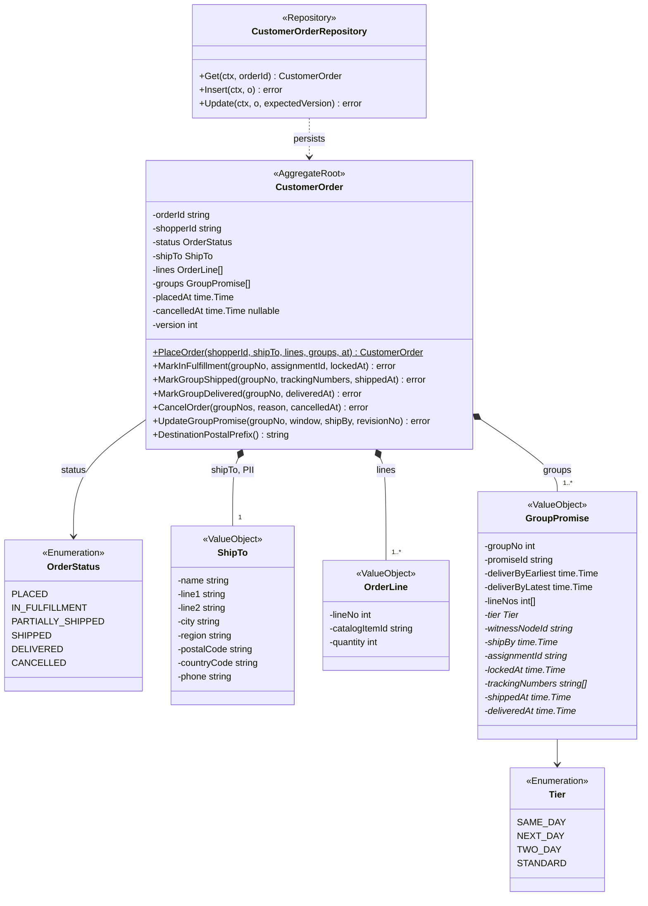
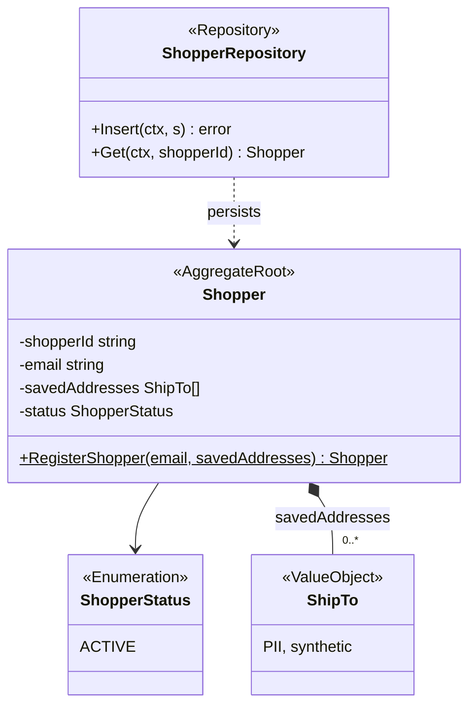
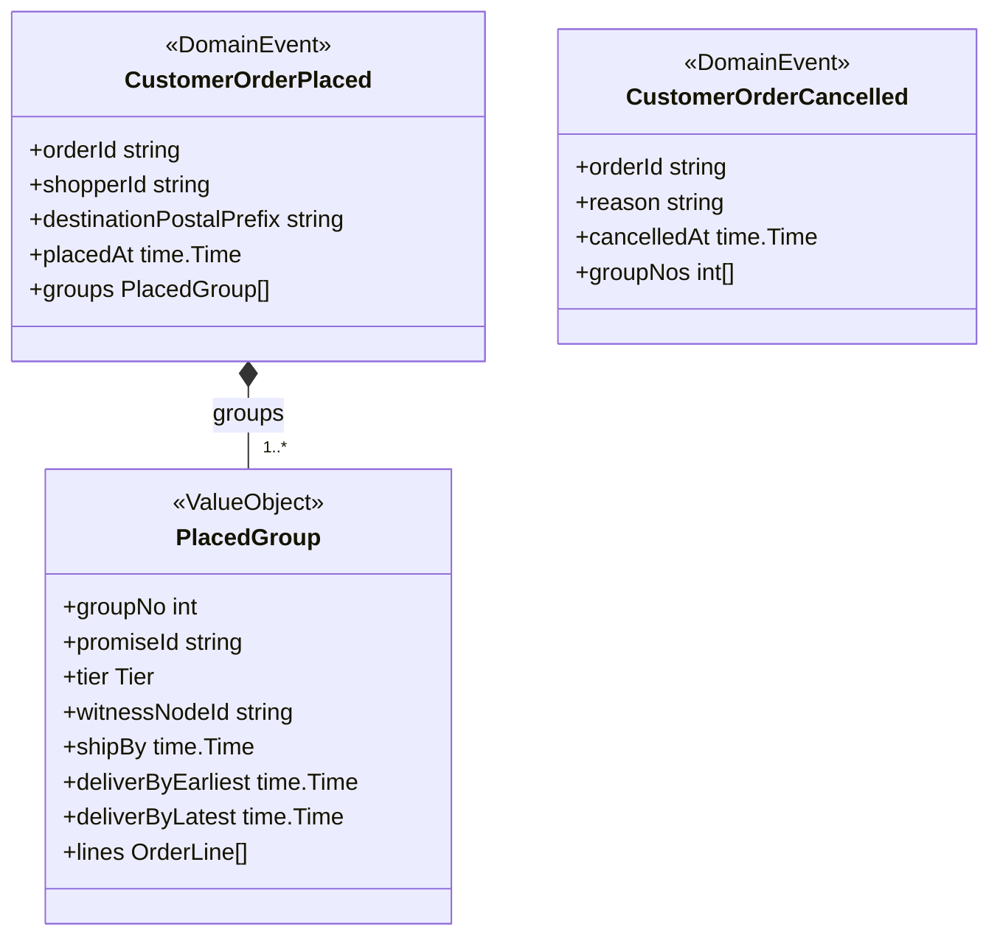
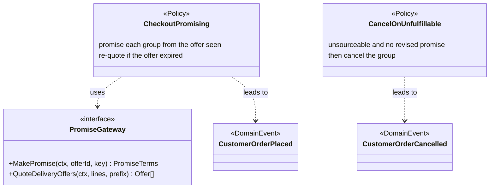
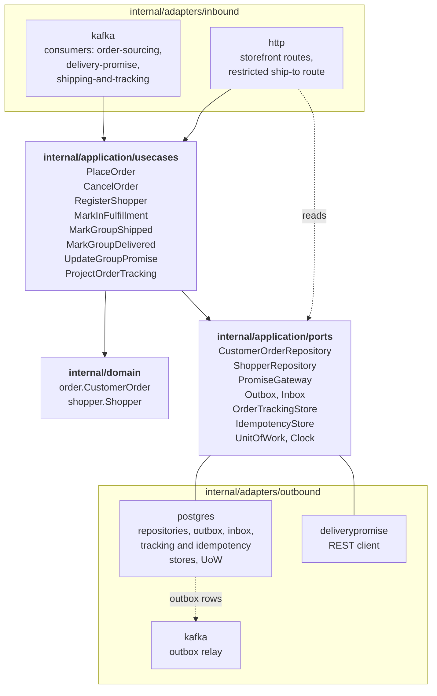

# Class Diagram

:::info[As built]
Derived from [`model/model.yaml`](https://github.com/IQVO/retail-network-docs/blob/main/model/model.yaml). This context's service is built; the model carries its as-built contracts, and identifiers (`Err...` names, routes, CloudEvents types) are the names the service uses.
:::

UML class diagrams of the **proposed** `internal/domain/**` packages, plus
the hexagonal ports and adapters. Type names come from the model's code
identifiers (`order.CustomerOrder`, `order.ShipTo`, `shopper.Shopper`) and
value objects. Fields are unexported in Go and shown with `-`; methods are
shown with `+`. A member marked `*` is not in the model's value object; it
carries an event field the aggregate must keep (see the
[Aggregate Design Canvas](/network/contexts/customer-ordering/aggregate-design-canvas)).

## 1. CustomerOrder aggregate

Derived from: `model.yaml → contexts[customer-ordering].aggregates[CustomerOrder]`
(`states`, `value_objects`, `commands`, `invariants`); `.publishes[*].data`
and `.consumes` for the `*` members; `contexts[delivery-promise].ul`
(`promise.Tier`).

Omitted: read accessors, the `Err...` variables (`ErrLineWithoutPromise`,
`ErrPromiseDestinationMismatch`, `ErrCancelAfterLock`,
`ErrStatusRegression`; listed on the Aggregate Design Canvas), the last
applied `revisionNo` per group, and the `cancelledAt` and reason of a single
cancelled group. `Tier` is `delivery-promise`'s vocabulary, re-declared
locally: there is no shared kernel.

## 2. Shopper aggregate

Derived from: `model.yaml → contexts[customer-ordering].aggregates[Shopper]`.

Omitted: `ErrShopperExists`. The model names the email uniqueness rule and
"saved addresses", but no further fields.

## 3. Domain events and policies

Derived from: `model.yaml → contexts[customer-ordering].publishes`,
`.policies`, `.sync_calls`. The second diagram repeats the two events as
bare boxes to show which policy leads to which.

Omitted: the CloudEvents envelope (built in the Kafka adapter). `PlacedGroup`,
`PromiseTerms` and `Offer` are proposed Go type names for the payload shapes
the model gives; they are not new messages. The events hold no `ShipTo`.

## 4. Hexagonal ports and adapters

Derived from: `model.yaml → contexts[customer-ordering].aggregates`,
`.inbound`, `.sync_calls`, `.read_models`; `conventions.integration_rules`
(outbox, inbox); the fleet's Go hexagonal layout.

Omitted: the composition root (`cmd/customer-ordering`), metrics and tracing.
`ProjectOrderTracking` is the projector that writes `OrderTrackingView`. It is
not a command of the model and changes no aggregate. The read routes
(`GetOrder`, `GetTracking`, `GetShipTo`) read the stores through their ports
without a use case. The `deliverypromise` package sits beside the `postgres`
and `kafka` adapters, because checkout's synchronous calls need an outbound
REST client.
