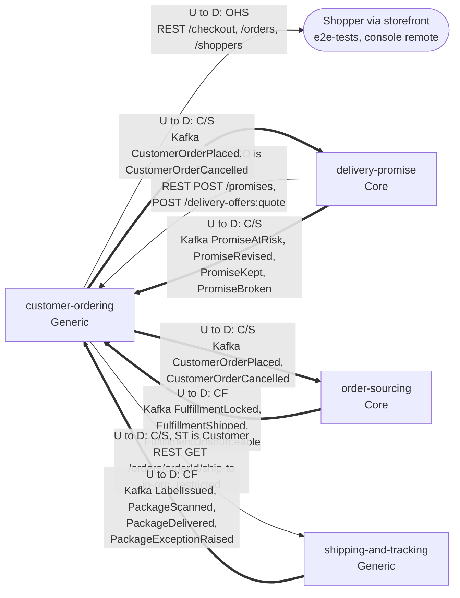

# Context Map

:::info[As built]
Derived from [`model/model.yaml`](https://github.com/IQVO/retail-network-docs/blob/main/model/model.yaml). This context's service is built; the model carries its as-built contracts, and identifiers (`Err...` names, routes, CloudEvents types) are the names the service uses.
:::

Following ddd-crew [Context Mapping](https://github.com/ddd-crew/context-mapping).
This is **customer-ordering's slice** of the
[network-wide context map](/network/strategic-design/context-map): every
relationship this context has, with the upstream (U) and downstream (D)
side, the pattern and the channel.

Derived from: `model.yaml → contexts[customer-ordering].inbound`,
`.sync_calls`, `.publishes`, `.consumes`; `contexts[delivery-promise].inbound`
(rows from `customer-ordering`), `contexts[order-sourcing].inbound`,
`contexts[shipping-and-tracking].sync_calls`.

Legend: arrows point from upstream to downstream. A solid arrow is a
synchronous REST relationship; a thick arrow is a Kafka event relationship.
`delivery-promise` is drawn three times in that sense: it is upstream for the
checkout calls and the promise events, and downstream for the order events.
The path parameter `{orderId}` is written `orderId` inside the diagram.

Omitted, because they have no edge with this context (**Separate Ways**):
`node-topology` (Supporting), `offer-availability` (Supporting; the
storefront queries its catalogue directly, and order lines carry only
`catalogItemId`), `vendor-connectivity` (Supporting), `linehaul-transportation`
(Supporting), `last-mile-delivery` (Supporting), `node-performance`
(Supporting), and the warehouse-systems `network-fulfillment` context
(Supporting in the fleet, external organization). The shopper also queries
`delivery-promise` directly for offers (`POST /delivery-offers:quote`, OHS).
That edge belongs to `delivery-promise` and is not drawn here. Also omitted:
`shipping-and-tracking` lists "shopper / customer-ordering" as a caller of
`GET /journeys/{trackingNumber}`, but this context's `sync_calls` do not
include it, so the tracking view is event-fed only (see Notes).

## Relationships

| Neighbour | Direction | Pattern | Channel | Messages | Why this pattern |
| --- | --- | --- | --- | --- | --- |
| Shopper / storefront (e2e-tests, console remote) | CO upstream, storefront downstream | **Open Host Service** | REST `POST /checkout`, `GET /orders/{orderId}`, `GET /orders/{orderId}/tracking`, `POST /orders/{orderId}:cancel`, `POST /shoppers` | `PlaceOrder`, `GetOrder`, `GetTracking`, `CancelOrder`, `RegisterShopper` | Many clients (tests, the console remote) use one published, versioned API; none negotiates it. |
| `delivery-promise` (Core) | DP upstream, CO downstream | **Customer/Supplier** (CO is the Customer) | REST `POST /delivery-offers:quote`, `POST /promises` (in-org, synchronous) | `QuoteDeliveryOffers`, `MakePromise` | Checkout needs an answer inside the shopper's request. DP serves this caller deliberately: its `inbound` names `customer-ordering` on both routes. |
| `delivery-promise` (Core) | CO upstream, DP downstream | **Customer/Supplier** | Kafka `retailnetwork.customer-ordering.events` | `CustomerOrderPlaced`, `CustomerOrderCancelled` | DP needs the placement to confirm the hold (`ConfirmPromise`) and the cancellation to release it (`CancelPromise`). |
| `delivery-promise` (Core) | DP upstream, CO downstream | **Customer/Supplier** | Kafka `retailnetwork.delivery-promise.events` | `PromiseAtRisk`, `PromiseRevised`, `PromiseKept`, `PromiseBroken` | DP lists CO as a named consumer; CO keeps each group's window current (`UpdateGroupPromise`) and shows the verdict. |
| `order-sourcing` (Core) | CO upstream, OS downstream | **Customer/Supplier** | Kafka `retailnetwork.customer-ordering.events` | `CustomerOrderPlaced`, `CustomerOrderCancelled` | OS queues one assignment per group from the placement. The event carries each group's promise snapshot so OS does not have to correlate it with DP's stream; that payload shape is negotiated for OS. |
| `order-sourcing` (Core) | OS upstream, CO downstream | **Conformist** | Kafka `retailnetwork.order-sourcing.events` | `FulfillmentLocked`, `FulfillmentShipped`, `FulfillmentUnsourceable` | CO takes the assignment facts as published and only projects them into status; nothing is translated. |
| `shipping-and-tracking` (Generic) | CO upstream, ST downstream | **Customer/Supplier** (ST is the Customer) | REST `GET /orders/{orderId}/ship-to` (in-org, restricted) | `GetShipTo` | The one sanctioned read of PII outside this context ([ADR 0006](/network/adr/0006-pii-confinement)). It is a dedicated, restricted route built for one customer, not part of the storefront OHS. |
| `shipping-and-tracking` (Generic) | ST upstream, CO downstream | **Conformist** | Kafka `retailnetwork.shipping-and-tracking.events` | `LabelIssued`, `PackageScanned`, `PackageDelivered`, `PackageExceptionRaised` | Package facts are taken as published, for status and tracking. |

## Notes on the patterns

- **No Anti-Corruption Layer.** Every upstream here is inside the same
  organization and speaks the network's language; the tracking projector
  reads the events as published. The only ACL in the network is in the fleet,
  on the far side of the Vendor API ([Vendor API](/network/integration/vendor-api)).
- **No Shared Kernel.** Identifiers such as `promiseId`, `assignmentId` and
  `trackingNumber` are values copied from events, not shared code.
- **No fleet edge.** Customer Ordering never consumes a `warehouse.*` topic
  and never calls a warehouse-systems service (the model's `hard_boundary`).
- **The tracking view is event-fed.** `shipping-and-tracking` offers
  `GET /journeys/{trackingNumber}` to "shopper / customer-ordering", but this
  context's `sync_calls` list only `delivery-promise`. The storefront may call
  that route itself; this context never does.
