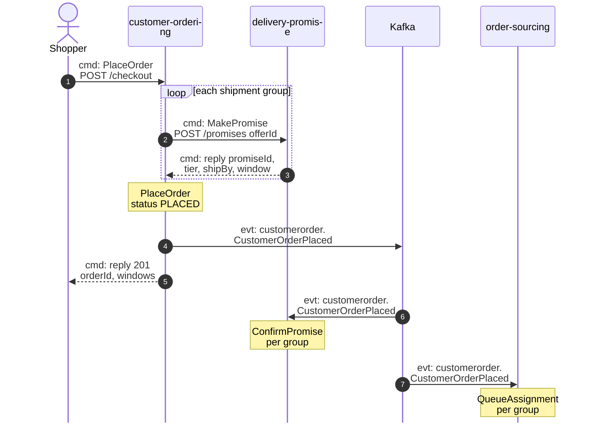
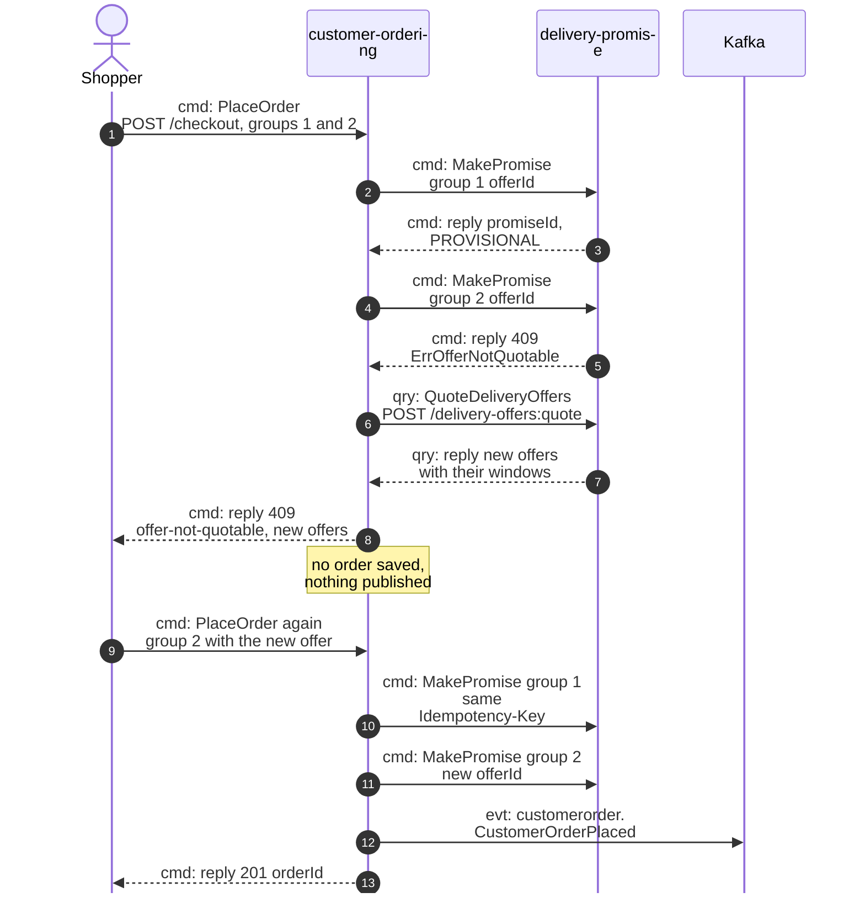
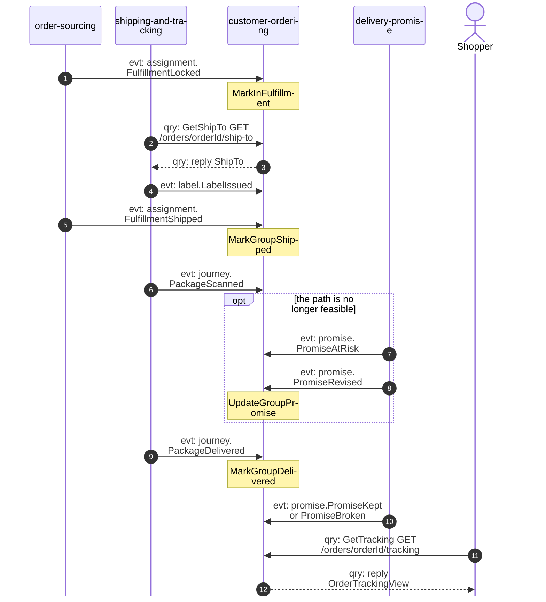
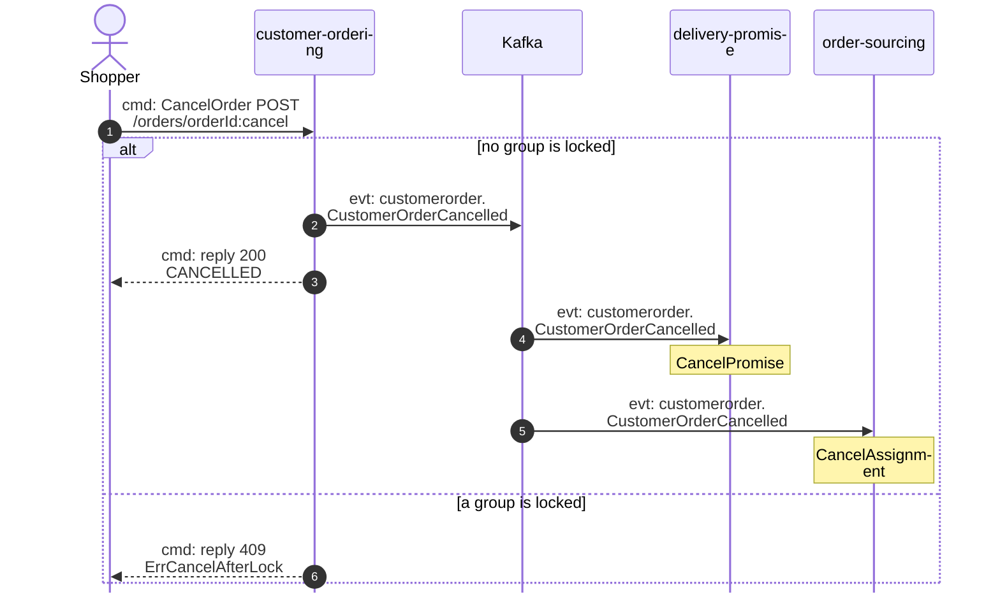
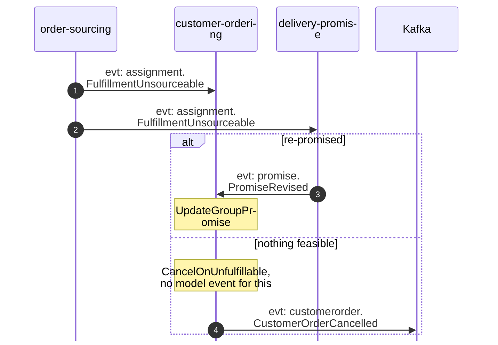

# Domain Message Flow

:::info[Proposed design]
Derived from [`model/model.yaml`](https://github.com/IQVO/retail-network-docs/blob/main/model/model.yaml). Nothing in this context is built yet; identifiers (`Err...` names, routes, CloudEvents types) are the names an implementation must use.
:::

Following ddd-crew [Domain Message Flow Modelling](https://github.com/ddd-crew/domain-message-flow-modelling).
Four scenarios. Participants are contexts and actors. Every arrow is a
message from the model, prefixed `cmd:` (command), `qry:` (query) or `evt:`
(event). A `Note` names a command a context runs on itself. Kafka is drawn
as one participant. Event names are written `entity.EventName`; the full
type is `com.retailnetwork.<tier>.<producer>.<entity>.<EventName>` (see
[Domain Events](/network/contexts/customer-ordering/domain-events)). REST path
parameters are written without braces. The network-wide flows are on
[Domain Message Flows](/network/strategic-design/domain-message-flows).

## 1. Checkout: every group promised, order placed

Derived from: `model.yaml → contexts[customer-ordering].inbound` (`POST /checkout`),
`.sync_calls` (`MakePromise`), `.policies[CheckoutPromising]`,
`.publishes[CustomerOrderPlaced]`; `contexts[delivery-promise].aggregates[Promise].transitions`;
`contexts[order-sourcing].aggregates[FulfillmentAssignment].commands`.

Omitted: the outbox write and relay (the event leaves after the commit; see
[Sequence Diagrams](/network/contexts/customer-ordering/sequence-diagrams)); the
events `delivery-promise` and `order-sourcing` raise in reaction
(`PromiseConfirmed` and `FulfillmentQueued`, both analytics-only). The shopper
saw the offers earlier, by querying `delivery-promise` directly; that query is
not this context's message.

## 2. Checkout fails: an offer expired (failure path)

Derived from: `model.yaml → contexts[customer-ordering].policies[CheckoutPromising]`,
`.sync_calls`; `contexts[delivery-promise].aggregates[DeliveryOffer].invariants`
(`ErrOfferNotQuotable`), `.aggregates[Promise].transitions`
(`ReleaseExpiredHolds`).

Omitted: the replies to the second checkout's two `MakePromise` calls. Also
omitted is the abandoned case. If the shopper never retries, group 1's promise
stays `PROVISIONAL` until `delivery-promise` releases it at `holdExpiresAt`
(`ReleaseExpiredHolds`, `PromiseReleased` to analytics only). This context
sends nothing for it. The same 409 shape is used for
`ErrPromiseCapacityExhausted` and `ErrBookClosed`. Reusing group 1's promise
relies on the proposed `Idempotency-Key` that this context derives from the
`offerId` when it calls `POST /promises`.

## 3. Fulfilment to delivery, with a re-promise

Derived from: `model.yaml → contexts[customer-ordering].consumes`,
`.inbound` (`GetShipTo`, `GetTracking`), `.aggregates[CustomerOrder].transitions`,
`.read_models[OrderTrackingView]`; `contexts[shipping-and-tracking].sync_calls`.

Omitted: Kafka between producer and consumer; the vendor side that leads to
the label (`vendor-connectivity` asks `shipping-and-tracking` for it after the
purchase order is accepted); `PackageExceptionRaised`, which only updates the
tracking view; more than one group or package. The event-to-command pairing
is this pack's reading of the model (see the
[canvas](/network/contexts/customer-ordering/bounded-context-canvas) open questions).

## 4. Cancellation, by the shopper or by an unfulfillable group

Then the policy-driven variant, when a group cannot be sourced:

Derived from: `model.yaml → contexts[customer-ordering].inbound` (`POST /orders/{orderId}:cancel`), `.aggregates[CustomerOrder].invariants`
(`ErrCancelAfterLock`), `.policies[CancelOnUnfulfillable]`,
`.publishes[CustomerOrderCancelled]`; `contexts[delivery-promise].policies[RepromiseOnRisk]`;
`contexts[order-sourcing].consumes`.

Omitted: Kafka between `order-sourcing` and the two consumers of
`FulfillmentUnsourceable`. `order-sourcing` re-queues the group on
`PromiseRevised` (`ApplyRevisedPromise`). Two consequences of the model are
listed as open questions. First, `order-sourcing` has no transition from
`UNSOURCEABLE` to `CANCELLED`, so a cancellation of an unsourceable group has
no target transition there. Second, "no revised promise is feasible" has no
event.
