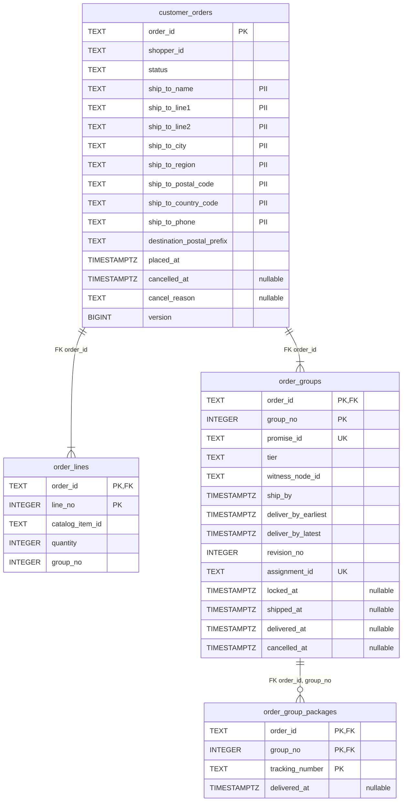
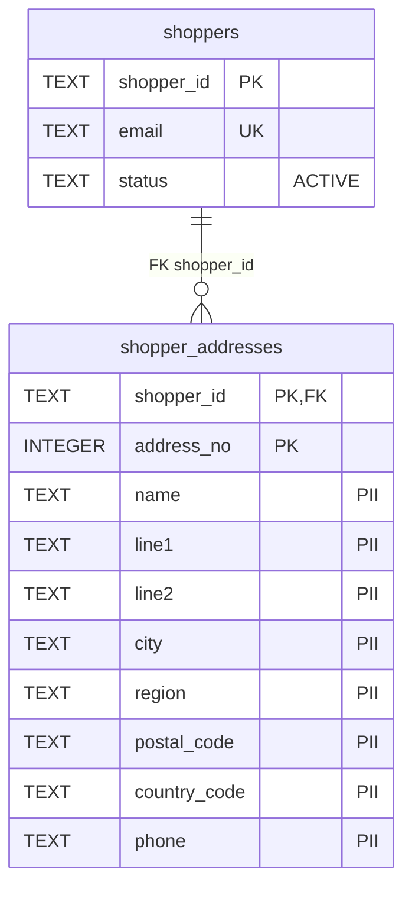
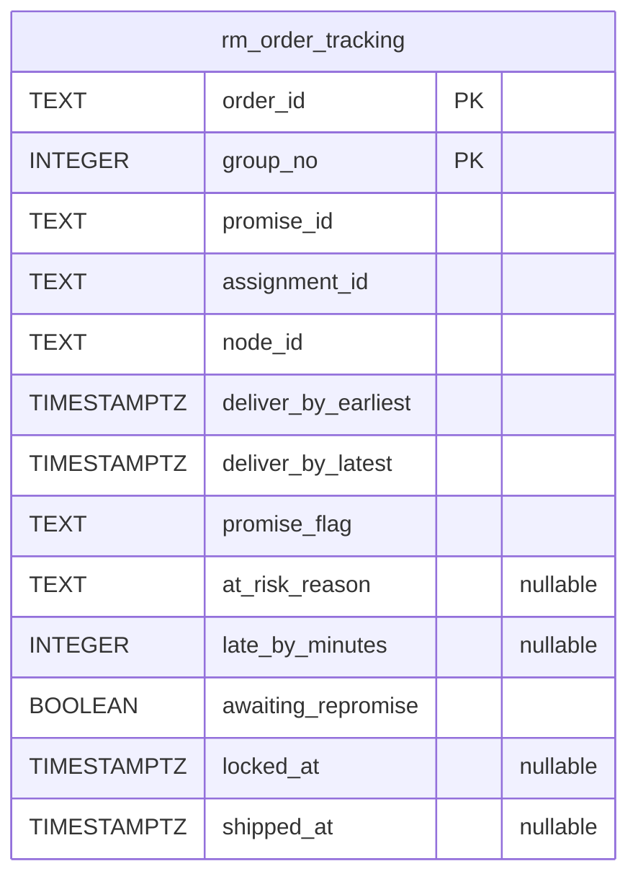
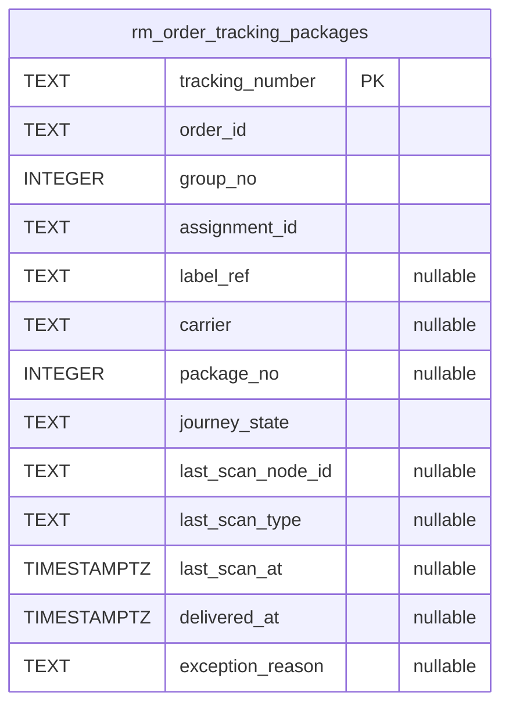
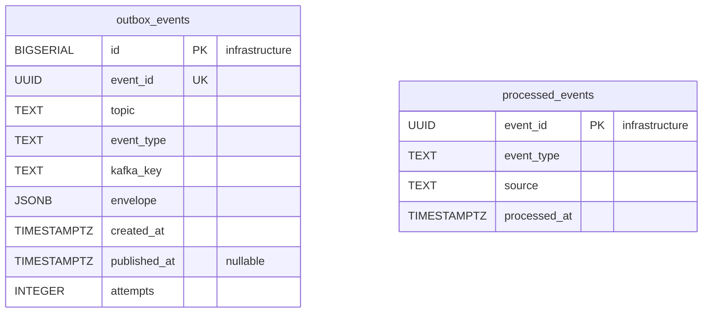
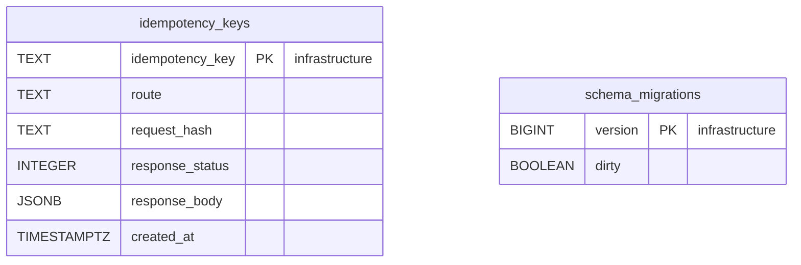

# Entity Relationship

:::info[As built]
Derived from [`model/model.yaml`](https://github.com/IQVO/retail-network-docs/blob/main/model/model.yaml). This context's service is built; the model carries its as-built contracts, and identifiers (`Err...` names, routes, CloudEvents types) are the names the service uses.
:::

The **proposed** Postgres schema. Customer Ordering owns its database and
shares no table with any other context (`conventions.integration_rules`).
Column names are the model's field names in `snake_case`. A relationship line
is drawn **only** inside one aggregate. The schema holds the network's only
ship-to columns, together with the label snapshot in `shipping-and-tracking`
([ADR 0006](/network/adr/0006-pii-confinement)).

## Aggregate tables

### CustomerOrder

### Shopper

Derived from: `model.yaml → contexts[customer-ordering].aggregates[CustomerOrder].value_objects`
(`ShipTo`, `OrderLine`, `GroupPromise`), `.states`; `.aggregates[Shopper]`
(`email` unique); `.publishes[*].data` (`destination_postal_prefix`, `tier`,
`witness_node_id`, `ship_by`, `cancelled_at`, the cancel `reason`);
`.consumes` (`assignment_id`, `locked_at`, `tracking_number`, `shipped_at`,
`delivered_at`, `revision_no`).

Column notes: `customer_orders.status` holds the six `CustomerOrder` states;
`customer_orders.shopper_id` is a reference by value (no FK); `version` is
the optimistic-concurrency counter every save checks; `order_lines.group_no`
names the group a line belongs to; `order_groups.revision_no` is the last
applied `PromiseRevised.revisionNo`; `order_groups.assignment_id` comes from
`FulfillmentLocked`.

Omitted: indexes (for example on `customer_orders.shopper_id`) and `CHECK`
constraints (for example `quantity > 0`). The `order_groups` columns from
`assignment_id` to `cancelled_at`, and `order_group_packages`, hold
per-group progress. The model's `GroupPromise` does not name this data, yet
`ErrCancelAfterLock` and the `PARTIALLY_SHIPPED`/`SHIPPED` choice need it.
The column names are the consumed events' field names. `address_no` is a
surrogate key; the model gives saved addresses no identity of their own.

## Read model tables

Derived from: `model.yaml → contexts[customer-ordering].read_models[OrderTrackingView]`
and the data of its source events.

`rm_order_tracking` and `rm_order_tracking_packages` are disposable. They
can be truncated and rebuilt by replaying the three consumed topics.
`node_id` comes from `FulfillmentLocked`; `journey_state` from
`PackageScanned.state`. `promise_flag` (`AT_RISK`, `KEPT`, `BROKEN` or null)
and `awaiting_repromise` are display columns derived from `PromiseAtRisk`,
`PromiseKept`, `PromiseBroken` and `FulfillmentUnsourceable`. They are not
model fields. `rm_order_tracking_packages` holds no address: a tracking line
is linked to its order by `assignment_id` and `tracking_number`, never by
the ship-to.

## Infrastructure tables

Derived from: `model.yaml → conventions.integration_rules` (transactional
outbox, idempotent consumers); `conventions.cloudevents` (topic, type, key).

**All four tables are infrastructure, not domain tables.** `outbox_events` is
the transactional outbox. It is written in the same transaction as the
aggregate and drained by the relay to `retailnetwork.customer-ordering.events`.
`event_id` is the CloudEvents `id`, `event_type` the full type, and
`kafka_key` the `orderId`. `processed_events` is the inbox, one row per
consumed CloudEvents `id`, written in the same transaction as the effect.
`idempotency_keys` stores the response of every state-changing `POST` for
replay. `schema_migrations` is the migration tool's bookkeeping.

## Why there are no foreign keys across aggregates or contexts

- `customer_orders.shopper_id` → `shoppers.shopper_id` is a reference **by
  value**. `CustomerOrder` and `Shopper` are separate aggregates with separate
  transactions. An FK would couple their lifecycles and lock both rows on
  checkout. The model names no check that the shopper exists.
- `order_groups.promise_id`, `order_groups.assignment_id`,
  `order_groups.witness_node_id`, `order_lines.catalog_item_id` and every
  `tracking_number` point into **other contexts' databases**
  (`delivery-promise`, `order-sourcing`, `node-topology`,
  `offer-availability`, `shipping-and-tracking`). No database is shared, so
  these are values copied from messages.
- The read-model tables have no FK at all. They are rebuilt from events and
  may briefly hold a row for an order whose own commit is not visible yet.

## Table ≠ aggregate

| Table | Aggregate / role | Notes |
| --- | --- | --- |
| `customer_orders` | **CustomerOrder** (root) | One row per order, with the `ShipTo` columns and `version` for optimistic concurrency. |
| `order_lines` | **CustomerOrder** (`OrderLine` value objects) | Written once at `PlaceOrder`; never updated. |
| `order_groups` | **CustomerOrder** (`GroupPromise` value objects, plus per-group progress) | Updated by `MarkInFulfillment`, `MarkGroupShipped`, `MarkGroupDelivered`, `UpdateGroupPromise`, `CancelOrder`, always with the root's `version`. |
| `order_group_packages` | **CustomerOrder** (the group's tracking numbers) | Written by `MarkGroupShipped`; `delivered_at` set from `PackageDelivered`. |
| `shoppers` | **Shopper** (root) | `email` unique (`ErrShopperExists`). |
| `shopper_addresses` | **Shopper** (saved `ShipTo` values) | PII. |
| `rm_order_tracking`, `rm_order_tracking_packages` | none (read model `OrderTrackingView`) | Serves `GET /orders/{orderId}/tracking`. |
| `outbox_events` | none (infrastructure) | Transactional outbox. |
| `processed_events` | none (infrastructure) | Inbox for idempotent consumers. |
| `idempotency_keys` | none (infrastructure) | `Idempotency-Key` replay store. |
| `schema_migrations` | none (infrastructure) | Migration bookkeeping. |
