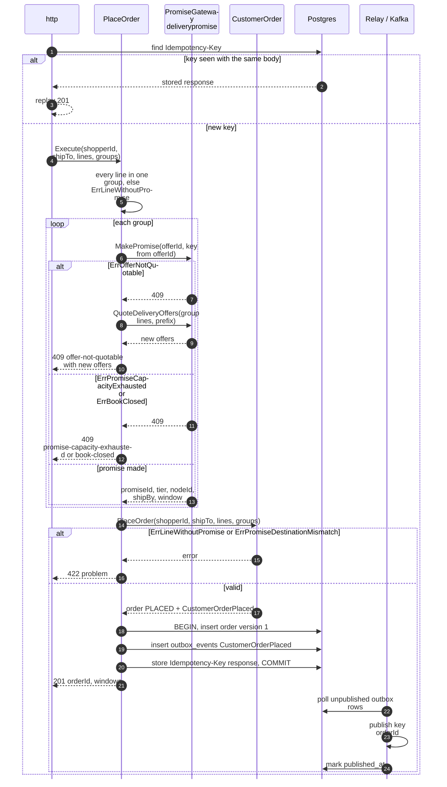
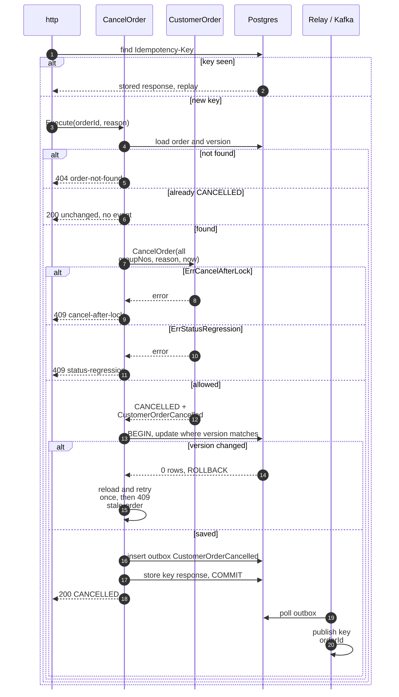
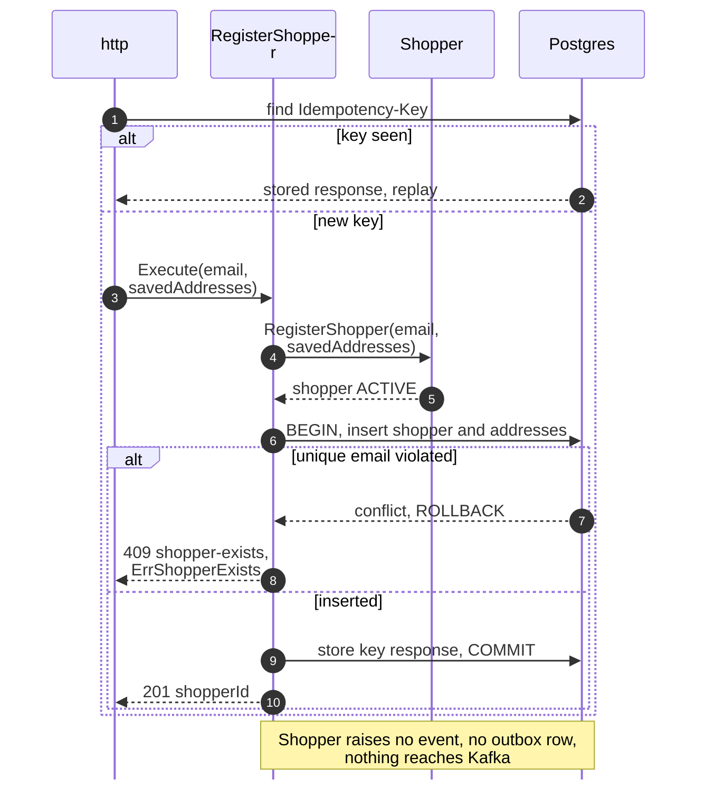
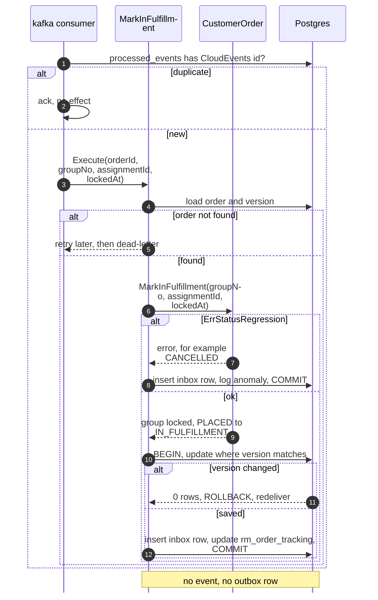
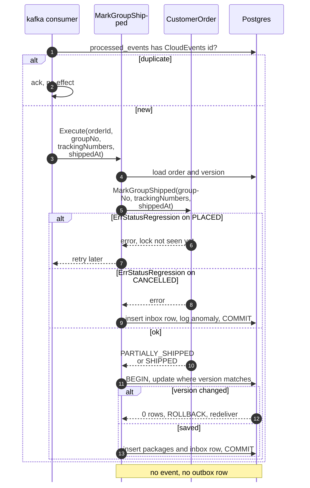
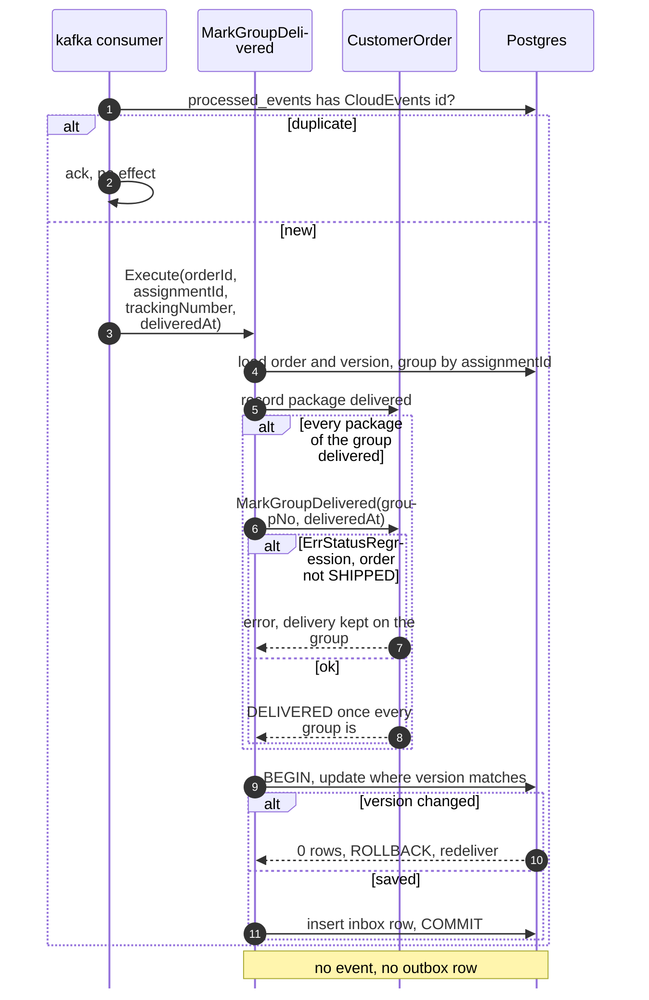
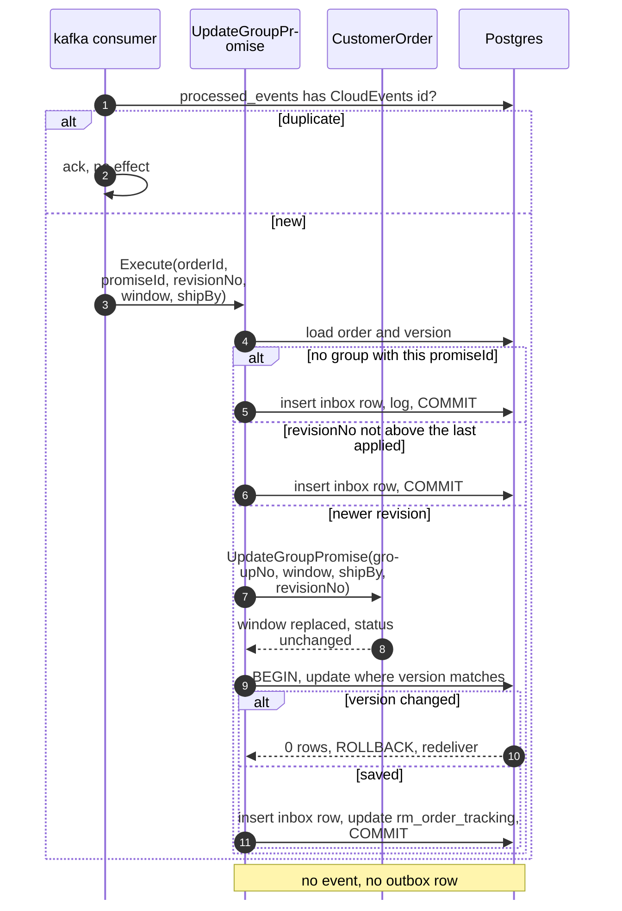

# Sequence Diagrams

:::info[Proposed design]
Derived from [`model/model.yaml`](https://github.com/IQVO/retail-network-docs/blob/main/model/model.yaml). Nothing in this context is built yet; identifiers (`Err...` names, routes, CloudEvents types) are the names an implementation must use.
:::

One UML sequence diagram per command use case on
[Use Cases](/network/contexts/customer-ordering/use-cases). Participant names are the
proposed packages and ports from the
[Class Diagram](/network/contexts/customer-ordering/class-diagram):

- `http` and `kafka` are the inbound adapters.
- The use case is in `internal/application/usecases`.
- `Postgres` stands for the repository, the outbox, the inbox and the
  idempotency store. They share one transaction through `UnitOfWork`.
- `Relay / Kafka` is the outbox relay. It reads committed `outbox_events`
  rows and publishes them to `retailnetwork.customer-ordering.events`.

Every save is conditional on the loaded `version` (optimistic concurrency).
Full CloudEvents types are on [Domain Events](/network/contexts/customer-ordering/domain-events).

## 1. PlaceOrder (REST POST /checkout)

Derived from: `model.yaml → contexts[customer-ordering].aggregates[CustomerOrder]`
(`PlaceOrder`, invariants), `.sync_calls`, `.policies[CheckoutPromising]`,
`.publishes[CustomerOrderPlaced]`; `conventions.integration_rules`.

Omitted: `ErrGroupSpansNodes` (422) and a `delivery-promise` timeout (503),
both handled like the 409 branch. Promises made before a failing group are
not released by this context; `delivery-promise` releases them at
`holdExpiresAt`. There is no version conflict on an insert. A second
insert with the same `orderId` cannot happen, because the id is minted here.

## 2. CancelOrder (REST POST /orders/orderId:cancel)

Derived from: `model.yaml → contexts[customer-ordering].aggregates[CustomerOrder]`
(`CancelOrder`, `ErrCancelAfterLock`, `ErrStatusRegression`),
`.publishes[CustomerOrderCancelled]`.

Omitted: the relay marking the row published (as in diagram 1). A lock
`order-sourcing` made but this context has not consumed yet is not visible
here (race, see [Use Cases](/network/contexts/customer-ordering/use-cases)).

## 3. CancelOrder by policy CancelOnUnfulfillable (Kafka)

```mermaid
%%{init: {"sequence": {"wrap": true, "width": 120, "actorMargin": 24, "messageMargin": 28, "boxMargin": 6, "noteMargin": 6, "mirrorActors": false}}}%%
sequenceDiagram
    autonumber
    participant KC as kafka consumer
    participant UC as CancelOrder policy
    participant A as CustomerOrder
    participant DB as Postgres
    participant K as Relay / Kafka
    KC->>DB: processed_events has CloudEvents id?
    alt duplicate
        KC->>KC: ack, no effect
    else new FulfillmentUnsourceable
        KC->>UC: Execute(orderId, groupNo, promiseId)
        UC->>DB: BEGIN, mark group awaiting re-promise, insert inbox row, COMMIT
        Note over UC: waits for PromiseRevised or for the not-feasible condition, which no model event signals
        opt not-feasible condition holds
            UC->>DB: load order and version
            UC->>A: CancelOrder(groupNo, reason, now)
            alt ErrCancelAfterLock or ErrStatusRegression
                A-->>UC: error
                UC->>UC: log anomaly, no event
            else allowed
                A-->>UC: group cancelled + CustomerOrderCancelled
                UC->>DB: BEGIN, update where version matches
                UC->>DB: insert outbox CustomerOrderCancelled, COMMIT
                K->>DB: poll outbox
                K->>K: publish key orderId
            end
        end
    end
```

Derived from: `model.yaml → contexts[customer-ordering].policies[CancelOnUnfulfillable]`,
`.consumes` (`FulfillmentUnsourceable`), `.publishes[CustomerOrderCancelled]`.

Omitted: the version-conflict retry (as in diagram 2). The trigger of the
`opt` block is the model gap recorded as hotspot H6 on
[EventStorming](/network/contexts/customer-ordering/eventstorming).

## 4. RegisterShopper (REST POST /shoppers)

Derived from: `model.yaml → contexts[customer-ordering].aggregates[Shopper]`.

Omitted: nothing else. The model gives `Shopper` no events.

## 5. MarkInFulfillment (Kafka FulfillmentLocked)

Derived from: `model.yaml → contexts[customer-ordering].aggregates[CustomerOrder]`
(`MarkInFulfillment`, `ErrStatusRegression`), `.consumes`
(`FulfillmentLocked`), `.read_models`.

Omitted: the tracking projector, which here runs in the same transaction.
It can also run as its own consumer.

## 6. MarkGroupShipped (Kafka FulfillmentShipped)

Derived from: `model.yaml → contexts[customer-ordering].aggregates[CustomerOrder]`
(`MarkGroupShipped`, transitions), `.consumes` (`FulfillmentShipped`).

Omitted: the order-not-found branch (as in diagram 5) and the tracking
projection.

## 7. MarkGroupDelivered (Kafka PackageDelivered)

Derived from: `model.yaml → contexts[customer-ordering].aggregates[CustomerOrder]`
(`MarkGroupDelivered`, transitions), `.consumes` (`PackageDelivered`).

Omitted: the order-not-found branch and the tracking projection. On
`PARTIALLY_SHIPPED` the model has no transition (hotspot H4), so the status
stays.

## 8. UpdateGroupPromise (Kafka PromiseRevised)

Derived from: `model.yaml → contexts[customer-ordering].aggregates[CustomerOrder]`
(`UpdateGroupPromise`), `.consumes` (`PromiseRevised`);
`contexts[delivery-promise].publishes[PromiseRevised].data`.

Omitted: telling the shopper about the new window, which belongs to the
future `customer-notification` context.
