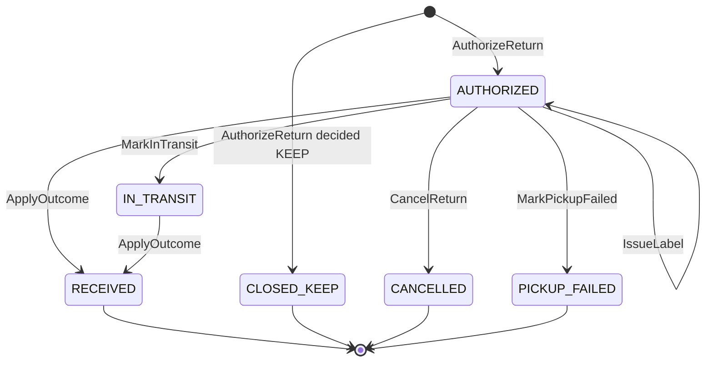

# Aggregate Design Canvas

:::info[As built]
Derived from [`network/model/model.yaml`](https://github.com/IQVO/warehouse-docs/blob/main/network/model/model.yaml). This context's service is built ([`IQVO/customer-returns`](https://github.com/IQVO/customer-returns), decided by [ADR 0012](/network/adr/0012-customer-returns-is-a-bounded-context)); the model carries its as-built contracts, and identifiers (`Err...` names, routes, CloudEvents types) are the names the service uses. Where the model left a choice open, the service's own ADRs 0001 to 0005 record what it does.
:::

Following the ddd-crew [Aggregate Design Canvas v1.1](https://github.com/ddd-crew/aggregate-design-canvas).
One aggregate root: **ReturnAuthorization**. Go packages (as built):
`internal/domain/returnauthorization`, with the read-model value types in
`internal/domain/network`.

## ReturnAuthorization

**Description.** One authorized return of one order group (`orderId` and
`groupNo`) and its lines: the reason, the decided disposition, the method,
the destination and origin nodes, the linked reverse-label tracking numbers
and the state. Identified by `authorizationId`, minted by the service with
the prefix `ret-`. Value objects:
`ReturnLine{lineNo, catalogItemId, quantity, unitPriceCents, ownerRef}`,
`ReturnReason`, `Disposition`, `ReturnMethod`,
`PickupWindow{pickupWindowStart, pickupWindowEnd}`, `CancelReason` and
`OutcomeLine{catalogItemId, ownerRef, qtyRestockable, qtyUnsellable}`.

Derived from: model.yaml → contexts[customer-returns].aggregates[ReturnAuthorization].states,
.transitions, .commands.

A `KEEP` closes at once: the model writes it as the transition from
`AUTHORIZED` to `CLOSED_KEEP` by `AuthorizeReturn`, and the service creates
the authorization directly in `CLOSED_KEEP`. `MarkInTransit` and
`MarkPickupFailed` exist in the domain with no caller, so `IN_TRANSIT` and
`PICKUP_FAILED` are reachable by no route or consumer today. `CancelReturn`
is both the shopper's cancellation and the lazy expiry.

| Invariant | Error |
| --- | --- |
| 1 to 50 lines, each quantity at least 1, a known reason, disposition and method; `expiresAt` = `authorizedAt` + 30 days | `ErrValidation` |
| The order group is `SHIPPED` or `DELIVERED` in `OrderGroupView` when the return is authorized (checked by the use case) | `ErrGroupNotShipped` |
| Every `lineNo` of the request resolves against the placed group (checked by the use case) | `ErrUnknownLine` |
| A disposition exists: `KEEP` applies, or the region has an `ACTIVE` returns centre, or a sourcing fact named the fulfilling node | `ErrNoReturnDestination` |
| `KEEP` has no destination node and no label and is `CLOSED_KEEP` at once; `PICKUP` has both window bounds inside the interval from `authorizedAt` to `expiresAt` and is never `KEEP` | `ErrValidation` |
| At most 5 tracking numbers, `packageNo` 1 to 5 (service ADR 0002 names it `ErrMaxPackages`; the code returns the shared validation error) | `ErrValidation` |
| Cancel only while `AUTHORIZED`; a label only while `AUTHORIZED` with a disposition other than `KEEP`; an outcome only while `AUTHORIZED` or `IN_TRANSIT` | `ErrIllegalTransition` |
| An authorization past `expiresAt` is cancelled on the next read, label or outcome call | `ErrAuthorizationExpired` |
| A label is issued only when the reverse-label route answers with a tracking number | `ErrLabelUnavailable` |
| An applied outcome names each authorized item at most once, with at least one unit and never more than the authorized quantity | `ErrValidation` |

**Corrective policies.** `LazyExpiry` cancels an expired authorization on
the next touch. `FirstFittingOutcomeCompletes` completes the first open
authorization an outcome fits and records every other outcome as a fact.
`UnexpectedLinesStayFacts` keeps lines the authorization never covered out
of the published event.

| Command | Inbound route or trigger | Issued by |
| --- | --- | --- |
| `AuthorizeReturn` | `POST /return-authorizations` | shopper / storefront |
| `IssueLabel` | `POST /return-authorizations/{authorizationId}/labels` | shopper / storefront |
| `CancelReturn` | `POST /return-authorizations/{authorizationId}/cancellations`; also the lazy expiry | shopper / storefront; any touch after `expiresAt` |
| `ApplyOutcome` | the consumer of the vendor's graded outcome (no HTTP) | not triggered today: the producer is not on `develop` |
| `MarkInTransit` | none | no caller as built |
| `MarkPickupFailed` | none | no caller as built |

| Event | Raised when | Full CloudEvents type |
| --- | --- | --- |
| `ReturnAuthorized` | `AuthorizeReturn` is saved, for every disposition, `KEEP` included | `com.retailnetwork.commerce.customer-returns.returnauthorization.ReturnAuthorized` |
| `ReturnLabelIssued` | `IssueLabel` links a tracking number, once per package | `com.retailnetwork.commerce.customer-returns.returnauthorization.ReturnLabelIssued` |
| `ReturnCompleted` | the first fitting graded outcome is applied | `com.retailnetwork.commerce.customer-returns.returnauthorization.ReturnCompleted` |
| `ReturnCancelled` | `CancelReturn` is saved (reason `SHOPPER_REQUESTED` or `EXPIRED`) | `com.retailnetwork.commerce.customer-returns.returnauthorization.ReturnCancelled` |

**Throughput:** low to medium, a share of shipped groups. **Size:** one row
per authorization with its lines and tracking numbers.

## Read models

| Read model | Fed by |
| --- | --- |
| `OrderGroupView` | `CustomerOrderPlaced` (writes `PROMISED` per group with the destination postal prefix, the witness node and the placed lines) and the terminal `ShopperNoticeDecided` families `GROUP_SHIPPED`, `GROUP_DELIVERED`, `GROUP_LOST`, `GROUP_RETURNED`. Order tolerant: a notice before its placed event creates the row, and a placed event never demotes a status a notice already set. |
| `ReturnsNetworkView` | Nodes from `NodeRegistered`, `NodeActivated`, `NodeSuspended`, `NodeRetired` (only `ACTIVE` `RETURNS_CENTER` nodes are candidates); prefixes from `ServiceAreaAssigned` (the highest `assignmentVersion` wins); origins from `FulfillmentLocked` (the fulfilling node) and `FulfillmentReleasedToNode` (the per-item `ownerRef`). |
| `ReturnOutcomeFacts` | No modelled event: every graded outcome as received, with a per-line unexpected flag. Its feeding consumer is built; the producer's event is not on `develop`. |
