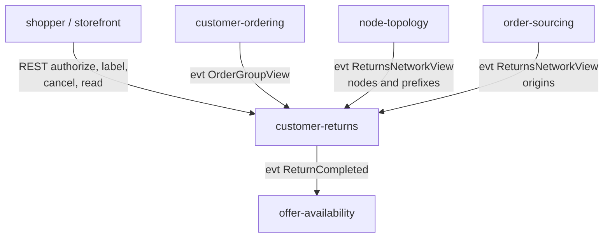

# Bounded Context Canvas

:::info[As built]
Derived from [`network/model/model.yaml`](https://github.com/IQVO/warehouse-docs/blob/main/network/model/model.yaml). This context's service is built ([`IQVO/customer-returns`](https://github.com/IQVO/customer-returns), decided by [ADR 0012](/network/adr/0012-customer-returns-is-a-bounded-context)); the model carries its as-built contracts, and identifiers (`Err...` names, routes, CloudEvents types) are the names the service uses. Where the model left a choice open, the service's own ADRs 0001 to 0005 record what it does.
:::

Following the ddd-crew [Bounded Context Canvas](https://github.com/ddd-crew/bounded-context-canvas).

Derived from: model.yaml → contexts[customer-returns].inbound, .publishes,
.consumes; contexts[offer-availability].consumes.

Omitted from the diagram only (not redrawn): `shipping-and-tracking` and
`vendor-connectivity`. Their side of the reverse-label call and of the vendor
seam is in their `develop` contracts, so both are rows of the model and of
sections 5 and 6 (policies `ReverseLabelCall` and
`FirstFittingOutcomeCompletes`).

## 1. Name

Customer Returns (`customer-returns`, `CR`), tier `commerce`, Supporting.

## 2. Purpose

Let a shopper return a shipped or delivered order group: authorize the
return, decide what happens to the goods, link the reverse labels and close
the authorization on the graded outcome, holding no money, no address and no
free text.

## 3. Strategic classification

| Axis | Value |
| --- | --- |
| Domain | Supporting |
| Business model | Experience protector and stock recoverer |
| Evolution | Custom-built |

## 4. Domain roles

Execution (return authorizations), Gateway for the storefront (Open Host
Service), Specification (the disposition decision).

## 5. Inbound communication

| Sender | Type | Message | Channel | Relationship |
| --- | --- | --- | --- | --- |
| shopper / storefront | command | `AuthorizeReturn`, `IssueLabel`, `CancelReturn` | REST `POST /return-authorizations`, `POST /return-authorizations/{authorizationId}/labels`, `POST /return-authorizations/{authorizationId}/cancellations` | OHS |
| shopper / storefront | query | `ListReturnAuthorizations`, `GetReturnAuthorization` | REST `GET /return-authorizations?orderId=`, `GET /return-authorizations/{authorizationId}` | OHS |
| `customer-ordering` | event | `CustomerOrderPlaced`, `ShopperNoticeDecided` | Kafka `retailnetwork.customer-ordering.events` | Conformist |
| `node-topology` | event | `NodeRegistered`, `NodeActivated`, `NodeSuspended`, `NodeRetired`, `ServiceAreaAssigned` | Kafka `retailnetwork.node-topology.events` | Conformist |
| `order-sourcing` | event | `FulfillmentReleasedToNode`, `FulfillmentLocked` | Kafka `retailnetwork.order-sourcing.events` | Conformist |
| `vendor-connectivity` | event | `VendorReturnOutcomeSubmitted` | Kafka `retailnetwork.vendor-connectivity.events` | Customer/Supplier |

All write routes take an `Idempotency-Key`. No authentication, as in every
other context (`conventions.no_auth`).

The consumer of the vendor's graded outcome (`VendorReturnOutcomeSubmitted`)
completes the first fitting open authorization; `vendor-connectivity`
publishes the event since its ADR 0014 shipped.

## 6. Outbound communication

| Message | Type | Consumers |
| --- | --- | --- |
| `ReturnAuthorized` | event | `vendor-connectivity` (its `ReturnAdviceView`) |
| `ReturnLabelIssued` | event | `vendor-connectivity` (its `ReturnAdviceView`) |
| `ReturnCompleted` | event | `offer-availability` |
| `ReturnCancelled` | event | `vendor-connectivity` (its `ReturnAdviceView`) |
| `IssueReturnLabel` | command (synchronous) | `shipping-and-tracking`, REST `POST /return-labels` |

The model lists **one synchronous call** (`sync_calls`): the reverse-label
call of `IssueLabel` to `shipping-and-tracking`'s `POST /return-labels`. It is
config-gated and off by default (policy `ReverseLabelCall`).

## 7. Ubiquitous language

See [Ubiquitous Language](/network/contexts/customer-returns/ubiquitous-language).

## 8. Business decisions

See [Business Context](/network/contexts/customer-returns/business-context#decisions-it-makes).
The rules as policies: `DispositionDecidedAtAuthorization`, `ReturnlessKeep`,
`PricesAreCallerFacts`, `LazyExpiry`, `ReverseLabelCall`, `OneLabelPerPackage`,
`FirstFittingOutcomeCompletes`, `UnexpectedLinesStayFacts`, `RestockIsAFact`,
`PickupIsRecordedNotRun`, `OutboxVersionedSchema`.

## 9. Assumptions

- A group's placed and shipped facts, the returns centres and the sourcing
  lock reach this context as events before the shopper asks. A view that
  lags refuses (`ErrGroupNotShipped`, `ErrNoReturnDestination`) rather than
  guesses, and the shopper retries with the same `Idempotency-Key`.
- The two order-group events have no ordering guarantee: a notice may arrive
  before its placed event, and the view tolerates both orders.
- Two authorizations of one group are distinct aggregates; nothing stops a
  second authorization of a group that already has one.

## 10. Verification metrics

As built: the Tier-2 counter `customer_returns.return.authorized` (attribute
`outcome` `authorized` or `rejected`; service ADR 0008). Not built: share of
returns decided `KEEP`; time from `AUTHORIZED` to `RECEIVED`; share of
outcome lines flagged unexpected.

## 11. Open questions

- When do the reverse-label route and the vendor seam reach their owners'
  `develop` contracts? Until then no label is issued and no return is
  completed.
- Network ADR 0012 names the promise witness as the fallback origin and
  speaks of fees as facts. Neither is built: the decision uses the sourcing
  lock only, and no fee field exists.
- The returnless threshold is a constant (1500 cents). Whether it becomes a
  policy is not decided.
- Nothing sets `IN_TRANSIT` or `PICKUP_FAILED` yet.
