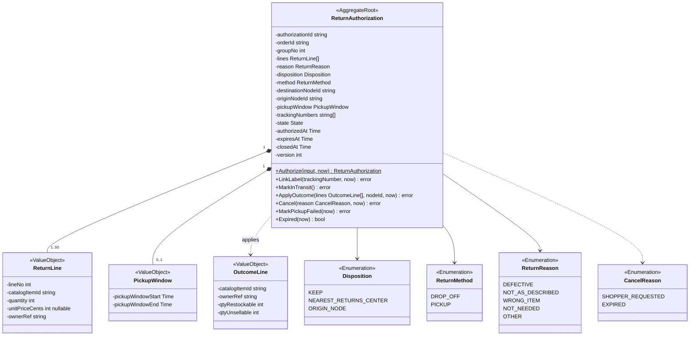
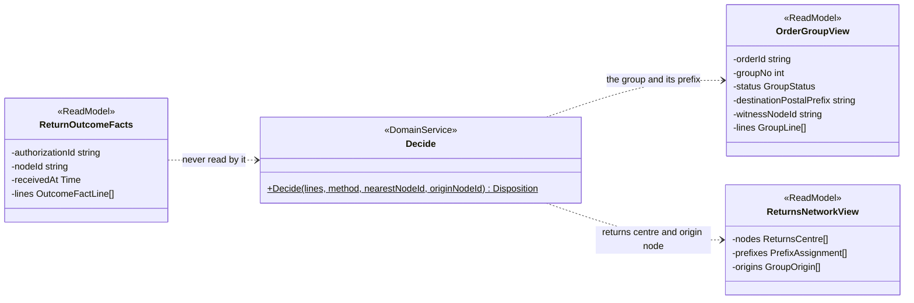
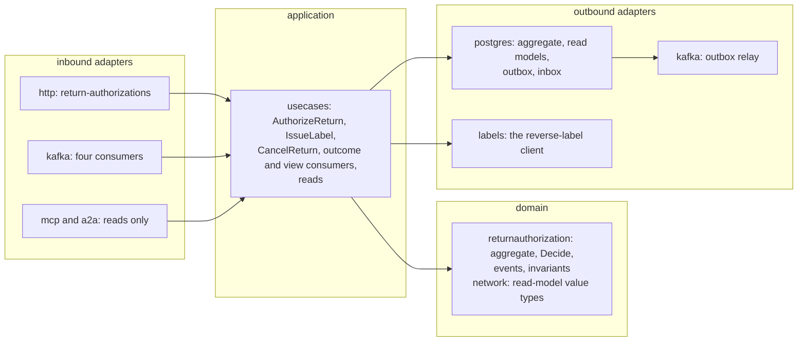

# Class Diagram

:::info[As built]
Derived from [`network/model/model.yaml`](https://github.com/IQVO/warehouse-docs/blob/main/network/model/model.yaml). This context's service is built ([`IQVO/customer-returns`](https://github.com/IQVO/customer-returns), decided by [ADR 0012](/network/adr/0012-customer-returns-is-a-bounded-context)); the model carries its as-built contracts, and identifiers (`Err...` names, routes, CloudEvents types) are the names the service uses. Where the model left a choice open, the service's own ADRs 0001 to 0005 record what it does.
:::

UML class diagrams of the domain model. Fields are shown unexported (`-`),
methods exported (`+`). As built, the service keeps the aggregate in
`internal/domain/returnauthorization` and the read-model value types in
`internal/domain/network`; the class names below are the model's names, the
Go types are on
[Ubiquitous Language](/network/contexts/customer-returns/ubiquitous-language).

## 1. ReturnAuthorization aggregate

Derived from: model.yaml → contexts[customer-returns].aggregates[ReturnAuthorization]
(`value_objects`, `commands`, `states`).

## 2. The decision and the read models

Derived from: model.yaml → contexts[customer-returns].read_models,
.policies[DispositionDecidedAtAuthorization].

## 3. Hexagonal layout

Derived from: the service's ADRs 0002 to 0006 (package names) and
model.yaml → contexts[customer-returns].inbound, .policies[ReverseLabelCall].
